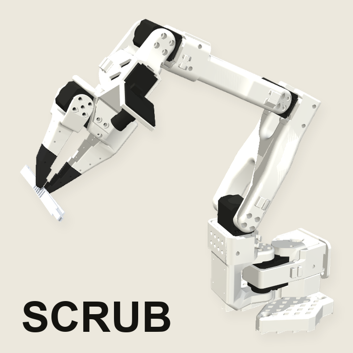

<p align="center"></p>

# Scrub

A robot arm that hands a surgeon the instrument they ask for out loud, then lets go when they pull. Built at DubHacks '26, Oct 17 to 18, 2026.

## What Scrub is

In an operating room the scrub tech passes each instrument the moment it is named and keeps the count of everything on the tray. Hospitals cannot hire enough of them: a surgical tech opening takes about 120 days to fill ([Periop Leader, 2024](https://www.periopleader.com/survey-staffing-woes-ease-slightly-but-challenges-remain/)). When the tech is missing, the surgeon looks away from the patient and searches the tray. Operating room time costs about $36 a minute ([Childers and Maggard-Gibbons, JAMA Surgery 2018](https://jamanetwork.com/journals/jamasurgery/fullarticle/2673385)), and instrument problems, mostly missing instruments, delayed a case about 10 minutes on average in one study ([Nichol et al., BMC Surgery 2024](https://doi.org/10.1186/s12893-024-02407-1)). Scrub takes the fetch-and-hold-out part of that job: you say "get the hemostat" or "scalpel", an SO-101 arm picks it from the tray, holds the handle out at a fixed handoff point and lets go when you pull it or say "let go". It never touches the patient. The business case is in [docs/BUSINESS.md](docs/BUSINESS.md).

## How it works

```
 phone (Photon -> ElevenLabs agent)        station page, Talk tab (browser speech)
              |                                         |
              v                                         |
        voice/  local word match first,                 |
                Gemini structured output for the rest   |
              |                     |                   |
              v                     v                   v
   controller/ state machine    explore/station/  recording station + autopick
   (sim/ MuJoCo arm, fake arm)        |  replays the average of our recorded demos
              |                       v
              |                  SO-101 follower (the real arm)
              v
   vision/  Perceptron detect (tray) and OCR (count sheet)
   ledger/  every event to MongoDB Atlas  ->  dashboard/  web page and tablet view
```

- **Voice (`voice/`, TypeScript).** An ElevenLabs agent (reached over a Photon number through SIP) uses our server as its Custom LLM, an OpenAI-style `/v1/chat/completions` endpoint. "Stop", "let go" and known instrument names, including room names ("Kelly" is the hemostat), are matched locally. Anything else goes to Gemini with structured output whose item field is an enum of the current tray's item ids (`voice/src/parse.ts:89-91`), so it cannot name an instrument that is not on the tray. When the station is running (found at `localhost:8090`, or `STATION_URL`), a request goes to it by local match and starts that instrument's averaged replay. The station page's Talk tab does the same in the browser with speech recognition, with Let go, Stop and Return to home buttons under the transcript.
- **Controller (`controller/`, Python, FastAPI).** A state machine (finding, picking, checking the grasp, moving to the hand, waiting for the pull, releasing, homing) that drives the fake arm and the MuJoCo sim (`sim/`) through one arm interface. `arm/` holds the hardware layer, kinematics, recording and the Perceptron training pipeline.
- **Recording station (`explore/station/`).** One process opens both arms, both cameras and the LeRobot dataset once, runs a 30 Hz leader-follower teleop loop and records episodes. Its Run tab drives the follower. Autopick's `average` mode is what moved the real arm: it takes every usable demo of one instrument, cuts each at the same moments (start, above the item, grasp, lift, hand-off), resamples each stage and takes the median point by point, then plays it back and holds the instrument out.
- **Vision (`vision/`).** Perceptron's `/v1/detect` finds the instruments on the tray (`vision/tray.py`), with a local detector when the API is slow. OCR on `perceptron-mk1.5` with a strict JSON schema reads the printed count sheet and falls back to Gemini (`vision/reading.py`).
- **Ledger and dashboard (`ledger/`, `dashboard/`).** Every event and the arm's temperature readings go to MongoDB Atlas, buffered to a local file when Atlas is down. The dashboard is a static page on the controller's event socket with a stop button and a tablet view. `ledger/serve.py` serves the read-only public page; `deploy/` sets it up on a Vultr server.
- `settings/` holds one JSON file per tray (`surgical.json`: scalpel handle, hemostat, Mayo scissors). Message formats are in [docs/CONTRACTS.md](docs/CONTRACTS.md).

## Hardware

- SO-101 leader and follower arms, Feetech STS3215 serial servos, follower on a 12 V supply. The servo label variant (7.4 V C001 or a 12 V part) was never checked by hand ([explore/research/overheating/README.md](explore/research/overheating/README.md)).
- Side camera: Logitech C920 (`--side C920`). Wrist camera: a small USB camera matched by the name part `icspring` (`--wrist icspring`). Both at 640x480, 30 fps requested.
- Magnets under the tape on the gripper jaw, to hold thin steel instruments.
- A Mac running the station, both arm buses and both cameras (our wrist camera shared a USB 2.0 hub with them and delivered 22.6 fps).

Cost: [docs/BUSINESS.md](docs/BUSINESS.md) calls it a "$250 arm" ("Voice to handoff on a $250 arm"). The repo has no itemized parts list or bill of materials, so no per-part prices are given here.

<!-- TODO (a person): fill in per-part prices (SO-101 leader + follower kits, STS3215 servos, 12 V supply, C920, wrist camera, magnets) with sources. Nothing in the repo itemizes the ~$250 figure. -->

Bring-up of the arm and cameras: [docs/BRINGUP.md](docs/BRINGUP.md). Running and recording on the real arm, and what to do when it overheats or drops off the bus: [explore/ARM-RUNBOOK.md](explore/ARM-RUNBOOK.md).

## Setup

Python 3.10 (the version LeRobot uses), Node 20 or newer, Git. Accounts and keys: [docs/SETUP.md](docs/SETUP.md).

```
python3.10 -m venv .venv
.venv/bin/pip install -r controller/requirements.txt -r vision/requirements.txt -r ledger/requirements.txt -r arm/requirements.txt
.venv/bin/pip install -r sim/requirements.txt          # MuJoCo sim
.venv/bin/pip install "lerobot[feetech]==0.4.4" opencv-python pyserial   # real arm and station only (see arm/requirements.txt)
.venv/bin/python -m sim.fetch_model                    # once, downloads the SO-101 MuJoCo model into sim/models/so101
cd voice && npm install && cd ..
cp .env.example .env                                    # fill in keys; never commit .env
```

`.env` names (values stay local): `PERCEPTRON_TEAM_API_KEY`, `PERCEPTRON_API_KEY`, `PERCEPTRON_DEPLOYMENT_ID`, `GEMINI_API_KEY`, `ELEVENLABS_API_KEY`, `ELEVENLABS_AGENT_ID`, `VOICE_LLM_SECRET`, `PHOTON_API_KEY`, `PHOTON_PROJECT_ID`, `PHOTON_SUMMARY_TO`, `PHOTON_LINE`, `SPECTRUM_PROJECT_ID`, `SPECTRUM_PROJECT_SECRET`, `MONGODB_URI`, `HF_TOKEN`, `SO101_PORT`, `CAMERA_INDEX`, `CONTROLLER_URL`, `VISION_URL`, `VOICE_PORT`, `STATION_URL`.

## Run

**The real arm: the recording station.** Under its supervisor, which restarts it after a hung camera or the page's Reconnect (Ctrl-C stops it):

```
explore/station/run_station.sh --task "pick the hemostat"
```

Open http://localhost:8090. Record tab: teleop and episodes. Run tab: autopick. Talk tab: one click turns on an always-listening microphone. Flags, controls and autopick modes: [explore/station/README.md](explore/station/README.md). Start the voice server beside it (`cd voice && npm run dev`, port 3000) and it finds the station by itself.

**The whole controller stack** (controller 8000, vision 8001, sim viewer 8002, voice 3000; Ctrl-C stops all):

```
.venv/bin/python -m controller.run_all                  # fake arm, fake vision, voice
.venv/bin/python -m controller.run_all --arm sim        # MuJoCo arm, viewer at :8002
.venv/bin/python -m controller.run_all --real           # judging preset
.venv/bin/python -m controller.run_all backup [--loop]  # sim arm stack plus a scripted demo run
.venv/bin/python -m controller.run_all reset            # clear the count, surgical tray, normal light
```

`--real` is `--arm real --vision real --ledger --judge --skills auto` plus a tunnel for the voice server (cloudflared if `voice/.bin/cloudflared` exists, else Pinggy) and points the ElevenLabs agent at it (`controller/run_all.py:70-71, 104-108, 327-340`). The controller then drives the follower through `arm/real_arm.py` if `SO101_PORT` is set, present and free; otherwise it runs the sim arm and says so. Only one process can hold the arm's serial port, so the station and a `--real` controller cannot run at once. The real-arm runs on Oct 18 went through the station. `backup` and `check` refuse to start the real arm. More in [controller/README.md](controller/README.md).

Health check of services and keys (names only): `.venv/bin/python -m controller.doctor`. Drive the voice server without a call: `cd voice && npm run say -- "grab me the kelly"`.

**Tests**, per folder:

```
.venv/bin/python -m pytest arm -q
.venv/bin/python -m pytest controller -q
.venv/bin/python -m pytest vision -q
.venv/bin/python -m pytest ledger -q
.venv/bin/python -m pytest explore -q
.venv/bin/python -m pytest sim -q          # needs sim.fetch_model first
.venv/bin/python -m pytest deploy dashboard video -q
cd voice && npm test
```

## What's real and what's simulation

| | Status (Oct 18) |
| --- | --- |
| Real arm | Runs only through the station (`explore/station`, `explore/arm_session.py`). 35 station runs, 7 of them camera calibration. |
| Real picks | Replays of our own recorded demonstrations (autopick `average` mode). No pick comes from a model. |
| Real handoffs | 2, both scalpel, where a hand took it and the jaw checked empty: 06:39:20 and 07:02:37. The second was asked for by voice at 07:02:14. The hemostat was offered twice (06:12, 06:22) with no confirmed take. |
| Perceptron training | 0 training jobs, 0 deployments. The fine-tune pipeline (`arm/pipeline.py`, `arm/train.py`) was never submitted. |
| Dataset | 29 episodes, 24 usable, 9.0 min: scalpel handle 11, scalpel 5, hemostat 6, tweezers 4, spatula 3 ([docs/DATA.md](docs/DATA.md)). |
| Controller | Runs the MuJoCo sim and the fake arm. Its grasp check and slow zone near the hand were tested there, not on the real arm. |
| Mayo scissors | Simulation only: 0 demonstrations, 0 real runs. |
| Returning an instrument | Manual on the real arm. The video's return is the sim, labeled as a simulated electromagnet pickup. |
| Phone call | A voice command moved the real arm at 07:02:14, but no log shows it came over the Photon number. |
| Ledger rates | Not real. There are 0 real-arm tries in the ledger; the `fake_arm:false` rows are test data. |

## Safety

Real arm (station path):

- **Thermal guard.** Motor temperatures are read every 2 s (`explore/arm_session.py:319-322` while driving, `explore/station/station.py:1112-1117` while parked). At 60 C the open episode is discarded, the run stops and the arm goes home with torque off (`station.py:44, 1134-1142`). It resumes when the hottest motor is at or below 50 C, or has stopped cooling for 3 minutes at or below 55 C (`station.py:44-45`, `arm/thermal.py:11-12, 44-51`). Autopick moves 1.6x slower when any motor is above 52 C (`explore/station/autopick.py:44, 1089, 1271`).
- **Speed caps.** Every motor at acceleration 40 and 1200 steps/s, about 105 deg/s (`arm_session.py:222-223, 484-491`). Each step moves at most 15 degrees (`max_relative_target=15`, `station.py:260`). Autopick moves peak at 45 deg/s (`autopick.py:42, 700`).
- **Gripper guard.** When the jaw stops closing for 0.3 s, it holds at the contact point plus a 1.5-unit squeeze instead of pushing; if it strains, it eases open (`arm_session.py:54-56, 556-630`).
- **Joint stall hold.** A joint pushing hard without moving for 1 s, or a motor that is too hot, holds where it is (`arm_session.py:227-228, 301-306, 424-432`).
- **Stop.** Voice or page "stop" freezes the arm in place with the motors on; then "continue", "return to home" or "kill" (`station.py:673-695`, `autopick.py:739-759`).
- **Release.** At the offer it lets go on a gripper load change of 35 or more, the jaw moving 1.2 units, or any joint pushed 2 degrees (`autopick.py:49-52, 962-969`), or on "let go" (`autopick.py:1107-1109`, `station.py:696-700`). It closes to check the jaw is empty, then goes home. Nobody takes it in 45 s: home holding it, motors off (`autopick.py:48, 980`).
- **KILL** (Escape or the page) sends torque off to every motor at once; a raised arm drops (`station.py:874-890`).

Controller only (fake arm and sim, not the real arm path):

- **Stop** freezes the arm and refuses handover and return until reset (`controller/core.py:700-701, 727-739`).
- **Grasp check** before carrying: the jaw position and load, plus the wrist camera when it can tell (`core.py:1621-1639`).
- **Slow zone.** Normal speed 0.3 to a point 8 cm short of the hand, then 0.1 for the last leg (`core.py:41-42, 1537-1545`).
- **Release** on a load change or the load collapsing (`core.py:1810-1838`) or on "let go" (`core.py:779-786`).
- Temperatures every 1 s on `arm/real_arm.py`; a trip stops the skill (`arm/real_arm.py:43, 404-412`).

Why these numbers: [explore/research/overheating/README.md](explore/research/overheating/README.md).

## Team

- **Anish**: `arm/` (hardware layer, recording, Perceptron training pipeline), `docs/`.
- **Caiden**: `controller/`, `voice/`, `sim/`, `explore/` (the recording station and autopick).
- **Brandon**: `vision/`, `deploy/`.
- **Evan**: `dashboard/`, `ledger/`, `settings/`, `design/`, `video/`.

## License

License: not yet chosen (no LICENSE file in this repo).
