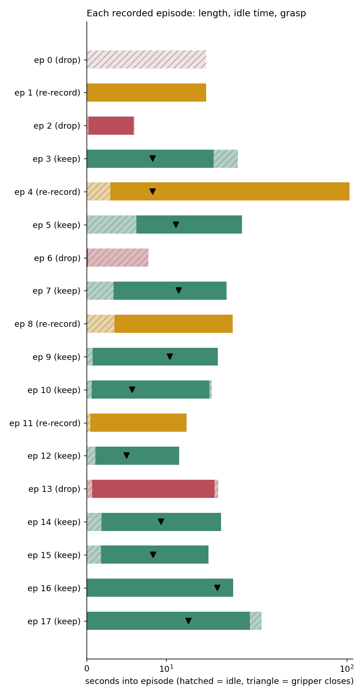
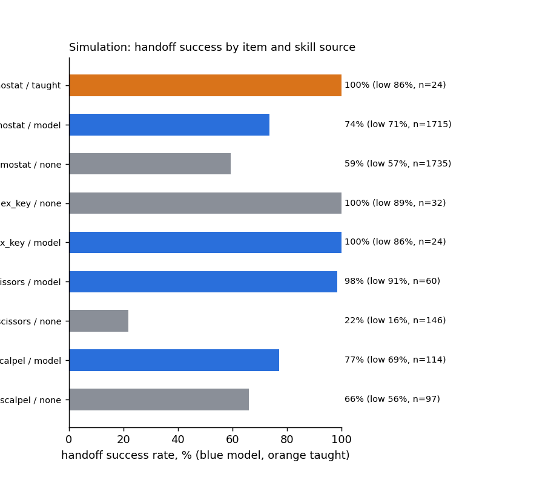
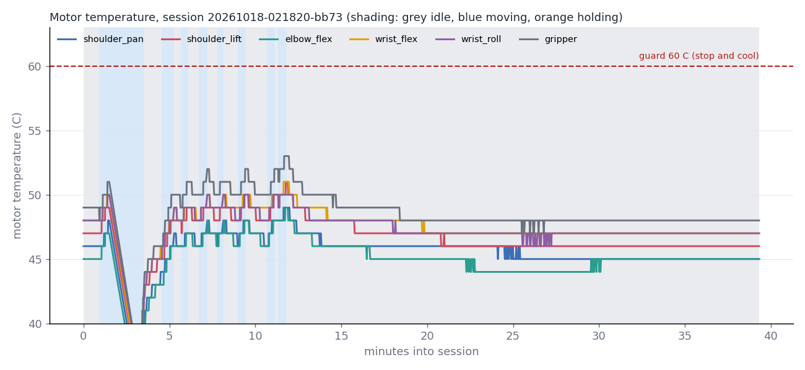
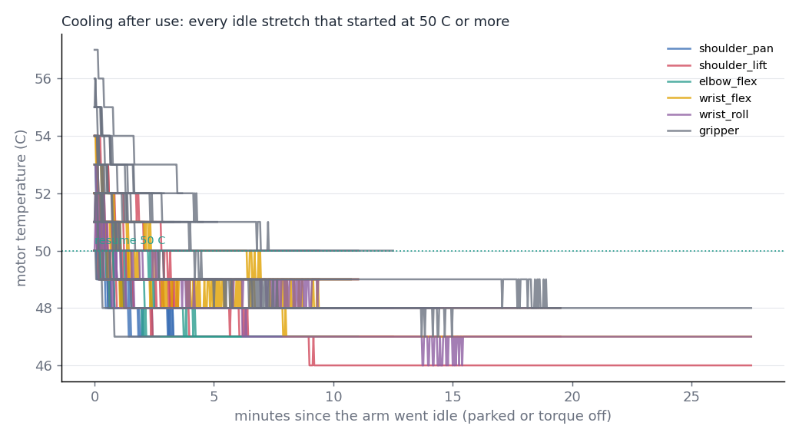
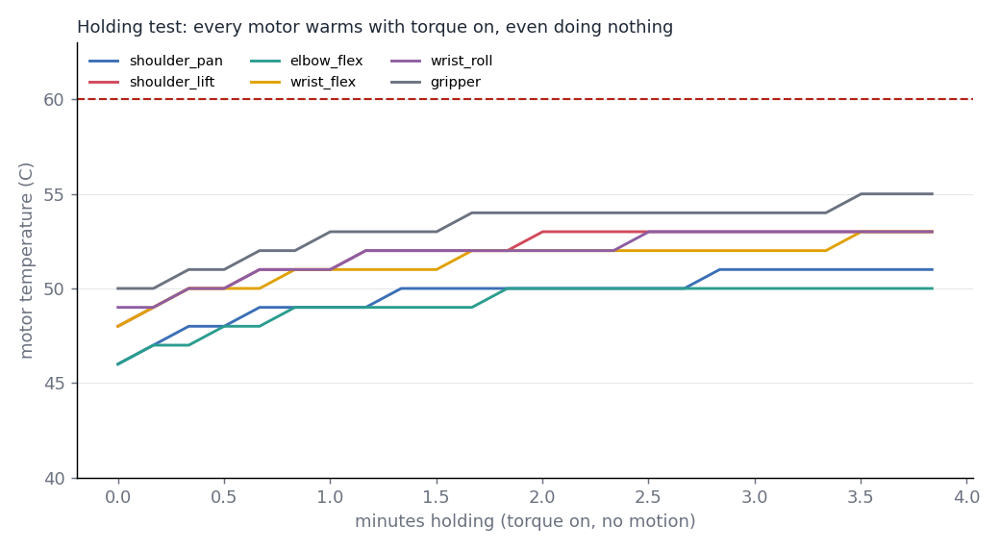

# Data: what MongoDB says

Read 2026-10-18 08:17 from `MongoDB Atlas, database scrub`. Regenerate with `.venv/bin/python -m explore.analysis`. Machine-readable copy: `data/analysis.json` (committed snapshot `docs/media/data/analysis.json`). Read-only: nothing here edits MongoDB.

- 70975 events, 29 episodes (0.15 h recorded), 20403 thermal rows
- Events by arm: fake 52021, pretag 17561, real 422, sim 971. Tags (`fake_arm`) started 2026-10-17 22:02; earlier rows are test data (`pretag`).

## Pitch and Devpost numbers

| Number | Value | Query | Read |
| --- | --- | --- | --- |
| Episodes recorded (MongoDB) | 29 | `db.episodes.countDocuments({})` | 2026-10-18 08:17 |
| Hours of demonstrations recorded | 0.15 | `db.episodes.aggregate([{$group:{_id:null,s:{$sum:"$duration_s"}}}])` | 2026-10-18 08:17 |
| Episodes usable for training | 24 of 29 | `db.episodes.find({}, {episode_index:1, task:1, duration_s:1, handoff:1})` | 2026-10-18 08:17 |
| Episodes with a handoff outcome | 7 | `db.episodes.countDocuments({handoff: {$ne: null}})` | 2026-10-18 08:17 |
| Real handoff success rate | no real data yet | `db.events.countDocuments({type:"handed", fake_arm:false})` | 2026-10-18 08:17 |
| Real median request-to-hand (s) | no real data yet | `db.events.find({type:"handed", fake_arm:false}, {request_to_hand_s:1})` | 2026-10-18 08:17 |
| Simulated handoff tries | 4511 | `db.events.countDocuments({type:"command", action:"handover", accepted:true, fake_arm:true})` | 2026-10-18 08:17 |
| Hottest motor and peak | gripper 57 C | `db.thermal.aggregate([{$match:{kind:'sample'}},{$project:{m:{$objectToArray:'$motors'}}},{$unwind:'$m'},{$group:{_id:'$m.k',peak:{$max:'$m.v.temp'}}},{$sort:{peak:-1}},{$limit:1}])` | 2026-10-18 08:17 |
| Thermal samples | 16722 | `db.thermal.countDocuments({kind:'sample'})` | 2026-10-18 08:17 |
| Max safe hold time | 264 s | `db.thermal.find({kind:'experiment',phase:'torque_on_hold'},{t:1,session:1,elapsed_s:1,temps:1}).sort({session:1,elapsed_s:1})` | 2026-10-18 08:17 |
| Reads logged | 177 | `db.events.countDocuments({type:"read"})` | 2026-10-18 08:17 |
| count_sheet OCR accuracy | 0/32 correct (0%), 32 unscored, item fields 33% of 96 | `db.events.find({type:"read","read.kind":"count_sheet"})` | 2026-10-18 08:17 |
| tray_tag OCR accuracy | 36/63 correct (57%), 0 unscored | `db.events.find({type:"read","read.kind":"tray_tag"})` | 2026-10-18 08:17 |
| pack_label OCR accuracy | no real data yet | `db.events.find({type:"read","read.kind":"pack_label"})` | 2026-10-18 08:17 |
| Median read latency | 1800 ms | `db.events.find({type:"read"},{"read.latency_ms":1})` | 2026-10-18 08:17 |
| Perceptron vs Gemini | Perceptron 82/89 answered, median 1800 ms; Gemini 10/17 answered, median 770 ms; 0 rescues | `db.events.find({type:"read","read.attempts":{$exists:true}},{"read.attempts":1})` | 2026-10-18 08:17 |

## Training data: episodes

29 episodes in MongoDB (9.0 min recorded), 24 usable as they are.

| Ep | Task | Length (frames) | Duration s | FPS | Idle start s | Idle end s | Gripper opens s | Gripper closes s | Verdict | Why |
| --- | --- | --- | --- | --- | --- | --- | --- | --- | --- | --- |
| 0 | pick the spatula | 450 | 15.0 | 30 | 15.0 | 15.0 | - | - | **drop** | the arm never moves |
| 1 | pick the spatula | 450 | 15.0 | 30 | 0.1 | 0.0 | 10.0 | - | **re-record** | the gripper opens but never closes on the item |
| 2 | pick the spatula | 180 | 6.0 | 30 | 0.3 | 0.1 | - | - | **drop** | the gripper never opens, so there is no grasp to learn |
| 3 | pick the scalpel handle | 569 | 19.0 | 30 | 0.1 | 3.1 | 0.4 | 8.3 | **keep** | trim 3.1 s idle at the end |
| 4 | pick the scalpel handle | 3143 | 104.8 | 30 | 3.0 | 0.2 | 6.0 | 8.3 | **re-record** | 105 s long with the arm moving only 19% of the time |
| 5 | pick the scalpel handle | 585 | 19.5 | 30 | 6.2 | 0.0 | 8.4 | 11.2 | **keep** | trim 6.2 s idle at the start |
| 6 | pick the scalpel handle | 233 | 7.8 | 30 | 0.1 | 7.6 | - | - | **drop** | the gripper never opens, so there is no grasp to learn |
| 7 | pick the scalpel handle | 528 | 17.6 | 30 | 3.4 | 0.1 | 7.3 | 11.6 | **keep** | trim 3.4 s idle at the start |
| 8 | pick the scalpel handle | 550 | 18.3 | 30 | 3.5 | 0.0 | 0.0 | 9.6 | **keep** | trim 3.5 s idle at the start |
| 9 | pick the scalpel handle | 493 | 16.4 | 30 | 0.8 | 0.0 | 6.4 | 10.5 | **keep** | 1 stall(s) over 1.5 s mid-episode |
| 10 | pick the scalpel handle | 471 | 15.7 | 30 | 0.6 | 0.3 | 2.8 | 5.7 | **keep** | clean: gripper opens and closes, little idle time |
| 11 | pick the scalpel handle | 377 | 12.6 | 30 | 0.5 | 0.0 | 0.0 | 5.3 | **keep** | clean: gripper opens and closes, little idle time |
| 12 | pick the scalpel handle | 349 | 11.6 | 30 | 1.1 | 0.0 | 2.8 | 5.0 | **keep** | clean: gripper opens and closes, little idle time |
| 13 | pick the scalpel handle | 495 | 16.5 | 30 | 0.7 | 0.5 | 0.0 | 6.5 | **keep** | clean: gripper opens and closes, little idle time |
| 14 | pick the tweezers | 506 | 16.9 | 30 | 1.9 | 0.0 | 3.1 | 9.3 | **keep** | clean: gripper opens and closes, little idle time |
| 15 | pick the tweezers | 459 | 15.3 | 30 | 1.8 | 0.0 | 2.5 | 8.4 | **keep** | clean: gripper opens and closes, little idle time |
| 16 | pick the tweezers | 551 | 18.4 | 30 | 0.0 | 0.0 | 0.0 | 9.1 | **keep** | clean: gripper opens and closes, little idle time |
| 17 | pick the tweezers | 767 | 25.6 | 30 | 0.0 | 4.3 | 0.2 | 12.8 | **keep** | trim 4.3 s idle at the end |
| 18 | pick the scalpel | 450 | 15.0 | 30 | 1.9 | 0.0 | 5.2 | 9.9 | **keep** | clean: gripper opens and closes, little idle time |
| 19 | pick the scalpel | 417 | 13.9 | 30 | 1.3 | 0.7 | 0.0 | 0.3 | **keep** | clean: gripper opens and closes, little idle time |
| 20 | pick the scalpel | 343 | 11.4 | 30 | 0.7 | 0.5 | 2.7 | 5.3 | **keep** | clean: gripper opens and closes, little idle time |
| 21 | pick the scalpel | 458 | 15.3 | 30 | 0.6 | 0.9 | 0.0 | 7.4 | **keep** | clean: gripper opens and closes, little idle time |
| 22 | pick the scalpel | 393 | 13.1 | 30 | 0.5 | 0.5 | 0.0 | 6.5 | **keep** | clean: gripper opens and closes, little idle time |
| 23 | pick the hemostat | 531 | 17.7 | 30 | 3.3 | 0.0 | 0.0 | 8.8 | **keep** | trim 3.3 s idle at the start |
| 24 | pick the hemostat | 414 | 13.8 | 30 | 0.0 | 0.1 | 0.0 | 5.9 | **keep** | clean: gripper opens and closes, little idle time |
| 25 | pick the hemostat | 376 | 12.5 | 30 | 0.1 | 0.3 | 0.0 | 5.8 | **keep** | clean: gripper opens and closes, little idle time |
| 26 | pick the hemostat | 438 | 14.6 | 30 | 0.7 | 0.0 | 0.0 | 6.5 | **keep** | clean: gripper opens and closes, little idle time |
| 27 | pick the hemostat | 643 | 21.4 | 30 | 1.4 | 0.1 | 0.0 | 8.3 | **keep** | clean: gripper opens and closes, little idle time |
| 28 | pick the hemostat | 512 | 17.1 | 30 | 0.9 | 0.0 | 0.0 | 7.6 | **keep** | clean: gripper opens and closes, little idle time |

### Joint motion (deg and deg/s, from `state` and `timestamp`)

| Ep | Joint | Range deg | Peak speed | Mean speed |
| --- | --- | --- | --- | --- |
| 0 | shoulder_pan.pos | 0.0 | 0 | 0.0 |
| 0 | shoulder_lift.pos | 0.0 | 0 | 0.0 |
| 0 | elbow_flex.pos | 0.2 | 3 | 0.0 |
| 0 | wrist_flex.pos | 0.0 | 0 | 0.0 |
| 0 | wrist_roll.pos | 0.0 | 0 | 0.0 |
| 0 | gripper.pos | 0.0 | 0 | 0.0 |
| 1 | shoulder_pan.pos | 34.7 | 69 | 10.3 |
| 1 | shoulder_lift.pos | 119.2 | 66 | 12.4 |
| 1 | elbow_flex.pos | 81.1 | 58 | 5.9 |
| 1 | wrist_flex.pos | 42.6 | 71 | 8.7 |
| 1 | wrist_roll.pos | 97.4 | 71 | 7.1 |
| 1 | gripper.pos | 10.6 | 30 | 0.7 |
| 2 | shoulder_pan.pos | 1.1 | 13 | 1.5 |
| 2 | shoulder_lift.pos | 0.4 | 3 | 0.2 |
| 2 | elbow_flex.pos | 0.1 | 3 | 0.0 |
| 2 | wrist_flex.pos | 0.4 | 8 | 0.1 |
| 2 | wrist_roll.pos | 0.9 | 24 | 0.5 |
| 2 | gripper.pos | 0.2 | 2 | 0.0 |
| 3 | shoulder_pan.pos | 80.4 | 50 | 5.4 |
| 3 | shoulder_lift.pos | 47.8 | 63 | 5.3 |
| 3 | elbow_flex.pos | 51.2 | 50 | 2.8 |
| 3 | wrist_flex.pos | 32.2 | 42 | 3.3 |
| 3 | wrist_roll.pos | 36.4 | 34 | 2.5 |
| 3 | gripper.pos | 31.3 | 63 | 6.1 |
| 4 | shoulder_pan.pos | 83.0 | 71 | 2.1 |
| 4 | shoulder_lift.pos | 121.2 | 69 | 3.1 |
| 4 | elbow_flex.pos | 75.0 | 55 | 1.4 |
| 4 | wrist_flex.pos | 81.1 | 66 | 2.3 |
| 4 | wrist_roll.pos | 80.5 | 87 | 2.3 |
| 4 | gripper.pos | 29.7 | 65 | 0.9 |
| 5 | shoulder_pan.pos | 93.1 | 71 | 8.9 |
| 5 | shoulder_lift.pos | 129.5 | 74 | 14.4 |
| 5 | elbow_flex.pos | 85.0 | 58 | 5.7 |
| 5 | wrist_flex.pos | 61.6 | 74 | 11.6 |
| 5 | wrist_roll.pos | 99.2 | 74 | 12.5 |
| 5 | gripper.pos | 21.5 | 54 | 2.0 |
| 6 | shoulder_pan.pos | 0.0 | 0 | 0.0 |
| 6 | shoulder_lift.pos | 0.0 | 0 | 0.0 |
| 6 | elbow_flex.pos | 0.4 | 8 | 0.1 |
| 6 | wrist_flex.pos | 0.1 | 3 | 0.0 |
| 6 | wrist_roll.pos | 0.0 | 0 | 0.0 |
| 6 | gripper.pos | 0.0 | 0 | 0.0 |
| 7 | shoulder_pan.pos | 72.0 | 63 | 7.0 |
| 7 | shoulder_lift.pos | 160.5 | 84 | 12.2 |
| 7 | elbow_flex.pos | 130.8 | 63 | 7.6 |
| 7 | wrist_flex.pos | 44.8 | 48 | 6.2 |
| 7 | wrist_roll.pos | 102.4 | 71 | 8.6 |
| 7 | gripper.pos | 24.7 | 59 | 2.1 |
| 8 | shoulder_pan.pos | 77.5 | 63 | 8.5 |
| 8 | shoulder_lift.pos | 126.2 | 82 | 10.3 |
| 8 | elbow_flex.pos | 86.6 | 61 | 6.3 |
| 8 | wrist_flex.pos | 42.7 | 69 | 8.2 |
| 8 | wrist_roll.pos | 81.6 | 71 | 10.4 |
| 8 | gripper.pos | 31.4 | 65 | 2.8 |
| 9 | shoulder_pan.pos | 80.7 | 68 | 8.9 |
| 9 | shoulder_lift.pos | 106.8 | 74 | 11.7 |
| 9 | elbow_flex.pos | 130.2 | 61 | 11.3 |
| 9 | wrist_flex.pos | 59.5 | 71 | 9.3 |
| 9 | wrist_roll.pos | 104.8 | 71 | 9.9 |
| 9 | gripper.pos | 26.3 | 59 | 2.3 |
| 10 | shoulder_pan.pos | 76.3 | 71 | 11.9 |
| 10 | shoulder_lift.pos | 119.7 | 87 | 18.4 |
| 10 | elbow_flex.pos | 79.1 | 58 | 9.8 |
| 10 | wrist_flex.pos | 69.4 | 63 | 11.7 |
| 10 | wrist_roll.pos | 113.9 | 71 | 14.4 |
| 10 | gripper.pos | 15.1 | 55 | 1.9 |
| 11 | shoulder_pan.pos | 105.6 | 69 | 16.2 |
| 11 | shoulder_lift.pos | 122.3 | 66 | 16.2 |
| 11 | elbow_flex.pos | 78.4 | 58 | 7.0 |
| 11 | wrist_flex.pos | 70.4 | 71 | 11.3 |
| 11 | wrist_roll.pos | 107.2 | 74 | 18.7 |
| 11 | gripper.pos | 20.9 | 57 | 2.5 |
| 12 | shoulder_pan.pos | 90.5 | 71 | 14.5 |
| 12 | shoulder_lift.pos | 127.8 | 61 | 15.0 |
| 12 | elbow_flex.pos | 83.1 | 58 | 8.2 |
| 12 | wrist_flex.pos | 86.1 | 71 | 16.7 |
| 12 | wrist_roll.pos | 100.7 | 69 | 19.0 |
| 12 | gripper.pos | 41.2 | 65 | 6.1 |
| 13 | shoulder_pan.pos | 28.5 | 40 | 3.6 |
| 13 | shoulder_lift.pos | 119.8 | 79 | 11.5 |
| 13 | elbow_flex.pos | 78.2 | 58 | 5.3 |
| 13 | wrist_flex.pos | 89.0 | 69 | 11.2 |
| 13 | wrist_roll.pos | 133.3 | 68 | 12.0 |
| 13 | gripper.pos | 39.8 | 63 | 4.2 |
| 14 | shoulder_pan.pos | 51.7 | 45 | 5.5 |
| 14 | shoulder_lift.pos | 121.7 | 66 | 10.2 |
| 14 | elbow_flex.pos | 81.9 | 55 | 5.3 |
| 14 | wrist_flex.pos | 87.2 | 71 | 11.5 |
| 14 | wrist_roll.pos | 153.3 | 74 | 17.3 |
| 14 | gripper.pos | 12.8 | 55 | 1.6 |
| 15 | shoulder_pan.pos | 36.4 | 63 | 4.7 |
| 15 | shoulder_lift.pos | 124.1 | 61 | 13.0 |
| 15 | elbow_flex.pos | 77.5 | 58 | 5.7 |
| 15 | wrist_flex.pos | 70.0 | 71 | 14.6 |
| 15 | wrist_roll.pos | 99.3 | 69 | 18.0 |
| 15 | gripper.pos | 36.4 | 65 | 5.2 |
| 16 | shoulder_pan.pos | 62.3 | 71 | 15.1 |
| 16 | shoulder_lift.pos | 120.6 | 79 | 11.5 |
| 16 | elbow_flex.pos | 91.3 | 69 | 7.4 |
| 16 | wrist_flex.pos | 39.6 | 66 | 8.1 |
| 16 | wrist_roll.pos | 129.1 | 74 | 20.1 |
| 16 | gripper.pos | 45.1 | 65 | 5.6 |
| 17 | shoulder_pan.pos | 54.5 | 71 | 10.3 |
| 17 | shoulder_lift.pos | 126.8 | 84 | 12.8 |
| 17 | elbow_flex.pos | 80.9 | 77 | 9.5 |
| 17 | wrist_flex.pos | 73.0 | 71 | 7.3 |
| 17 | wrist_roll.pos | 113.4 | 74 | 11.5 |
| 17 | gripper.pos | 34.9 | 65 | 4.8 |
| 18 | shoulder_pan.pos | 81.4 | 61 | 8.4 |
| 18 | shoulder_lift.pos | 83.0 | 69 | 7.2 |
| 18 | elbow_flex.pos | 101.4 | 53 | 10.6 |
| 18 | wrist_flex.pos | 44.5 | 47 | 5.8 |
| 18 | wrist_roll.pos | 84.6 | 74 | 8.7 |
| 18 | gripper.pos | 52.3 | 67 | 6.1 |
| 19 | shoulder_pan.pos | 59.1 | 71 | 8.3 |
| 19 | shoulder_lift.pos | 111.5 | 71 | 10.5 |
| 19 | elbow_flex.pos | 93.7 | 61 | 12.3 |
| 19 | wrist_flex.pos | 25.6 | 39 | 2.9 |
| 19 | wrist_roll.pos | 76.3 | 71 | 11.2 |
| 19 | gripper.pos | 52.3 | 67 | 7.7 |
| 20 | shoulder_pan.pos | 46.2 | 61 | 9.9 |
| 20 | shoulder_lift.pos | 104.8 | 79 | 14.2 |
| 20 | elbow_flex.pos | 97.2 | 58 | 11.8 |
| 20 | wrist_flex.pos | 42.2 | 66 | 7.2 |
| 20 | wrist_roll.pos | 61.5 | 63 | 11.6 |
| 20 | gripper.pos | 25.2 | 61 | 3.6 |
| 21 | shoulder_pan.pos | 39.6 | 66 | 5.8 |
| 21 | shoulder_lift.pos | 128.8 | 69 | 15.2 |
| 21 | elbow_flex.pos | 85.5 | 58 | 6.6 |
| 21 | wrist_flex.pos | 48.7 | 69 | 10.4 |
| 21 | wrist_roll.pos | 67.5 | 66 | 8.9 |
| 21 | gripper.pos | 25.9 | 61 | 3.4 |
| 22 | shoulder_pan.pos | 52.3 | 71 | 8.3 |
| 22 | shoulder_lift.pos | 121.5 | 87 | 13.7 |
| 22 | elbow_flex.pos | 101.5 | 69 | 13.8 |
| 22 | wrist_flex.pos | 26.7 | 32 | 3.0 |
| 22 | wrist_roll.pos | 75.1 | 71 | 11.6 |
| 22 | gripper.pos | 31.7 | 83 | 4.8 |
| 23 | shoulder_pan.pos | 52.8 | 74 | 6.8 |
| 23 | shoulder_lift.pos | 126.0 | 82 | 11.2 |
| 23 | elbow_flex.pos | 87.2 | 61 | 5.4 |
| 23 | wrist_flex.pos | 53.6 | 55 | 7.4 |
| 23 | wrist_roll.pos | 75.9 | 68 | 8.8 |
| 23 | gripper.pos | 35.2 | 63 | 3.3 |
| 24 | shoulder_pan.pos | 60.7 | 74 | 11.3 |
| 24 | shoulder_lift.pos | 126.5 | 77 | 14.2 |
| 24 | elbow_flex.pos | 84.8 | 61 | 6.9 |
| 24 | wrist_flex.pos | 20.8 | 37 | 4.4 |
| 24 | wrist_roll.pos | 74.6 | 58 | 11.5 |
| 24 | gripper.pos | 31.8 | 63 | 4.6 |
| 25 | shoulder_pan.pos | 68.9 | 71 | 11.4 |
| 25 | shoulder_lift.pos | 125.4 | 61 | 14.1 |
| 25 | elbow_flex.pos | 89.4 | 58 | 7.8 |
| 25 | wrist_flex.pos | 52.0 | 74 | 12.8 |
| 25 | wrist_roll.pos | 52.9 | 71 | 8.9 |
| 25 | gripper.pos | 36.8 | 65 | 5.8 |
| 26 | shoulder_pan.pos | 63.8 | 71 | 10.9 |
| 26 | shoulder_lift.pos | 138.1 | 61 | 12.9 |
| 26 | elbow_flex.pos | 102.1 | 61 | 7.7 |
| 26 | wrist_flex.pos | 52.2 | 71 | 8.9 |
| 26 | wrist_roll.pos | 52.3 | 58 | 7.3 |
| 26 | gripper.pos | 33.3 | 65 | 4.7 |
| 27 | shoulder_pan.pos | 94.0 | 71 | 11.6 |
| 27 | shoulder_lift.pos | 115.3 | 82 | 10.2 |
| 27 | elbow_flex.pos | 76.0 | 58 | 4.0 |
| 27 | wrist_flex.pos | 79.4 | 74 | 15.3 |
| 27 | wrist_roll.pos | 97.1 | 74 | 10.0 |
| 27 | gripper.pos | 35.5 | 79 | 5.9 |
| 28 | shoulder_pan.pos | 81.8 | 71 | 9.9 |
| 28 | shoulder_lift.pos | 131.0 | 69 | 12.0 |
| 28 | elbow_flex.pos | 82.5 | 61 | 5.5 |
| 28 | wrist_flex.pos | 66.2 | 66 | 9.9 |
| 28 | wrist_roll.pos | 93.0 | 74 | 12.3 |
| 28 | gripper.pos | 24.9 | 59 | 2.7 |

### Per task

| Task | Episodes | Start-pose spread (deg) | Lighting |
| --- | --- | --- | --- |
| pick the spatula | 3 | 3.8 | not recorded (no lighting field) |
| pick the scalpel handle | 11 | 16.8 | not recorded (no lighting field) |
| pick the tweezers | 4 | 15.2 | not recorded (no lighting field) |
| pick the scalpel | 5 | 7.9 | not recorded (no lighting field) |
| pick the hemostat | 6 | 3.2 | not recorded (no lighting field) |

Local dataset `~/scrub-dataset`: 29 episodes, 16131 frames. Camera fps: dataset says 30; git history: side and wrist 29-31 fps; wrist 18.7-22.6 fps on the spatula episodes.

### Flags

- Only 29 episodes (24 usable); ACT usually needs 50+ per task. A training job now will overfit.
- Gripper never opens in episodes [0, 2, 6].
- Gripper opens but never closes in episodes [1].
- Idle head or tail over 2 s in episodes [0, 3, 4, 5, 6, 7, 8, 17, 23]; trim before training.
- Episodes [4] run over 60 s; a pick should take well under a minute.
- No lighting field on any episode, so lighting variety cannot be checked.
- Wrist camera frame rate is not stored per episode. git history: side and wrist 29-31 fps; wrist 18.7-22.6 fps on the spatula episodes; below 25 fps is a training concern.
- 22 of 29 episodes have no handoff outcome attached.

## Handoffs: what the arm did, per item, lighting and skill source

**Definition.** A try is one accepted handover command (a `command` event with action `handover` and accepted true), keyed by command_id; all later events with that command_id belong to it. A success is a try whose flow emitted `handed` (the arm reached the hand and offered the item) or `set_down` (sharp items such as the scalpel are set on a safe spot by design); the same two events ledger.stats counts. A miss is a `missed` event in the try (retries are the `retries` field on handed/missed). A stop is a `stopped` event in the try. Time is request_to_hand_s on the `handed` event. Lighting and skill_source come from the try's own events (skill_source 'none' when the flow ended before one was chosen). Rate range is the Wilson 95% interval.

**Trusted: NO.** The 30 real-tagged handed rows have median 0.41 s and span 0.41-0.43 s, matching the fake arm's median 0.42 s, with no misses or retries across 30 cases. They are the test real_tries_are_recorded_fake_ones_are_not in controller/test_flows.py (RecordingArm motion_s=0.1, auto_pull_s=0.2, fake_arm=False), which wrote to Atlas whenever the tests ran with MONGODB_URI set; no real SO-101 hands over in 0.4 s.

### Real arm (tagged real, suspect): 422 rows, 30 tries

| item | lighting | skill | tries | ok | rate | 95% range | median s | p90 s | retries | misses | stops |
| --- | --- | --- | ---: | ---: | ---: | --- | ---: | ---: | ---: | ---: | ---: |
| hemostat | normal | model | 30 | 30 | 100% | 89-100% | 0.41 | 0.42 | 0 | 0 | 0 |

Do not quote these as real results. The pitch says "no real data yet".

### Miss reasons (real-tagged)

- none

### Untagged after tags started (possibly the real arm, unproven): 674 rows, 48 tries

These rows carry no `fake_arm` field, so the controller that wrote them did not say which arm it ran. Not counted as real. A `set_down` counts as a success here, including "No hand ... safe spot".

| item | lighting | skill | tries | ok | rate | 95% range | median s | p90 s | retries | misses | stops |
| --- | --- | --- | ---: | ---: | ---: | --- | ---: | ---: | ---: | ---: | ---: |
| hemostat | dim | none | 6 | 6 | 100% | 61-100% | - | - | 4 | 4 | 0 |
| hemostat | normal | none | 14 | 13 | 93% | 69-99% | 6.28 | 6.36 | 1 | 2 | 0 |
| mayo_scissors | dim | none | 1 | 0 | 0% | 0-79% | - | - | 0 | 1 | 0 |
| mayo_scissors | normal | none | 12 | 12 | 100% | 76-100% | 6.29 | 6.34 | 0 | 0 | 0 |
| scalpel | dim | none | 3 | 0 | 0% | 0-56% | - | - | 0 | 3 | 0 |
| scalpel | normal | none | 12 | 12 | 100% | 76-100% | 7.63 | 7.90 | 0 | 0 | 0 |

Miss reasons: checking: Missed the hemostat, trying again. (5); finding: I don't see the scalpel on the tray. (3); finding: I don't see the hemostat on the tray. (1); finding: I don't see the mayo scissors on the tray. (1)

### Simulation (fake and sim arms, never real): 52992 rows, 4511 tries

| item | lighting | skill | tries | ok | rate | 95% range | median s | p90 s | retries | misses | stops |
| --- | --- | --- | ---: | ---: | ---: | --- | ---: | ---: | ---: | ---: | ---: |
| hemostat | bright | model | 2 | 2 | 100% | 34-100% | 0.81 | 0.82 | 0 | 0 | 0 |
| hemostat | dim | model | 6 | 6 | 100% | 61-100% | 3.11 | 4.54 | 0 | 0 | 0 |
| hemostat | dim | none | 3 | 3 | 100% | 44-100% | 2.14 | 4.08 | 0 | 0 | 0 |
| hemostat | normal | model | 2142 | 1579 | 74% | 72-76% | 0.41 | 0.80 | 128 | 291 | 311 |
| hemostat | normal | none | 1757 | 1025 | 58% | 56-61% | 0.43 | 0.44 | 128 | 288 | 292 |
| hemostat | normal | taught | 30 | 30 | 100% | 89-100% | 0.41 | 0.42 | 0 | 0 | 0 |
| hex_key | normal | model | 30 | 30 | 100% | 89-100% | 0.41 | 0.42 | 0 | 0 | 0 |
| hex_key | normal | none | 32 | 32 | 100% | 89-100% | 0.42 | 0.44 | 0 | 0 | 0 |
| mayo_scissors | normal | model | 93 | 89 | 96% | 89-98% | 6.15 | 6.32 | 1 | 1 | 2 |
| mayo_scissors | normal | none | 158 | 32 | 20% | 15-27% | 0.42 | 0.44 | 0 | 0 | 0 |
| scalpel | normal | model | 161 | 128 | 80% | 73-85% | 0.46 | 7.99 | 0 | 0 | 1 |
| scalpel | normal | none | 97 | 64 | 66% | 56-75% | 0.32 | 0.33 | 0 | 0 | 0 |

### Simulation miss reasons

- checking: Missed the hemostat, trying again.: 256
- checking: I couldn't pick the hemostat.: 192
- finding: I don't see the hemostat on the tray.: 67
- moving_to_hand: That's out of my reach.: 64
- checking: Missed the mayo scissors, trying again.: 1

## Heat

Source: `thermal` collection, real hardware (recording Mac). Temperatures are whole degrees C from the STS3215 `present_temperature` register.

Phase grouping: idle = parked, off, preview, killed and the idle monitor (arm not working a task); moving = recording, teleop, resetting; holding = `torque_on_hold` experiment rows (torque on, goal = present). Guard = 60 C (`COOL_TRIP`, arm/thermal.py; resume at 50 C). Firmware limit = 70 C.

### Per motor

| Motor | Idle C | Moving C | Holding C | Peak C | Hold rise C/min | Min from idle to guard (hold) | Cool C/min |
| --- | --- | --- | --- | --- | --- | --- | --- |
| shoulder_pan | 47.0 | 48.0 | 50.0 | 51 | 1.03 | 12.7 | 0.80 |
| shoulder_lift | 48.0 | 50.0 | 52.5 | 54 | 1.07 | 11.2 | 0.74 |
| elbow_flex | 47.0 | 49.0 | 50.0 | 53 | 0.84 | 15.4 | 0.73 |
| wrist_flex | 49.0 | 50.0 | 52.0 | 54 | 0.95 | 11.6 | 0.61 |
| wrist_roll | 48.0 | 50.0 | 52.0 | 53 | 0.98 | 12.2 | 0.59 |
| gripper | 50.0 | 52.0 | 54.0 | 57 | 1.13 | 8.8 | 0.77 |

Medians per phase group; the hold rate is a least-squares fit over the hold experiment (stretches of 60 s or more), the cool rate over the first 5 min of idle stretches that began at 49 C or more and fell at least 1 C. `n/a` means no usable stretch.

### Cooling

Median fall 0.73 C/min over 282 motor-stretches; 60 C to 50 C would take about 14 min at that rate (linear extrapolation: the data never went above 55 C, and real cooling slows near the ambient floor).

### Sessions

| Session | Source | Mode | Minutes | Moving min | Start C | Peak C (motor) | Median hottest while moving C |
| --- | --- | --- | --- | --- | --- | --- | --- |
| 20261018-021820-bb73 | station | station | 39.3 | 3.7 | 49 | 53 (gripper) | 50.0 |
| 20261018-013938-6072 | station | station | 36.4 | 2.5 | 49 | 53 (gripper) | 51.0 |
| 20261018-061835-bafc | station | station | 31.6 | 2.6 | 52 | 54 (gripper) | 52.0 |
| 20261018-065735-1cab | station | station | 26.4 | 0.9 | 49 | 51 (gripper) | 49.0 |
| 20261018-055609-fc7a | station | station | 15.3 | 3.6 | 51 | 56 (gripper) | 53.0 |
| 20261018-051102-59a8 | station | station | 13.3 | 2.3 | 52 | 55 (gripper) | 53.0 |
| 20261018-025804-b097 | station | station | 12.8 | 0.9 | 50 | 50 (gripper) | 49.0 |
| 20261018-034137-5acd | station | station | 12.8 | 0.3 | 51 | 52 (gripper) | 51.0 |

### Settings: what kept it cool or hot

Gripper temperature at grasp start, by gripper `torque_limit`:

| torque_limit | Grasps | Median C | Max C | Median |load| |
| --- | --- | --- | --- | --- |
| 350 | 512 | 52.0 | 57 | 322 |

Session settings that were the same in every session (so they cannot explain any difference): COOL_RESUME=50, COOL_TRIP=60, DEADBAND_DEG=0.4, EASE_DEG_S=45.0, GAP_DEG=25.0, GENTLE_ACCEL=40, GENTLE_SPEED=1200, GRIP_SQUEEZE=1.5, JOINT_LOAD_MAX=250. None of them varied.
Register snapshot: acceleration [40, 254], torque_limit [500, 1000], goal_velocity [0, 1200], max_temperature_limit [70], overload_torque [25, 80].

### Recommendations

- gripper is the hottest motor: peak 57 C against a 60 C guard and a 70 C firmware limit. Nothing in the data reached the guard (hot events: 0).
- With torque on and no motion, gripper warms fastest: 1.13 C/min. Holding is not free; every motor warms with torque on.
- Plan for at most 264 s of continuous hold per pass (half of the 529 s the gripper needs from idle to the 60 C guard); then torque off or park.
- Park or torque off between passes: motors fall about 0.73 C/min (median), so 60 C to 50 C takes about 14 min.
- gripper and wrist_flex idle warmest (50 and 49 C against 47 C for elbow_flex): their idle temperature is not a fault, only their rise is.
- No guard trips were recorded, so the guard values are untested on this data; keep COOL_TRIP at 60.

## Reading

## Reading (OCR)

177 `read` events (fake 177). Reads do not depend on the arm: the camera and the vision calls are real even on a fake-arm run, so every read here is real camera data.

Scoring: Reads are split into scored and unscored. Scored = tied to a printed prop in truth.json: tray_tag always (a failed read counts as scored-incorrect); count_sheet when it is ok and its tray id and item ids equal a truth sheet's; pack_label when it is ok and at least one label's lot (or item+lot) is in truth. Other ok reads (test-scenario sheets, lots like L-4471) are unscored (not a printed prop); failed count_sheet and pack_label reads are counted as failed, not scored. A scored read is correct when tray_tag: tray id equals a truth tray_id; count_sheet: items (id, expected, initial, closing) equal a truth sheet's; pack_label: every label's (item, lot) matches a truth label. accuracy = correct / scored. Live events carry no filename, so this is content matching, not per-file scoring.

| Kind | Reads | ok | Scored | Unscored (not a printed prop) | Failed | Correct | Accuracy | Item fields right | Median ms | p90 ms |
| --- | --- | --- | --- | --- | --- | --- | --- | --- | --- | --- |
| count_sheet | 92 | 64 | 32 | 32 | 28 | 0 | 0% | 33% of 96 | 1800 | 6840 |
| pack_label | 22 | 12 | 0 | 12 | 10 | 0 | no real data yet | n/a | 2100 | 2100 |
| tray_tag | 63 | 44 | 63 | 0 | 19 | 36 | 57% | n/a | 12 | 3000 |

Overall latency: median 1800 ms, p90 3000 ms.

| Method (per attempt) | Attempted | Answered | Failed | Median ms |
| --- | --- | --- | --- | --- |
| gemini | 17 | 10 | 7 | 770 |
| perceptron | 89 | 82 | 7 | 1800 |
| qr | 31 | 26 | 5 | 12 |

Gemini rescued a failed Perceptron read 0 time(s).

Error reasons:

- 24 x vision unreachable
- 8 x no known tray
- 8 x perceptron: timeout
- 8 x no overhead frame yet
- 3 x perceptron: ValueError: no tray tag text
- 2 x perceptron: ValueError: no row matched an item of this setting
- 2 x perceptron: ValueError: no label read
- 2 x blurry

Captions: 11, agree with the label 0, median latency 833 ms.

Offline bench (separate from live reads): (Oct 18, rendered props, not photos): count sheets correct (Perceptron, 1.8-2.3 s); tray tags correct (QR, 0.05 s); pack labels 4 of 4 (Perceptron, 2.4-2.5 s). Upper bound, not live accuracy.

