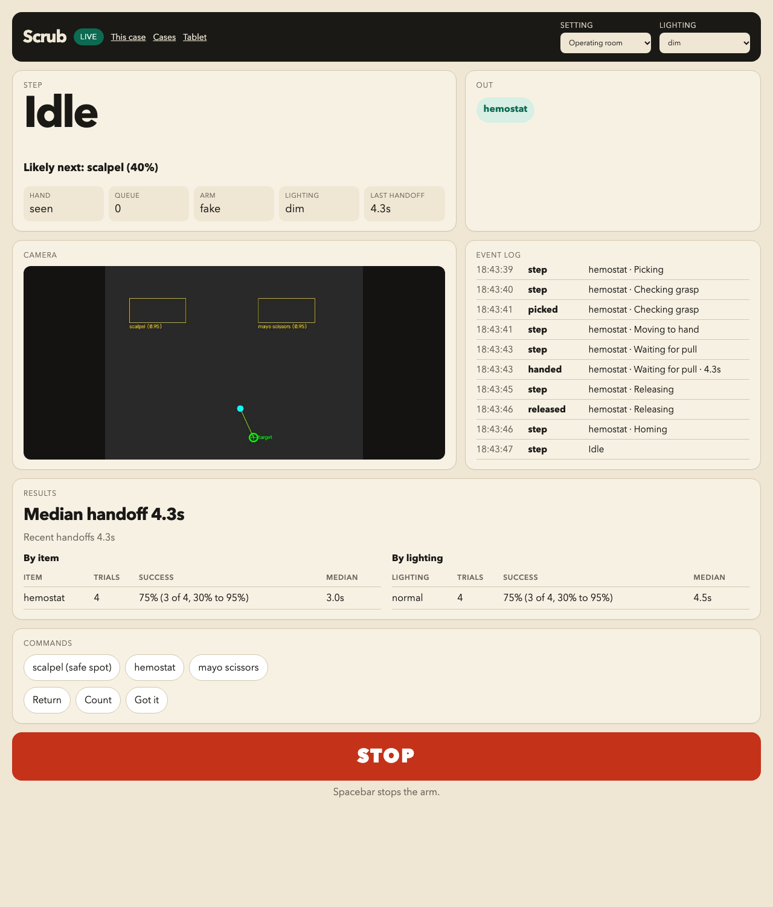
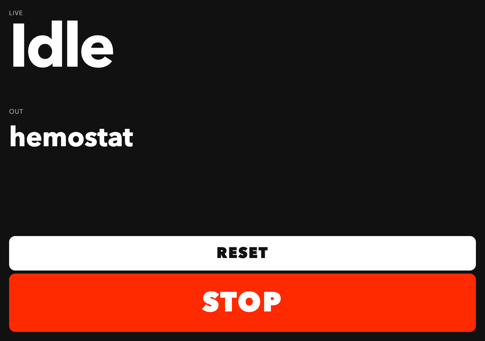
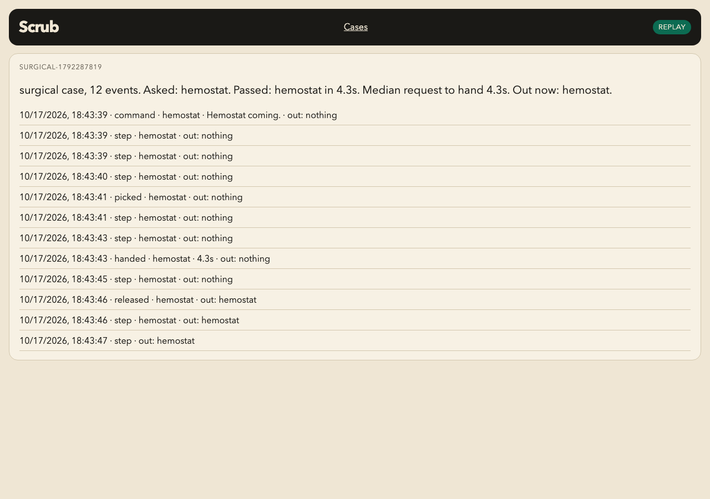
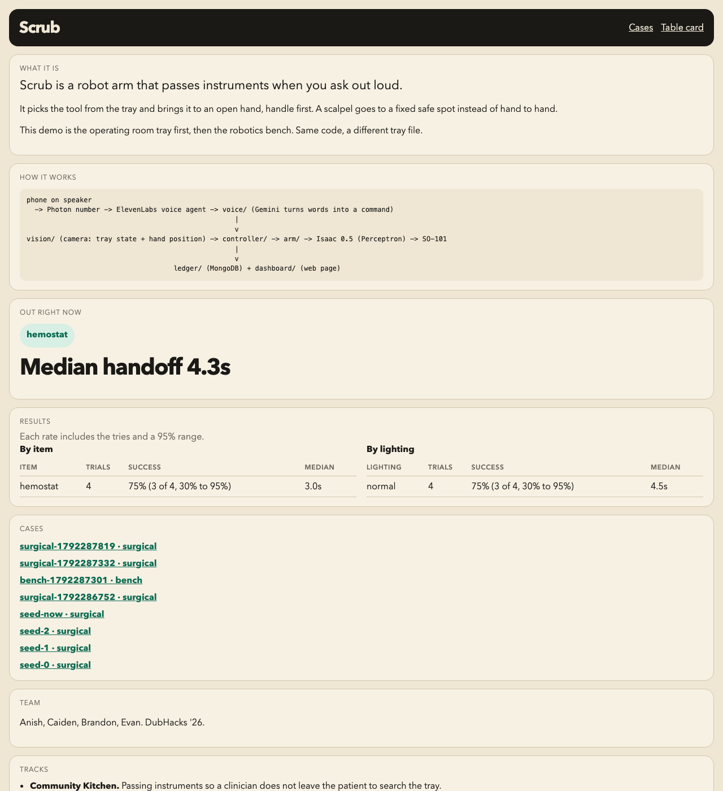

# Scrub: the full context pack (read this first, all of it)

Written Sun Oct 18, about 3 AM, for any Claude chat working on Scrub that is missing context. Part 1 is the summary you need to act. Part 2 appends the full text of every doc that matters (proposal, overview, business case, pitch, Devpost, Q&A, demo, design system, integration status, state, what's left, research, video plans, hacker guide summary), so you never have to guess. When Part 1 and a doc disagree on **current status**, `docs/INTEGRATION.md` and `team/LEFT.md` in the repo win, because they change hourly. Pull the repo before acting.

---

# PART 1: what you need to know

## 1. The event

- **DubHacks '26**, Oct 17 to 18, 2026, UW HUB, Seattle. Team of four.
- **Final Devpost by 9:30 AM Sunday** (it locks at 10:00, hard). Needs a public GitHub repo and a 2 to 3 minute demo video. No video, no judging.
- **Judging from 10:30 AM in the HUB Ballroom.** Be there by 10:20. Pitch under 3 minutes. The main-track judge comes to the table; sponsor judges (Perceptron, Photon, NEXT and others doing in-person judging) also come to the table separately. Stay at the table until every track you entered has judged you.
- Rules: at least 70% of the code written during the event (hacking started Sat 12:30 PM). One title track, up to 3 sponsored side tracks, any number of non-sponsored ones.

## 2. The team

| Person | Role tonight | Speaks in the pitch |
| --- | --- | --- |
| Anish | UW CS, robot learning research. Arm, training, the pitch lead | His grandmother's story, the problem, the close. Faces the judge, calls "go to backup" |
| Caiden | SFU, robotics, ~3 years of internships. The arm lives on his Mac; runs the agent passes; controller, voice, tools | His grandpa's story, narrates the video, the build. Runs the laptop |
| Evan | Tray, lamp, data log, Devpost and the video edit | Short parts |
| Brandon | Vision; plays the clinician's hand. May be away; Evan covers | Short part (hand tracking) |

Never state anyone's age. Use they/them for anyone whose pronouns aren't stated.

## 3. Scrub in one paragraph

Scrub is a robot arm that works as a surgeon's second pair of hands. The surgeon asks for an instrument out loud, over a phone call on speaker. The SO-101 arm picks it from the tray, brings it to the surgeon's open hand handle first, and lets go when they pull it or say "got it". Scalpels never go hand to hand: Scrub sets them on a fixed safe spot and says "scalpel down". When the surgeon sets an instrument in the return spot, Scrub puts it back in its slot. It keeps a running count checked by an overhead camera, reads the paper count sheet, and texts a case summary at the end. The pick is learned (Perceptron's Isaac 0.5 model fine-tuned on our demonstrations), backed up by vision-adjusted taught picks; the move to the hand is planned from a hand tracker. It's a research and training prototype, not a medical device.

## 4. The problem, with every number we're allowed to say (sourced)

Say only these numbers, and only with these meanings. If a number isn't here, don't say it.

| Claim | Source |
| --- | --- |
| A surgical tech job takes about **120 days** to fill | Periop Leader (OR Manager) survey, Aug 28, 2024. https://www.periopleader.com/survey-staffing-woes-ease-slightly-but-challenges-remain/ |
| About **8,600 openings a year** for surgical assistants and technologists in the US, 2025 to 2035 | US BLS Occupational Outlook Handbook. https://www.bls.gov/ooh/healthcare/surgical-technologists.htm |
| Instrument problems (mostly missing instruments) delayed cases about **10 minutes** on average (10.16 min), 7 pediatric ORs | Nichol et al., BMC Surgery 2024. https://doi.org/10.1186/s12893-024-02407-1 |
| OR time costs about **$36 to $37 a minute** (California, FY2014 data) | Childers and Maggard-Gibbons, JAMA Surgery 2018. https://jamanetwork.com/journals/jamasurgery/fullarticle/2673385 |
| An item left inside a patient about **once in 5,500 operations**; **62%** (21 of 34) had a count called correct | Cima et al., J Am Coll Surg 2008 (Mayo Clinic, 191,168 operations). https://pubmed.ncbi.nlm.nih.gov/18589366/ |
| About **385,000** needlestick and sharps injuries a year to US hospital staff | CDC Sharps Safety. https://www.cdc.gov/sharpssafety/ |
| Nurses and techs get cut most often while **passing** sharps | American Nurse, data from 87 US hospitals. https://www.myamericannurse.com/practical-strategies-to-prevent-surgical-sharps-injuries/ |
| Hands-free passing used at least 75% of the time: **35% fewer** incidents (cuts, glove tears, contamination) | Stringer et al., Public Health Reports 2009. https://pmc.ncbi.nlm.nih.gov/articles/PMC2708668/ |
| Rural Rajasthan has about **one in five** of the specialist doctors it needs (510 of 2,600 required at CHCs) | Health Dynamics of India 2022-23, via ETV Bharat. https://etvbharat.com/en/!bharat/shortage-of-specialist-doctors-hits-rural-health-sector-in-india-enn24091005534 |
| About **18%** of Canadians live in rural areas, and **fewer than 1 in 10** doctors work there | See the sources table in `PITCH-FINAL.md` (Part 2) for the exact citation |
| Prior work: RoboNurse-VLA, a 2024 research robot scrub nurse driven by voice | arXiv 2409.19590. https://arxiv.org/abs/2409.19590 |

Business numbers (from `docs/BUSINESS.md`, all **assumptions** unless sourced): $750 per OR per month, $1,500 setup, about $792 a month all-in over 3 years; break-even at **22 OR minutes saved per room per month** (about one minute per working day) at $36 a minute. We have not measured minutes saved; the honest claim is the break-even point. The SO-101 build is about **$250** in parts (pitch line: "Anyone can build it for $250, and the code is open source").

**Never say on stage:** that Scrub prevents retained items (it adds a second check); that it replaces scrub techs (it helps them); that it's ready for patients or clinical use; anything about FDA being easy; da Vinci-level precision. Say "research and training prototype". First market: surgical training and simulation labs (no patients), then surgery centers, then rural hospitals.

## 5. Tracks (what we enter and what each needs to be true)

- **Title: Community Kitchen** (accessibility, health, civic). The Devpost draft ticks it. Prizes are pick-one items (Switch 2, PS5, AirPods Pro 3, and so on).
- **Sponsored (max 3):** Perceptron Robotics (fine-tune their model on an SO-101; judged on creativity, task difficulty, technical execution; video of the working arm required), Perceptron Perception (their vision API: detect, OCR, captions, video events; we use detect on the tray and hand, OCR for count sheets, tray tags and pack labels, captions on event clips), Photon ($700 / $300, plus $400 best voice agent; needs a real call and real texts). If all three are real, those are the three; otherwise swap in whichever passes.
- **Non-sponsored:** DubHacks NEXT ($200 + interview; `docs/BUSINESS.md`), MLH Gemini API, MLH MongoDB Atlas, MLH Vultr, MLH Commit Fellowship (form after submitting), MLH DEV writing. Tiger Data, Backboard and GoDaddy were dropped (no keys or domain).
- **Claim a track only if `docs/INTEGRATION.md` says PASS.**

## 6. The system (how it fits together)

```
phone on speaker -> Photon number -> ElevenLabs voice agent (Custom LLM) -> voice/ (TypeScript, Gemini: words -> one command from the tray's fixed list; "stop" skips Gemini)
                                                                                  |
vision/ (overhead camera: tray slots, hand, OCR reads, clip captions; Perceptron API) -> controller/ (FastAPI :8000, the only thing that moves the arm) -> arm/ -> SO-101
                                                                                  |                                            (Perceptron Isaac model via run_skill, taught picks, IK)
ledger/ (MongoDB Atlas: every event, trial, read, thermal sample; public judge page on Vultr) <- controller events
sim/ (MuJoCo SO-101 + table, :8002) stands in for the arm and the overhead camera
video/ (cuts the demo video from real footage and ledger events; simcine re-renders sim runs at 1080p)
```

Ports: controller 8000, vision 8001, sim 8002, voice 3000, ledger 8080, recorder/station 8090, thermal page 8093. `python -m controller.run_all --real` starts the judging stack; `python -m controller.run_all backup --offline --loop` plays a full scripted case on the sim.

## 7. Where things really stand (about 3 AM; check INTEGRATION.md and LEFT.md for newer)

Working:
- Software combed and audited; every Critical and High finding fixed with tests. Sim backup run is CLEAN (all three handovers, scalpel to the safe spot, return, count).
- Perceptron robotics key works. **Quota: 5 successful training jobs per team, 0 used, 0 deployments** (checked via `GET /v1/jobs` at 2:05 AM; `team/LEFT.md` saying 2 were used is wrong).
- Perceptron detect works (about 1.8 s per call). Gemini works. ElevenLabs speech works. MongoDB Atlas works (database `scrub`: about 63,600 events, mostly fake-arm and sim tests; 3,800 thermal samples; 8 recorded episodes, all "pick the spatula" tests). Vultr public page works. Hugging Face works. MediaPipe and MuJoCo work.
- New tonight: shared hardware layer for the live arm (retried reads, joint limits, gripper torque by situation, thermal guard, release on pull, rest and wake), taught skills, the ops page and the doctor command, OCR reading (count sheets, tray tags, pack labels), clip captions, dataset video QA, a recording station, all pages restyled on one design system, plan files moved to `team/`.

Not done (the critical path):
- **No surgical training data yet** and no training run. Chat A (`team/RUN-TRAIN.md`) records the hemostat (30 to 40 episodes) and starts run 1, then all surgical items for run 2.
- **The phone call isn't proven** (ElevenLabs agent id, Photon line and SIP). Chat B (`team/RUN-PHOTON.md`) must finish it by 6 AM.
- **Smart pick** (vision-located, three grasp methods, grasp check and retry, per-item method chosen from data, sharps safe zone enforced): Chat C (`team/RUN-SMART-PICK.md`).
- **Data analysis and the real numbers** for the pitch: Chat D (`team/RUN-DATA.md`).
- Arm poses (`carry`, `safe_spot`), slot boxes and camera-to-arm calibration, the wrist camera's frame rate (18 to 23 fps; needs about 30).

## 8. The demo plan

Three ready levels (`team/DEMO.md`), each labeled honestly on screen:
1. Live real arm: the fine-tuned model for items that passed their real tries, vision-adjusted taught picks for the rest.
2. Live real arm, taught picks only.
3. The sim (and the 1080p sim video) next to the recorded real-arm video.

One line everywhere: **"The fine-tuned model picks; our code keeps it safe and carries it to the hand."** Every pick on the dashboard shows its `skill_source`. Every number on screen or in the Devpost comes from the ledger or the dataset; if there is no real number yet, skip the sentence.

## 9. The pitch (current draft: `PITCH-FINAL.md`, Part 2)

About 385 spoken words. Opens on Anish's grandmother in Bhararwa, Rajasthan (liver problem, turned yellow, surgery couldn't be scheduled, waited months; she's OK now) and the rural Rajasthan stat; then Caiden's grandpa in rural Canada (travels weekly to another hospital for eye injections) and the rural Canada stat; then "So we built Scrub." Caiden narrates the arm video. Close: start with rural hospitals, "Anyone can build it for $250, and the code is open source." Separate 60-second Perceptron version and 30-second Photon version.

## 10. The look (design system: `docs/DESIGN-SYSTEM.md`, `design/scrub.css`)

Scrub's pages look like things already in an operating room: a nurse-station status board printed on paper (Swiss grid, black rules, small-caps labels) and a medical device monitor (near-black, fixed numeric readouts, alarm colors). Two themes:
- `paper`: background `#ece8dd`, ink `#14130f`, mute `#625f55`, hairline `#b9b4a4`, red `#c8201a` (stop, sharps, high alarm), amber `#9a5b00` (waiting, stale), green `#1d6a38` (ok), cyan `#0e6f86` (info).
- `monitor`: background `#0f1110`, ink `#e8e6df`, red `#ff4b3e`, amber `#ffb02e`, green `#3ad17a`, cyan `#4cc9e8`.
- Fonts: **Archivo** (labels, headings, 900 for the SCRUB brand) and **IBM Plex Mono** (numbers, times, codes, logs). Tabular numerals, real units.
- Components: masthead with a 4px ink rule; sections with a 2px rule and small-caps label; big mono readouts with units; the step strip (FIND, PICK, CHECK, HAND, WAIT, RELEASE, HOME); item rows with codes like HEM-01; a mono event log; square buttons, 44px tall, STOP solid red and always visible; full-width alarm banners; plain-sentence empty states.
- Never: shadows, gradients, glass, bento cards, emojis, Inter or Geist, em dashes in copy. Corners 0 to 2px. Motion only on state change. Color only carries meaning. Copy in the voice of the room ("Count 2 of 3", "Mayo scissors, curved").
- The video uses the same look: Archivo and Plex Mono overlays, the step strip, and a SIMULATION label on any sim shot.

## 11. Video assets that exist

- `data/video/out/sim-cinematic.mp4` on Anish's laptop (also in the workspace `video/` folder): 40 s, 1080p, a recorded sim run re-rendered in MuJoCo with steel instruments, a drape, a gloved hand, shadows, a following camera, captions and the step strip, labeled SIMULATION. Re-make it with `python -m video.simcine record` then `render`.
- `data/video/out/sim-backup.mp4` on Evan's Mac: 68.8 s screen capture of the sim and dashboard.
- The video tool (`python -m video ...`): corners, ingest, topdown (plane warp, photo plate, joint reconstruction), clean, find, overlay, cards, render, preview. EDLs in `video/edl/`.
- Still needed: real-arm footage (shots A1 to A8 in `team/VIDEO.md`), the phone call screen recording, the training montage, the Perceptron unedited roll.

## 12. Writing rules for anything the team will read or say

Short and plain. No em dashes. No "it's not X, it's Y". No rhetorical questions, colon reveals, one-line paragraphs for effect or neat moral endings. No filler (really, just, actually, honestly, truly, simply, very). No decorative AI words (delve, leverage, seamless, robust as praise, crucial, pivotal, unlock, empower, journey). No praise of the team. Facts about people and results stay real.

---

# PART 2: the full documents

Contents of Part 2:

- PITCH-FINAL.md (current pitch draft, Anish's workspace)
- docs/OVERVIEW.md
- team/PROPOSAL.md
- docs/BUSINESS.md
- team/PITCH.md
- team/DEVPOST.md
- team/QNA.md
- team/DEMO.md
- team/SLIDES.md
- docs/DESIGN-SYSTEM.md
- docs/INTEGRATION.md
- team/STATE.md
- team/LEFT.md
- docs/RECOGNITION.md
- docs/TRAINING.md
- docs/TEACH.md
- docs/CONTRACTS.md
- team/VIDEO.md
- team/VIDEO-SCRIPT.md
- docs/VIDEO-TOOL.md
- explore/research/SURGEON_RESEARCH.md
- team/research/01-startup-tracks.md
- team/research/02-medical-go-to-market.md
- team/research/03-market-competitors.md
- team/research/04-buildout-ideas.md
- team/research/TRACKS.md
- explore/research/overheating/README.md
- GUIDE-SUMMARY.md (hacker guide: every track, prize, rule and deadline)

---

## FILE: PITCH-FINAL.md (current pitch draft, Anish's workspace)

# Scrub pitch (draft 2, Sun Oct 18, ~3:30 AM)

Quoted lines are spoken. Everything else is a stage note: don't read it.

Lead angle: **access.** Small and rural hospitals have operating rooms but not enough people. Speed (more operations with the same staff) and cost ($250) both serve that. Scrub is an assistant for the surgeon: it passes, puts back and counts, and the surgeon stays in charge.

Proof is the arm video, edited, with each clip labeled `model` or `taught` in a corner caption. If the arm comes to the table, the same words go over the live arm.

## Who says what

| Person | Speaks | Words | Does |
| --- | --- | --- | --- |
| Caiden | His grandpa, the video narration, the build | about 185 | Plays the video, runs the laptop |
| Anish | His grandmother, the problem, the close | about 145 | Faces the judge, calls "go to backup" |
| Brandon | Hand tracking | about 25 | Points at the hand on screen |
| Evan | Pre-med line and lighting | about 30 | Holds the second screen (dashboard or temperature graph) |

## Main version: talk, then the arm video (about 385 words, aim for 2:45)

**0:00 Anish's grandmother (Anish).** Title card on screen.

> My grandmother lives in Bhararwa, a small town in Rajasthan. She had a problem with her liver and started turning yellow. Her surgery couldn't be scheduled, and she waited months. My family was scared. She's OK now. Rural Rajasthan has about one in five of the specialist doctors it needs.

**0:20 Caiden's grandpa (Caiden).**

> My grandpa lives in rural Canada. His town has a hospital, but every week he travels to another one for eye injections. About 18 percent of Canadians live in rural areas, and fewer than one in ten doctors work there.

**0:35 The problem and Scrub (Anish).**

> Small hospitals have operating rooms but not enough people. Without a scrub tech, the surgeon stops, looks away from the patient, and searches the tray. Surgical robots cost more than these hospitals can spend. So we built Scrub, an assistant on a $250 open-source arm. The surgeon asks out loud, and Scrub hands it over.

**0:55 Video starts (Caiden presses play, then narrates).** Video: a request on the phone, the hemostat pick, the handoff handle first, the release on pull, the scalpel to the safe spot, a stop.

> Here it is on our arm. The surgeon says "hemostat." Scrub picks it with a model we trained on our own demonstrations, brings it handle first to the open hand, and lets go when the surgeon pulls. Scalpels never go hand to hand, so Scrub sets them on a safe spot. Say stop, and it freezes until a person resets it.

If the hemostat clip is a taught skill, say "with a skill we taught it" instead of "with a model we trained". The caption in the video says which.

**1:20 Hand tracking (Brandon).** Video: the hand tracker view, the arm slowing, the hand pulled away and the arm holding.

> A camera finds the surgeon's open hand ten times a second. The arm slows down near it, and if the hand moves away, it holds still.

**1:30 Lighting (Evan).** Video: the lamp on, glare on the steel, a handoff in bright light.

> Brandon and I both want to go into medicine. Operating lights throw glare off steel, so we tested every instrument in bright, normal and dim light, and logged every try.

**1:45 Return, count, text (Caiden).** Video: a tool set in the return spot, the arm putting it back, the count, the count sheet read, the summary text on the phone.

> Set a tool in the return spot and Scrub puts it back. It keeps the count, reads the count sheet to check it, and texts a summary when the case ends.

**2:00 How we built it (Caiden).** Video: the temperature graph, then the arm resting. Prop: a wet paper towel.

> The motors overheated even holding still. At one in the morning we were cooling them with wet paper towels while we wrote a guard that watches every motor and rests the arm between requests. We fixed rate limits in the arm's code that made it slow, and put magnets in the gripper so steel doesn't slip.

**2:25 The close (Anish).** Video ends on the title card or the arm at rest.

> Scrub passes, puts back and counts. The surgeon stays in charge. Anyone can build it for $250, and the code is open source. We'd start with rural hospitals, like the one in Caiden's grandpa's town. Questions?

### Video order for the editor

About 90 seconds, 0:55 to 2:25, in this order: the hemostat request and handoff, the scalpel to the safe spot, a stop, the hand tracker and the hold, the lamp and glare, a return to the slot, the count and the count sheet, the summary text, the temperature graph, the arm resting. Caption each pick `model` or `taught`.

### If the arm comes to the table

Same words over the live arm. Brandon plays the clinician and says the requests ("Hemostat.", "Scalpel.", "Count.", "End of case."). After Brandon's line at 1:20, add the judge's turn and cut Evan's pre-med sentence to keep time:

Caiden:
> Your turn. Hold out your hand and ask for the scissors.

### If Brandon isn't back

Evan says the hand-tracking line, then his own. In the live version Evan plays the clinician and Anish turns the lamp on.

## Perceptron Robotics judge (about 60 seconds, Anish)

> We trained Perceptron's Isaac 0.5 on our own demonstrations on this SO-101. We recorded by teleoperation, with a side camera and a wrist camera at 30 frames a second, in bright, normal and dim light. Every episode passes our own dataset check before it uploads: length, frozen arm, gripper, joint jumps, dropped frames, dark cameras.
>
> Thin steel is a hard grasp. The hemostat lies almost flat and reflects light, so we put magnets in the gripper.
>
> The model picks. Our code keeps it safe and carries it to the hand: speed and joint limits, a grasp check, a temperature guard after our motors overheated, and a planned move to the surgeon's open hand, which is somewhere new every time. We also use your vision API to find the instruments in the tray, read the count sheet and the sterile pack labels, and caption every clip. Every pick on the dashboard says whether the model or a taught skill ran it.
>
> Here's the run.

If no model is deployed by judging, change the first sentence to "We recorded our own demonstrations and built the full pipeline to your training endpoint," and say "Today the picks are skills we taught by hand, labeled on the screen."

## Photon judge (about 30 seconds, Caiden)

> There's no app to install. A nurse in a small hospital calls a phone number. Photon carries the call to an ElevenLabs voice agent. Gemini turns the words into one action and one item from the tray, so it can't ask for something that isn't there, and the arm moves. "Stop" skips Gemini, so the arm freezes right away. Texts work on the same thread: "what's out", a restock, or a photo of the count sheet. When the case ends, the summary comes back as a text.

Then let the judge call or text the number. Photon's docs say shared lines can't take calls, so if the line is text-only, have the judge text "what's out".

## When the arm fails (live version)

**Level 2 (real arm, taught skills only).** At 0:55 say "Scrub picks it with a skill we taught it, and the screen says so." Never say the model is running. Everything else stays.

**Level 3 (sim next to the real-arm video).** At 0:55, before "Here it is", Caiden says: "The arm on this screen is a simulation. The video next to it is our real arm." Skip the judge's turn. Same safety, count and build lines. The sim runs the same controller and stop rule as the real arm.

Triggers from DEMO.md: API down or slow, or the model fails twice on one item, go to level 2. Two failed picks in a row or "Too hot" twice, go to level 3. Anything unsafe: Space first, then level 3. Anish calls it.

## The 10 likeliest judge questions

| # | Question | Answer | Who |
| --- | --- | --- | --- |
| 1 | How is this different from surgical robots hospitals already have? | Those hold tools for the surgeon during the operation and cost far more than a small hospital can spend. Scrub does the scrub tech's job of passing and counting, on a $250 arm. Research labs have built robot scrub nurses, like RoboNurse-VLA in 2024. We found none on the market | Anish |
| 2 | Does it replace scrub techs? | No. It's for the places that don't have enough of them. A surgical tech job in the US takes about 120 days to fill. Where there is a tech, Scrub lets them focus on the field | Anish |
| 3 | What does the model do and what does your code do? | The model does the pick: approach, grasp, lift. Our code does the limits, the grasp check, the heat guard and the move to the hand, because the hand is somewhere new every time. The model has no "done" signal, so our code decides when a pick is finished and the camera confirms the slot is empty | Anish |
| 4 | What if it gets something wrong? | It checks every grasp with the gripper and the camera, retries once, then says it missed. If it isn't sure what you said, it asks "Which instrument?" If the hand leaves for more than half a second or something crosses the path, it holds still | Caiden |
| 5 | How do you stop it? | Say "stop", press Space, or the stop button on any page. "Stop" skips Gemini and goes straight to the controller. It stays frozen until a person resets it. Only the controller can move the arm | Caiden |
| 6 | Operating rooms are loud. Why voice? | The surgeon's hands are busy, and they already ask out loud. Gemini maps clinic words like "Kelly" or "Mayo" to the right item, and a clinic can teach it new ones ("call the hemostat a clamp"). If Gemini is slow, a local word match takes over. The dashboard buttons send the same commands | Caiden |
| 7 | How did you deal with the overheating? | Torque on at 12 V heats the motors even holding still. We log every motor's temperature twice a second to MongoDB. At 60 C the arm stops and cools, and it resumes at 50 C. The gripper uses 15% torque idle, 35% holding and 50% moving. Between requests the arm rests with torque off, which also saves power | Caiden |
| 8 | Would a hospital use this today? | Not yet. A real version needs a sterile drape, a medical-grade arm and testing with clinical staff. The software talks to the arm through one interface, so the arm can change | Anish |
| 9 | Who pays, and how much? | Rural and small hospitals, a monthly fee per operating room. Our planning number is $750 a room a month plus $1,500 setup. Operating room time costs about $36 a minute, so it pays for itself at about one minute saved a working day | Anish |
| 10 | Does it work beyond surgery? | A new tray is new demonstrations and one settings file, no new code. We built a robotics bench tray (pliers, wire cutters, hex key), and the same works for a dental tray | Anish |

## More to say at the table (from the repo)

Use these in questions or while the next judge walks up.

- **Check the tray.** Say "check the tray" before a case and Scrub compares the tray to the list and says what's missing. In a 2024 study of seven operating rooms, instrument problems, mostly missing instruments, delayed a case about 10 minutes on average.
- **Reads the paper the OR already uses.** The count sheet, the tray tag (QR first, printed text second) and sterile pack labels, with lot and expiry. It warns on an expired pack. On our printed test props, Perceptron read all 9 correctly in 1.8 to 2.7 seconds, and the QR tray tag read in 0.05 seconds.
- **The count.** A Mayo Clinic study found an item left inside a patient about once in 5,500 operations, and most of those counts had been called correct. Scrub adds a second, camera-checked count. The nurse still owns the official count.
- **Sharps.** US hospital staff have about 385,000 needle and sharps injuries a year (CDC). Staff get cut most often while passing sharps.
- **Every event goes to MongoDB.** The success tables, the count and the case replays read from it. If the database is down, events go to a local file and upload later.
- **Case replay and public page.** Every case has a replay with the clip captions. The public page has the success tables and a QR code for the table.
- **Sim backup.** A MuJoCo model of the SO-101 runs the same controller. We test every flow on it.
- **Tests.** The controller's flow tests pass 67 of 67 on the fake and sim arms. The arm code has 94 tests, including the safety guards.
- **One command starts everything.** `run_all` starts the controller, vision, voice and the ledger and prints every URL. `run_all reset` clears between judges.
- **The recorder.** Both cameras, the loop rate and the motor temperatures live on one page, with a kill switch, "Home + motors off", and a cool-down lock.

## Sources for what we say

| What we say | Source |
| --- | --- |
| Rural Rajasthan has about one in five of the specialist doctors it needs | Health Dynamics of India 2022-23: rural Rajasthan CHCs have 510 of 2,600 required surgeons, OB-GYNs, physicians and pediatricians. ETV Bharat: https://etvbharat.com/en/!bharat/shortage-of-specialist-doctors-hits-rural-health-sector-in-india-enn24091005534 |
| About 18% of Canadians live in rural areas, fewer than one in ten doctors work there | CIHI 2011 data via CMAJ: 8.6% of physicians served about 18% of the population. https://www.cmaj.ca/content/185/1/E1 |
| Rural India's CHCs have 83% fewer surgeons than they need (table talk only) | Rural Health Statistics 2021-22. https://www.iasgyan.in/daily-current-affairs/rural-health-statistics-report |
| A surgical tech job takes about 120 days to fill (US) | Periop Leader survey, 2024 |
| Instrument delays about 10 minutes a case | Nichol et al., BMC Surgery 2024 |
| About 385,000 sharps injuries a year | CDC Sharps Safety |
| An item left inside about once in 5,500 operations | Cima et al., J Am Coll Surg 2008 |
| Operating room time about $36 a minute | JAMA Surgery, 2018 |
| RoboNurse-VLA, 2024 | arXiv 2409.19590 |

The US sources have full links in the repo's `team/PITCH.md`.


---

## FILE: docs/OVERVIEW.md

# Scrub: the whole project in one document

Read this first. It explains every idea, decision and part of the project, and where everything lives. Other docs go deeper; this one ties them together. If another doc disagrees with this one on **what we're building**, this one wins. For **current status**, `team/LEFT.md` wins. For what each outside tool does today, `docs/INTEGRATION.md` wins.

DubHacks '26, Oct 17 to 18, 2026. Team: Anish, Caiden, Brandon, Evan.

---

## 1. Scrub in one paragraph

Scrub is a robot arm that works as a surgeon's second pair of hands. The surgeon asks for an instrument out loud, designed as a phone call on speaker (the phone number is pending). The SO-101 arm picks it from the tray, brings it to the surgeon's open hand handle first, and lets go when they take it. Scalpels never go hand to hand: Scrub sets them in a fixed safe spot. When the surgeon sets an instrument in the return spot, Scrub puts it back in its slot. Scrub keeps a running count of every instrument out and reads it back on request, and texts a summary at the end of the case. The picking is meant to be learned (we are recording demonstrations to fine-tune Perceptron's Isaac 0.5 model, and no model is deployed yet; taught waypoint skills cover the picks until one is). The move to the hand is planned from a hand tracker.

## 2. The problem

- Operating rooms depend on scrub techs who pass instruments and keep the count. There aren't enough of them: a surgical tech job takes about 120 days to fill (Periop Leader, 2024).
- When nobody is there to pass, the surgeon stops, looks away from the patient, puts down what they're holding and searches the tray.
- Counts are a safety step: an instrument or sponge left inside a patient (a "retained surgical item") is a serious, costly error, and manual counts miss things.
- Sharps injuries happen during hand-to-hand passing, which is why operating rooms pass sharps hands-free.

Sources and numbers: `team/PROPOSAL.md` (sources section), `docs/BUSINESS.md`, `explore/research/SURGEON_RESEARCH.md`. **Any number used in the pitch, slides or Devpost must be checked against its source first.** `SURGEON_RESEARCH.md` section 6 lists risky claims to avoid on stage.

## 3. What Scrub does (the user's view)

| The surgeon | Scrub |
| --- | --- |
| Says "hemostat" (or "Kelly", "grab me the kelly") | Says "hemostat coming", picks it, checks the grasp, lifts it, brings it to the open hand handle first, and stops a few cm short |
| Takes it (pulls) or says "got it" | Opens the gripper, goes home, logs the time from request to hand. Pulling is detected from the grip load collapsing while the hand is at the handoff spot (release on pull) |
| Says "scalpel" / "knife" | Puts it at the safe spot and says "scalpel down". Never hand to hand |
| Sets an instrument in the return spot | Sees it, says "returning the hemostat", puts it back in its slot (auto return) |
| Says "count" / "what's out" | Reads back what's out, checked against the camera |
| Says "check the tray" | Compares the tray to the expected items and says what's missing |
| Says "stop" | Freezes instantly (skips Gemini). A person must reset it |
| Says "read the count sheet" | Reads the sheet's expected, initial and closing counts and says where its own count and the sheet disagree |
| Says "what tray is this" | Reads the tray tag, says which tray it is, and switches the setting when idle |
| Says "read the pack" | Reads the sterile pack's lot and expiry and warns on an expired pack |
| Says "end of case" | Texts a case summary to the same phone thread, with a link to the case replay |
| Texts "add a second hemostat to the surgical tray" | Logs a restock and replies |
| Says "call the hemostat a clamp" | Learns the new word for this clinic |

Scrub reads the paper the OR team already uses: the count sheet, the tray tag (QR first, printed text second) and sterile pack labels. Perceptron OCR reads first and Gemini is the fallback. Matching uses the fixed item list, so a read never invents an item. Details are in `docs/INTEGRATION.md` and `vision/README.md`.

Event clips get a Perceptron caption from 5 frames, with an `agrees` flag when the camera disagrees with the controller's event. Captions go to the ledger replay. Dataset QA flags failed grasps, drops and dark cameras before anything uploads.

What is measured: on rendered props, all 9 rendered props read correctly (5 count sheets, 2 tray tags, 2 sheets of 4 pack labels): Perceptron in 1.8 to 2.7 s, the tray tags by QR in 0.05 s. What is not measured yet: real photos of the printed props and of the real tray (`docs/RECOGNITION.md`).

Between commands the arm rests. After the arm is home and nothing has been queued for 2 s, the controller calls `arm.rest()`: torque off on all six motors, nothing written. Before the next command it calls `arm.wake()`: each motor's goal is set to where it already is, then torque comes on, so nothing moves. `GET /state` reports `resting`. The fake, sim and real arms implement both.

Every pick and return carries a skill source on its events, `model` (the fine-tuned Isaac model) or `taught` (a replayed, labeled backup). The dashboard, the ops page, the case replay and the end-of-case summary show it.

## 4. Scope decisions, and what is real

### Decisions and why

| Decision | Why |
| --- | --- |
| **Surgical first.** Operating room tray: scalpel handle, hemostat, Mayo scissors | The strongest story (staffing, counts, sharps) and the instruments we have |
| **Robotics bench tray is the second setting:** needle-nose pliers, wire cutters, hex key | Shows that a new setting needs new demonstrations and a settings file, and no new code |
| **Dental is dropped.** `settings/dental.json` stays on disk but is hidden everywhere a judge looks | We have no dental tools to record with |
| **Handoff goes to the person's actual hand**, not a fixed spot | A hand tracker plus calibration adapts to each clinician |
| **The fine-tuned model picks, and our code keeps it safe and carries it to the hand.** The model does approach, grasp and lift. Our code does smoothing, speed and joint limits, the claw guard, the thermal guard, the grasp check, and the planned move from carry to the hand | The model learns grasps from demos. The hand position changes every time, so a planned move is safer and more accurate |
| **Voice over a phone call** (Photon + ElevenLabs), designed and pending | Clinicians already ask out loud. The number and the agent are not set up yet; the voice server already answers typed lines |
| **Gemini turns words into one action and one item**, from a fixed list | It cannot invent an item that is not on the tray. "Stop" never waits for Gemini |
| **Only 2 training runs** | Perceptron's quota is 2 successful jobs per team. Run 1 is the hemostat, run 2 is the full surgical set. Nothing uploads until dataset QA passes |
| **One dataset, one calibration, fixed cameras** | Each training run starts from the base model and takes one dataset |
| **Taught skills are a labeled backup, never presented as the model** | If the model fails an item on the table, the demo still runs, and it says which source moved the arm |
| **The arm lives on Caiden's Mac** | Recording and live runs happen there. One process owns the arm ports and cameras at a time |
| **A sim backup stays ready** | If the arm fails at the table, the MuJoCo arm plays a full run next to the recorded real-arm video |

### Real (built, tested, runs today)

- **Controller, voice, vision, ledger, dashboard, settings, sim, deploy.** Tested on the fake arm and the sim arm: `controller.test_flows` 85/85, 87 tests in `sim`, `ledger` and `vision`, the `arm` tests and `controller.test_run_all` pass, voice `npm test` passes. `python -m controller.run_all check` passes on its own fake stack.
- **One-command stack and the backup.** `python -m controller.run_all` starts the controller, vision, voice and (with `--ledger`) the ledger and prints every URL. `--real --tunnel` is the judging preset. `run_all backup` plays a full run on the sim arm. `run_all reset` clears between judges.
- **Rest and wake between commands.** After 2 s at home with nothing queued the controller rests the arm (torque off); before the next command it wakes it without moving. The fake, sim and real arms implement both.
- **The shared hardware layer in `arm/hardware.py`**, used by the recorder and `arm/real_arm.py`: retried bus reads, joint limits, gripper torque by situation, a thermal guard that raises `ArmFault` (the controller turns it into an error event that holds the arm), handoff detection.
- **Release on pull.** The controller opens the gripper when the grip load collapses while the hand is at the handoff spot, or on "got it".
- **Taught skills, the labeled backup.** `arm/taught.py` plays a few joint waypoints per item and direction, taught with `python -m arm.teach` (`docs/TEACH.md`). `--skills model|taught|auto` picks the source; `auto` uses the model for an item once a deployment exists and the item passed its last 3 real tries. Every pick and return event carries `skill_source`.
- **The ops page and the doctor.** `GET /ops` shows the step, `skill_source` per item, arm temperatures and loads, camera rates, API latencies and last errors. `python -m controller.doctor` checks every service, key (names only) and log, and asks Gemini to turn recent errors into a short list.
- **Thermal telemetry and the cool-down guard (recorder).** Every recorder session samples each motor at 2 Hz (temperature, load, position, goal, current, voltage) to `~/scrub-logs/thermal/` and to MongoDB. At 60 C the guard stops the arm and cools it, and it resumes at 50 C or when cooling levels off. `explore/thermal_analyze.py` reports which motor heats, how fast, and in which phase. `explore/thermal_web.py` serves a live temperature site on port 8093. Findings and the ranked causes are in `explore/research/overheating/README.md`. The main heat source is torque on at 12 V, so the arm now rests with torque off.
- **Gripper torque by situation.** 15% when idle and shut, 35% when holding, 50% when moving, with a dead zone of 3. Overload flags are cleared at startup, bus reads are retried 3 times, and wrist_roll is held to plus or minus 150 degrees.
- **Lift and pulled-out handoff detection (recorder).** Lift is the gripper tip height from the SO-101 model, at least 3 cm while holding. Pulled-out is the grip load collapsing while the leader still holds shut. Each episode ends with `lift_m`, `pulled` and `handoff_success`.
- **The recorder and the recording station (`explore/`).** `explore/arm_session.py` records with the leader and follower and serves its page on port 8090. `explore/station/` is a persistent station on port 8090: arms, cameras and dataset opened once, unlimited start, save and discard of episodes, a KILL switch, Home + motors off, Motors on, a cool-down lock and reconnect. The home pose is in `explore/home_pose.json`.
- **Dataset QA (`explore/dataset/`).** `qa` marks each demo PASS, WARN or FAIL (length, frozen arm, gripper, joint jumps, dropped frames, dark or frozen cameras, state lag). `variety` shows where grasps happened and where to record next. `replay` plays the recorded joints in the sim beside the real video. `aim` checks camera level and brightness. `qa_video` flags a failed grasp or a drop with one bounded Perceptron call per episode. `arm.dataset_check` checks metadata, 30 fps timestamps, camera shapes and the six joints, and `arm.train pipeline --check-only` gates every upload.
- **Perceptron Robotics API client** (`arm/perceptron.py`, `arm/train.py`, `arm/pipeline.py`, `arm/upload_dataset.py`). The team key returns HTTP 200 and the pipeline passes its offline self-tests. No job has been submitted and there are 0 deployments.
- **Perceptron vision.** `vision/` calls the detect API for tray items and the hand; detect answered in 1.8 s in the integration run. `explore/recognition/bench.py` measured weak accuracy on 5 synthetic cases (found rate 0.4, median 2.7 s), so the tray reading needs checking on real frames (`docs/RECOGNITION.md`).
- **The video tool (`video/`).** `python -m video` has `corners`, `ingest`, `topdown`, `clean`, `find`, `overlay`, `cards`, `render`, `preview`, `export-ledger` and `demo-assets`. Every simulated or reconstructed shot is labeled, every number on screen comes from the ledger or the dataset, and speed changes carry a "2x" tag. Spec: `docs/VIDEO-TOOL.md`. Its 25 tests pass when Playwright browsers are installed (the card test needs them).
- **The shared design system (`design/`).** One stylesheet, `design/scrub.css`, with a paper theme and a monitor theme, copied by `design/sync.py` into the dashboard, the tablet view, the ledger pages and the sim viewer. The nurse and demo consoles keep their approved styling inside isolated blocks. Spec: `docs/DESIGN-SYSTEM.md`.
- **MongoDB Atlas and the public page on Vultr.** The ledger and thermal telemetry are in Atlas (`scrub.events`, `scrub.thermal`). `http://144.202.95.111/` serves the judge page from it through nginx, over HTTP only. `bash ledger/push_public.sh root@<ip>` updates it.

### Partly done or not working yet

- **The real-arm path through the controller has not run a full case on hardware.** `arm/real_arm.py` has the hardware layer, rest, wake, telemetry and taught skills, and its tests pass offline. `SO101_PORT` is empty in the integration run, so it was not tried against the follower.
- **No model is deployed.** `python -m arm.train deployments` shows 0, so `PERCEPTRON_DEPLOYMENT_ID` names nothing. Training run 1 has not finished. No "fine-tuned" or live-inference claim until it has and a model-driven pick is recorded.
- **Rig and vision calibration.** `arm/rig.json` is an unmeasured template (`hardware_verified: false`). `vision/calibration.json` does not exist. Slot boxes are not marked, so the hand target and tray slots are defaults.
- **Cameras.** At the last check the wrist camera ran at about 23 fps and was dark, and the side camera was not seen. Recording needs both at about 30 fps (`python -m arm.check_setup`).
- **Training data.** No batch is logged in `docs/DATA-LOG.md` yet.
- **The phone path.** Designed in `voice/README.md` (Photon number, SIP, an ElevenLabs agent with a Custom LLM pointing at `voice/`). `ELEVENLABS_AGENT_ID` is empty, no tunnel URL is recorded, and no Photon line exists. Photon keys load and the texting code passes its mocked test, but no real text has gone out. The ElevenLabs key works: the arm speaks in the room. The phone agent and the Photon line are being set up now.
- **Hugging Face and GoDaddy.** `HF_TOKEN` is empty, so the training pipeline cannot start. No domain is bought, so the public page has no HTTPS and the replay link in the text has no host.
- **Tiger Data and Backboard are not live.** `ledger/tiger.py` and `ledger/memory.py` exist, but both keys are empty. The series and memory pages answer from the local ledger. We make no track claim for either.
- **Reading and recognition on real photos.** The readers, captions and the bench run, but every accuracy number so far comes from rendered props, synthetic trays or 7 recorded episodes. Real photos of the printed count sheet, tray tag, pack labels, the tray and gloved hands are listed in `docs/RECOGNITION.md` ("Photos to take"). The demo beat for the count sheet waits on that.
- **Design review.** The restyle is checked by script and by fetching every page. Browser screenshots are pending.

### Dropped

- **Dental.** No tools, no recordings, hidden everywhere a judge looks.
- **A third setting.** The proposal's three trays are two.
- **The idea prototypes.** The gallery in `team/prototypes/` is inspiration only and moves out before the repo goes public.
- **Claims with no real use behind them.** Any track claim that `docs/INTEGRATION.md` cannot prove with a command is cut.

## 5. How the system fits together

```
phone on speaker
  -> Photon number -> ElevenLabs agent (speech) -> voice/ (Gemini: words to command)
                                                     |
                                                     v
vision/ (overhead camera: tray + hand) ----------> controller/ ----> arm/ ----> SO-101
                                                     |                |
                                                     |                +-- model skill: Perceptron Isaac 0.5
                                                     |                +-- taught skill: arm/taught.py (backup)
                                                     |                +-- fake arm or sim arm (sim/) for tests and the backup demo
                                                     v
                           ledger/ (MongoDB) + dashboard/ + ops page + public page (Vultr)
```

Only the controller moves the arm. Everything else sends it information. The messages between parts are fixed in `docs/CONTRACTS.md`. A picture is in `docs/media/`. `team/` holds the team's working notes and is removed before the repo goes public.

| Part | Folder | Port | What it does | Built on |
| --- | --- | --- | --- | --- |
| Controller | `controller/` | 8000 | The brain: queue of commands, the step-by-step handoff (find, pick, check grasp, move to hand or safe spot, wait for pull, release, home, log), return, count, tray check, every safety rule, rest and wake between commands. Serves the dashboard, the nurse console, the demo page and the ops page. `run_all.py` starts the whole stack; `doctor.py` checks it | FastAPI |
| Arm | `arm/` | | Connects to the SO-101 (LeRobot), runs the fine-tuned model (sends side and wrist images plus 6 joint angles, plays the returned moves at 30 Hz), the hand-reaching math (`move_to`, inverse kinematics), pose teaching, taught skills, the training pipeline. The shared hardware layer (reads, limits, torque, heat) is used by both the recorder and the live arm | LeRobot, Perceptron Robotics API |
| Vision | `vision/` | 8001 | The overhead camera: MediaPipe finds the open hand and turns it into an arm target; Perceptron's vision API finds instruments and maps them to tray slots; tray check; lighting tags; event clips with Perceptron captions; reading count sheets, tray tags and pack labels; a video stream with boxes | OpenCV, MediaPipe, Perceptron detect |
| Voice | `voice/` | 3000 | The ElevenLabs agent's custom LLM endpoint: Gemini parses each phrase, "stop" goes straight to the controller, replies are spoken; texts in and out on the Photon thread; end-of-case summary | TypeScript, Gemini, Photon |
| Ledger | `ledger/` | 8080 | Logs every event and test result to MongoDB Atlas (with a local file if Mongo is down), success tables with ranges, and the public pages: judge page, case list, case replay, series, memory, QR table card. Series and memory read the local ledger. Runs on Vultr for the public | MongoDB |
| Dashboard | `dashboard/` | served at 8000 | What judges watch: live camera, current step, what's out, event log, tray and lighting pickers, stop and reset. `tablet.html` is a large-text view | plain HTML/JS |
| Settings | `settings/` | | One file per tray: items, the words people say, which item is sharp, slot boxes, the model instructions | JSON |
| Sim | `sim/` | 8002 | A MuJoCo model of the SO-101 with the same arm interface. Used for testing without hardware, as the backup demo, and for replaying recorded joints | MuJoCo |
| Design | `design/` | | The shared stylesheet and its sync and check scripts | CSS |
| Video | `video/` | | Cleans real footage and builds the demo video and the Perceptron arm video from the ledger and dataset | OpenCV, ffmpeg |
| Deploy | `deploy/` | | Puts the public page on a Vultr server; `python -m deploy` checks every key and service | |
| Recorder and tools | `explore/` | 8090, 8093 | The recorder and recording station, the temperature site, dataset QA, the recognition bench and the overheating research. These are real tools; the rest of `explore/` is not (section 11) | LeRobot, MongoDB |
| Team notes | `team/` | | Status, tasks, pitch, prompts and QA notes. Removed before the repo goes public | |

**One arm path.** The recorder (`explore/arm_session.py`) got every reliability fix first. The live demo goes through `controller/` and `arm/real_arm.py`. Both use the hardware layer in `arm/hardware.py`, so what makes recording safe also makes the live arm safe.

**Skill sources.** The arm objects (`FakeArm`, the sim arm and `arm/real_arm.py`) all take `run_skill(instruction, max_s, source)`. `source="model"` calls the deployment. `source="taught"` plays a taught skill. The controller picks the source per item from `--skills`, and tags the start and end events of each pick and return.

**Telemetry.** Arms may offer `telemetry()`, which returns temperatures, loads, the hottest motor and whether the arm is cooling. `GET /state` carries it as `arm_telemetry`, along with `skills` and `latency_ms`, for the ops page.

## 6. Data and training (plain version; details in `docs/TRAINING.md`)

1. A person moves the **leader** arm and the **follower** copies it. The recorder (`python -m arm.record`, which runs `explore/arm_session.py` by default) saves both cameras (`side`, `wrist`, 640x480, 30 fps) and the 6 joint angles. One try is one **episode**. The recorder page on port 8090 shows both feeds and the loop rate.
2. Each episode is labeled with its exact instruction: `pick the hemostat`, `return the hemostat`. One model learns every item and both directions.
3. The recorder protects the arm while it records: joint limits, gripper torque by situation, retried bus reads, and the cool-down guard. It marks each episode with lift, pulled-out and handoff success, so a handover that did not lift or release is easy to find.
4. We vary the item's position slightly and the lighting (bright, normal, dim), because operating lights cause glare on steel. Every batch gets a row in `docs/DATA-LOG.md`.
5. Before anything uploads, dataset QA must pass: about 30 Hz on both cameras and no dark wrist frames. `python -m explore.dataset.qa --root <dataset>` and `python -m arm.dataset_check <dataset>` run it. Neither checks the task strings or the planned episode count (`dataset_check` only needs at least 2 episodes that agree with the metadata), so check those by hand against `docs/DATA-LOG.md` and Perceptron's `GET /validation`.
6. The dataset goes to Hugging Face. Perceptron fine-tunes Isaac 0.5 on it (about an hour plus export) and gives us a deployment. Run 1 is the hemostat only. While it trains we record the Mayo scissors and the scalpel (its pick goes to the safe spot) into the same dataset and teach the backup skills. Run 2 uses the full surgical set if the data is clean.
7. `arm/real_arm.py` streams camera frames and joint angles to the deployment and plays back the moves it returns. A late or stale move is never played.
8. The model has no "done" signal, so our code decides when a pick is finished (gripper closed and still, or a time limit), checks the grasp, and the camera confirms the slot is empty.
9. An item goes to `model` only after it passes real tries through the controller, logged to the ledger. Until then it runs on a taught skill and is labeled that way. The Perceptron arm video (`video/edl/perceptron-arm.yaml`) shows real tries only, cleaned, with the success table from the ledger.

The fine-tuned model picks; our code keeps it safe and carries it to the hand.

Targets per item are in `docs/TRAINING.md`. The step-by-step operator walkthrough is in the same file.

## 7. Safety design

- Stop works from every state, by voice, the stop button or the spacebar, and skips everything else.
- After a stop, a person must reset before Scrub moves again.
- The arm only enters a bounded handoff region, only toward an open hand, slows near the hand, and stops if the hand is lost or something crosses the path.
- Sharps go to the safe spot, never to a hand.
- A late or stale model move is never executed; the arm holds instead.
- The gripper eases off before overloading; motor heat and stalls are watched.
- Scrub never touches the patient. In a clinic it would run under a sterile drape on a medical-grade arm.

## 8. Tracks and what each one gets from us

| Track | What we show |
| --- | --- |
| **Community Kitchen** (title) | Health care staffing gap; a working assistant a judge can use live; clean dashboard and table |
| **Perceptron Robotics** (pending) | The fine-tune pipeline and key work. Claim a fine-tuned Isaac 0.5 model, success rates by item and lighting, and the required arm video only after run 1 finishes and a model-driven pick is recorded |
| **Perceptron Perception** | Their vision API doing real work: tray state, grasp check, auto return, the count, labeled event clips. The bench found accuracy weak, with numbers in `docs/RECOGNITION.md` |
| **Photon** (pending) | Designed: the case runs over a call to the Photon number, with texts in and the summary out on the same thread. No line and no real text yet |
| DubHacks NEXT | The business case in `docs/BUSINESS.md`: surgery centers first, priced per operating room per month |
| MLH Gemini | Speech to command with structured output, the summary, texts, the doctor |
| MLH MongoDB Atlas | The ledger, case replay, success tables, thermal telemetry |
| MLH Vultr | The public judge page on a Vultr server |
| MLH Commit Fellowship | Tick on Devpost + a form |
| MLH DEV | A post after the event (draft at the end of `team/DEVPOST.md`) |

Dropped or held back: MLH Tiger Data and MLH Backboard (no key, nothing real runs against them), MLH GoDaddy (no domain bought; claim it only once one is), Hugging Face as a sponsor claim (no token). The basis for each row is the Track claims section of `docs/INTEGRATION.md`.

## 9. What already exists (prior work) and what's different

Robot scrub nurses are an active research area (Penelope, Gestonurse, RoboNurse-VLA and newer VLA scrub nurses). None is on the market. Scrub differs by: a cheap open-source arm, voice over a phone call (designed), handoff to the actual hand, put-back to the exact slot, the automatic count with a camera check, sharps handled hands-free, more than one setting on one model, and measured lighting robustness. Details: `team/PROPOSAL.md` (team notes) and `explore/research/SURGEON_RESEARCH.md` section 3.

## 10. The business (summary of `docs/BUSINESS.md`)

Start with surgery centers and training labs. Sell per operating room per month, priced below the cost of covering unfilled scrub tech shifts. It assists scrub techs rather than replacing them. A medical-grade arm and FDA clearance come later; the software talks to the arm through one interface, so it can move to better hardware. All numbers there are planning estimates and are labeled that way.

## 11. The `explore/` folder: how to treat it

`explore/` is Caiden's agents' scratch area. **It is not the product, and agents must not build features from it.**

| Path | What it is | Use it for |
| --- | --- | --- |
| `explore/arm_session.py`, `arm_ui.*` | The recorder that drives the real arm on the Mac, with camera and motor safety guards. `arm/record.py` runs it | **Real tool** |
| `explore/station/` | The persistent recording station on port 8090 | **Real tool** |
| `explore/thermal_*.py`, `home_pose.py`, `calibrate_follower.py` | Heat logging and analysis, the temperature site, the folded home pose, follower recalibration | **Real tools** |
| `explore/recognition/` | The recognition bench and capture tool | **Real tool**, results in `docs/RECOGNITION.md` |
| `explore/dataset/` | Checks recorded episodes (cadence, joint limits, camera aim, replay in sim, video QA) | **Real tool.** Run it before every training run |
| `explore/bench/` | An on-device tray identifier | Experimental |
| `explore/research/isaac-workshop-notes.md` | The Perceptron workshop deck as notes: commands, quotas, inference timing | **Reference.** Facts summarized in `docs/PERCEPTRON-ROBOTICS.md` |
| `explore/research/SURGEON_RESEARCH.md` | Retained items, staffing, prior robotic scrub nurses, judging, risky claims | **Reference** for the pitch. Check every number |
| `explore/research/01-04` | Startup tracks, medical go-to-market and FDA path, competitors and market, 30 build-out ideas | **Reference** for NEXT and Q&A. Ideas, not plans |
| `explore/research/perceptron-mk15-notes.md`, `TRACKS.md` | Perception API notes, track descriptions | Reference |
| `team/prototypes/` (66 files), `status-board/`, `pages/`, `IDEAS-BACKLOG.md` | Clickable mockups and idea lists from brainstorming, many for ideas we didn't build (kitchen, pills, telepresence, surgical skills) | Inspiration only. Planned for removal before the repo goes public |

## 12. Which doc to read for what

| You want | Read |
| --- | --- |
| Rules for agents, who owns which files | `AGENTS.md` |
| Message formats between parts | `docs/CONTRACTS.md` |
| What's done and what's next | `team/LEFT.md`, `team/LEFT.md` |
| What each outside tool does today, with proof | `docs/INTEGRATION.md` |
| Hardware steps left | `team/LEFT.md`, `docs/BRINGUP.md` |
| Accounts and keys left | `team/LEFT.md`, `docs/SETUP.md` |
| Training | `docs/TRAINING.md`, `docs/PERCEPTRON-ROBOTICS.md`, `docs/TEACH.md` |
| Tray recognition numbers | `docs/RECOGNITION.md` |
| Shared look and the video tool | `docs/DESIGN-SYSTEM.md`, `docs/VIDEO-TOOL.md` |
| Pitch and demo | `team/PITCH.md`, `team/DEMO.md`, `team/QNA.md`, `team/SLIDES.md` |
| Devpost and posts | `team/DEVPOST.md`, `docs/README-PUBLIC.md` (the future public README) |
| Business case | `docs/BUSINESS.md` |
| Original full proposal (some parts outdated: dental, three settings) | `team/PROPOSAL.md` |
| Bugs found | `team/QA.md`, `team/AUDIT.md` |
| The timeline | `team/LEFT.md` |

## 13. Glossary

| Word | Meaning |
| --- | --- |
| SO-101 | The open-source robot arm (6 motors). Leader = the one a person moves; follower = the one that copies and does the work |
| LeRobot | Hugging Face's software for recording and running robot arms |
| Isaac 0.5 | Perceptron's robot model. We fine-tune it on our demos |
| Episode | One recorded try of one task |
| Instruction | The text label of a task, like `pick the hemostat`. The model is given the same text at run time |
| Deployment | A trained model ready to call. Its id goes in `.env` |
| Chunk | 30 future moves (1 second) the model returns per request |
| RTC | Real-time chunking: how new chunks blend with the moves already being played |
| Cadence | How many frames per second recording really achieved. Must be about 30 |
| Handoff region | The box of space the arm may enter to hand something over |
| Safe spot | Where sharps are set down |
| Return spot | Where a clinician sets a used instrument for Scrub to put back |
| Ledger | The log of every event and result (MongoDB) |
| Case | One procedure from start to "end of case"; has a `case_id` |
| Fake arm / sim arm / real arm | Controller modes: instant fake responses, the MuJoCo simulation, or the real SO-101 |


---

## FILE: team/PROPOSAL.md

> Scope change Sat Oct 17 6:30 PM: surgical first, the robotics bench is the second setting, dental is dropped. See team/LEFT.md.

# Scrub: a robot assistant that passes instruments

DubHacks '26

## Summary

Scrub is a robot arm that works as a second pair of hands. A clinician asks for an instrument out loud, and Scrub picks it from the tray and holds it out handle first at the clinician's side. It lets go when they take it. When they're done, they set the instrument down in the return spot and Scrub puts it back in its slot. Scalpels never go hand to hand: Scrub places them in a fixed safe spot, the way operating room staff pass sharps. Scrub keeps a running count of every instrument out and reads back what's missing before the case ends.

Scrub talks back. The voice runs over a real phone call on speaker, so everyone at the table hears the request and the answer.

We show the same system in three settings:

1. **Operating room:** scalpel handle, hemostat, Mayo scissors.
2. **Dental office:** mouth mirror, explorer, cotton pliers.
3. **Robotics lab bench:** needle-nose pliers, wire cutters, hex key.

One fine-tuned model and one codebase run all three. Each setting is a tray of three items and its own demonstrations. Adding a setting needs no new code.

**Tracks:**

- **Title:** Community Kitchen
- **Sponsored:** Perceptron Robotics, Perceptron Perception, Photon
- **Non-sponsored:** DubHacks NEXT, MLH Gemini API, MLH Vultr, MLH MongoDB Atlas, MLH GoDaddy Registry, MLH Commit Fellowship, MLH DEV writing challenge

## The problem

Dentists and surgeons work with an assistant whose job includes handing them instruments. Clinics can't hire enough of these assistants, and when nobody is there, the clinician turns away from the patient, puts down what they're holding, and searches the tray.

| Who | The number | Source |
| --- | --- | --- |
| Dental assistants | 69% of dentists recruiting assistants call it "extremely" (40.1%) or "very" (29.1%) challenging, Q3 2025 | ADA Health Policy Institute, via Becker's Dental |
| Dental practices | In any given month, 4 in 10 practices are trying to hire assistants or hygienists | ADA Health Policy Institute |
| Surgical technologists | A surgical tech job takes about 120 days to fill, versus 77 for a nurse. Accredited training programs fell from over 500 to about 430 | OR Manager 2024, via Becker's Hospital Review |
| US physicians | Projected shortage of 13,500 to 86,000 by 2036, including 10,100 to 19,900 surgeons | AAMC |
| Canada | 5.9 million adults have no regular family doctor or nurse practitioner | OurCare 2025, Canadian Medical Association |

The assistant numbers are the gap Scrub fills. The doctor numbers show why a clinician's time is too scarce to spend searching a tray.

The same problem shows up on a technical bench. A technician holding a circuit board or a motor has to set it down every time they need a different tool. Robotics labs, repair shops and makerspaces lose that time on every swap.

## What Scrub does

### Passing an instrument

1. The clinician says what they need: "scalpel," "hemostat," "scissors."
2. Scrub answers on the speakerphone ("hemostat coming"), picks the hemostat from its slot, and checks the grasp.
3. The camera finds the clinician's open hand, and the arm brings the instrument to it, handle first.
4. The clinician takes it. Scrub feels the pull in the gripper and lets go. They can also say "got it."
5. The arm goes back home and the count updates.

The handoff adapts to the person. The clinician holds out an open hand wherever is comfortable, and a hand tracker on the overhead camera finds where it is. The arm brings the instrument to a point a few centimeters short of the palm, with the handle turned toward it, and waits there for the clinician to close their hand. If the hand moves, the target moves with it. If the hand is out of the arm's reach, Scrub holds at the closest point it can reach and says "a little closer."

Scrub also remembers each clinician. Their usual hand height and side are saved, so the arm starts heading to the right place before the hand is fully out.

Avoiding the person:
- The arm only enters a marked handoff region above the table edge. It never moves toward anything outside it.
- It approaches slowly and stops short of the palm instead of pushing into the hand.
- If the tracker loses the hand, or sees an arm or body crossing the path, the arm stops where it is.

### Sharps

The scalpel never goes hand to hand. Scrub places it in a fixed safe spot on the table and says "scalpel down." The clinician picks it up from there. This follows AORN's guidance for operating rooms: pass sharps hands-free, one at a time, and call it out when one is placed.

### Taking instruments back

When the clinician is done with an instrument, they set it in the return spot, an empty area beside the tray. The camera sees it, Scrub says "returning the hemostat," picks it up, and puts it back in its slot. The count marks it as back.

### The count

Scrub tracks every instrument that leaves and returns. Say "count" and it reads back what's still out: "Two out: hemostat and scissors." When the case ends, the same phone thread gets a text summary of what was used and anything missing. Operating rooms already run instrument counts as a safety check, because a tool left behind is a serious error. Scrub keeps that count automatically.

### Talking to Scrub

The clinician talks the way they would to an assistant. Plain names always work. Scrub also understands the names clinicians actually use. For example, surgeons often call a hemostat a "Kelly," which is the name of a common type of hemostat clamp. Supporting both is a short list of extra words per item, not extra code.

Commands:

- an item name: hand it over
- "return": take back what's in the return spot
- "count": read back what's out
- "stop": freeze the arm immediately

The spacebar on the laptop is also a stop key, standing in for the foot pedal a real clinic would use.

### How commands work, with Gemini

1. ElevenLabs turns what the clinician says on the Photon call into text as they speak.
2. That text goes to the Gemini API with the current setting's item list (each item's name, its other names and whether it's sharp) and the five actions Scrub can take: hand over an item, return, count, stop, and "didn't understand."
3. Gemini picks exactly one action and one item from that list, using structured output. It can't invent an item that isn't on the tray. "Grab me the Kelly" and "hemostat please" both become "hand over: hemostat."
4. "Stop" skips Gemini entirely. The voice agent checks for that word first so the arm freezes with no delay.
5. If Gemini returns "didn't understand," or names an item that isn't on the tray, Scrub asks back on the call: "Which instrument?"
6. Gemini also writes the end-of-case text from the ledger: what was used, how many times, and anything still out.

Gemini only turns words into a command. It never moves the arm. Every command still goes through the controller and its safety rules.

## How it works

Seven parts run on one laptop. Perceptron, Photon, ElevenLabs and Gemini run in the cloud. Only the controller moves the arm.

| Part | Job | Built with |
| --- | --- | --- |
| Camera | Grabs frames from the overhead camera with exposure locked so bright light doesn't throw it off | Python, OpenCV |
| Perception | Finds each item on the tray and in the return spot; confirms a slot is empty after a pick; feeds the count | Perceptron vision API |
| Hand tracker | Finds the clinician's open hand many times a second and turns its position into a target for the arm; saves each clinician's usual hand position | MediaPipe hand tracking, a one-time camera-to-arm calibration |
| Voice agent | Answers the phone call, turns speech into a command, speaks replies, texts the end-of-case summary | Photon 2.0 (phone number for the call and texts), ElevenLabs for the voice, Gemini to turn speech into a command and write the summary |
| Policy | Sends camera images, arm position and a text instruction ("pick the hemostat") to the fine-tuned Isaac 0.5 model and plays back the movements it returns | Perceptron's fine-tuning and inference endpoints, LeRobot tools |
| Controller | Runs each request step by step and enforces the safety rules | Python service |
| Ledger and dashboard | Logs every item out and back with timestamps and request-to-hand time; shows the live camera, the count and the results | MongoDB Atlas, a web page |

### One request, start to finish

1. **Hear it.** The voice agent turns "hemostat" into a request and sends it to the controller.
2. **Find it.** The controller checks the latest tray view. If the hemostat isn't there, Scrub says so.
3. **Pick it.** The policy runs "pick the hemostat."
4. **Check the grasp.** Two checks: the gripper stopped before closing all the way, so something is in it, and the camera sees the slot empty. If either fails, Scrub retries once, then says it missed.
5. **Hand it over, or set it down.** For regular items, the hand tracker locates the clinician's open hand, and the arm moves to just short of the palm, handle first, at reduced speed. The scalpel goes to the safe spot.
6. **Let go.** Release when the gripper feels a pull, or when the clinician says "got it." If nobody takes it within 30 seconds, it goes back to its slot.
7. **Log it.** The ledger marks the item out with its request-to-hand time. The arm returns home.

### Settings

Each setting is a small file: the three items, their slots, which one is sharp, and the words people use for each. At the start we pick which setting is running from the dashboard. Switching settings means swapping the tray and picking the new file.

### Safety rules in the controller

- The arm moves between home, the tray, the safe spot and the return spot, and enters the handoff region only to meet a tracked hand.
- Slow speed inside the handoff region, stopping a few centimeters short of the palm.
- Stop if the hand is lost or something crosses the path.
- Stop on "stop," the spacebar or the dashboard button, from any step.
- Scrub never hands over a sharp.
- If the model stops sending movements, the arm holds still and Scrub reports a problem.

## Why Scrub stands out

- **It does a real job people can't hire for.** The staffing numbers come from the ADA, the AAMC and operating room surveys.
- **It talks.** Asking out loud is how clinicians already work. Judges hear the whole exchange on speaker.
- **It generalizes.** One model, one codebase, three settings, swapped live in front of the judge.
- **It follows real clinical practice.** Sharps go hands-free, instruments are counted out and back, items come back to their slots.
- **It works under operating room lighting.** Surgical lights deliver 40,000 to 160,000 lux under the IEC 60601-2-41 standard, and steel instruments throw glare. Scrub is trained and tested under bright, normal and dim light, with the success rate shown for each.
- **It's affordable.** It runs on an open-source arm that costs a few hundred dollars. The software talks to the arm through one interface, so a clinic version runs on a medical-grade arm.
- **It keeps the clinician in control.** Fully autonomous dental and surgical robots need years of approval. An assistant that passes and counts instruments, and never touches the patient, can reach clinics sooner.

## Tracks

### Title track: Community Kitchen

Community Kitchen covers health, accessibility and assistive technology. Scrub fills a health care staffing gap, which is the core of this track. The rubric is Functionality 30%, Track applicability 30%, Design 20%, Creativity 20%, each scored out of 8.

| Rubric line | Weight | How Scrub earns a high score |
| --- | --- | --- |
| Functionality | 30% | A judge asks for an instrument and gets it, live, every time. The success-rate tables back it up |
| Track applicability | 30% | The pitch opens and closes on clinic staffing, with sourced numbers |
| Design | 20% | A clean dashboard with the live camera, the count and handoff times; a tidy table with real instruments on a blue towel |
| Creativity | 20% | Voice on a live phone call, three settings on one system, sharps handled hands-free, the automatic count, measured lighting robustness |

### Sponsored side tracks we're entering

#### Perceptron Robotics

- **What they want:** take their pre-trained checkpoint on the SO-101 arm, collect our own demonstrations, and fine-tune it for a new task. Judged on creativity, task difficulty and technical execution. A short video of the working arm is required.
- **Requirements:**
    - the interest form before Saturday 10:30 AM (slots announced at noon)
    - the workshop Saturday 12:30 to 1:15 in HUB 334
    - shared arm time, about 20 teams on 5 arms
- **What we build:** one language-conditioned policy covering 9 items in 3 settings, for both handing out and putting back. It's trained on our own demos under three lighting setups.
- **Why the task is hard:**
    - thin, shiny instruments
    - picking by the handle so it's offered handle first
    - placing items back in their exact slots
    - glare from bright light
    - one model across three settings
- **What we show them:**
    - the live handoff and return
    - success rates by item and by lighting
    - the dataset and fine-tuned model on the Hugging Face Hub
    - the required arm video

#### Perceptron Perception

- **What they want:** creative, useful applications of their vision models through the API, out of the box: object localization, OCR, captioning, tracking, finding events in video. No fine-tuning expected.
- **What we use it for:**
    1. **Tray view:** where each instrument is and which slots are empty.
    2. **Grasp check:** confirms the slot is empty after a pick.
    3. **Returns:** spots an instrument set down in the return spot and names it, which triggers the return.
    4. **The count:** compares the tray and return spot against the starting tray to list what's out.
- **What we show them:** the dashboard with live boxes on every instrument. "Count" answered straight from the camera. A return triggered by setting an instrument down.

#### Photon

- **What they want:** an agent built on Photon 2.0 and live on at least one Photon channel (iMessage, SMS, WhatsApp, phone calls and others). Judged on vision, craft, depth and traction. They call out voice agents on a phone number that remember the call when the conversation moves to text. Prizes: $700 for the winner, $300 for the runner-up, and a separate $400 for the best voice agent.
- **Requirements:**
    - a Photon 2.0 project with a phone number
    - voice calls run on that number, connected to a voice service (ElevenLabs)
    - texts go to the same number's thread
- **What we build:**
    - **During the case:** the clinician calls Scrub's Photon number, and the call stays on speaker. Every request and every reply goes through that call, so the whole table hears it.
    - **After the case:** the same thread gets a text with the count, the instruments used and anything still out. This is the call-to-text memory Photon asks for.
    - **Restocking:** staff can text "add a second hemostat to the surgical tray," and Scrub logs it.
- **What we show them:** a judge calls the number on speaker, asks for an instrument, watches it arrive, then gets the summary text on their own phone.
- **Best voice agent:** the speakerphone demo is a voice agent running a physical robot through a real call, which also enters us for the separate $400 prize.

### Sponsored side tracks we're not entering

We can enter only three. These are the ones we left out and what it would take to enter each.

| Track | What they want | Prize | Why we left it out |
| --- | --- | --- | --- |
| Cloudforce | A tiny separate agent built in UW's Purple: 2 to 3 questions in, one personal result out, no login. Posted on social. Judged on live engagement at the table, with a +10% bonus for a LinkedIn post tagging Cloudforce and UW | $1,000 most viral, $500 most interesting, $500 raffle where every entry is a ticket | It has nothing to do with Scrub and would take one of our three sponsored slots. Our sponsored slots go to the tracks Scrub can win |
| SideShift | The strongest startup idea of the weekend, any stack. They like ideas with a clear way to reach people | $1,500 + work trial, $500 + interview, interview | Scrub has a strong startup story, but DubHacks NEXT judges the same story without using a sponsored slot. SideShift is our swap if the Photon call isn't working by Saturday 8 PM |
| VEYZL | An AI project audited by VEYZL on every pull request, with proof the findings changed what shipped | Not announced | An audit of an agent that moves a physical arm would fit. With no prize announced, it's worth less than our three |
| T-Mobile | Better phone shopping and plan recommendations on their mock data, in one of five directions | Jetson Orin Nano Super, Plaud NotePin S, 6 months Claude Pro | Phone shopping has no connection to Scrub |
| SpaceXAI | A project built on space data, made with Cursor, using the Grok Imagine or Voice API | Cursor keyboards, names sent to SpaceXAI recruiting, an Owala raffle | Space data has no connection to Scrub |

### Non-sponsored side tracks and the work we'll do for each

MLH tracks are judged from the Devpost page, so the write-up names each one and shows where it's used.

| Track | Prize | What we'll do |
| --- | --- | --- |
| DubHacks NEXT | $200 + a guaranteed interview for NEXT Batch 6; second place gets the interview | Judged in person on a real problem, a clear user, revenue potential and iteration over the weekend. We'll pitch dental offices as the first customer, priced as a monthly fee per chair. We'll show the iteration with numbers: success rate after fine-tuning run 1 versus run 2, and how long the third setting took to add |
| MLH Gemini API | MLH swag | Gemini turns each spoken request into a command, including names like "Kelly," and writes the end-of-case summary that Photon texts |
| MLH Vultr | M5Stack Tab5 | Host the dashboard and the backend on a Vultr server so anyone with the link can see the live count and results. Keep a Vultr GPU ready for fine-tuning if Perceptron's endpoint is busy |
| MLH MongoDB Atlas | M5Stack IoT kit | Store the instrument ledger, every request and handoff time, and the test results that fill the success tables |
| MLH GoDaddy Registry | Gift card | Register a domain for the dashboard and point it at the Vultr server. Put it on Devpost |
| MLH Commit Fellowship | An interview for the Commit Fellowship + a copy of The Lean Startup | Tick it on Devpost and fill in MLH's supplemental form at mlh.link/commit-fellowship-form |
| MLH DEV writing challenge | $100 | After the event, publish a post on DEV about building Scrub: the data collection, the lighting tests and what we learned |

## The pitch

About 2 minutes 30 seconds of speaking, said while the demo runs so pitch and demo fit in 3 minutes. One person speaks; the others run the arm and the trays.

> In a dental office or an operating room, the doctor works with an assistant who hands them instruments. Clinics can't hire enough of them. Two out of three dentists who are recruiting say finding one is very or extremely hard, and a surgical tech job stays open about four months.
>
> When nobody is there, the doctor turns away from the patient, puts down what they're holding, and searches the tray.
>
> This is Scrub. The doctor asks for what they need, and Scrub hands it over, handle first, and lets go when they take it. Scalpels go to a safe spot instead of hand to hand, the way operating rooms pass sharps. When an instrument is done, it goes back in its slot, and Scrub keeps the count so nothing gets left behind.
>
> We taught it from our own demonstrations and fine-tuned Perceptron's Isaac model on them. Operating lights are extremely bright and steel throws glare, so we trained and tested under bright, normal and dim light. Here's the success rate for each.
>
> The same system works anywhere someone needs a second pair of hands. You've seen the operating room. Here's a dental office, and here's a robotics lab. Each one is a new tray and new demonstrations, with no new code.
>
> Scrub runs on an open-source arm that costs a few hundred dollars, and the software is ready for a medical-grade arm. We're starting with dental offices.

## The demo

The judge asking for an instrument themselves is the moment that sells it, so we practice that step the most.

**Setup:** the operating room tray on the blue towel, the lamp off, the dashboard facing the judge, a phone on speaker connected to Scrub's number.

| Time | What's said | What happens |
| --- | --- | --- |
| 0:00 | The staffing numbers | A teammate stands as the clinician, hands busy |
| 0:30 | "This is Scrub." | Teammate says "hemostat." Scrub answers on speaker, and the hemostat arrives handle first. Teammate takes it and the gripper lets go. The dashboard shows the time |
| 0:50 | The sharps line | "Scalpel." Scrub places it in the safe spot and says "scalpel down" |
| 1:05 | "Try it." | The judge asks for the scissors out loud. They get them |
| 1:20 | The return line | The teammate sets the hemostat in the return spot. Scrub says "returning the hemostat" and puts it back in its slot |
| 1:40 | The lighting line | Lamp on, aimed at the tray. Glare appears and another request works. Point at the lighting table |
| 2:00 | The three-settings line | Swap to the dental tray, ask for the mirror. Swap to the bench tray, ask for the pliers |
| 2:30 | The close | "Count." Scrub reads back what's out, and the summary text arrives |
| 3:00 | Questions | Everyone |

For a judge with only a minute or two, run the 0:30, 1:05 and 2:30 steps.

## Feasibility

Everything here uses hardware Perceptron provides plus things we already own. The software parts are standard pieces, and the hard robotics work is in our team's research area.

| Piece | Difficulty | Hours | What makes it doable | Backup if it struggles |
| --- | --- | --- | --- | --- |
| Pick and hand out 9 items | Hard | Arm time plus 2 hours of setup | Fine-tuning a pre-trained model is what the track is built for. Anish works on robot learning | Drop to the operating room tray alone. Three items is still a full demo |
| Put items back in their slots | Hard | Arm time | Same model, more demos, same training run | The clinician returns items to the tray by hand and Scrub counts them |
| Voice on a Photon call | Medium | 4 to 6 | Photon publishes a step-by-step guide for connecting ElevenLabs to a phone number | The same commands typed on the dashboard, spoken back through the laptop |
| Turning speech into commands | Easy | 1 to 2 | Gemini with a short item list per setting | Exact item names only |
| Tray view and count | Medium | 4 to 6 | Object localization is what Perceptron's vision API does | Count from the controller's own log of what it handed out and took back |
| Hand tracking and moving to the person's hand | Medium | 6 to 8 | A local hand tracker (MediaPipe) finds the palm many times a second; the camera is calibrated to the arm once, so a palm position becomes an arm target | Use the clinician's saved usual position, so the arm goes to their spot and waits |
| Release on pull | Medium | 2 | The arm's motors report load; confirm at the workshop | Release on "got it" |
| Controller and safety | Medium | 6 to 8 | A step-by-step loop, built and tested on a fake arm before the real one | None needed; this is plain code |
| Dashboard and ledger | Easy | 4 to 6 | Standard web page and database | A simpler page with the count only |
| Lighting robustness | Medium | Mostly recording time | Record in three lighting setups and vary images in training | Show the normal and bright results only |
| Arm time | The real limit | About 4 hours needed | Two people per slot, recording in priority order | Operating room set first, so a complete demo exists early |

**Data and arm time:** about 15 hand-out demos and 10 put-back demos per item, so 75 per setting and about 225 in total. Two people can record about 60 demos an hour, so that's roughly 4 hours of arm time across our slots.

**Team time:** the software adds up to about 25 to 35 hours of work. Across four people over 21 hours, with Claude and Codex helping, that leaves room for testing and rehearsal.

**What we confirm at the workshop:**
- slot length and whether we can get overnight time
- that the gripper reports load
- how long a fine-tuning run takes

The plan works either way: everything waiting on an answer has a backup in the table above.

## Data and training

### One demonstration

- **Hand out:** the arm starts at home with the item in its slot. It picks the item by the handle and lifts it into the carry pose. The move to the person's hand is planned from the hand tracker's position, not learned, so it adapts to wherever the hand is. For the scalpel, it places it in the safe spot instead. The demo ends with the item held still. Releasing isn't part of it, because the controller opens the gripper on a pull.
- **Put back:** the item lies in the return spot. The arm picks it and places it in its slot.
- Each demo is saved with its instruction, such as "pick the hemostat" or "return the hemostat," so one model learns every item and both directions.

### What changes between demos

- the item's exact position and angle in its slot and in the return spot
- the lighting: a third each in bright, normal and dim
- which other items are on the tray

### Recording order

| Order | Setting | Items | Demos | Arm time |
| --- | --- | --- | --- | --- |
| 1 | Operating room | Scalpel handle, hemostat, Mayo scissors | 75 | About 1 hour 15 minutes |
| 2 | Dental office | Mouth mirror, explorer, cotton pliers | 75 | About 1 hour 15 minutes |
| 3 | Robotics bench | Needle-nose pliers, wire cutters, hex key | 75 | About 1 hour 15 minutes |

Two people per slot: one moves the leader arm, one resets the tray and keeps the log.

### Fine-tuning

1. **Run 1:** right after the operating room set, to see early whether grasps work.
2. **Run 2:** all three settings together, so one model covers everything.
3. If an item fails often after run 1, record 10 more demos of it before run 2.

### Item placement

Instruments lie flat on the tray, spaced apart, in the same slot every time. If a thin instrument is hard to grip flat, a folded strip of towel under its handle lifts it slightly so the gripper can close around it. The handle has to sit where the gripper can reach.

### Testing

| Test | Tries | What we record |
| --- | --- | --- |
| Operating room items in all three lighting setups | 10 per item per setup (90) | Success, retries, request-to-hand time |
| Dental and bench items in normal and bright light | 5 per item per setup (60) | Success, retries |
| Put-back for every item | 5 per item (45) | Success |
| Adding the bench setting | Once | Minutes from the first bench demo to the first working bench handoff |

These results fill the tables on the dashboard, in the pitch and on Devpost.

## Lighting

Surgical lights deliver 40,000 to 160,000 lux at their reference distance under IEC 60601-2-41. A normal room is a few hundred lux. A bright lamp close to the tray won't reach surgical levels, but it reproduces the glare off steel, which is what the camera has to handle.

| Setup | How we make it |
| --- | --- |
| Bright | The brightest lamp we have, close to the tray and angled so steel shines |
| Normal | Room lights only |
| Dim | Lamp off and some room lights off |

How Scrub handles it:

1. **Record in all three.** About a third of the demos in each, so the model never depends on one look.
2. **Vary images during training.** Random brightness, contrast and color changes during fine-tuning.
3. **Lock the camera.** Fixed exposure and white balance, so turning on the lamp doesn't change how the camera sees everything else.
4. **Matte background.** A blue towel under the tray, like a surgical drape, cuts reflections off the table.
5. **Measure it.** A free lux-meter phone app reads the light level for each setup, shown on the dashboard.

## Build timeline

Five workstreams run in parallel from 12:30 Saturday and meet at five checkpoints.

| Stream | Sat 12:30 to 6 PM | Sat 6 to 11 PM | Overnight, 11 PM to 6 AM | Sun 6 to 10 AM |
| --- | --- | --- | --- | --- |
| Arm and training | Workshop, arm setup, tray positions fixed, operating room demos | Fine-tuning run 1, dental demos, first real handoff | Bench demos (timed), fine-tuning run 2, extra demos for weak items | Tests and success tables, the arm video, a recorded backup run |
| Perception | Camera with locked exposure, tray view from the vision API | Grasp check, return-spot detection | The count from tray and return spot | Freeze, support tests |
| Voice | Photon number live, ElevenLabs voice on the call | Gemini commands, spoken replies, the end-of-case text | Faster replies, sharps call-outs | Freeze, rehearsal |
| Controller and dashboard | Request steps on a fake arm, stop key, speed limit | Retry, release on pull, put-back flow, handoff timer, MongoDB ledger | Full runs end to end; dashboard on Vultr with the domain | Freeze, rehearsal |
| Pitch and Devpost | Pitch draft, DubHacks NEXT pricing | Devpost draft by 10:30 PM | Devpost text, README | Demo video, final Devpost by 9:30 AM |

### Checkpoints

1. **Sat 6:00 PM:** a spoken request on the Photon call runs through every step on a fake arm and shows on the dashboard.
2. **Sat 10:30 PM:** Devpost draft submitted with overview and tracks. First real handoff on the run 1 model.
3. **Sun 2:00 AM:** all three settings trained, and put-back working.
4. **Sun 6:00 AM:** feature freeze. Run tests, fill the tables, rehearse.
5. **Sun 9:30 AM:** demo video uploaded, repo public with a README, final Devpost submitted. It locks at 10:00.

### Overnight

The HUB closes overnight. The workspace is Gates Center G01 from 11 PM, and sleeping there isn't allowed. Anyone heading home around midnight takes work that runs on its own, like a fine-tuning run or a test batch.

## From demo to clinic

| Question | How it's handled |
| --- | --- |
| Sterility | The arm works under a sterile plastic drape, the way surgical robots are draped today. Trays and instruments go through normal sterilization |
| Medical-grade hardware | The software talks to the arm through one interface, so it moves onto a medical-grade arm with force limits and certified parts |
| Safety around people | A bounded handoff region, slow approach that stops short of the palm, stop when the hand is lost, gripper force limits, stop by voice, foot pedal or button. Scrub never touches the patient |
| Sharps | Never hand to hand. Placed in a safe spot and announced, following AORN guidance |
| Regulation | An instrument-passing assistant that never touches the patient is a lower-risk device than a robot that operates. The path is FDA clearance in the US and Health Canada licensing, starting with dental offices |
| Loud rooms | Voice, plus a foot pedal for stop and next |
| Different words per clinic | Each clinic edits its own word list, with no code changes |

---

# Team notes (not for judges)

## What already exists

Robot scrub nurses are an active research area. We found no instrument-passing robot on the market. Know these before judging. If a Perceptron judge mentions RoboNurse-VLA, name it and list what's different.

| System | What it does | Status |
| --- | --- | --- |
| Penelope (2000s) | Voice-controlled robot scrub tech with a magnetic gripper on a cart | Early product attempt; reported as awaiting FDA approval; voice struggled in noisy rooms |
| Gestonurse (2012) | Passes instruments on hand gestures; 95% of gestures recognized | Research |
| Automated scrub nurse robot (2025) | Inserts the next instrument into the surgical port after the surgeon withdraws one | Research, built for the scrub nurse shortage |
| RoboNurse-VLA (CUHK, 2025) | Vision-language-action model that hands over instruments on voice command | Research, the closest to Scrub |
| Voice-interactive VLA scrub nurse (2026) | Fine-tuned model hands over and takes back instruments on voice command | Research; missed grasps were the main failure, which is why we check every grasp |
| LLM scrub nurse with counting (2026) | Speech and vision for handoff, sorting and counting | Research |
| Perceptive (2024) | Fully autonomous robot that performed a dental procedure | Company; a different job, since it does the procedure. US approval expected to take years |

What's different about Scrub:
- three settings on one system
- a cheap open-source arm
- voice over a real phone call
- put-back to the exact slot
- the automatic count
- sharps handled hands-free
- measured lighting robustness

## Judge questions and answers

| Question | Answer |
| --- | --- |
| Hasn't this been done? | Research labs have built robot scrub nurses, most recently RoboNurse-VLA in 2025. None is on the market. We run one system across three settings on a cheap arm, put instruments back, keep the count, handle sharps hands-free, and measured it under harsh light |
| Would a hospital let this near a patient? | It never touches the patient. In a clinic it runs under a sterile drape on a medical-grade arm, like today's surgical robots. Dental offices come first because the sterile procedure is simpler |
| What if it drops something or misses? | Every grasp is checked twice. On a miss it retries once, then says so |
| Why voice? Operating rooms are loud | Voice is how clinicians already ask for instruments. A foot pedal backs it up |
| How fast is it? | About [measured] seconds from request to hand, shown on the dashboard |
| How much data did it need? | About 25 demos per item, 225 total. Adding the bench setting took [measured] |
| Why Perceptron's model and not a script? | A scripted grasp breaks when an item sits at a new angle or the light changes. The fine-tuned model handles both, and the success table shows it |
| Who pays? | Dental practices first, a monthly fee per chair, less than covering an unfilled assistant shift |
| Does it replace assistants? | It covers instrument passing and counting, so the assistants a clinic has can cover more chairs |
| What's next? | A medical-grade arm, and handing the next instrument before it's asked for, based on the step of the procedure |

## Questions for the Perceptron workshop (Sat 12:30, HUB 334)

- How long is each team's arm slot, and can we book time overnight?
- Can we bring our own tray, lamp, towel and instruments to the arm station?
- Can we read the gripper motor's load, for release on pull?
- How long does a fine-tuning run take, and how many demos per item do they suggest?
- Does the fine-tuning pipeline support image changes like brightness and contrast?
- Can one model take a different text instruction per item?
- How fast is inference per movement chunk, and does it run only on their endpoint?
- How do we call the vision API (keys, rate limits)?
- Will the arm be at our table for judging, or do we demo at their station?

## What to bring

Already have:
- [ ] Surgical kit: scalpel handle (blade off), hemostat, Mayo scissors
- [ ] Bench tools: needle-nose pliers, wire cutters, hex key
- [ ] Nitrile gloves in a couple of sizes
- [ ] Boxes or trays for the three settings

Need:
- [ ] Dental mirror, explorer and cotton pliers (cheap kits at drugstores and online)
- [ ] A blue towel for under the trays
- [ ] The brightest lamp we have
- [ ] Painter's tape to mark where each tray and item sits, so positions match the training demos
- [ ] A phone on speaker for the Photon call
- [ ] A power strip and an extension cord, because the arm, a lamp and four laptops need more outlets than one table has
- [ ] Laptop and phone chargers
- [ ] A USB webcam, only if Perceptron's setup has no overhead camera

## Sources

- ADA Health Policy Institute, dental workforce shortages: https://www.ada.org/resources/research/health-policy-institute/dental-practice-research/dental-workforce-shortages
- Becker's Dental, Q3 2025 recruiting data: https://beckersdental.com/staffing-issues/40712-1-3-of-dentists-continuing-to-recruit-dental-hygienists-and-assistants.html
- Becker's Hospital Review, the surgical technologist shortage: https://www.beckershospitalreview.com/academic-medical-center/academic-medical-centers-workforce/the-surgical-technologist-shortage-explained/
- AAMC, projected physician shortage: https://www.aamc.org/news/press-releases/new-aamc-report-shows-continuing-projected-physician-shortage
- CMA, OurCare 2025: https://www.cma.ca/latest-stories/national-survey-59-million-canada-still-without-regular-doctor
- Getinge, IEC 60601-2-41 surgical light requirements: https://www.getinge.com/dam/hospital/documents/english/maquet-surgical-lights-iec-standard-flyer-en-global.pdf
- AORN, cutting sharps injuries: https://www.aorn.org/outpatient-surgery/article/2019-October-5-ways-to-slash-sharps-injuries
- Penelope: https://reliasmedia.com/articles/3871-will-robot-penelope-replace-a-scrub-nurse
- Gestonurse: https://www.springermedicine.com/gestonurse-a-robotic-surgical-nurse-for-handling-surgical-instru/21860572
- Automated scrub nurse robot, 2025: https://pubmed.ncbi.nlm.nih.gov/40478472/
- RoboNurse-VLA, 2025: https://arxiv.org/abs/2409.19590
- Voice-interactive VLA scrub nurse, 2026: https://link.springer.com/article/10.1007/s11701-026-03866-9
- LLM-embedded robotic scrub nurse, 2026: https://advanced.onlinelibrary.wiley.com/doi/10.1002/aisy.202500483
- Perceptive, first fully automated dental procedure: https://www.businesswire.com/news/home/20240730980575/en/5689014
- Photon ElevenLabs voice guide: https://photon.codes/docs/beta/cookbooks/voice/elevenlabs
- DubHacks '26 hacker guide: https://dubhacks.notion.site/The-DubHacks-26-Hacker-Guide-15dff32c1d7e83748aac8154036aa658


---

## FILE: docs/BUSINESS.md

# DubHacks NEXT business case: Scrub

Team Scrub, DubHacks '26.

Scrub is a research prototype, not a medical device. We make no clinical claims. Every number below is either sourced (link in the Sources section) or marked **assumption**. Assumptions are our planning guesses, not results.

## Summary

Scrub is a robot arm that passes instruments when a surgeon asks out loud. It brings each one to the open hand, handle first. It sets scalpels on a safe spot instead of passing them hand to hand. It puts used instruments back in their slots and keeps a count it checks with a camera.

Operating rooms can't hire enough scrub techs. We would sell Scrub per operating room per month, starting with surgery centers, and first in training labs where no patient is involved.

## 1. The first market: surgery centers and operating rooms

### Why surgical first

1. **The job is well defined.** A scrub tech passes instruments, takes them back and keeps the count. Trays, instruments and sharps rules are standard. That makes the task small enough to automate and to measure.
2. **The shortage is real.** A surgical tech job takes about 120 days to fill (Periop Leader survey, 2024). The US projects about 8,600 openings a year for surgical assistants and technologists through 2035 (BLS).
3. **Operating room time is expensive.** It cost about $36 to $37 a minute in California hospitals (JAMA Surgery, 2018, fiscal year 2014 data). Instrument problems, mostly missing instruments, delayed a case about 10 minutes on average in one 2024 study.
4. **Counts and sharps matter.** One Mayo Clinic study found an item left inside a patient about once in 5,500 operations, and 62% of those had a count called correct. US hospital staff have about 385,000 needle and sharps injuries a year (CDC).
5. **A safe way in.** Live operating rooms would need FDA clearance. We start in surgical training and simulation labs, with no patient, and earn clinical use later.

## 2. What it does

Scrub helps scrub techs. It doesn't replace them.

- **Handoff by voice.** The surgeon says "hemostat" or "Mayo scissors." Scrub brings it to the open hand.
- **Sharps on a safe spot.** A scalpel is never passed hand to hand.
- **Lets go on a pull.** It opens when the clinician takes the tool, or says "got it."
- **Puts things back.** A tool set in the return spot goes back to its slot.
- **Keeps the count.** "Count" reads back what's out, checked against the camera. "Check the tray" says what's missing before the case.
- **Case summary.** "End of case" texts a summary with a link to the case replay.

That leaves the scrub tech free for the sterile field and the next step of the case.

## 3. Pricing (assumptions)

- **Subscription:** $750 per operating room per month. **Assumption.**
- **Setup:** $1,500 per room for the arm, the overhead camera and the mount. **Assumption.**
- Over a 3-year contract the setup adds about $42 a month ($1,500 / 36), so the full cost is about **$792 per room per month**.

## 4. Does it pay for itself?

Scrub only pays for itself if it saves the room more than it costs. The cleanest way to measure that is operating room minutes.

- Sourced: operating room time costs about $36 a minute (JAMA Surgery, 2018).
- Full cost: about $792 per room per month (assumption above).
- Break-even: $792 / $36 = **22 minutes of operating room time saved per room per month**. That is about one minute per working day.

| Minutes saved per room per month (**assumption**) | Value at $36 a minute | Scrub cost per month | Net per room per month |
| --- | --- | --- | --- |
| 10 | $360 | $792 | **-$432** (loses money) |
| 22 | $792 | $792 | **$0** (break-even) |
| 30 | $1,080 | $792 | **+$288** |
| 60 | $2,160 | $792 | **+$1,368** |

How to read this:

- Ten minutes is about one instrument delay in the 2024 study. One avoided delay a month does not pay for Scrub. About two or more do.
- The $36 figure is the full average cost of a minute, from 2014 California data. A saved minute is only worth that if the room uses it, for example to fit in another case. So treat the table as the best case for each row.
- We have not measured how many minutes Scrub saves. That is the first thing a pilot has to measure. Until then, the honest claim is the break-even point, not a profit.
- Not counted: fewer sharps injuries, a second count, and covering a shift when no scrub tech is free. Those may matter more than minutes, but we have no measured numbers for them yet.

## 5. Who buys

1. **Surgery centers.** Many rooms, standard trays, repeat procedures. One tray file can roll out to every room.
2. **Hospital operating room groups.** Short on scrub techs and wanting a logged count.
3. **Surgical training and simulation labs.** Standard trays, no patients. This is where we start.

## 6. What we proved this weekend

1. **A second setting with no new code.** The same system runs the operating room tray (scalpel handle, hemostat, Mayo scissors) and a robotics bench tray (needle-nose pliers, wire cutters, hex key). The bench needed new demonstrations and one settings file. Time to add it: [measured] minutes.
2. **A checked grasp.** The gripper and the overhead camera both check each pick. A miss is retried once, then reported out loud. Grasp check accuracy: [measured].
3. **Glare.** Steel reflects operating lights. The camera locks exposure and white balance, and every try is tagged bright, normal or dim. Success by lighting: [measured].
4. **Hand-safe motion.** The camera finds the open hand about 10 times a second. The arm slows near it and holds still if the hand is lost or the path is blocked. Freeze time: [measured] ms.
5. **Sharps never hand to hand.** The scalpel goes to a safe spot.

## 7. Roadmap

- **Months 1 to 3.** 20 interviews with surgery center managers and operating room leads. Two prototype arms in training labs.
- **Months 4 to 6.** Five training and simulation rooms. Measure minutes saved, request-to-hand time and success rate.
- **Months 7 to 12.** A mounting kit for common operating room tables, a medical-grade arm, and the start of the regulatory path before any use near a patient.

## Sources

- Periop Leader (OR Manager), "Survey: Staffing woes ease slightly, but challenges remain", Aug 28, 2024: https://www.periopleader.com/survey-staffing-woes-ease-slightly-but-challenges-remain/
- US Bureau of Labor Statistics, Surgical Assistants and Technologists: https://www.bls.gov/ooh/healthcare/surgical-technologists.htm
- Childers CP, Maggard-Gibbons M. Understanding Costs of Care in the Operating Room. JAMA Surgery, 2018: https://jamanetwork.com/journals/jamasurgery/fullarticle/2673385
- Nichol PF et al. Observed rates of surgical instrument errors. BMC Surgery, 2024: https://doi.org/10.1186/s12893-024-02407-1
- Cima RR et al. Retained foreign object events in surgical patients. J Am Coll Surg, 2008: https://pubmed.ncbi.nlm.nih.gov/18589366/
- CDC, Sharps Safety: https://www.cdc.gov/sharpssafety/


---

## FILE: team/PITCH.md

# Pitch

Three minutes, spoken over the live demo. The beats and times match the demo console (`http://localhost:8000/demo`) and the table in `team/DEMO.md`. Questions are in `team/QNA.md`.

Fill every `[measured]` from the dashboard tables (`GET /stats`) on Sunday morning. If a number is not on the dashboard yet, skip the sentence. Never guess a number.

## Which level this script is for

This script is level 1 of `team/DEMO.md`: the live real arm, the fine-tuned model for the items that passed their real tries, taught skills for the rest, every pick labeled on the dashboard. One line goes in everywhere: "The fine-tuned model picks; our code keeps it safe and carries it to the hand."

Every claim below must run at the table or be in the Perceptron video. Real-try success rates are "to fill from the ledger" until the ledger has them; skip the sentence if it is still empty.

- Level 2 (taught only): say "In this run the pick is a skill we taught by hand, labeled on the screen. The fine-tuned model is shown in our video." Do not say the model is running.
- Level 3 (sim next to the video): say "This arm is a simulation. The video beside it is the real arm running our fine-tuned model." Same safety and controller story.
- In the 2:00 beat, "we fine-tuned Perceptron's Isaac model" holds only for the items that are `model` on the dashboard. For a `taught` item say "this one is a taught skill".

## Who does what

| Person | Where they stand | Speaks | Also does |
| --- | --- | --- | --- |
| Anish | Next to the judge, facing them | The problem, "This is Scrub", the second tray, the close | Calls "go to backup" if the arm dies |
| Caiden | At the demo laptop, one hand near Space | Sharps and stop, the judge's turn, the return and the count | Runs the console keys and the stop key |
| Evan | Beside the lamp and the spare tray | The lighting test and the tables (short) | Lamp on and off, swaps trays, resets the tray |
| Brandon | Across the tray from the arm, as the clinician | Hand tracking (short) | Asks for each instrument on the phone, takes the handoffs |

## The script

Spoken words only. About 400 words, which is about 3 minutes at 130 words a minute.

**0:00 The problem (Anish).** Brandon stands with his hands busy.

> Every operation has a scrub tech. They hand the surgeon each instrument and keep the count. Hospitals can't hire enough of them. A surgical tech job takes about 120 days to fill.
>
> So the surgeon looks away from the patient, puts down what they're holding, and searches the tray. And when an instrument is missing, the case waits. One study found those delays ran about ten minutes.

**0:30 The first handoff (Anish, then Brandon).**

> This is Scrub. You ask for what you need, out loud.

Brandon: "Hemostat."

> Scrub picks it from the tray with the fine-tuned model [if the dashboard says `model` for the hemostat; otherwise say "with a skill we taught"]. The fine-tuned model picks; our code keeps it safe and carries it to the hand, handle first, and lets go when he pulls. The dashboard times every handoff and labels the source.

**0:50 Sharps and stop (Caiden).** Brandon: "Scalpel."

> Scalpels never go hand to hand. Nurses and techs get cut most often while passing sharps. US hospital staff have about 385,000 needle and sharps injuries a year. So Scrub sets the scalpel on a safe spot and says "scalpel down." Anyone can say stop, and the arm freezes until a person resets it.

**1:05 The judge's turn (Caiden, then Brandon).**

> Your turn. Ask for the scissors.

The judge asks. The Mayo scissors arrive in their hand.

Brandon:

> A camera over the tray finds your open hand ten times a second. The arm slows down near it. If your hand leaves, the arm holds still.

**1:20 Return and count (Caiden).** Brandon sets the hemostat in the return spot.

> Done with a tool? Set it in the return spot. Scrub puts it back in its slot by itself. It also keeps the count. That matters. A Mayo Clinic study found an item left inside a patient about once in every 5,500 operations. Most of those counts had been called correct.

**1:40 Glare and the tables (Evan).** Evan turns the lamp on over the tray.

> Operating lights are bright, and steel throws glare. So we test every item in bright, normal and dim light. Brandon, ask again.

Brandon asks for any instrument. It arrives.

> Every try is saved in MongoDB. This table is live. [measured] percent in bright light, [measured] in normal. The range next to each one shows how sure we are.

**2:00 A second tray (Anish).** Evan turns the lamp off and swaps to the bench tray. Caiden presses `2`. Brandon: "Needle-nose pliers."

> Scrub is built for the operating room. But this is a robotics bench tray. Same arm, same code. The bench tray is not part of tonight's real-arm tries. Say this beat only if the bench tray ran on the real arm today; otherwise skip it and use the sim or the video. Time to add a tray: [to fill from the ledger].

**2:30 The close (Brandon, Caiden, Anish).** Brandon: "Count." Then: "End of case."

Caiden:

> It reads back what's still out. When the case ends, the summary comes as a text on the same phone.

Anish:

> Scrub runs on an open-source arm that costs a few hundred dollars. We'd sell it per operating room, starting with surgery centers. It helps scrub techs. It doesn't replace them. This is a research prototype, not a medical device. Questions?

## If a beat fails

Keep talking. The fix for each beat is in the "If it fails" column of `team/DEMO.md`. A stop is a feature: say so.

## Sources

Every number above was checked against its source on Oct 17, 2026. Say only these numbers.

| What we say | Source |
| --- | --- |
| A surgical tech job takes about 120 days to fill | Periop Leader (OR Manager) survey, Aug 28, 2024: "Filling a surgical technologist position takes an average of 120 days." https://www.periopleader.com/survey-staffing-woes-ease-slightly-but-challenges-remain/ (excerpt shown on https://periopleader.com/tag/surgical-technologists) |
| Instrument delays ran about ten minutes | Nichol et al., BMC Surgery 2024, 7 pediatric operating rooms: "The average length of delays per case was 10.16 min." Most errors were missing instruments. https://doi.org/10.1186/s12893-024-02407-1 |
| About 385,000 needle and sharps injuries a year to US hospital staff | CDC Sharps Safety: "approximately 385,000 needlesticks and other sharps-related injuries to hospital-based healthcare personnel each year." https://www.cdc.gov/sharpssafety/ |
| Nurses and techs get cut most often while passing sharps | American Nurse, citing data from 87 US hospitals: injuries to nurses and technicians "most often occurred when they passed or disassembled devices." https://www.myamericannurse.com/practical-strategies-to-prevent-surgical-sharps-injuries/ |
| An item left inside about once in 5,500 operations, most with a correct count | Cima et al., J Am Coll Surg 2008 (Mayo Clinic, 191,168 operations): "approximately 1:5,500 operations", and 21 of 34 (62%) had a count reported as correct. https://pubmed.ncbi.nlm.nih.gov/18589366/ and https://psnet.ahrq.gov/issue/incidence-and-characteristics-potential-and-actual-retained-foreign-object-events-surgical |

Also checked, used in `team/QNA.md` and `team/NEXT-PASS-PROMPT.md` (section "Earlier next-steps notes") only:

| What we say | Source |
| --- | --- |
| About 8,600 openings a year for surgical assistants and technologists | US Bureau of Labor Statistics, Occupational Outlook Handbook (2025 to 2035): "About 8,600 openings for surgical assistants and technologists are projected each year, on average, over the decade." https://www.bls.gov/ooh/healthcare/surgical-technologists.htm |
| Hands-free passing used at least 75% of the time: 35% fewer incidents | Stringer et al., Public Health Reports 2009: "the HFT-associated reduction in rate was 35%" (cuts, glove tears and contamination together). https://pmc.ncbi.nlm.nih.gov/articles/PMC2708668/ |
| Operating room time costs about $36 a minute | Childers and Maggard-Gibbons, JAMA Surgery 2018: "The mean cost of OR time was $36 to $37 per minute using financial data from California's short-term general and specialty hospitals in FY2014." https://jamanetwork.com/journals/jamasurgery/fullarticle/2673385 |
| RoboNurse-VLA, a 2024 research robot scrub nurse driven by voice | arXiv 2409.19590, submitted Sep 29, 2024. https://arxiv.org/abs/2409.19590 |

Do not say on stage: that Scrub prevents retained items (it adds a second check), that it replaces scrub techs, that it is ready for patients, or anything about FDA being easy. See `explore/research/SURGEON_RESEARCH.md` section 6.

## Demo video (2 to 3 minutes, required)

The shot list and the edit plan are in `team/DEVPOST.md` ("Video shot list" and "Video edit plan"). The spoken track can reuse this script. Anish records the separate Perceptron arm video: one unedited roll of picks and returns across items and lighting, with the success table at the end.


---

## FILE: team/DEVPOST.md

# Devpost text

Owner: Evan. Ready to paste before 10:30 PM Saturday. Plain words. No buzzwords. No em dashes.

Paste into the Devpost form from **Project name** through **Built with**. Leave this note out. Leave the video sections out of the form. Evan submits the draft by 10:00 PM Saturday (see `team/LEFT.md`).

Measured arm numbers stay as `[measured]` until the tests are logged on Sunday morning. Do not invent a success rate.

## Project name

Scrub

## Tagline

A robot arm that passes instruments when you ask out loud.

## Tracks to tick, and where each one is used

- **Community Kitchen (title).** The job itself: a clinician asks, and Scrub passes the instrument so they do not turn away from the patient to search the tray.
- **Perceptron Robotics (pending).** The SO-101 arm and the fine-tune pipeline work offline and the team key is accepted. There is no deployment yet. Claim "fine-tuned" and live inference only after training run 1 finishes and a model-driven pick is recorded (`docs/INTEGRATION.md`, Track claims).
- **Perceptron Perception.** Their vision API on the overhead camera. It says which slots are full and whether the return spot holds an instrument. That drives the grasp check, the automatic return, the count check and "check the tray".
- **Photon (pending).** Designed: a case over a call to a Photon number, with texts in (restock, what's out) and the end-of-case summary out on the same thread. The phone line is not set up and no real text has gone out. Claim it only after one does.
- **DubHacks NEXT.** The business case (`docs/BUSINESS.md`): surgery centers first, a monthly fee per operating room, with the break-even worked out.
- **MLH Gemini API.** Turns what was said into one command from the current tray, with structured output. It cannot invent an instrument that is not on the tray. It also writes the end-of-case summary and reads texts.
- **MLH MongoDB Atlas.** Stores every event and every measured trial. The success tables are read from there.
- **MLH Vultr.** The public judge page runs on a Vultr server.
- **MLH Commit Fellowship.** The form Anish sends after we submit.
- **MLH DEV writing.** A post after the event (draft at the end of this file).

## Inspiration

Surgeons work with a scrub tech who hands them instruments and keeps the count. Hospitals cannot hire enough of them. A surgical tech job takes about 120 days to fill ([Periop Leader, 2024](https://www.periopleader.com/survey-staffing-woes-ease-slightly-but-challenges-remain/)). When nobody is there, the surgeon looks away from the patient, puts down what they are holding, and searches the tray.

The count and the sharps matter too. One Mayo Clinic study found an item left inside a patient about once in 5,500 operations, and most of those counts had been called correct ([Cima et al., 2008](https://pubmed.ncbi.nlm.nih.gov/18589366/)). US hospital staff have about 385,000 needle and sharps injuries a year ([CDC](https://www.cdc.gov/sharpssafety/)), most often while passing them.

## What it does

Scrub is a robot arm that passes instruments by voice. A clinician asks out loud. Scrub picks the instrument from the tray and brings it to an open hand, handle first. It lets go when the person pulls, or when they say "got it."

A scalpel never goes hand to hand. Scrub sets it in a fixed safe spot and says "scalpel down." That follows the operating-room habit of passing sharps one at a time, in a called-out spot.

When an instrument is done, it goes in the return spot. After about two seconds Scrub puts it back in its slot on its own. Say "count" and Scrub reads back what is still out, checked against the camera. Say "check the tray" before a case and it says what is missing. Say "end of case" and a summary arrives by text.

The demo is the operating room tray first. The robotics bench is the second tray. It uses the same code, new demonstrations and a different settings file.

- Operating room: scalpel handle, hemostat, Mayo scissors
- Robotics bench: needle-nose pliers, wire cutters, hex key

Plain names work. So do the names people actually say. "Kelly" is the hemostat. "Mayo" is the scissors. "Allen key" is the hex key.

## How we built it

The designed path is a phone on speaker calling a Photon number, with an ElevenLabs agent turning the speech into text. The phone number is pending, so the demo also takes typed lines and the browser. Gemini turns that text into one command from the current tray. The word "stop" never waits on Gemini. It freezes the arm immediately.

A camera watches the tray and the clinician's hand. MediaPipe finds the open hand. Perceptron's vision model says which slots are full. The Isaac 0.5 model, to be fine-tuned on our own demonstrations, is meant to run the pick and the return on an SO-101 arm. The demonstrations are being recorded and no model is deployed yet. Until one is, taught waypoint skills do the picks and the events say which source moved the arm.

Only the controller moves the arm. It checks the grasp, sends sharps to the safe spot, and stops on the word "stop", the spacebar, or the button on the dashboard. After a stop, the arm stays frozen until someone presses reset.

MongoDB Atlas stores every event and every measured trial. If Atlas is down, the same events sit in a local file and upload when the connection comes back. The dashboard shows the live camera, the current step, the current lighting, what is out, the handoff time, and the success tables. Each rate shows the number of tries and a 95% range. If the tray camera is reusing an old reading, the page says "vision stale."

The public page (hosted for judges) has the count, those tables, and a link to each case. A case page lists every event, the handoff times, and what was out at each moment. A series page shows handoffs by minute and a memory page answers what usually comes next. Both read the local ledger. A tablet view across the room shows the step, what is out, and stop and reset in large type. The dashboard can also name the instrument that usually comes next. That line is only a suggestion. The arm does not move until someone asks.

## Screenshots

Taken from a fake-arm case, with the overhead camera stand-in running. The real arm photos replace nothing here until Sunday. They are extra.









## Challenges

Operating lights are bright, and steel instruments throw glare. Every item is recorded and tested in bright, normal, and dim light so the result is a table, not a guess. The range next to each rate is there so a small number of tries does not look more certain than it is.

Handing someone a scalpel is the wrong habit, so that one item has its own path. The arm, the camera, the voice agent, and the log are separate programs. They share a short list of messages, which is what let four people build them at the same time.

The phone number, the overhead camera, and the arm setup still need a person in the room. The software path can be run without them, on a fake arm.

## Accomplishments

Working in the repo as of Saturday night:

- The operating room tray and the robotics bench tray, on one system. Only the scalpel is marked sharp.
- A live dashboard. A handover on the fake arm updates the step, the log, what is out, and the seconds from request to hand. Stop and reset are on the page. Spacebar stops the arm.
- A ledger of every event, success tables with a 95% range, and a public judge page.
- A case replay, a tablet view, and a "likely next" line that does not move the arm.
- Typed speech ("grab me the kelly") becomes a hemostat handover through Gemini, through the same endpoint the ElevenLabs agent calls. A full case on a real Photon call: [measured].
- The camera locks exposure, finds an open hand, and posts the tray.

The real-arm numbers go here on Sunday morning:

- Request to hand, median: [measured] seconds
- Success rate by item: [measured]
- Success rate in bright light: [measured]
- Success rate in normal light: [measured]
- Success rate in dim light: [measured]
- Minutes to add the bench tray: [measured]

## What we learned

The useful version of this job is small. Pass the instrument, put it back, keep the count, and do not hand someone a sharp. Extra names are a list on the tray file. Stop has to be its own path, because a round trip to a model is too slow when someone says stop.

## What's next

Surgery centers are the first customers, as a monthly fee per operating room. At about $36 a minute of operating room time ([JAMA Surgery, 2018](https://jamanetwork.com/journals/jamasurgery/fullarticle/2673385)), Scrub breaks even if it saves a room about 22 minutes a month. We have not measured that yet, so a pilot comes first. Scrub is a research prototype with no clinical claims, so training labs come before live cases. A medical-grade arm is the later version of this weekend's arm. After that, Scrub can hand over the next instrument before it is asked for, using the step of the procedure.

## Built with

Python, FastAPI, HTML, JavaScript, MongoDB Atlas, Gemini, ElevenLabs, Photon (texts; phone line pending), Perceptron (vision API; Isaac 0.5 fine-tune pending), MediaPipe, LeRobot, SO-101, Vultr

## Video shot list (after the arm works, not pasted into the Devpost form)

Edit a 2 to 3 minute video from these shots once the real arm can hand an instrument over. Record each one a few times and keep the cleanest take. The spoken script is in `team/PITCH.md`. Phone audio has to be clear: put a second phone or the laptop mic next to the speakerphone.

- [ ] 1. Title card, about 5 seconds.
- [ ] 2. Brandon's hands are busy. He says "hemostat" to the speakerphone. Close-up of the pick, the hand receiving it handle first, and the gripper opening when he pulls. Dashboard shows the handoff seconds.
- [ ] 3. "Scalpel." The scalpel goes to the safe spot. Scrub says "scalpel down." It does not go to the hand.
- [ ] 4. Return. Hemostat goes in the return spot. Scrub says "returning the hemostat" and puts it back in its slot.
- [ ] 5. Evan turns the lamp on. Glare shows on the steel. A handoff still succeeds. Cut to the lighting table on the dashboard.
- [ ] 6. Swap to the robotics bench tray and ask for the pliers. Same arm, no new code.
- [ ] 7. "Count." The voice reads back what is out. Then the summary text arrives on the phone.
- [ ] 8. Dashboard: the live camera, what is out, and the success tables. Hold long enough to read the numbers and the ranges.
- [ ] 9. Close on the team and the arm.

Separate from this edit: Anish records the Perceptron arm video as one unedited roll of picks and returns, with the success table at the end. That file is for the robotics track, not this 2 to 3 minute cut.

Before upload, replace the `[measured]` slots above with the numbers on the dashboard tables. Upload the video and submit the final Devpost by Sun 9:30 AM.

## Video edit plan (after the arm works)

Cut one 2 minute film, 16:9, 1080p. No music. Room sound only, with the speakerphone loud enough to hear the ask and the reply. Do not include a failed take, or a shot of the laptop setup. The fake-arm screenshots stay in the written Devpost. This film is the real arm.

Assembly, in this order. Times are the finished cut, not the length of the raw take.

| Time | Picture | Sound | On-screen text |
| --- | --- | --- | --- |
| 0:00 to 0:05 | Arm at rest over the operating room tray. | Quiet room. | Scrub. A robot arm that passes instruments when you ask. |
| 0:05 to 0:28 | Brandon's hands stay on the work. He asks for a hemostat. Cut to the pick, then the handle landing in the open hand, then the gripper letting go when he pulls. | The ask, then "hemostat coming." | Last 3 seconds: the dashboard handoff seconds. |
| 0:28 to 0:42 | Ask for the scalpel. It goes to the safe spot. It does not go to the hand. | "Scalpel down." | Safe spot. |
| 0:42 to 0:58 | Hemostat in the return spot. The arm puts it back in its slot. | "Returning the hemostat." | Return. |
| 0:58 to 1:12 | Lamp on. Glare on the steel. A handoff still finishes. Cut to the lighting table. | The ask only. | Bright, normal, dim. |
| 1:12 to 1:28 | Switch the picker to the robotics bench. Ask for the pliers. Same arm. | The ask, then the reply. | Same code. Different tray. |
| 1:28 to 1:44 | Ask for a count. Then the phone shows the summary text. | The spoken count. | What is still out. |
| 1:44 to 1:56 | Hold the dashboard: camera, what is out, success tables with the ranges. | None. | Long enough to read the numbers. |
| 1:56 to 2:05 | Team and the arm. | None. | Anish, Caiden, Brandon, Evan. DubHacks '26. |

Edit notes:

- Cut on the motion, not on a pause. If a take hesitates, use the next take of that shot.
- Keep one wide shot and one close-up for the hemostat handoff. The close-up has to show the handle, not the tip, arriving first.
- The scalpel shot is the proof it does not go hand to hand. Do not shorten it into the hemostat sequence.
- The lighting shot needs the glare visible before the cut to the table. If the glare is not in frame, reshoot that one.
- The bench shot is one ask. Do not explain the settings file on camera.
- The count and the phone text are one sequence. If the text is late, hold the phone until it arrives, then cut.
- Captions only where the table above says so. White text, bottom left, no animation.
- Export H.264, 1080p, 30 fps, stereo from the mic that was next to the speakerphone.
- Separate file, not part of this cut: Anish's unedited roll of picks and returns for the robotics track, with the success table at the end.

## DEV post

This section is the DEV.to post for the MLH DEV writing track. It is not part of the Devpost form. Publish steps are in `team/LEFT.md`. Fill every `[measured]` from the dashboard tables first, or cut the sentence.

Post title: Building Scrub: a robot arm that passes surgical instruments by voice

By Team Scrub (Anish, Caiden, Brandon, Evan) at DubHacks '26.

### The problem

Surgeons work with a scrub tech who hands them instruments and keeps the count. Hospitals can't hire enough of them. A surgical tech job takes about 120 days to fill ([Periop Leader, 2024](https://www.periopleader.com/survey-staffing-woes-ease-slightly-but-challenges-remain/)).

When nobody is there to pass, the surgeon looks away from the patient, puts down what they're holding, and searches the tray.

The count matters. One Mayo Clinic study found an item left inside a patient about once in 5,500 operations, and most of those counts had been called correct ([Cima et al., 2008](https://pubmed.ncbi.nlm.nih.gov/18589366/)). Sharps matter too. US hospital staff have about 385,000 needle and sharps injuries a year ([CDC](https://www.cdc.gov/sharpssafety/)).

Scrub is our weekend answer. You ask for an instrument out loud. A small open-source arm picks it from the tray, brings it to your open hand handle first, and lets go when you pull. Scalpels go to a safe spot instead. Used tools go back to their slots, and Scrub keeps the count.

### How it fits together

Five parts, built in parallel by four people, talking over a short list of HTTP and WebSocket messages:

1. **Voice.** A phone on speaker calls a Photon number (the number is pending). An ElevenLabs agent hears the words. Its language model is our voice server, where Gemini turns them into one action and one item from the current tray. Clinic words work: "Kelly" is the hemostat, "Mayo" is the scissors. "Stop" skips Gemini and goes straight to the controller.
2. **Vision.** One overhead camera. MediaPipe finds the open hand about 10 times a second. Perceptron's vision API finds the instruments and says which slots are full.
3. **Arm.** An SO-101 is meant to run Perceptron's Isaac 0.5, fine-tuned on our own demonstrations, for the pick and the return. Until the model is deployed, taught waypoint skills do the picks, and every event says which one moved the arm. The move to the hand is planned from the camera, because the hand is somewhere new every time.
4. **Controller.** The only thing that moves the arm. It checks every grasp, sends sharps to the safe spot, and freezes on "stop".
5. **Ledger and dashboard.** Every event goes to MongoDB Atlas. The dashboard shows the step, what's out, the handoff time and the success tables.

### Teaching the arm

Hard-coded paths break when a tool sits a little off or the light changes. So we taught the arm from demonstrations.

- A person moves a leader arm. The follower copies it. LeRobot records two cameras (side and wrist) and six joint angles at 30 frames a second.
- Each episode has its exact instruction, like `pick the hemostat` or `return the hemostat`. One model learns every item and both directions.
- The plan: 20 picks and 10 returns for each operating room instrument, 15 picks and 10 returns for each bench tool, across bright, normal and dim light. We recorded [measured] clean episodes.
- The bench tray (needle-nose pliers, wire cutters, hex key) needed new demonstrations and one settings file. No code change. It took [measured] minutes.

### Glare

Operating lights are bright and steel throws glare. With auto exposure, the camera kept changing its gain and the tray went dark around a reflection.

1. At startup we lock exposure and white balance, so a lamp no longer makes the picture flicker.
2. The vision service tags every frame bright, normal or dim from its brightness, and every logged trial carries that tag.
3. We test in all three. Results: bright [measured]%, normal [measured]%, dim [measured]%. Median request to hand: [measured] seconds.

### Safety rules we built in

1. **Sharps never go hand to hand.** Operating rooms pass sharps hands-free for a reason. Scrub sets the scalpel on a fixed safe spot and says "scalpel down."
2. **Every grasp is checked twice.** The gripper position shows whether the jaws closed on something. The camera shows whether the slot is now empty. A miss is retried once, then reported out loud.
3. **Stop is its own path and it latches.** "Stop", the spacebar or the stop button freezes the arm in [measured] ms. It stays frozen until a person resets it.
4. **The hand decides.** The arm slows near the hand. If the hand is lost or something crosses the path, it holds still and says so.
5. **Let go on a pull.** The arm waits with the tool. When you pull, the gripper feels the load change and opens. You can also say "got it."

### What we learned

The useful version of this job is small. Pass the instrument, put it back, keep the count, and never hand someone a blade. Stop has to be its own path, because a round trip to a model is too slow when someone says stop.

### What's next

Surgery centers first, in training labs before any patient. A monthly fee per operating room. At about $36 a minute of operating room time ([JAMA Surgery, 2018](https://jamanetwork.com/journals/jamasurgery/fullarticle/2673385)), Scrub breaks even if it saves a room about 22 minutes a month, and a pilot has to show that. It helps scrub techs. It doesn't replace them. Scrub is a research prototype with no clinical claims.

The code, the recording tools and the tests are open source in our repo.


---

## FILE: team/QNA.md

# Judge Q&A

Short, honest answers. Surgical first: the operating room tray (scalpel handle, hemostat, Mayo scissors). The robotics bench tray (needle-nose pliers, wire cutters, hex key) is the second setting. Research prototype. No clinical claims.

`[measured]` is a number we fill from the dashboard tables on Sunday. If it is not filled, say "we're still logging that" and do not guess. Every outside number here is the same one used in `team/PITCH.md`, with its source listed there.

Who answers: Anish (arm, training, business), Caiden (controller, voice, safety), Brandon (camera, hand tracking, tray vision), Evan (data, dashboard, tables, hosting). Anyone can start. The owner finishes.

## The problem

| # | Question | Answer | Who |
| --- | --- | --- | --- |
| 1 | How bad is the shortage? | A surgical tech job takes about 120 days to fill (Periop Leader survey, 2024). The US projects about 8,600 openings a year for surgical assistants and technologists (BLS) | Anish |
| 2 | Why does the count matter? | A Mayo Clinic study found an item left inside a patient about once in 5,500 operations. In 62% of those, the count had been called correct. Scrub adds a second check. It does not replace the human count | Caiden |
| 3 | Why the fuss about sharps? | About 385,000 needle and sharps injuries a year to US hospital staff (CDC). Nurses and techs get hurt most often while passing devices. In one study, surgeries that used hands-free passing at least 75% of the time had 35% fewer cuts, glove tears and blood contacts (Stringer, 2009) | Caiden |
| 4 | What does a missing instrument cost? | In a 2024 study of seven operating rooms, instrument problems, mostly missing instruments, delayed a case about 10 minutes on average. Operating room time cost about $36 a minute in California hospitals (JAMA Surgery, 2018). "Check the tray" catches a missing instrument before the case | Anish |

## Technology

| # | Question | Answer | Who |
| --- | --- | --- | --- |
| 5 | How does a request become a motion? | The phone call goes to a Photon number. An ElevenLabs agent hears it. Its language model is our voice server. Gemini turns the words into one action and one item from the current tray. The controller runs the steps: pick, check the grasp, move to the hand or the safe spot, wait for the pull, let go, go home | Caiden |
| 6 | What does the learned model do? | It does the pick and the return. We recorded our own demonstrations on the SO-101 and fine-tuned Perceptron's Isaac 0.5 on them. One model, told in words which item and which direction | Anish |
| 7 | And the move to the hand? | That part is planned, not learned. The hand is in a different place every time, so the arm moves to a point the camera gives it | Anish |
| 8 | Why a model instead of scripted paths? | Scripts break when an item sits at an angle or the light changes. The model learns from varied demos. The table shows how well it holds up: [measured] | Anish |
| 9 | How does hand tracking work? | One overhead camera. MediaPipe finds the open palm about 10 times a second. Calibration turns that into a point for the arm. The arm slows down near the hand and waits for a pull or "got it" | Brandon |
| 10 | What does Perceptron's vision API do? | It finds the instruments and says which slots are full and whether the return spot is holding one. That drives the grasp check, the automatic return, the count check and "check the tray" | Brandon |
| 11 | How do you handle glare? | The camera locks exposure and white balance, so a lamp doesn't make it flicker. Every try is tagged bright, normal or dim. Bright: [measured]%. Normal: [measured]% | Brandon |
| 12 | How do you use Gemini? | Structured output: one action and one item id from the current tray. It can't invent an instrument that isn't there. If Gemini is slow or down, a local word match takes over. It also writes the end-of-case summary and reads texts | Caiden |
| 13 | Why does "stop" skip Gemini? | A round trip to a model is too slow for a stop. "Stop" goes straight to the controller's stop endpoint | Caiden |
| 14 | What happens after "end of case"? | Scrub texts a summary on the same Photon thread: the count first, what was passed, set down or missed, and the median handoff time. With the public page set, a second text links the case replay | Caiden |
| 15 | What does the sim do? | A MuJoCo model of the SO-101 runs the same controller. We test flows on it, and it is our backup if the real arm fails | Caiden |
| 16 | Can clinics use their own words? | Yes. "Kelly" is the hemostat, "Mayo" is the scissors, "Allen key" is the hex key. A clinician can say "call the hemostat a clamp" and Scrub saves it | Caiden |

## Data and training

| # | Question | Answer | Who |
| --- | --- | --- | --- |
| 17 | How much data? | The plan is 20 picks and 10 returns for each operating room instrument, and 15 picks and 10 returns for each bench tool, spread across bright, normal and dim. Recorded so far: [measured] episodes | Anish |
| 18 | How did you fine-tune? | LeRobot records two cameras (side and wrist) and six joint angles at 30 frames a second. The dataset goes to Hugging Face, and Perceptron fine-tunes Isaac 0.5 on it. We get two training runs, so we check every dataset before training | Anish |
| 19 | What did the second tray take? | New demonstrations and one settings file. No code change. Minutes from first bench demo to first bench handoff: [measured] | Anish |
| 20 | How reliable is it? | Success by item and by lighting, with the number of tries and a 95% range, is on the dashboard: [measured]. The range is there so a small sample doesn't look more certain than it is | Evan |
| 21 | Where is the data stored? | Every event and every test goes to MongoDB Atlas. The tables, the count and the case replays read from it. If Atlas is down, events go to a local file and upload later | Evan |
| 22 | How fast is a handoff? | Median request to hand: [measured] seconds. The dashboard times every one | Evan |

## Safety

| # | Question | Answer | Who |
| --- | --- | --- | --- |
| 23 | How do you stop it? | Say "stop", press Space, or press the stop button on any page. It freezes and stays frozen until a person resets it. Stop latency: [measured] ms | Caiden |
| 24 | What if the hand moves away? | If the hand is lost for more than half a second, or something crosses the path, the arm holds still and says so. It doesn't retry on its own. A reset carries the item to the safe spot | Caiden |
| 25 | What if it misses a grasp? | The gripper and the camera both check. It retries once. A second miss, it says so out loud and doesn't guess | Caiden |
| 26 | Can it squeeze too hard? | While we record, the arm stops at the point where the jaws touch the tool plus a small squeeze, instead of pushing into overload. We are still testing the live grip on the real arm | Anish |
| 27 | Can anything else move the arm? | No. Only the controller moves the arm. Voice, vision and the pages only send it requests | Caiden |

## Clinical and regulatory

| # | Question | Answer | Who |
| --- | --- | --- | --- |
| 28 | Would a hospital let this near a patient? | Not today. It is a research prototype and never touches the patient. A real version would sit under a sterile drape on a medical-grade arm, after testing with clinical staff | Anish |
| 29 | Is it FDA cleared? | No. It is not a medical device and we make no clinical claims. A real version needs a regulatory path, worked out with experts. We'd start in training labs, where no patient is involved | Anish |
| 30 | What about sterility? | We don't claim it. A real version needs a draped or sterilizable arm and gripper | Anish |
| 31 | Does it prevent retained items? | No single tool does. Scrub adds a second, camera-checked count. The clinician still owns the official count | Caiden |
| 32 | Is any data private? | We don't record patients. Events log items, steps and times | Evan |

## Business

| # | Question | Answer | Who |
| --- | --- | --- | --- |
| 33 | Who pays? | Surgery centers first, then hospital operating rooms, with training labs as the first site. A monthly fee per operating room. The details are in `team/NEXT-PASS-PROMPT.md` (section "Earlier next-steps notes") | Anish |
| 34 | What would it cost? | Our planning number is $750 per room per month plus a $1,500 setup. That is an assumption until we talk to buyers | Anish |
| 35 | Does it pay for itself? | With the setup spread over three years, it costs about $792 a room a month. At about $36 a minute of operating room time, that is 22 minutes a month, about one minute a working day. Below that it doesn't pay on time alone. We haven't measured minutes saved yet. That is what a pilot measures first | Anish |
| 36 | Does it replace scrub techs? | No. It passes, puts back and counts, so a scarce tech can focus on the field and the next step | Anish |
| 37 | Has this been done before? | Research labs have built robot scrub nurses, for example RoboNurse-VLA (a 2024 paper), Penelope and Gestonurse. None is on the market as far as we know. Scrub runs on a low-cost arm, over a real phone call, hands to the actual hand, puts items back in their slots and keeps a camera-checked count | Anish |
| 38 | What does the hardware cost? | The SO-101 arm costs a few hundred dollars. A medical-grade arm is the later version. The software talks to the arm through one interface, so it can move | Anish |
| 39 | What's next? | A pilot in a training lab, a medical-grade arm, and talks with operating room nurses. Later, handing over the next instrument before it's asked for. The dashboard already suggests one, but that never moves the arm | Anish |

## Failure modes

| # | Question | Answer | Who |
| --- | --- | --- | --- |
| 40 | What if the call drops? | The dashboard, tablet and demo console send the same commands. Stop also works from the spacebar | Caiden |
| 41 | What if Wi-Fi is down? | The local pages still work and stop never needs the network. Gemini, Photon and Atlas pause or queue | Caiden |
| 42 | Operating rooms are loud. Why voice? | Clinicians already ask out loud with their hands busy. The call has noise handling, and the buttons are a backup. Speech accuracy in a loud room: [measured] | Caiden |
| 43 | What if the camera loses the tray? | The dashboard says "vision stale" and the arm doesn't trust the old reading | Brandon |

## By track

| # | Question | Answer | Who |
| --- | --- | --- | --- |
| 44 | Community Kitchen: why does this fit? | It fills a real staffing gap in health care with a tool anyone at the table can use live | Anish |
| 45 | Perceptron Robotics: what is hard here? | A handoff to a moving hand, glare on steel, sharps on their own path, and one model across two trays. Isaac 0.5 fine-tuned on our own demos | Anish |
| 46 | Perceptron Perception: what does vision decide? | Tray state, the grasp check, the automatic return, the count check and the tray check. Each one gates an arm action | Brandon |
| 47 | Photon: why a phone call? | It needs no new app. The whole case runs on one call, and texts in (restock, what's out) and the summary out use the same thread | Caiden |
| 48 | MLH Gemini: where is it essential? | Messy speech ("grab me the kelly") becomes one valid command, plus the summary and the texts | Caiden |
| 49 | MLH MongoDB Atlas: what is stored? | Every event and test. The tables and case replays read from it | Evan |
| 50 | Vultr and GoDaddy: what for? | The public judge page runs on a Vultr server at our domain, which is on the QR code at the table | Evan |
| 51 | DubHacks NEXT: what is the business? | A monthly fee per operating room, surgery centers first. See questions 33 to 36 | Anish |


---

## FILE: team/DEMO.md

# Live demo run

Surgical first. The operating room tray (scalpel handle, hemostat, Mayo scissors) is the demo. The robotics bench tray (needle-nose pliers, wire cutters, hex key) comes second, to show a new setting needs new demonstrations and a settings file, not new code.

The words to say are in `team/PITCH.md`. This file is who stands where, what each person does, and what to do when something fails. The beat times match the demo console at `http://localhost:8000/demo`.

Numbers: say a success rate or a time only once it is on the dashboard. Until then it is `[measured]` and you skip the sentence.

## Three demo levels

We start the day on level 1 and drop a level only on a trigger below. Every level labels where each pick came from (`model` or `taught`) on the dashboard and in the voice reply. The Perceptron claim is made only at level 1, and only for the items that passed their real tries.

Flag check on Oct 18 1:55: `controller.run_all --help` and `python -m controller --help` both list `--skills {model,taught,auto}`. `run_all --real` is the judging preset (`--arm real --vision real --ledger --judge --skills auto`, plus the tunnel and the ElevenLabs agent update).

### Level 1: live real arm, model where it passed, taught for the rest

```
.venv/bin/python -m controller.run_all --arm real --vision real --tunnel --ledger --skills auto
```

Long form if `run_all` has no `--skills`: start the pieces yourself, each in its own terminal, from the repo root.

```
.venv/bin/python -m controller --real-arm --skills auto --setting surgical
.venv/bin/python -m vision
(cd voice && npm run dev)
.venv/bin/python -m ledger serve
```

`auto` uses the model for an item only if it has a ready deployment and passed its last 3 real tries, else the taught skill. Setup steps 3 to 10 below apply unchanged. Check the labels on the dashboard before the first judge: each item shows `model` or `taught`.

At the table:

| Person | Does |
| --- | --- |
| Anish | Speaks. Calls the drop to level 2 or 3. Owns the arm and the Perceptron staff |
| Caiden | Runs the command above, the stop key (Space), reset between judges, reads the `model` or `taught` label off the dashboard when asked |
| Brandon | The clinician hand and the phone call |
| Evan | Instruments back in their slots, lamp, the success table from the ledger on the second screen |

30-second pitch: "A surgeon asks out loud for an instrument. The pick is done by a Perceptron Isaac model that we fine-tuned on our own demonstrations on this arm. The screen says which items use the model and which use a taught skill. The fine-tuned model picks; our code keeps it safe and carries it to the hand. Real tries: [to fill from the ledger] of 10 per item." Skip the numbers line until the ledger has them.

### Level 2: live real arm, taught only

```
.venv/bin/python -m controller.run_all --arm real --vision real --tunnel --ledger --skills taught
```

Long form: `.venv/bin/python -m controller --real-arm --skills taught --setting surgical` with the same vision, voice and ledger terminals as level 1. Same table roles. Everything on the dashboard reads `taught`.

30-second pitch: "A surgeon asks for an instrument out loud and the arm hands it over. In this run the pick is a skill we taught by hand, and the screen says so. The fine-tuned Perceptron model is the other path; it is shown in our recorded video from the real arm, not in this run. Our code keeps the arm safe and carries the instrument to the hand."

Do not say the Perceptron model is running at this level.

### Level 3: sim backup next to the recorded real-arm video

```
.venv/bin/python -m controller.run_all backup --offline --loop --pause 2
```

Stop the real-arm stack first (Ctrl+C in the `run_all` terminal) or it refuses to start on port 8000. Open the dashboard it prints. Play the recorded real-arm video (`renders/perceptron-arm.mp4`, the Perceptron arm video that is on Devpost) on the laptop next to it. Anish stands by the video; Caiden at the laptop.

30-second pitch: "The arm on screen is a simulation, labeled as one. The video beside it is the real SO-101 running our fine-tuned model, filmed this morning, with the success table from our ledger. The code, the stop rule and the controller in the sim are the same ones that drive the real arm."

### When to drop a level

| Trigger | Go to |
| --- | --- |
| A model pick fails twice in a row for one item | stay on level 1, but set that item to taught (`--skills auto` does it after 3 failed tries; otherwise restart with `--skills taught`) and say so |
| The Perceptron API is down, slow (a pick starts more than 10 s after the request) or the deployment is not ready | level 2 |
| Two taught or model picks fail in a row on the real arm, or any motor is too hot and the arm holds (the dashboard shows "Too hot") | wait 3 minutes to cool at level 2 once; if it repeats, level 3 |
| The arm moves unsafely, a cable is loose, power drops, or the camera feed is lost | level 3 at once. Press Space first |
| Ballroom has no power or no room for the arm, or Perceptron staff want video only | level 3 |

Anish decides. Caiden confirms the dashboard label matches what is said.

### Message for Anish to send the Perceptron staff

> Hi, we are team Scrub (DubHacks '26, Robotics track). We have an SO-101 arm running a Perceptron Isaac model fine-tuned on our own demonstrations, plus a recorded video of it. Three questions. Can the arm come to our table in the HUB Ballroom for judging at 10:30? Is there a power outlet at the table (we need one standard outlet for the arm supply and a laptop)? Do the judges want a live demo at the table or only the video? If live, we label which items run the model and which run a skill we taught. Thanks, Anish

The sections below are the level 1 and general table run: roles, setup, the 3-minute run and failure fixes.

## Roles

| Person | Stands | Speaks | Runs |
| --- | --- | --- | --- |
| Anish | Next to the judge, facing them | The problem, "This is Scrub", the second tray, the close | Decides "the arm is dead, go to backup" (he owns the arm) |
| Caiden | At the demo laptop, one hand near Space | Sharps and stop, the judge's turn, the return and the count | The demo console keys, the stop key, the reset between judges |
| Evan | Beside the lamp and the spare tray, out of the camera | The lighting test and the tables | Lamp on and off, swaps the trays, puts instruments back between judges, turns the dashboard screen to the judge |
| Brandon | Across the tray from the arm, as the clinician | Hand tracking | The phone call on speaker. Asks for each instrument and takes the handoffs. Keeps a spare phone |

Stop rule: anyone who sees a problem says "stop" out loud. Caiden hits Space at the same moment.

## Setup (before the first judge)

Commands run from the repo root on Caiden's Mac.

1. Power strip on. Arm powered and clamped. Clear space around it.
2. Start everything (level 1 adds `--skills auto`, level 2 `--skills taught`, see above):
   ```
   .venv/bin/python -m controller.run_all --arm real --vision real --tunnel --ledger
   ```
   It waits for each part and prints every URL: dashboard, demo console, nurse console, tablet, vision preview, voice health, the tunnel and the judge page. Add `--judge` if a judge will touch the laptop (then the controller only takes handover, count, stop and got it).
3. Paste the printed tunnel URL plus `/v1` into the ElevenLabs agent's Custom LLM Server URL. Free tunnels change every start and end after 60 minutes, so recheck this before each judging block.
4. In a second terminal, check the running stack without moving the arm:
   ```
   .venv/bin/python -m controller.run_all check --url http://localhost:8000 --vision-url http://localhost:8001 --voice-url http://localhost:3000
   ```
   Everything should read PASS. "handover -> ledger" says SKIP on the real arm. That is expected. The check switches to the bench tray and back and clears the count, so run it before you lay out the tray.
5. Surgical tray on the blue towel: scalpel handle, hemostat, Mayo scissors in their slots. Return spot and safe spot empty.
6. Lamp off. Overhead camera picture looks normal at `http://localhost:8001/`.
7. Dashboard `http://localhost:8000/` on the screen facing the judge. Tablet view `/tablet.html` across the room if there is space.
8. Demo console `http://localhost:8000/demo` on the laptop. Press `1` (surgical), then `R` (reset and clear the count). The preflight row should be all "ok".
9. Brandon calls the Photon number on speaker. Volume up. Second phone or the laptop mic next to it if we are filming. Say "check the tray". Scrub should answer that the tray is ready. Then one test: "hemostat", take it, put it back.
10. Bench tray within Evan's reach. Backup video open on the laptop. Slides open (`team/SLIDES.md`).

## The 3-minute run

The console's run clock starts when Caiden presses Enter on "This is Scrub". Each arm beat moves on by itself when the arm is done. The sharps, return and lighting beats run a little long. The second tray beat has slack to make it up.

| Time | Who | What happens | Judge sees | If it fails |
| --- | --- | --- | --- | --- |
| 0:00 | Anish speaks. Brandon stands with his hands busy | The problem: the scrub tech shortage and the search for the tray | A clinician who can't reach | Nothing can fail. Keep talking |
| 0:30 | Anish, then Brandon says "Hemostat." | Scrub says "hemostat coming", picks it, brings it to Brandon's open hand handle first. He pulls and the gripper opens | The handoff and the seconds on the dashboard | No answer on the call: Caiden presses `C` (sends the cue's request). Anish says "Same command, typed instead of spoken." A miss: Scrub retries once by itself. A second miss: Scrub says so. Anish: "It tells you when it can't. It never guesses." Move on |
| 0:50 | Brandon says "Scalpel." Caiden speaks | The arm sets the scalpel on the safe spot. Scrub says "scalpel down." Brandon picks it up from the spot | The scalpel never comes to the hand | Anything heads the wrong way: Space at once. Caiden: "That's the stop. It holds until a person resets it." Then `R` |
| 1:05 | Caiden invites the judge. Then Brandon speaks | The judge says "scissors" (or "Mayo") to the phone. Brandon steps back so the judge's hand is the only open hand | Mayo scissors arrive in the judge's hand | Not heard: "Once more, close to the phone." Still nothing: Caiden presses `C`. If the judge asks for something odd: "Good one. Today it hands instruments, counts and stops." |
| 1:20 | Brandon sets the hemostat in the return spot. Caiden speaks | After about 2 seconds, Scrub says "returning the hemostat" and puts it in its slot | The return, then the count line on the dashboard | Not picked up in 5 s: outside judge mode, Brandon says "return the hemostat." In judge mode (return is not allowed), Evan slots it by hand. Do not claim the automatic return unless it worked |
| 1:40 | Evan turns the lamp on and speaks. Caiden presses `L` (bright). Brandon asks for any instrument | Glare on the steel. The handoff still works. Evan points at the lighting table | The live table by lighting | A miss in glare: it retries once. Evan: "This is why we test bright, normal and dim." Lamp off. Do not say a rate that is not on the table |
| 2:00 | Evan: lamp off, swap to the bench tray. Caiden: `L` back to normal, then `2` once the tray is down. Brandon: "Needle-nose pliers." Anish speaks | The pliers arrive | The dashboard shows the robotics bench tray | `2` refused: the arm is busy. Wait for idle and press `2` again. Still failing: show the bench row of the table and say it in words. Never fake it |
| 2:30 | Brandon: "Count." Then "End of case." Caiden, then Anish | Scrub reads what is out. The summary text arrives on Brandon's phone | The count read aloud, the text on the phone | No text: Caiden runs `curl -XPOST localhost:3000/summary`. Still none: show the case page on the dashboard. Count looks wrong: "The camera also checks the count," and move on |
| 3:00 | Anish | "Questions?" | | Answers by area, see `team/QNA.md` |

## The 60-second version

For a judge in a hurry. Press `K` on the console for the short cue cards.

| Time | Who | Say | Judge sees | If it fails |
| --- | --- | --- | --- | --- |
| 0:00 | Anish | "Hospitals can't hire enough scrub techs. A surgical tech job takes about 120 days to fill. So the surgeon stops to search the tray. This is Scrub. You ask out loud." | The tray, the arm, the dashboard | Nothing |
| 0:15 | Brandon: "Hemostat." | | The hemostat arrives handle first. The seconds on the dashboard | No answer: Caiden presses `C`. A miss: it retries once |
| 0:30 | Caiden | "Your turn. Ask for the scissors." | Mayo scissors arrive in the judge's hand | Not heard: `C` |
| 0:45 | Brandon: "Count." Anish | "It keeps the count. Scalpels go to a safe spot, never hand to hand. And a second tray works with no new code. It's a research prototype. Questions?" | The count read aloud | Skip the text. Show the count on the dashboard |

Skip the scalpel, return, lamp and bench tray in the short version. Show them during questions if there is time.

## Between judges (about 60 seconds)

1. Caiden runs `.venv/bin/python -m controller.run_all reset`. It waits for the arm to go idle, resets it (this also clears a stop), clears the count, loads the surgical tray and sets normal light. It prints "READY for the next judge". (On the console, `R` resets and clears the count, `1` loads surgical, `L` sets normal.)
2. Evan puts every instrument back in its slot. Return spot and safe spot empty. Lamp off.
3. Brandon checks the call is still live. If it went quiet, hang up and call again. Say "check the tray". Scrub should say the tray is ready.
4. Look at the dashboard: count 0, step idle, no "vision stale".
5. Every hour: check the tunnel is still up (`curl <tunnel>/health`). If not, restart it and paste the new URL into ElevenLabs.

## When something fails

| What fails | What you see | What to do | Who |
| --- | --- | --- | --- |
| Call drops or no answer | No "heard" on the dashboard | Brandon calls again. Twice failed: use the console (`C`) or the dashboard item buttons. "Same controller, typed instead of spoken" | Brandon, Caiden |
| Wrong word heard | Scrub asks "Which instrument?" | Say it again, closer to the phone. Then `C` | Brandon, Caiden |
| Wi-Fi down | Tunnel, Gemini and Photon unreachable | Use the console and the dashboard buttons. Stop still works with no network. The public judge page may lag | Caiden |
| Grasp missed | "checking", then a retry | It retries once, then says it missed. Evan resets the item. Continue | Evan |
| Arm heads the wrong way | Motion toward the wrong place | Space or "stop". Explain the latch. `R` | Caiden |
| Hand not found | Scrub says it has no hand and sets the item on the safe spot | Brandon opens his palm in the camera's view. "It won't move to a hand it can't see." Try once more | Brandon |
| Hand leaves mid-move | Scrub says "Lost your hand. Holding." | That is the safety rule working. Say so. `R` carries the item to the safe spot | Caiden |
| Vision stale | Dashboard says "vision stale" | Check the camera cable and `http://localhost:8001/` | Brandon |
| Lamp breaks detection | Missed detections under the lamp | Lamp off. Point at the table | Evan |
| Stopped and refusing | "I'm stopped. Reset me first." | `R` on the console or `run_all reset` | Caiden |
| Summary text missing | No text on the phone | `curl -XPOST localhost:3000/summary`. Then show the case page | Caiden |
| MongoDB down | Ledger errors in the terminal | Events go to a local file and upload later. Say that if asked | Evan |
| Arm dead | No motion, errors, stop will not clear | Anish calls it. Caiden presses Ctrl-C in the run_all terminal, then runs `.venv/bin/python -m controller.run_all backup`. The sim arm plays a full run on the same dashboard. Or press `B` on the console for the backup video, then the slides | Anish decides, Caiden runs |

`run_all backup` will not start while the real-arm controller holds port 8000. Stop it first, or run the backup beside it with `.venv/bin/python -m controller.run_all backup --base-port 8100 --offline` (`--offline` matters: without it a second voice server opens a listener on the live Photon line) and show `http://localhost:8100/`.

## Rules for the table

- Say a number only if it is on the dashboard. Otherwise skip the sentence.
- Never claim clinical use. Say "research prototype".
- Never say Scrub prevents retained items or replaces scrub techs. It adds a second check and helps them.
- Stay at the table the whole round.


---

## FILE: team/SLIDES.md

# Backup slides

Owner: Caiden. Five slides in Google Slides. Shown only if the arm fails at judging, and used as title cards in the video. The story, numbers and names match `team/PITCH.md`. Sources for every number are in the Sources table there.

Fill `[measured]` from `GET /stats` and the dashboard tables on Sunday morning. If a number is not there yet, delete the line instead of leaving the bracket on a slide.

## Which level

These slides match level 1 of `team/DEMO.md` (live real arm, model where it passed, taught for the rest). Level 2: change the "Perceptron Isaac" bullet on slide 3 to "taught skills, labeled; the fine-tuned model is in our video". Level 3: add "the arm shown is a simulation; the real-arm video is beside it" to slide 2. Never show a number that is still "to fill from the ledger".

## Slide text (paste into Google Slides)

**1. Surgeons need a second pair of hands**
- A surgical tech job takes about 120 days to fill.
- Without one, the surgeon looks away from the patient, puts down what they're holding, and searches the tray.
- In one Mayo Clinic study, about 1 in 5,500 operations left an item inside the patient. Most of those counts were called correct.
- US hospital staff have about 385,000 needle and sharps injuries a year.
- Small print: Periop Leader 2024; Cima et al., J Am Coll Surg 2008; CDC.

**2. Scrub**
- Ask out loud. The instrument arrives handle first. The gripper lets go when you take it.
- The fine-tuned model picks; our code keeps it safe and carries it to the hand.
- Operating room tray: scalpel handle, hemostat, Mayo scissors.
- Scalpels go to a safe spot, never hand to hand.
- Set a tool in the return spot and it goes back to its slot.
- Say "count" and it reads what's still out. The case summary arrives by text.

**3. How it works**
- Picture: `docs/media/system.png` (same as `docs/media/system.svg`).
- A phone call to a Photon number. An ElevenLabs voice agent. Gemini turns the words into one command from the tray.
- Perceptron Isaac 0.5, fine-tuned on our own demonstrations on this arm, does the pick for the items that passed their real tries. The others use a skill we taught by hand, labeled `taught` on the dashboard.
- The fine-tuned model picks; our code keeps it safe and carries it to the hand: smoothing, speed and joint limits, a claw guard, a heat guard, a grasp check, and a planned move from carry to the hand.
- One overhead camera: a hand tracker finds the open hand, Perceptron vision reads the tray.
- Only the controller moves the arm. "Stop" skips Gemini and freezes the arm until a person resets it.
- Every event goes to MongoDB Atlas.

**4. Results**
- Success by item and by lighting (bright, normal, dim), with the tries and a 95% range: [measured].
- Median request to hand: [measured] s over [measured] handoffs.
- Real tries per item (10 each, model and taught shown separately): [to fill from the ledger].
- Second setting, the robotics bench tray: include only if it ran on the real arm today. Otherwise delete this line.

**5. Business**
- Surgery centers first, starting in training labs. A monthly fee per operating room.
- Planning numbers: $750 per room per month plus $1,500 setup. Assumptions until we talk to buyers.
- Runs on an open-source arm that costs a few hundred dollars. The software is ready for a medical-grade arm.
- Helps scrub techs. Doesn't replace them. Research prototype, not a medical device.

Link to the deck:


---

## FILE: docs/DESIGN-SYSTEM.md

# Scrub design system (one look for every page)

Caiden's pages already look right: `team/status-board/`, `team/status-board/mockups/*`, `controller/demo.html`, `controller/nurse.html`. The rest (`dashboard/`, `dashboard/tablet.*`, `ledger/public/*`, `sim/web/*`) were built separately and don't match. This doc turns Caiden's look into one shared system so every page a judge sees looks like the same product.

Read first: `team/prototypes/DESIGN-DE-AI.md` (the rules and the banned "AI look"), then open `team/status-board/index.html`, `team/status-board/mockups/wall-display.html`, `scrub-tablet.html` and `controller/demo.html` in a browser.

## 1. The idea

Scrub's pages look like things that already exist in an operating room: a **nurse-station status board** printed on paper (Swiss grid, black rules, small caps labels) and a **medical device monitor** (near-black screen, fixed numeric readouts, alarm colors). Nothing looks like a startup landing page.

Two themes, one set of tokens:

| Theme | Feel | Used by |
| --- | --- | --- |
| `paper` (default) | Swiss status board on warm paper | dashboard, judge page, case list and replay, series, memory, table card, sim viewer, nurse console |
| `monitor` | Medical device HMI, near-black | demo console, tablet view, wall display, fullscreen mode of the dashboard |

## 2. Tokens (copy from `team/status-board/style.css`)

```css
:root, [data-theme="paper"] {
  --paper:#ece8dd; --paper2:#e3dfd2; --ink:#14130f; --mute:#625f55; --hair:#b9b4a4;
  --red:#c8201a;   /* high priority alarm, STOP, sharps */
  --amber:#9a5b00; /* medium: waiting, stale, retry */
  --green:#1d6a38; /* ok: handed, returned, live */
  --cyan:#0e6f86;  /* info only */
}
[data-theme="monitor"] {
  --paper:#0f1110; --paper2:#181b19; --ink:#e8e6df; --mute:#8d8a80; --hair:#2c302d;
  --red:#ff4b3e; --amber:#ffb02e; --green:#3ad17a; --cyan:#4cc9e8;
}
--f: 'Archivo', Arial, sans-serif;          /* labels, headings */
--m: 'IBM Plex Mono', ui-monospace, monospace; /* numbers, times, codes, logs */
```

Alarm colors follow IEC 60601-1-8 meaning (red high, amber medium, cyan info). Color only ever carries meaning. One accent at most beyond that.

## 3. Components (build once in `design/scrub.css`, reuse everywhere)

| Component | Spec |
| --- | --- |
| Masthead | 4px ink rule under it; brand "SCRUB" 900 weight; small-caps subtitle ("OR 4 · Surgical tray"); right side: live/down/mock connection word in its color, case clock `T+00:12:40` in mono |
| Section | 2px ink rule on top, small-caps label (12px, .14em tracking, mute color), no boxes, no shadows |
| Readout | Big number in mono with its unit printed ("6.4 s", "3 / 3"), label above in small caps |
| Step strip | The handoff steps in a row (FIND, PICK, CHECK, HAND, WAIT, RELEASE, HOME), current one filled ink, failed one red |
| Item row | Instrument name, slot, status word (ON TRAY / OUT / SAFE SPOT / RETURNING), item code style ("HEM-01") |
| Event log | Mono, one line per event, time first, status color only on the status word |
| Buttons | Square, 1px ink border, uppercase 15px, 44px min height; pressed = inverted. STOP is solid red, full width on its panel, and always visible |
| Tables | 1px hair rules, tabular numbers, rate with tries and range ("83%  10/12  [55–95]") |
| Banner | Full-width red bar for STOPPED / ARM FROZEN / VISION STALE (amber) |
| Empty state | A plain sentence in mute ("No real-arm tries yet. Tables fill as tests run."), never a spinner |
| Camera panel | The stream edge to edge, labels burned in mono at the corners (CAM OVERHEAD · 30 FPS · BRIGHT) |
| Footer | One mute line: team, DubHacks '26, "Terms · Privacy" placeholders |

Rules: corners 0 to 2px; separate with rules and space, never shadows; motion only on state change (a count updating, an alarm); tabular numerals everywhere; real units; copy in the voice of the room ("Count 2 of 3", "Mayo scissors, curved"). No emojis, gradients, glass, cards-with-shadows, bento grids, Inter/Geist, or em dashes in copy.

## 4. How to apply it

- Create `design/scrub.css` (tokens, both themes, components) and `design/README.md` with a screenshot of each component.
- Each page links `../design/scrub.css` (or the controller serves `/design/`) and keeps only page-specific layout in its own CSS.
- **Keep every behavior**: element ids the JS uses, keyboard shortcuts (space = stop), WebSocket and polling code, data fields. This is a restyle.
- Phone width: everything readable at 375px with no sideways scroll. The judge page is the most important on a phone (the QR code goes there).
- After each page: screenshot it at 1440px and 390px into `docs/media/ui/` and compare with Caiden's mockups.


---

## FILE: docs/INTEGRATION.md

# Integration: every tool, proven

Run Oct 18, 1:00 AM on the arm Mac. The arm and cameras were not touched (the recorder holds them). Keys are named, never shown. A row says PASS only when the command below printed success on this run.

`.venv/bin/python -m deploy` is the account check. Add `SCRUB_SERVER_IP=144.202.95.111` to `.env` so it can see the Vultr page.

| Tool | What it does in Scrub | Called from | Proof command | Result |
| --- | --- | --- | --- | --- |
| Perceptron robotics: API and key | Datasets, fine-tune jobs, deployments | `arm/perceptron.py` (`capabilities`, `train`), `arm/train.py` | `python -m arm.train capabilities` | PASS. HTTP 200, `ready_for_training: true` |
| Perceptron robotics: fine-tune pipeline | Upload dataset, register, train, deploy | `arm/pipeline.py`, `arm/upload_dataset.py`, `arm/train.py` | `python -m arm.train self-test`; `pytest -q arm/test_pipeline.py arm/test_perceptron.py` | PASS offline (9 self-tests, 27 unit tests). No job submitted by design |
| Perceptron robotics: live inference | The arm runs the deployed model | `arm/real_arm.py` `Arm.run_skill` | `python -m arm.train deployments` | FAIL. 0 deployments; `PERCEPTRON_DEPLOYMENT_ID` names nothing. Needs run 1 to finish (Caiden). Also `SO101_PORT` empty: set when the follower is plugged in (Caiden) |
| Perceptron vision | Detect tray items and the hand | `vision/service.py`, `vision/tray.py`; `explore/recognition/bench.py` `run_perceptron` | `python -m vision.lighting --check-api`; `python -m explore.recognition.bench --repeat 1` | PASS. detect HTTP 200 in 1.8 s; bench ran (found rate 0.4 on 5 synthetic cases, median 2.7 s). Accuracy is weak, see Track claims |
| Gemini: words to a command | Parses what was said | `voice/src/parse.ts` `geminiParse` | `cd voice && npm test`; `python -m deploy` (Gemini row) | PASS. HTTP 200, voice tests passed |
| Gemini: tray check from an image | Names items in a tray photo | `explore/recognition/bench.py` `run_gemini` only | `python -m explore.recognition.bench` | PASS in the bench (check_tray found 1.0, accuracy 0.5 on 2 cases). Not in the live path: `controller/traycheck.py` uses vision detect, not Gemini |
| Perceptron OCR: count sheet | Reads the printed count sheet (tray, expected, handwritten initial and closing counts) | `vision/reading.py` `read_count_sheet`, vision `POST /read/count_sheet`, controller `read_sheet` | `python -m vision.reading count_sheet explore/recognition/props/count_sheet_surgical_filled.png --setting surgical` | PASS on rendered props (Oct 18, 2 AM): 5 of 5 sheets correct (blank, handwritten, 20 degrees), 1.8 to 2.3 s. Real photos of the printed sheet not taken yet |
| Perceptron OCR: pack labels | Reads lot and expiry, flags expired packs | `vision/reading.py` `read_pack_label`, controller `read_pack` | `python -m vision.reading pack_label explore/recognition/props/pack_labels_angle.png --setting surgical --today 2026-10-18` | PASS on rendered props: 4 of 4 labels, flat and angled, expired mayo scissors flagged, 2.4 to 2.7 s |
| QR and OCR: tray tag | Names the tray and switches the setting | `vision/reading.py` `read_tray_tag`, controller `read_tray` | `python -m vision.reading tray_tag explore/recognition/props/tray_tag_surgical.png` | PASS. QR 0.03 to 0.05 s; text-only crop by Perceptron 1.0 s. A no-tag frame now answers "I can't read the tray tag." (2 of 2, after a fix for an invented tray) |
| Gemini: OCR fallback | Reads the same paper when Perceptron fails | `vision/reading.py` (Gemini backend) | `pytest -q vision/test_reading.py` | PASS. Forced Perceptron timeout, Gemini answered correctly in 1.2 s; correct on all renders, 1.7 to 2.9 s (one 12.1 s) |
| Voice to reading | "read the count sheet", "what tray is this", "read the pack" | `voice/src/parse.ts`, `voice/src/turn.ts`, `controller/reads.py` | `cd voice && npm test`; live chain voice to controller to vision to Perceptron | PASS (Oct 18, 2 AM). Spoken answer in the same reply, 1.0 to 2.5 s. Camera frames of real paper not tested yet |
| Perceptron captions: event clips | Captions each 3 s clip (5 frames), `agrees` with the controller's event | `vision/clips.py`, controller `POST /vision/caption`, ledger replay | `python -m vision.test_clips`; one fake-arm handover with `VISION_AUTO_CAPTION=1` | PASS. Captions 0.8 to 2.3 s; picked and handed captions written to the ledger as `caption` records. A still-arm clip labeled handed gives `agrees: false` |
| Perceptron: dataset QA | Flags dark, failed-grasp and dropped episodes before upload | `explore/dataset/qa_video.py` | `python -m explore.dataset.qa_video --dataset ~/scrub-dataset --report qa.md` | PASS. 7 episodes, 7 calls, median 2.2 s: grasp failed on 0, 2, 3, 5, 6; dropped on 2, 3; 0 dark |
| Video tool: captions | Ranks takes with captions as a second signal | `video/captions.py`, `video find` | `python -m unittest video.test_video` | PASS (5 new tests). 2 older tests need the SO-101 model and Playwright Chromium |
| Gemini: doctor | Plain-language fix list | `controller/doctor.py` `ask_gemini` | `python -m controller.doctor` | PASS. Printed the "what to do" lines |
| ElevenLabs: key and speech | Arm speaks in the room | `explore/arm_voice.py` `_audio` | `python -c "from explore import arm_voice as v; print(v._audio('check'))"` | PASS. 22 KB mp3 returned |
| ElevenLabs: voice agent on the call | Phone voice, Custom LLM to `voice/` | `voice/scripts/agent.ts`, `voice/src/server.ts` `/v1/chat/completions` | `cd voice && npm run agent -- status`; `VOICE_URL=https://<tunnel> npm run say -- "hemostat"` | PASS (Oct 18, 2:40 AM) for the agent and the Custom LLM path; no real phone call yet (no callable number, Photon row). Agent `Scrub`: Flash v2 voice, interruptions on, no auth or allowlist, no concurrency limit, prompt carries `Caller:` and `Conversation:`. Through a cloudflared tunnel: "hemostat", "got it", "count", "take back the hemostat", "read the count sheet", "what tray is this", "read the pack", "stop" all answered (reads need a controller started after 20f055f). Second conversation at once: "Scrub is busy with another call", its "stop" still stopped the arm. No key: 401. Browser call without a number: `https://elevenlabs.io/app/talk-to?agent_id=<ELEVENLABS_AGENT_ID>` (page loads; not tried with a mic) |
| Photon: texts | End-of-case summary, inbound texts | `voice/src/summary.ts` `getPhoton`, `voice/src/texts.ts` | `cd voice && npm test`; `npm run photon -- status` | PARTIAL, counted FAIL. Spectrum keys work (HTTP 200, `[texts] listening`). 0 users, so no recipient. A shared line only takes texts from its registered user: `npm run photon -- add-user +1<phone>` (Anish), then a text and "end of case" prove it. Replay link falls back to `http://<SCRUB_SERVER_IP>/case.html?id=` when `SCRUB_PUBLIC_URL` is empty |
| Photon: phone number and call | SIP inbound into ElevenLabs | `voice/scripts/photon.ts`, `voice/README.md` Call setup | `cd voice && npm run photon -- status` | FAIL: no number that can take calls. Done by API: voice platform on, inbound route `sips:sip.rtc.elevenlabs.io:5061`. Photon docs: "Shared lines cannot take calls"; we are on the shared plan, so `setup` never gives a callable number. Left (Anish, needs a purchase): buy an SMS number in the Photon dashboard (or a Business dedicated line), then `npm run photon -- use-line +1...` and call (`voice/README.md`, Anish steps) |
| MongoDB Atlas: ledger | Every event, success tables | `ledger/logbook.py`, `controller/core.py` | `python -m deploy`; `python -m controller.run_all check` | PASS. ping ok, 33,814 event docs in `scrub.events`; check wrote 12 lines for a fake handover |
| MongoDB Atlas: thermal | Arm temperatures | `explore/thermal_log.py` `_insert` | pymongo count on `scrub.thermal` | PASS. 2,148 docs |
| Vultr | Public judge page | `deploy/setup_public.sh`, `ledger/serve.py` | `curl http://144.202.95.111/api/stats`; `python -m deploy` (Vultr row) | PASS. HTTP 200, live Atlas numbers. HTTP only |
| GoDaddy | Domain on the QR code | `deploy/enable_https.ps1` | none | FAIL. No domain bought; `SCRUB_PUBLIC_URL` empty, so the replay link in the text has no host. Evan or Brandon buys it |
| Tiger Data | Handoff time series | `ledger/tiger.py` | `python -m deploy` | FAIL. missing key `TIGER_DATABASE_URL`, Evan or Brandon adds it. The series page runs from the local ledger |
| Backboard | Memory notes and next-item answer | `ledger/memory.py` | `python -m deploy` | FAIL. missing keys `BACKBOARD_API_KEY` and `BACKBOARD_ASSISTANT_ID`. Page answers from the local ledger |
| Hugging Face | Dataset repo Perceptron trains from | `arm/record.py` (repo name), `arm/train.py` `dataset_url`, `arm/pipeline.py` | `python -m deploy` (Hugging Face row); write check: create and delete a private dataset repo with `huggingface_hub.HfApi` | PASS (Oct 18, 1:40 AM). `HF_TOKEN` and `HF_USER=caidenm11` set on the arm Mac from Caiden's Hub login; whoami HTTP 200; a private dataset repo was created and deleted |
| MediaPipe | Hand at the handoff spot | `vision/hand.py` `HandTracker` | load the real landmarker on a blank frame; `pytest -q vision/test_vision.py -k hand` | PASS. Real model downloaded and ran (no hand on a blank frame, as expected); 7 hand tests. `vision/models/` is empty here, so the first `python -m vision` needs internet |
| MuJoCo | Sim backup, joint reconstruction | `sim/`, `controller/run_all.py` backup, `video/reconstruction.py` | `python -m controller.run_all backup --offline --loop --pause 2 --base-port 8200 --no-open`; `pytest -q controller/test_backup.py` | PASS (Oct 18, 3:10 AM). 5 of 5 runs CLEAN (hemostat 6.2 to 6.3 s, scalpel 7.6 to 8.0 s, Mayo scissors 6.1 to 6.3 s, auto return, count). The earlier FAIL was rig.json degrees read as radians (85 s homing); the sim now clamps joint goals, and backup refuses a controller port another process holds |
| `video/` | Demo cut from ledger and joints | `video/__main__.py`, `video/sim_backup.py` | `python -m video find` (prints `events from ledger/buffer.jsonl` or Atlas); `python -m video.sim_backup capture` then `build`; `python -m unittest video.test_video` | PASS. `--events` defaults to the ledger (buffer, then Atlas) and the dataset to `~/scrub-dataset`. Sim rows are labeled SIMULATION without `--allow-synthetic`. Sim backup video rendered (55 s, every frame labeled, request-to-hand numbers match the ledger). 38 tests. The Perceptron arm video waits for real model tries |
| Perceptron OCR: reading bench | Scores count sheet, pack label and tray tag reads against the printed props | `explore/recognition/read_bench.py` | `python -m explore.recognition.read_bench` | PASS on renders only: count sheet 10/10 (90/90 cells, median 1.6 s), pack labels 4/4 (expired flagged every read), tray tag 4/4 by QR in about 50 ms. Real photos of the printed props not taken yet |
| Perceptron captions: dataset QA | Flags failed grasps, drops and dark cameras per episode before upload | `explore/dataset/qa.py --captions`, `explore/dataset/qa_video.py` | `python -m explore.dataset.qa --root ~/scrub-dataset --out /tmp/qa.html --captions --caption-episodes 3 --caption-max-calls 3` | PASS. Read-only; on 3 spatula episodes it flagged 2 failed grasps |
| Stack | One command starts everything | `controller/run_all.py` | `python -m controller.run_all --base-port 8100 --ledger --judge --skills auto --offline` | PASS on fake arm. Controller, vision, voice, ledger and every URL answered; Ctrl-C stopped all |

Also seen: voice on :3000 stopped answering during this run (not stopped by these commands). Restart with `cd voice && npm run dev` or `run_all`.

## Phone call

Path: phone -> Photon SMS or dedicated number (SIP) -> `sips:sip.rtc.elevenlabs.io:5061` -> ElevenLabs agent `Scrub` -> Custom LLM `https://<tunnel>/v1/chat/completions` (Bearer `VOICE_LLM_SECRET`) -> Gemini or the local match -> controller -> arm -> `say` lines streamed back and spoken. "end of case" texts the summary on Photon. `python -m controller.run_all --real` starts the tunnel, re-points the agent at each new URL (retried, then `!!` lines), checks `GET <url>/health` through the public URL, prints `phone (call it)` and `no phone (talk)`. Not yet proven: a real call (no callable number) and a real text (no Photon user).

Turn time, measured Oct 18 2:30 AM through a cloudflared tunnel, fake arm, Gemini on (`[timing]` lines; medians in voice `GET /health` `timing` and on `/ops`). 9 turns Gemini parsed: Gemini median 624 ms (509 to 818), controller 1 ms, first spoken line 772 ms at the server, about 0.9 s at the caller end of the tunnel. Local matches ("stop", "got it", reads): under 25 ms at the server; "stop" 0.07 to 0.11 s through the tunnel. Not included: ElevenLabs speech to text and text to speech, which only a real call measures.

No phone network: `http://localhost:3000/talk` (push to talk in the browser, posts to `/heard` like a call turn) or `cd voice && npm run talk`. Linked on `/ops` and printed by `run_all`.


## Track claims

Supported by evidence now:
- MLH MongoDB Atlas: ledger and thermal telemetry in Atlas.
- MLH Gemini API: voice parse, doctor, bench.
- MLH Vultr: the page is live on the server.
- Perceptron vision: detect runs in `vision/`, with the bench numbers above.
- ElevenLabs: key works and the arm speaks with it in the room. The phone agent (Custom LLM to `voice/` through the tunnel) answers every call phrase through the public URL in about 0.9 s (Gemini) or 0.1 s ("stop"). No phone call yet.

Perceptron perceptive track (their vision models), what Scrub uses now, each with its proof:
- Localization (detect): tray items and the blocked path, `vision/tray.py`. Proof: `python -m vision.lighting --check-api`.
- OCR: count sheet, tray tag text, pack labels, `vision/reading.py`. Proof: `python -m vision.reading count_sheet explore/recognition/props/count_sheet_surgical_filled.png --setting surgical`.
- Captioning and video events: 5-frame clip captions with `agrees`, `vision/clips.py`; episode QA, `explore/dataset/qa_video.py`. Proof: `python -m vision.test_clips` and the qa_video command above.
- Not used: tracking.
Accuracy on real photos is pending (`docs/RECOGNITION.md`, "Real tray"). Anish decides whether to enter the perceptive track as one of our 3 sponsored tracks.

Supported only once someone fixes a missing item:
- Perceptron robotics: the pipeline works offline and the key now returns 200, but there is no deployment. Claim "fine-tuned" and live inference only after run 1 and a model-driven pick are recorded.
- Photon: claim only if a real text or call goes through. Calls need a bought SMS number (shared lines cannot take calls); texts need Anish added as a user (`npm run photon -- add-user`). Steps in `voice/README.md`.
- MLH GoDaddy: needs a bought domain and DNS.

Drop unless the keys land before 10:00 AM:
- MLH Tiger Data and MLH Backboard: no key exists, nothing real runs against either service. The pages work from the local ledger, which is not those products. Remove both from Devpost and `team/DEVPOST.md` (lines 25 and 26, and the built-with list at line 116).
- Hugging Face as a sponsor claim: the token works now, but it is only storage for the dataset. Not a track.
- MediaPipe as a headline claim: it works, but is a supporting detail.


---

## FILE: team/STATE.md

# State of Scrub (Sun Oct 18, 1:45 AM)

What exists and what works now, from the code, the test runs and the live checks on the arm Mac. What is left to do, with who and when, is in `team/LEFT.md`. Every tool with its proof command is in `docs/INTEGRATION.md`. The project in one document is `docs/OVERVIEW.md`; every message and endpoint is in `docs/CONTRACTS.md`.

Scrub is an SO-101 arm that passes surgical instruments by voice. Surgical tray first (scalpel handle, hemostat, Mayo scissors). Robotics bench tray second (needle-nose pliers, wire cutters, hex key), to show a new setting needs demos and no new code. `settings/dental.json` stays on disk but is hidden. Only the controller moves the arm.

## Summary

The software runs end to end on the fake arm and the MuJoCo sim arm, and its tests pass. The real arm path (`arm/real_arm.py` on the shared `arm/hardware.py` layer, with rest and wake, the thermal guard and taught skills) is tested on fake buses only. No fine-tuning run has finished: the Robotics API answers with the team key (HTTP 200) and lists 0 deployments. `arm/rig.json` has a measured `home`, but `hardware_verified` is false and `carry` and `safe_spot` are null. No taught skill is recorded (`arm/skills/surgical/` is empty; `arm/skills/example/` holds one sample). `vision/calibration.json` does not exist and no slot box is marked in `settings/surgical.json` or `settings/bench.json`. `docs/DATA-LOG.md` has no batch row; `~/scrub-dataset` holds 6 unlogged episodes that do not count. The phone line, the domain and the end-of-case text to a real phone still need a person.

## Data flow

```
phone -> Photon number -> ElevenLabs agent --(Custom LLM, via tunnel)--> voice :3000 -> Gemini (words -> Command)
                                                                              | POST /command, /stop
overhead camera -> vision :8001 --POST /vision/hand, /vision/tray--> controller :8000 --move/pick/release--> arm
                                                                              |  (fake | sim :8002 | real SO-101: Perceptron model or taught skill)
                                                                              +--events (WS /events)--> dashboard, tablet, nurse, demo console, /ops
                                                                              +--log--> ledger --> MongoDB Atlas --> public page :8080 (Vultr 144.202.95.111)
voice <-- WS /events (spoken lines)          Photon text in: restock, what's out, check the tray, summary
voice --end of case--> Photon text out: count, items, times, case replay link
```

## Parts

`PY` is `.venv/bin/python`. All commands run from the repo root. Status words: works; offline only (tested on fakes or sim, needs hardware or an account to be real); partial.

| Folder (owner) | What it holds | Start | Port | Status |
| --- | --- | --- | --- | --- |
| `controller/` (Caiden) | Step machine, safety, events, `--skills model\|taught\|auto` with `skill_source` on pick and return events, release on pull, judge mode, trials and smoke tools; serves the dashboard, `/demo`, `/nurse`, `/ops` | `PY -m controller` (`--sim-arm`, `--real-arm`, `--judge`, `--setting bench`, `--skills`) | 8000 | offline only: fake and sim arm pass; never run on the real arm |
| `controller/run_all.py` | Starts controller, vision, voice, tunnel and ledger; prints URLs; `reset`, `backup`, `check`; `--real` is the judging preset (`--arm real --vision real --ledger --judge --skills auto`) | `PY -m controller.run_all` (judging: `PY -m controller.run_all --real --tunnel`) | 8000, 8001, 8002, 3000, 8080 | works |
| `controller/doctor.py` | Checks every service, key presence (never values) and logs; Gemini writes the fix list | `PY -m controller.doctor` | none | works |
| `voice/` (Caiden) | ElevenLabs Custom LLM endpoint, Gemini to Command, spoken lines, Photon texts in and out, end-of-case summary | `cd voice && npm run dev` (tunnel: `npm run tunnel`; no call: `npm run say -- "grab me the kelly"`) | 3000 | works with Gemini; the live call and a real text are not done (setup in `voice/README.md` Call setup) |
| `vision/` (Brandon) | Locked-exposure camera, MediaPipe hand, Perceptron tray detect, `path_clear`, MJPEG preview, tray check, event clips with Perceptron captions, OCR reading of count sheets, tray tags and pack labels | `PY -m vision` (`--fake` with no camera; binds 127.0.0.1, `VISION_HOST=0.0.0.0` opens it) | 8001 | partial: no `calibration.json`, no slot boxes, lighting tests not run |
| `arm/` (Anish) | Arm interface, shared hardware layer, LeRobot real arm, 30 Hz streaming, kinematics, sessions, taught skills, pose teaching, recorder wrapper, dataset check, training CLI and pipeline | no server. `PY -m arm.check_setup`, `PY -m arm.record`, `PY -m arm.teach`, `PY -m arm.teach skill <item> pick\|return`, `PY -m arm.taught --check`, `PY -m arm.dataset_check <root>`, `PY -m arm.train ...` | none | offline only: no logged episodes, no finished run, rig not verified |
| `sim/` (Caiden) | MuJoCo SO-101 and table on the same Arm interface; 3D viewer; backup-demo arm | `PY -m sim` (or `controller --sim-arm`) | 8002 | works |
| `ledger/` (Evan) | Event log, success tables (fake-arm and sim rows left out), case replay, public judge page, series and memory pages, QR card, DATA-LOG rows | `PY -m ledger serve`; `PY -m ledger log ...` | 8080 | works; Atlas and the Vultr page pass, no domain |
| `dashboard/` (Evan) | Static dashboard and tablet pages; "No real-arm tries yet." empty state; stale-vision warning | served by the controller | 8000 | works |
| `settings/` (Evan) | One JSON per tray, plus `<id>.local.json` clinic-word overlay | loaded by the controller | none | partial: items final, slot boxes null |
| `deploy/` (Brandon) | `python -m deploy` checks every key against its service; public page server scripts (`setup_public.sh`, nginx, `enable_https.ps1`) | `PY -m deploy` | none | works |
| `video/` | Demo cut from ledger events and joints: ingest, EDL render, cards, overlays, sim backup capture | `PY -m video ...` (`video/README.md`, `docs/VIDEO-TOOL.md`) | none | works on synthetic assets; no real footage yet |
| `explore/` (Caiden) | Real tools: `station/` (persistent recording station), `arm_session.py` and `arm_ui.*` (recorder), `dataset/` (QA, video QA, variety, replay, aim), `recognition/` (bench), `thermal_log.py`, `thermal_analyze.py`, `thermal_web.py`, `home_pose.py`, `calibrate_follower.py`. The rest is research | station or recorder page 8090 (`PY explore/station/station.py --task "..."`); thermal 8093; dataset tools 8095, 8096 | 8090, 8093, 8095, 8096 | works offline; the wrist camera ran 22.6 fps and dark on Oct 17 |

## URLs

| URL | What |
| --- | --- |
| http://localhost:8000/ | dashboard: step, what is out, log, tables, stop |
| http://localhost:8000/ops | operator page: steps, skill source, arm temperatures, vision, voice, latencies, errors |
| http://localhost:8000/demo | judge console: 1 surgical, 2 bench, R reset, Space stop, J judge mode |
| http://localhost:8000/nurse | nurse console: pose, side and wrist cameras, count against the camera |
| http://localhost:8000/tablet.html | big-type tablet view |
| http://localhost:8001/ | vision preview (`/stream` MJPEG, `/health` with `fps.overhead` and `detect_p50_ms`) |
| http://localhost:3000/health | voice server (key booleans, never values) |
| http://localhost:8080/ (`/cases.html`, `/card.html`, `/series.html`, `/memory.html`) | public judge page, case replay, table card, series, memory |
| http://144.202.95.111/ | the public page on Vultr (HTTP only) |
| http://localhost:8002/web/viewer.html | sim 3D viewer |
| http://localhost:8090/ | recording station or recorder page |
| http://localhost:8093/ | live arm temperatures |

## Tests

Run on this worktree Sun Oct 18, 1:35 to 1:45 AM.

| Suite | Command | Result |
| --- | --- | --- |
| controller flows | `PY -m controller.test_flows` | 85/85 passed |
| run_all | `PY -m controller.test_run_all` | 32 OK |
| trials | `PY -m controller.trials --self-test` | 20 OK |
| doctor | `PY -m controller.test_doctor` | prints "doctor ok" (STATUS run, 1:00 to 1:30 AM) |
| arm | `PY -m unittest discover -s arm -t . -p "test_*.py"` | 134 OK |
| vision | `PY -m vision.test_vision`; `PY -m pytest -q vision/test_clips.py vision/test_reading.py` | 47 OK; 35 passed |
| ledger | `PY -m ledger.test_ledger` | 22 OK |
| deploy | `PY -m deploy.test_check_env` | 8 OK |
| sim | `PY -m pytest -q sim/test_sim.py` | 17 passed |
| station | `PY -m pytest -q explore/station/test_station.py` | 3 passed |
| recognition bench | `PY -m pytest -q explore/recognition` | 30 passed |
| thermal analyzer | `PY -m unittest discover -s explore -p test_thermal_analyze.py` | 13 OK |
| video | `PY -m pytest -q video` | 25 passed, 1 failed here: the Playwright browser is not installed under this worktree's `data/video/browser` (environment, not code) |
| voice | `cd voice && npm test` | voice tests passed |

Run suites one at a time. Several at once can collide on shared test ports.

## Live checks

`PY -m deploy` on the arm Mac at 1:40 AM:

| Service | Result |
| --- | --- |
| Perceptron robotics | PASS, HTTP 200 |
| Perceptron detect | PASS (key ok, HTTP 400 on the 1x1 test image) |
| Perceptron deployment | FAIL: the id in `PERCEPTRON_DEPLOYMENT_ID` is not among 0 deployments |
| Gemini, ElevenLabs, MongoDB Atlas, Hugging Face | PASS |
| Vultr public page | PASS, HTTP 200 |
| Photon | FAIL, HTTP 403 (the probe sends the Spectrum secret to a REST path; `docs/INTEGRATION.md` treats it as unreliable) |
| Tiger Data, Backboard | FAIL, keys missing |
| controller :8000, vision :8001, voice :3000 with keys plus a cloudflared tunnel (voice node PID 81245, tunnel PID 79751) | PASS (running) |

Key names set in `.env` (values never read): PERCEPTRON_TEAM_API_KEY, PERCEPTRON_DEPLOYMENT_ID, PERCEPTRON_API_KEY, HF_TOKEN, HF_USER, GEMINI_API_KEY, ELEVENLABS_API_KEY, VOICE_LLM_SECRET, MONGODB_URI, SCRUB_SERVER_IP, SPECTRUM_PROJECT_ID and SPECTRUM_PROJECT_SECRET (read as the Photon keys), CAMERA_INDEX. Missing: SO101_PORT, SCRUB_PUBLIC_URL, TIGER_DATABASE_URL, BACKBOARD_API_KEY, BACKBOARD_ASSISTANT_ID. `deploy` reports ELEVENLABS_AGENT_ID as set although no `ELEVENLABS_AGENT_ID=` line with a value is in `.env` (it may come from the shell).

Running at 1:45 AM: vision on :8001 is an older `--fake` build (its `/health` has no `fps` or `detect_p50_ms`), and the controller on :8000 is a fake-arm build whose `/state` has no `skills` or `arm_telemetry`. No recorder holds the arm ports.

## Proven live (from `docs/INTEGRATION.md`, 1:00 AM)

| Proven | Not proven |
| --- | --- |
| Perceptron robotics key (`arm.train capabilities`, `ready_for_training: true`) | Live inference: 0 deployments, no job recorded in any doc |
| Perceptron detect in `vision/` (HTTP 200 in 1.8 s; bench found rate 0.4 on 5 synthetic cases, median 2.7 s) | Detect accuracy on real trays |
| Gemini: voice parse, doctor, recognition bench | Gemini tray check in the live path (only in the bench) |
| ElevenLabs speech in the room (22 KB mp3 returned); phone agent "Scrub" created, its Custom LLM reached `voice/` through the tunnel and a "hemostat" turn moved the sim arm | A real phone call (no Photon line yet) |
| MongoDB Atlas: 33,814 event docs in `scrub.events`, 2,148 in `scrub.thermal` | Photon: no real text or call sent |
| Vultr page `http://144.202.95.111/api/stats` with live Atlas numbers | GoDaddy domain and HTTPS |
| MediaPipe landmarker ran on a blank frame | MediaPipe model cached on this Mac (`vision/models/` is empty) |
| MuJoCo sim stack and scripted backup run | Tiger Data, Backboard (no keys; pages run from the local ledger) |
| `run_all --base-port 8100 --ledger --judge --skills auto --offline`: every URL answered | Any real-arm try |

## Fake or not real yet

- The arm in every passing run is the fake arm or the sim arm. No real handoff has happened.
- Success tables show "No real-arm tries yet." Fake-arm and sim rows are left out (`GET /api/stats?sim=1` includes them).
- Recorded data: 6 unlogged episodes in `~/scrub-dataset`, plus two 4-episode test sets from Oct 17 (`~/scrub-dataset-backup-1820`, `~/scrub-dataset-blackwrist-1820`). None count toward training.
- Hardware seen on Oct 17: follower `/dev/tty.usbmodem5C821089781`, leader `/dev/tty.usbmodem5C821067211`, calibration ids `scrub_follower` and `scrub_leader` (follower recalibrated 21:49). The side camera (C920) was not seen; the wrist camera (icspring) ran 640x480 at 22.6 fps and needs 28 or more.
- Thermal (Oct 17 230 s torque-on hold): gripper fastest at 1.13 C/min, peak 55 C; other motors 0.84 to 1.07 C/min. Recorder runs were 2 to 48 s, too short for a phase or load conclusion (`explore/research/overheating/HANDOFF.md`). The guard cools the arm at 60 C.
- Perceptron allows 2 successful training jobs per team.
- Tiger Data and Backboard pages answer from the local ledger, not those services.
- `video/` demo assets are synthetic until real footage is ingested.

## Safety rules held in code

Stop works from every state and thread. Freeze resends the last command (no sag, no slack grip). A chunk older than capture plus 400 ms never runs. Handoff only inside the region and only to an open hand with a clear path. Sharps go to the safe spot, never hand to hand. Only `POST /reset` rearms after a stop. The claw guard and range clamp keep the gripper from stalling. Serial ports held by another process are refused. Details and tests: `team/AUDIT.md`.

## Related docs

`README.md` (run steps), `docs/SETUP.md`, `docs/BRINGUP.md` (first contact with the arm), `docs/TRAINING.md` (recording and the two runs), `docs/TEACH.md` (taught skills), `docs/ARM.md`, `docs/PERCEPTRON-ROBOTICS.md`, `docs/RECOGNITION.md`, `docs/VIDEO-TOOL.md`, `docs/DESIGN-SYSTEM.md`, `docs/DATA-LOG.md`, `team/AUDIT.md`, `team/DEMO.md`.

## After DubHacks

The business case and roadmap are in `docs/BUSINESS.md`: break-even is 22 operating room minutes saved per room per month ($792 a month at $36 an OR minute, JAMA Surgery 2018).


---

## FILE: team/LEFT.md

# What's left (Sun Oct 18, 1:45 AM)

The one list of what is left before judging. It replaces STATUS, WORKING-NOW, NEXT, TASKS, PLAN, HARDWARE-TODO and ACCOUNTS-TODO. What exists and works now is in `team/STATE.md`. If something is done, it is not here; delete an item when it is done.

Commands are bash on the arm Mac, from the repo root. `.venv/bin/python` is the Python. One process owns the arm ports and the cameras at a time: stop teleop, the recorder or station, `arm.teach`, the controller and `python -m vision` before the next step. Follower `/dev/tty.usbmodem5C821089781`, leader `/dev/tty.usbmodem5C821067211`, calibration ids `scrub_follower` and `scrub_leader`. Never paste a key into chat, a doc or a commit.

Fixed deadlines: final Devpost submitted by 9:30 AM (locks 10:00, needs the public repo and the 2 to 3 minute video), everyone in the HUB Ballroom at 10:20, judging from 10:30.

Roles: Anish arm, training and the pitch. Caiden controller, voice and tools. Brandon vision and the clinician hand. Evan tray, lamp, `docs/DATA-LOG.md`, Devpost and the video edit.

## People only

Ordered by deadline. Arm items point to a step in "Tonight's plan" and a procedure in "Arm procedures" below.

### Training quota (checked, no action)
The earlier "2 jobs used" is wrong. Checked 2:05 AM Oct 18: `GET /v1/jobs` is empty, capabilities `successful_jobs_per_team` 5 with 0 used, 0 deployments; about 65 of 1200 shared GPU hours used. The 14 `pick the spatula` episodes in `~/scrub-dataset` are not training data; surgical training data goes in `~/scrub-surgical` (`team/RUN-TRAIN.md`).

### Restart vision and the controller on the new builds (Brandon for vision, Caiden for the controller, by 2:00)
Vision on :8001 is an older `--fake` build: its `/health` has no `fps` or `detect_p50_ms`. The controller on :8000 is a fake-arm build with no `skills` in `/state`.
1. Ctrl+C the old `python -m vision --fake` (or `kill` its pid from `ps aux | grep "vision --fake"`).
2. With the overhead camera plugged in: `.venv/bin/python -m vision`. It binds 127.0.0.1 now. If a phone or tablet must show the stream, start it with `VISION_HOST=0.0.0.0 .venv/bin/python -m vision`.
3. `curl -s localhost:8001/health`: you should see `camera: true`, `fps` and, after a few detects on the real camera, `detect_p50_ms`. Write that number in the chat; `TRAY_STALE_S` (8 s) must stay above it.
4. Restart the controller the same way (or stop it and use `run_all`), then `curl -s localhost:8000/state` should include `skills`.

### Cache the MediaPipe model (Brandon, by 2:00)
`vision/models/` is empty, so the first `python -m vision` downloads the hand model. Run `.venv/bin/python -m vision` once on internet (the restart above does it), then `ls vision/models` should list the model file. After that vision starts offline.

### Devpost draft check (Evan, by 2:30)
STATUS never confirmed the Saturday draft. Open https://devpost.com, the DubHacks '26 project, Edit: confirm the team, the draft text from `team/DEVPOST.md` and the tracks. Per `docs/INTEGRATION.md`, do not tick MLH Tiger Data or MLH Backboard unless their keys land (see below).

### Arm night run (Anish, Evan, Brandon, Caiden, 1:45 to 8:15)
The ordered run is "Tonight's plan" below: cameras, tape, teleop test, poses, run 1 data, gates, run 1, more data and taught skills, real tries, run 2, more tries, filming. Each step names who and which process owns the arm.

### Teach poses and set hardware_verified (Anish, by 2:30; hardware_verified after procedure 10)
`arm/rig.json` has a measured `home`, but `carry` and `safe_spot` are null and `hardware_verified` is false. Teach them with procedure 5. Set `hardware_verified: true` only after the five-point reach check and the gripper load check pass (procedure 10). `arm.taught --check` on the arm and the real-arm controller need it.

### Teach the taught skills (Anish, by 4:15)
`arm/skills/surgical/` is empty. Teach pick and return for `hemostat`, `mayo_scissors` and `scalpel` with `docs/TEACH.md`, about 15 minutes per item:
`.venv/bin/python -m arm.teach skill hemostat pick --setting surgical --supported-and-empty`
`.venv/bin/python -m arm.teach skill hemostat return --setting surgical --supported-and-empty`
Check without the arm: `.venv/bin/python -m arm.taught --check --setting surgical --fake` (every item `ok`, final PASS). Check on the arm once `hardware_verified` is true: `.venv/bin/python -m arm.taught --check --setting surgical`. The plan records no bench episodes, so the bench tray has no real-arm skill unless someone also teaches `--setting bench` items.

### Real-try measurements: latency, sessions, pull release (Anish and Caiden, during plan step 8, by 5:10)
1. M6 and M7: after 5 picks on the real arm, `curl -s localhost:8000/arm/pose | jq .counters`. If `late / (accepted + late)` is over 0.2, move the arm Mac to a phone hotspot or a wired link and measure again.
2. M8: if the controller start prints 3 or more `HTTP 409` lines, the deployment caps sessions. Say so in the chat; Caiden decides whether to pre-open fewer.
3. Pull release: close the gripper on a real hemostat and read the held load, then have a person pull and read it again (procedure 10.2). Set `PULL_COLLAPSE_FRAC` in `.env` to a share between the pulled and held loads (default 0.3; `0` turns it off). If the load does not change, leave it off and release on "got it".
4. If the hand flickers open and closed in the vision preview and stops the approach, set `HAND_CLOSED_READS=0` in `.env` and restart the controller.

### Smart pick on the real arm: safe zone, tries per method, policy (Anish teaches, Caiden runs tries, when the arm is free between Chat A's recordings, by 7:00)
Built and tested on the fake and sim arms (`docs/PICKING.md`); no real try yet. On the real arm no method can pick until these are done: `model` needs a deployment, `taught_adjusted` a taught pick (above), `ik` `vision/calibration.json` (below).
1. Safe zone (with the poses above): tape a 10 cm square at least 15 cm from the handoff box and off the path to the hand. `.venv/bin/python -m arm.teach --port /dev/tty.usbmodem5C821089781 --robot-id scrub_follower --supported-and-empty`, hold the scalpel's set-down pose (blade down, pointed away from the handoff side) over the square, `s`, `q`. It must print no "move it at least 15 cm away" line. Until `arm/rig.json` has `safe_zone`, the real arm refuses the scalpel.
2. Controller in smart mode: `.venv/bin/python -m controller --real-arm --setting surgical --skills smart`, vision running. Check `curl -s localhost:8000/state | jq '.skills.policy, .safe_zone'` (problems `[]`).
3. 10 tries per item per ready method, spotter on the stop: `.venv/bin/python -m controller.trials --settings surgical --actions handover --lighting normal --tries 10 --methods taught_adjusted,ik` (add `model` once Chat A has a deployment; drop a method that isn't ready). Each try asks you to confirm the physical result.
4. Policy: `.venv/bin/python -m controller.picker --setting surgical` prints method, n, ok, Wilson lower bound and median time per item and writes `data/skill_policy.json`. Copy the table into `docs/PICKING.md` "Per item, measured" and the honest line into `team/PITCH.md`.
5. Check on the arm once: "hand me the scalpel" ends at the safe zone, and a hand put in the zone before set-down gets "Clear the safe spot".

### Slot boxes and camera-to-arm calibration (Brandon with Anish, by 6:30)
`slot` and `return_spot` are null in `settings/surgical.json` and `settings/bench.json`, and `vision/calibration.json` does not exist. Procedure 8 (B5 and B6). Brandon marks slot boxes on his own view while Anish records; calibration needs the arm still and the controller stopped.

### Lighting tests (Brandon, by 6:30)
With the real overhead camera: `.venv/bin/python -m vision.lighting --all-conditions --csv ~/scrub-lighting.csv` (bright, normal, dim in turn). Post the hand, detect and stale rates per light in the chat.

### Backup video (Evan or Caiden, by 7:00)
Screen-record the sim backup with the dashboard open: `.venv/bin/python -m controller.run_all backup --offline --loop --pause 2`. Stop any stack on :8000 first. Label it as the sim in the video. Used for demo level 3 (`team/DEMO.md`).

### Perceptron staff message (Anish, by 8:00)
Send the message in `team/DEMO.md` ("Message for Anish to send the Perceptron staff"): can the arm come to the Ballroom, is there an outlet, live or video only. Adjust it to what is true (do not say a fine-tuned model runs until a deployment passes tries).

### Backup slide deck (Caiden, by 8:00)
Build the 5-slide Google Slides deck from `team/SLIDES.md` (diagram `docs/media/system.png`) and paste the link in `team/SLIDES.md` and the chat. Leave the success-table slide marked "to fill from the ledger" until plan step 13.

### Perceptron arm video and demo video (Anish operates, Evan films and edits, Caiden runs `video/`, 7:15 to 8:15)
Plan step 12 and procedure 14. Real tries only. Write ledger events for the cut with `.venv/bin/python -m video export-ledger`, then render `.venv/bin/python -m video render --edl video/edl/perceptron-arm.yaml --bindings edit.json --output renders/perceptron-arm.mp4` (`video/README.md`, `docs/VIDEO-TOOL.md`). The demo video (2 to 3 minutes) uses `video/edl/demo.yaml` and the shot list in `team/DEVPOST.md`. Upload both. Say "cleaned" if a failed try is cut. Never call it clinically validated.

### Domain and HTTPS (Evan or Brandon, by 8:30)
No domain is bought, so `SCRUB_PUBLIC_URL` is empty and the replay link in the summary text has no host. Steps in `deploy/README.md` (GoDaddy, HTTPS):
1. MLH GoDaddy Registry offer on the DubHacks sponsor page, buy one short domain.
2. Manage DNS: A record `@` to `144.202.95.111`, TTL 600; CNAME `www` to `@`, TTL 600.
3. HTTPS from a Windows machine (this Mac has no `pwsh`): `powershell -File deploy/enable_https.ps1 -Target root@144.202.95.111 -Domain <domain> -Email <school email>`.
4. Add `SCRUB_PUBLIC_URL=https://<domain>` to `.env`; `.venv/bin/python -m deploy` shows Vultr public page PASS on the domain.
If not done by 8:30, the QR card and Devpost use `http://144.202.95.111/` and MLH GoDaddy is dropped from the tracks.

### Make the repo public (Anish, the repo owner, at 8:30)
Run the commands in `team/HIDE.md` (README-PUBLIC becomes README, `team/`, `AGENTS.md` and `CLAUDE.md` are removed, push), then on GitHub `anish-agr/dubhacks-2026`, Settings, Change visibility, Public (or `gh repo edit anish-agr/dubhacks-2026 --visibility public --accept-visibility-change-consequences`). The history was scanned for keys on Oct 17 (no hits, `.env` never committed); rerun `git log -p | grep -iE "api_key|secret|mongodb\+srv"` on anything added since.

### Tiger Data and Backboard: keys or drop (Evan, by 9:15)
`TIGER_DATABASE_URL`, `BACKBOARD_API_KEY` and `BACKBOARD_ASSISTANT_ID` are missing; the pages run from the local ledger. Either add them (Tiger: https://console.cloud.timescale.com, new service, copy the `postgresql://...` URL into `TIGER_DATABASE_URL`; Backboard: https://app.backboard.io, API key plus an assistant named Scrub; then `.venv/bin/python -m deploy` PASS), or leave them out. `team/DEVPOST.md` already leaves both out; add them back only after `deploy` shows PASS.

### Fill the measured numbers and pick the demo level (Evan for Devpost, Caiden for docs, Anish reviews, 8:15 to 9:15)
Plan step 13. Fill every `[measured]` and "to fill from the ledger" in `team/PITCH.md`, `team/DEVPOST.md` and the slides from `curl -s localhost:8080/api/stats` (real-arm tries only). Mark anything unproven as unproven; claim "fine-tuned" only for items whose model picks passed. Anish picks the demo level from `team/DEMO.md` (level 1 `--skills auto`, level 2 `--skills taught`, level 3 sim backup next to the real video).

### Final Devpost (Evan, by 9:30)
Upload the demo video, paste the final text from `team/DEVPOST.md`, link the public repo, check the tracks, submit. Screenshot in the chat.

### Pack for the Ballroom (everyone, 9:15 to 9:30)
Arm, power strip, spare USB cable, laptop, tape, trays, towel, lamp, phone. In the HUB Ballroom by 10:20.

### MLH Commit Fellowship form (Anish, after the Devpost submit, by 10:00)
https://mlh.link/commit-fellowship-form.

### Rehearsal (everyone, 9:30 to 10:20 and in line)
Three runs of `team/DEMO.md`, under 3 minutes twice in a row. Anish speaks, Brandon is the clinician hand, Caiden runs the stack and the stop key (Space), Evan swaps trays and the lamp. Judging command on the real arm: `.venv/bin/python -m controller.run_all --real --tunnel`. Between judges: `.venv/bin/python -m controller.run_all reset`.

### Phone call (Anish, by 4:00, so it can be rehearsed; must work before 6:00)
Built and tested from code (Oct 18, 2:40 AM): the ElevenLabs agent "Scrub" answers every call phrase through the public tunnel ("hemostat" about 0.9 s to the first spoken line, "stop" about 0.1 s), a second call at once hears "Scrub is busy", any number may call, `run_all --real` re-points the agent on every tunnel URL and self-checks it. **Blocker: no number that can take calls.** Photon's docs say "Shared lines cannot take calls", and our project is on the shared plan, so the old `setup` step would never ring. Full steps with what you should see: `voice/README.md` "Anish: the steps left".
1. app.photon.codes, Dubhacks, Voice, Lines: buy a US SMS number (confirm the price; may need Pro, $25/month). It shows in Lines.
2. On that line: Inbound calls on, `sips:sip.rtc.elevenlabs.io:5061`, TLS, media encryption Auto, no credentials, Save.
3. On the arm Mac: `cd voice && npm run photon -- use-line +1<the new number>`. You should see `[env] wrote PHOTON_LINE in .env` and `[agent] imported +1... and assigned the agent`.
4. `npm run photon -- add-user +1<Anish's mobile>` and `PHOTON_SUMMARY_TO=+1<Anish's mobile>` in `.env` (the end-of-case iMessage; iPhone only).
5. Stop the voice server on :3000 and the cloudflared tunnel (`kill <pid>`, never `pkill`), then `.venv/bin/python -m controller.run_all --real`. The table shows `public self-check OK` and `phone (call it) +1...`. (The voice on :3000 now is old code: no timings, no busy line, no `/talk`.)
6. Call from any phone. Say "hemostat", "got it", "what's out", "read the count sheet", "take back the hemostat", "stop", "end of case". Then text the number "add a second hemostat to the surgical tray" from the phone in step 4.
7. Record 30 s of a real call (screen and audio: QuickTime, New Screen Recording, with the phone on speaker) into `data/video/raw/`.
If no number by 6:00: judges talk to the same agent at `https://elevenlabs.io/app/talk-to?agent_id=<ELEVENLABS_AGENT_ID>` in a browser, and `http://localhost:3000/talk` if the network fails. Photon is then claimed for texts only, if step 4 works.

### Photos for recognition and the printed props (Caiden or Brandon, at the arm when it is free, about 20 min, by 6:30)
1. Print at 100% on US Letter from `explore/recognition/props/`: `count_sheet_surgical.html` twice, `tray_tag_surgical.html`, `pack_labels.html`. On one count sheet write a date, a case number, your name, Initial 1, 1, 1 and Closing 1, 0, 1.
2. Take the photos in `docs/RECOGNITION.md` "Photos to take" (about 140 frames): `.venv/bin/python -m explore.recognition.capture --set tray1 --camera overhead --light normal`, then `--camera wrist` for the gripper shots. Phone photos work with `--import <folder>`.
3. Tell Caiden. Caiden runs `.venv/bin/python -m explore.recognition.bench --images data/recognition/tray1 --repeat 2 --max-calls 120`, replaces "Real tray (pending photos)" in `docs/RECOGNITION.md` with the numbers, decides whether Gemini becomes the second opinion in `controller/traycheck.py`, and reruns the readers on the photographed props.

### Count sheet demo beat (Caiden, only after step 3 above, by 8:15)
Hold the written count sheet under the overhead camera and say "read the count sheet". If Scrub reads it right 3 times in a row, add a 20-second beat to `team/DEMO.md`: read the sheet at the start, "end of case" at the end, and Scrub says where the sheet and its count disagree. If not, leave it out.

### Perceptive track decision (Anish, by 8:30)
`docs/INTEGRATION.md` "Track claims" lists the Perceptron perceptive capabilities Scrub uses now (detect, OCR, captions, video QA) with proof commands. Decide whether to enter that track as one of our 3 sponsored tracks.

### Test records in Atlas (Evan, by 9:00)
An OCR test on Oct 18 at about 1:55 AM wrote fake-arm records to Atlas under case `surgical-1792313826`: one handover, three `read` events and two `caption` records, all with `fake_arm: true`. Filter `fake_arm` out of the public tables or delete that case.

### vision test on macOS (Brandon)
`vision.test_pipeline.ProfileTests.test_short_sim_source_loop_stays_bounded` fails on the arm Mac (`rss_start` is 0), also on a clean `origin/main`. The test reads process memory in a way that returns 0 here.

### Thermal baseline experiment (Caiden, only when the arm is free; not needed for the demo)
TH2 in `explore/research/overheating/HANDOFF.md`: baseline experiment 1, then fan-only experiment 2, every follower motor at or under 47 C at the start, up to 10 minutes of the fixed routine, never bypass the 60 C cooldown. Analyze with `.venv/bin/python explore/thermal_analyze.py --session <id>` and append the C/min per motor to HANDOFF Results.

### DEV post (Anish, after the event)
https://dev.to, New Post, the writeup from the last section of `team/DEVPOST.md`, the MLH hackathon tag, link it in Devpost.

## Tonight's plan

### Training re-plan at 2:40 AM (Chat A, `team/RUN-TRAIN.md`; this replaces the training rows of the table below)

Checked: 5 successful jobs per team, 0 used, 0 deployments. The station is stopped. Side camera (C920) 30.0 fps. Wrist camera (icspring) 22.6 fps in every mode (default, MJPG, YUY2) at brightness 147, so light is not the cause; ffmpeg gets 22.58 fps at 640x480@30 too. All four USB devices (both arm buses, both cameras) share one USB 2.0 hub on one Mac port, and the Mac's two other USB controllers are empty.

| Clock | Step | Who |
| --- | --- | --- |
| now | Move the wrist camera (icspring) off the hub to a free Mac port (USB-C adapter), then `.venv/bin/python explore/camera_fps.py icspring`. If it still prints under 29, record anyway with the override below and say so | person at the arm |
| 2:50 to 3:40 | Run 1 data: `.venv/bin/python explore/station/station.py --task "pick the hemostat" --root ~/scrub-surgical --port 8090`. 24 `pick the hemostat`, 12 `return the hemostat` (task buttons on the page), under 20 s each, hemostat shifted a little in its slot each time, normal and bright light. A red RE-RECORD banner means record that one again. Push each batch: `.venv/bin/python explore/dataset/to_mongo.py --root ~/scrub-surgical` | Anish drives, Evan resets |
| 3:40 | Stop the station (Ctrl-C). `.venv/bin/python -m arm.train preflight ~/scrub-surgical` must print `PREFLIGHT PASS`. If the wrist stayed slow: `SCRUB_ACCEPT_CAMERA_FPS=wrist=22 .venv/bin/python -m arm.train preflight ~/scrub-surgical` (printed as a warning, written in `docs/TRAINING.md`) | Chat A |
| 3:45 | Run 1: `.venv/bin/python -m arm.train pipeline ~/scrub-surgical --cadence-report ~/scrub-surgical-cadence.json --idempotency-key scrub-run-1` (direct upload, standard, expert_only, 1000 steps). Same env override if used | Chat A |
| 3:50 to 4:40 | While run 1 trains: same station, same root, `pick/return the mayo scissors` and `pick the scalpel` (to the safe spot), 25 to 30 each. Run 2 on the whole root as soon as it passes preflight (key `scrub-run-2`) | Anish, Evan |
| deployment ready | 10 real tries per item with `--skills model`, every try in the ledger with `skill_source: model` | all |

Written 00:45 for 00:45 to 09:30. Goal: a fine-tuned model that passes real tries, and a Perceptron arm video. Training is the only thing on a clock, so the data steps come first and everything else runs while it trains. Times are targets; if a step slips, cut in the order at the end. At 1:45 nothing in the repo shows step 1 or later done, and no recorder holds the ports.

Rule for every step: one process owns the arm ports and the cameras. Stop the one before it first. The recorder is `.venv/bin/python -m arm.record` (over `explore/arm_session.py`) or the persistent station `.venv/bin/python explore/station/station.py --task "pick the hemostat" --root ~/scrub-dataset` (page http://localhost:8090; Space starts and saves, Backspace discards, Escape is KILL and drops a raised arm).

Facts at 00:50: `arm.train deployments` returns an empty list, `status deployment` on the id in `.env` returned HTTP 404, and no job or dataset id is written in any doc. Treat run 1 as the first real job unless the job ids from Anish say otherwise.

| Clock | Step | Who | Owns the arm and cameras |
| --- | --- | --- | --- |
| 00:45 to 01:00 | 1. Cameras to 30 fps at 640x480: `.venv/bin/python -m arm.check_setup --side C920 --wrist icspring --seconds 3` (procedures 1 and 2). Lamp on, direct USB ports. If the wrist camera will not reach 28 fps, write what fixed it in `docs/DATA-LOG.md` notes | Anish at the cameras, Caiden reads the output | `arm.check_setup` only |
| 01:00 to 01:15 | 2a. Tape the base, tray outline, slots, return spot and both camera mounts (procedure 3). Cameras never move after this | Anish, Evan | none |
| 01:15 to 01:20 | 2b. One slow teleop test (procedure 4) | Anish | `explore/arm_session.py` |
| 01:20 to 01:40 | 2c. Teach `home`, `carry`, `safe_spot` and the handoff box into `arm/rig.json`, plus the shoulder_lift offset (procedure 5). Torque stays off after exit | Anish; Caiden reviews `arm/rig.json` | `arm.teach` only |
| 01:40 to 02:30 | 3. Run 1 data: hemostat only, 30 to 40 episodes, "pick the hemostat" and "return the hemostat", normal and bright light (about 20 pick, 10 to 20 return, half per light). `--print-only` first (procedure 6). Cadence about 30 Hz after each episode. Log every batch in `docs/DATA-LOG.md` | Anish drives the leader; Evan resets, moves the lamp, writes the log | the recorder only. Brandon marks slot boxes on his own laptop view, no ports from this Mac |
| 02:30 to 02:50 | 4. Gates, read-only on the dataset: `.venv/bin/python -m explore.dataset.qa --root ~/scrub-dataset --out ~/qa.html`, `.venv/bin/python -m arm.dataset_check ~/scrub-dataset --cadence-report ~/scrub-dataset-cadence.json`, then `.venv/bin/python -m arm.train pipeline ~/scrub-dataset --cadence-report ~/scrub-dataset-cadence.json --check-only`. Then the video check: `.venv/bin/python -m explore.dataset.qa_video --dataset ~/scrub-dataset --report ~/qa_video.md` (one Perceptron call per episode; `--no-api` for the free dark-camera check only). On the 7 episodes at 1:30 AM it flagged a failed grasp on 0, 2, 3, 5 and 6, a drop on 3, and episode 4 picking scissors instead of the spatula. Drop or re-record flagged episodes before upload. Replay episode 0 (procedure 7.3). Fix every FAIL, re-record those episodes. Every item in "Perceptron pre-flight" ticked | Caiden runs QA, Anish replays | `lerobot-replay` for the replay, then nothing |
| 02:50 to 03:05 | 5. Upload and start run 1 (procedure 7.6, key `scrub-run-1`). Anish says "approve" out loud; Caiden checks the printed job id and the command first. Job id in the chat and in `docs/TRAINING.md` | Anish, Caiden | none (cloud) |
| 03:05 to 04:15 | 6. While run 1 trains (about 45 min plus queue and export): record the Mayo scissors and the scalpel (pick ends at the safe spot), normal and bright, about 25 pick and 10 return each. Then teach taught skills for hemostat, scissors, scalpel (`docs/TEACH.md`). Follow the job in another terminal: `.venv/bin/python -m arm.train follow <job-id>`. Do not change the run-1 folder or cadence file until the deployment is ready unless you snapshotted them (`docs/TRAINING.md`) | Anish and Evan record, then Anish teaches. Caiden watches the job and runs QA on new batches | the recorder, then `arm.teach`, one at a time |
| 04:15 | 7. Check run 1: `.venv/bin/python -m arm.train deployments` shows a ready deployment and `PERCEPTRON_DEPLOYMENT_ID` is set. If not ready by 04:45, keep recording and teaching and ask the Perceptron staff | Anish, Caiden | none |
| 04:20 to 05:10 | 8. 10 real tries for the hemostat with the model: `.venv/bin/python -m controller --real-arm --skills model` plus vision, ask by `curl` or voice (procedure 9). Brandon is the hand, Evan resets, Caiden holds Space. Log each try (`controller/trials.py` or the ledger). Take the latency, session and pull-release readings (People only) | all four | the controller only |
| 05:10 to 05:20 | 9. Run 2 on the full surgical dataset if QA is clean (key `scrub-run-2`, procedure 11). The last run. Start no later than 05:30 so it finishes before 07:00 | Anish, Caiden | none |
| 05:20 to 06:30 | 10. While run 2 trains: 10 tries per item with `--skills taught` for the scissors and the scalpel, ledger rows labeled `taught`. Brandon finishes slot boxes and `vision/calibration.json` (procedure 8). Evan starts `.venv/bin/python -m video ingest` on clips filmed so far. Sleep in shifts, at most two asleep at once | all | the controller only |
| 06:00 | Feature freeze: only fixes and tests from here | all | |
| 06:30 to 07:15 | 11. Run 2 ready: 10 tries per item with `--skills model` (hemostat, scissors, scalpel). An item goes to `model` only if it passes its last 3 tries; `--skills auto` then picks per item. If run 2 is not ready by 07:15, use run 1 only | all four | the controller only |
| 07:15 to 08:15 | 12. Film with `video/`: real tries only, cleaned only, the ledger success table as the end card, `video/edl/perceptron-arm.yaml` | Anish operates, Evan films and edits, Caiden runs `video/` | the controller for filming, then nothing |
| 08:15 to 09:15 | 13. Devpost: video, measured numbers from the ledger, unproven marked unproven. Fill `team/PITCH.md` and `team/SLIDES.md` blanks. Choose the demo level (`team/DEMO.md`) | Evan, Caiden, Anish | none |
| 09:15 to 09:30 | 14. Submit on Devpost. Pack for the Ballroom | everyone | none |

What to cut if time runs short, first to last: sleep stays; drop the dim and extra-light batches; drop run 2 and use run 1 plus taught skills (level 1 still says which source each item used); the bench tray is not in this plan; 10 tries per item becomes 5 and the table says 5. Never cut QA before an upload and never film with a failed try removed without saying "cleaned" in the video.

## Perceptron pre-flight

Tick every box before spending a training run. Perceptron allows 2 successful jobs per team; never start a speculative or replacement job. Sources: `docs/TRAINING.md` (Gates before each training run), `docs/PERCEPTRON-ROBOTICS.md` Part 1.

- [ ] The job ids from Anish are checked (`arm.train status job <id>`) and the quota left is known.
- [ ] `PERCEPTRON_DEPLOYMENT_ID` is empty or names a real deployment.
- [ ] `.venv/bin/python -m arm.train capabilities` answers HTTP 200: `standard`, `expert_only`, horizon 30, RTC and 1000 steps allowed. Result written in `docs/ARM.md`.
- [ ] `.venv/bin/python -m deploy` shows Perceptron robotics PASS. Hugging Face also passes (`HF_USER=caidenm11`), but the default pipeline uploads straight to Perceptron and does not need it.
- [ ] Counts meet the plan for this run, every episode logged in `docs/DATA-LOG.md`.
- [ ] Every episode has a measured 29 to 31 Hz loop and side and wrist cameras at 29 to 31 fps (the pipeline refuses otherwise; `SCRUB_ACCEPT_CAMERA_FPS=wrist=22` lowers the wrist floor on purpose and prints a warning). Every task is an exact `pick the <item>` or `return the <item>` from `settings/surgical.json` (the 13 "pick the spatula" episodes in `~/scrub-dataset` fail this).
- [ ] A stable snapshot: encoding finished, nothing writing to the folder.
- [ ] `.venv/bin/python -m explore.dataset.qa --root ~/scrub-surgical --out ~/qa.html --captions` has no FAIL (the pipeline runs the same QA and blocks on a FAIL; a gripper false alarm passes only with `--accept-qa-fail <eps>` after a person watched that episode). Read the caption report for failed grasps.
- [ ] `.venv/bin/python -m arm.dataset_check ~/scrub-dataset --cadence-report ~/scrub-dataset-cadence.json` passes.
- [ ] Episode 0 replayed on the real follower with a spotter (procedure 7.3); for run 2 also one episode of each new item.
- [ ] `.venv/bin/python -m arm.train pipeline ~/scrub-dataset --cadence-report ~/scrub-dataset-cadence.json --check-only` exits 0 with fps 30.
- [ ] Upload source chosen: the default `--source upload` sends the checked folder straight to Perceptron and saves the dataset id before any bytes move (registering counts against Perceptron's dataset quota, so run it once). Only with `--source hf`: the dataset is pushed as `caidenm11/scrub` and the 40-character commit SHA is passed as `--revision`.
- [ ] The idempotency key is `scrub-run-1` or `scrub-run-2`, and the resume state file `.env.pipeline-<key>.json` is not deleted.
- [ ] Anish says "approve" out loud and Caiden has read the full command.

## Arm procedures

Kept from the old hardware list. Commands and what you should see.

1. **Wrist camera (icspring) to 30 fps** (Anish or Caiden, 15 min). On Oct 17 it ran 22.6 fps; LeRobot needs 30. Plug it directly into a Mac port, lamp on so the grasp area is bright, close every app using a camera. Run `.venv/bin/python -m arm.check_setup --wrist icspring --seconds 3`. You should see `wrist ... 640x480 ... 30.x ... PASS` and a bright saved frame showing the jaws and the table. Under 28 fps: another port on the other side, another cable, a brighter lamp. If it passes only in bright light, record bright and normal only and say so in `docs/DATA-LOG.md`. Never record under 29 Hz.
2. **Side camera (C920) seen** (Anish or Caiden, 5 min). Plug it in directly, run `.venv/bin/python -m arm.check_setup --no-cameras`; you should see `HD Pro Webcam C920`, `icspring camera`, `MacBook Pro Camera`. Missing: another cable and port, replug; last resort another 640x480 webcam passed with `--side <name part>`. Then `.venv/bin/python -m arm.check_setup --side C920 --wrist icspring --seconds 3`: both roles PASS at about 30 fps and a final `PASS`. If the C920 reports 30 but looks choppy (repeated frames), the room is too dim.
3. **Tape** (Anish and one person, 10 min). Arm base, tray outline, slots, return spot, both camera mounts. Keep the safe spot clear and apart from the handoff region.
4. **Slow teleop test** (Anish, 5 min). `.venv/bin/python explore/arm_session.py --side C920 --wrist icspring`, open http://localhost:8090, move the leader slowly through the full range. You should see the follower copy it, both feeds live, the loop at about 30 Hz and no "joint guard" lines. Ctrl+C. On `joint guard: wrist_flex ... outside its calibrated range`: `.venv/bin/python explore/calibrate_follower.py` (cycle the 12 V power first if a motor reads past one turn). Without hardware, `.venv/bin/python explore/arm_session.py --check` says whether `~/scrub-dataset` is ready to train.
5. **Teach poses** (Anish, 20 min). Support the empty arm by hand, nothing else on the port. `.venv/bin/python -m arm.teach --port /dev/tty.usbmodem5C821089781 --robot-id scrub_follower --supported-and-empty`. Move by hand, then key plus Enter: `h` home, `c` carry, `s` safe spot, `a` and `b` opposite corners of the handoff box (at least 1 cm apart on every axis), `p` print, `q` quit. Torque stays off. You should see `home`, `carry`, `safe_spot` and the region in `arm/rig.json`, and `hardware_verified` still false. Measure the shoulder_lift offset (rest reads about -103.7 deg, past the URDF limit of -100; suggested +4 deg) and the joint signs, put them in `arm/rig.json`, then `.venv/bin/python -m arm --dry-run --self-test` must still pass.
6. **Record** (Anish drives, one person resets). Look first: `.venv/bin/python -m arm.record --task "pick the hemostat" --lighting bright --episodes 5 --side C920 --wrist icspring --print-only`, then the same without `--print-only`. Keys: `n` or right arrow ends an episode, `r` or left arrow re-records, `q` or Esc saves and quits. Cadence about 30 Hz after each episode; under 29, close apps and re-record. Exact task words are in `docs/TRAINING.md` (`pick the mayo scissors`, `return the hemostat`, ...). After each batch one new row should be in `docs/DATA-LOG.md`; if not, `.venv/bin/python -m ledger log --setting surgical --item hemostat --direction hand-out --lighting bright --demos 5 --dataset local --notes "cadence ok"`. Throw away bad or blocked-camera episodes.
7. **Check, replay, run 1** (Anish).
   1. QA: `.venv/bin/python -m explore.dataset.qa --root ~/scrub-dataset --out ~/qa.html`, open it, fix every FAIL.
   2. Variety: `PYTHONPATH=. .venv/bin/python explore/dataset/variety.py --root ~/scrub-dataset --out ~/variety.html`.
   3. Replay episode 0 (clear workspace, blunt object, nobody in the path): `lerobot-replay --robot.type=so101_follower --robot.port=/dev/tty.usbmodem5C821089781 --robot.id=scrub_follower --robot.use_degrees=true --dataset.repo_id=<HF_USER>/scrub --dataset.root=$HOME/scrub-dataset --dataset.episode=0`. It should repeat the recorded move.
   4. Local check: `.venv/bin/python -m arm.dataset_check ~/scrub-dataset --cadence-report ~/scrub-dataset-cadence.json` and `.venv/bin/python -m arm.train pipeline ~/scrub-dataset --cadence-report ~/scrub-dataset-cadence.json --check-only`: no problems, every episode 29 to 31 Hz.
   5. Push to the Hub and note the commit SHA (`docs/TRAINING.md`).
   6. Run 1: `.venv/bin/python -m arm.train pipeline ~/scrub-dataset --cadence-report ~/scrub-dataset-cadence.json --repo-id <HF_USER>/scrub --revision <HF_COMMIT> --idempotency-key scrub-run-1 --backend standard --mode expert_only --steps 1000 --confirmed-replay --confirmed-hf-matches-local`.
   7. You should see the dataset ready, validation passed, a job id, then a ready deployment and `PERCEPTRON_DEPLOYMENT_ID` written to `.env`. If the reply is lost, rerun the same command with the same key; never a new key. Validation failed: `.venv/bin/python -m arm.train validation <dataset id>`, fix, make a new dataset.
8. **Slot boxes and calibration** (Brandon, with Anish for B6). B5: overhead camera index set (`CAMERA_INDEX` from the shell or `.env`), `.venv/bin/python -m vision` in its own terminal, `curl -s http://localhost:8001/snapshot -o ~/scrub-tray.jpg`, `.venv/bin/python -m vision.mark_slots --setting surgical --image ~/scrub-tray.jpg`, then `--setting bench`. You should see `slot` and `return_spot` filled in both settings files; check with `curl -s localhost:8001/tray_check`. Wrong place means the camera moved: re-snapshot. B6: real camera, controller stopped, arm still. `.venv/bin/python -m vision.calibrate`, one line per point `pixel_x pixel_y arm_x arm_y arm_z` in meters, 6 to 8 spread points, then a blank line, plus held-out points. Accept only if the held-out error is under about 2 cm (the command writes the file even when it is not). Restart vision, check http://localhost:8001/ shows a non-null `target` for a hand and `path_clear` changes with an obstacle. Save one real hand height for the clinician with `POST /clinician` (default 0.18 m).
9. **First real tries** (Anish, Caiden). `.venv/bin/python -m controller --real-arm --setting surgical` (add `--skills model` or `taught`). It must not move on connect. `curl -s -XPOST localhost:8000/command -H 'content-type: application/json' -d '{"action":"handover","item":"hemostat","source":"keyboard"}'` with a spotter and the stop in reach (`curl -XPOST localhost:8000/stop`). You should see pick, carry, slow approach, release only after a pull or `got_it`, then home. Reset after a stop: `curl -XPOST localhost:8000/reset -H 'content-type: application/json' -d '{"clear_count":false}'`. An item that fails often gets 10 more episodes before run 2.
10. **Reach and gripper load checks** (Anish, before `hardware_verified`).
    1. Reach: 5 spread points inside the handoff box (corners and center) with `move_to`, measure the tip with a ruler: each within about 2 cm, handle toward the person. A miss means fixing signs, offsets or the base transform in `arm/rig.json` and repeating all five.
    2. Gripper load: close on a real item and on air, read the signed `Present_Load` both times (`arm/real_arm.py` `gripper_load()`), then once more while a person pulls. No usable change means pull release stays off and the demo uses "got it".
    3. Both pass: measured poses, region and limits in `arm/rig.json`; `.venv/bin/python -m arm.train contract <DEPLOYMENT_ID>`, check six joints in order, absolute targets, two cameras, horizon and rate 30, RTC delay 12, pin its `contract_id` in `verified_contract_id`; set `hardware_verified: true`; `.venv/bin/python -m unittest arm.test_kinematics arm.test_real_arm -v` still passes.
11. **Run 2** (Anish, the last run). Same pipeline command with `--idempotency-key scrub-run-2`, a newly pinned revision of the whole dataset, the same gates. It starts from the base model. Confirm a new ready deployment with `.venv/bin/python -m arm.train deployments`.
12. **Voice handoff on the real arm** (Caiden, Anish). Real arm up, voice on :3000. `curl -s -XPOST localhost:3000/heard -H 'content-type: application/json' -d '{"text":"grab me the kelly"}'` (moves the real arm). You should hear "Hemostat coming.", see the handover, release on "got it", home. "stop" must hold the arm at any point.
13. **Success tests** (Anish, Evan, a spotter). `.venv/bin/python -m controller.trials --plan-only` shows the full 195-trial matrix; tonight's plan uses 10 tries per item instead. Start with `.venv/bin/python -m controller.trials --settings surgical --items hemostat --lighting normal --actions handover --tries 2` and widen. A person confirms physical success after each try; failures count. Each try lands in the ledger and the dashboard tables.
14. **Perceptron arm video** (Anish, 15 min). One clean real handoff from request to home, side and wrist views plus the arm in frame. A labeled sim backup next to it. Save outside the repo, upload for Devpost.

## Team decisions still open

| Decision | Why it matters | Decide by |
| --- | --- | --- |
| May the real arm use the saved spot when vision is down? | After 5 s with no Hand posts, the arm goes to the saved spot without a hand check. "Only toward an open hand" holds only while vision runs (`team/AUDIT.md` Low) | before plan step 8 (4:20) |
| Is the 400 ms deadline measured from the right moment? | It is measured after the frame is grabbed and encoded, so image age at execution can reach about 580 ms. Decide from the `counters.late` reading in plan step 8 (`team/AUDIT.md` M6, M7) | 6:00 feature freeze |

## Code

Everything planned is built and its tests pass (`team/STATE.md`). These are open because each sits in a folder another session or owner was editing during this pass.

| What | Who | Why it is still open |
| --- | --- | --- |
| Link the judges' data page: add `<a href="data.html">Data</a>` after the Memory link in each `ledger/public/*.html` nav, and add `data.html` to `PAGES` in `design/test_ui.py` | Evan | Chat D could only add `ledger/public/data.html` and `/api/data` |
| Training data: drop and re-record the episodes listed in `team/NOTES-DATA.md` (regenerated every 30 min by `.venv/bin/python -m explore.analysis`) before a training job | Chat A (Anish) | the list changes as episodes arrive |
| The 344 `fake_arm: false` events in Atlas from before 2:20 AM are leaked test runs (0.4 s handoffs), not the arm. `explore.analysis` leaves them out; filter them from any public table too (do not delete without the team) | Evan | read-only data chat |
| `video/` test `test_every_command_on_markerless_synthetic_assets` fails in a fresh worktree because the Playwright browser is not installed under `data/video/browser`. Install it once: `PLAYWRIGHT_BROWSERS_PATH=$PWD/data/video/browser .venv/bin/python -m playwright install chromium` | Caiden | environment setup, only on a new checkout |


---

## FILE: docs/RECOGNITION.md

# Recognition bench

Compares ways to recognize the surgical tray items (scalpel, hemostat, mayo scissors) on saved images. Code is `explore/recognition/bench.py`, scoring tests are `explore/recognition/test_bench.py`.

```
.venv/bin/python -m explore.recognition.bench --repeat 2
.venv/bin/python -m unittest explore.recognition.test_bench
```

It reads keys from `.env` and never prints them. It writes `explore/recognition/out/bench.json` and `bench.md`. Use `--images DIR` for other photos: `DIR/<item_id>/*.jpg` for single-item crops, and `DIR/labels.json` for whole-tray photos (`{"tray.jpg": {"items": [...], "boxes": {"scalpel": [x1, y1, x2, y2]}}}`, plus `label` and `light` as `capture.py` writes them).

## Methods

Pick with `--methods` (comma list, default all six).

| Method | What it does |
| --- | --- |
| `perceptron` | The `/v1/detect` call `vision/tray.py` makes, frame shrunk to 640 px wide |
| `perceptron_small` | The same on a 416 px wide frame |
| `perceptron_crop` | The same on the tray region only (union of the slot boxes in `settings/<tray>.json`, else the central 70%) |
| `gemini_tray` | Gemini `gemini-3.5-flash-lite` checks the tray against an enum of item names |
| `gemini_ref` | The same, with one reference image of each item in the prompt before the tray image |
| `mediapipe_glove` | MediaPipe hand landmarker (settings from `vision/hand.py`, local, no API) on `glove_*` images |

`--max-calls N` caps the API calls over all API methods (default 120, split evenly between them). Gemini waits 3 s between calls and retries once after 20 s on an HTTP 429. Other flags: `--repeat` (default 3), `--setting`, `--perceptron-timeout` (default 15 s; `vision/tray.py` uses 6 s), `--hand-model`, `--out`, `--model`.

`bench.md` has three tables: per method, per light level (bright, normal, dim, unknown) and per item (images, found rate, box IoU), then the first errors and notes.

## Smoke test (Oct 17, synthetic, not evidence)

The numbers in this section come from the first version of the bench, before the new methods. They are a smoke test only.

### What data exists

The repo holds three real crops, one per item, in `explore/bench/refs/` (80x23, 172x121 and 96x35 px, from the real tray). The six images under `vision/clips/` are 640x480 and completely black (fake-camera clips). There is no whole-tray photo, no image with printed text and no image of a gloved hand. So the numbers below come from 3 real crops plus 2 synthetic trays composed from those crops on a dark 640x480 background (boxes known by construction). The crops are loose: the hemostat crop also shows a scalpel-like rod, so a "scalpel" hit on it is not clearly wrong. Treat every number as a smoke test, not accuracy on a real tray.

### Methods and results (this run: 5 images, 2 repeats each)

| Method | Calls | Found rate | Accuracy | Median latency |
| --- | --- | --- | --- | --- |
| Perceptron `/v1/detect`, the same call `vision/tray.py` makes | 10 | 0.4 | 0.2 | 2.5 s |
| Gemini `gemini-3.5-flash-lite`, name the instruments in a crop | 6 | 0.33 | 0.0 | 0.97 s |
| Gemini `gemini-3.5-flash-lite`, check a tray against the expected list | 4 | 0.5 | 0.5 | 1.56 s |

No call failed in the final run. An earlier run hit HTTP 429 from Gemini when calls came back to back, so the bench now waits 3 s between Gemini calls and retries once after 20 s. About 80 API calls were made across three runs in total while fixing the synthetic tray layout.

Perceptron detect, per image (found = all expected items returned a box):

- Crops: scalpel found, hemostat found, mayo scissors not found in either repeat. Scalpel was also returned for the hemostat and mayo crops.
- Synthetic tray with all three: scalpel and hemostat found, mayo scissors not found. The scalpel box had IoU 0.0 against the pasted crop and the hemostat box IoU 0.34, so those boxes landed on the wrong part of the image (probably on the scalpel-like rod inside the hemostat crop).
- Synthetic tray without the scalpel: hemostat found with IoU 0.996, mayo scissors not found, and a scalpel was still returned (the rod in the hemostat crop).
- Latency per call: 1.8 to 2.5 s on crops, 3.8 to 4.7 s on the 640x480 trays. These runs used the old limits (a 4.0 s timeout and a 3 s stale cutoff), so the larger frames sat on both. `vision/` now uses a 6 s timeout, uploads frames 640 px wide and treats a read as stale after 8 s. The first call in an earlier run took 9.6 s (cold connection).

Gemini naming a crop (open names matched to item ids with the same alias list as vision): scalpel crop named `retractor` once and nothing once. Hemostat crop named `scalpel handle`, `hemostat` and `forceps`. Mayo crop named `surgical retractor` and `surgical blade`. It never produced "mayo scissors" and used generic names (forceps, retractor). Open naming needs a constrained list.

Gemini checking a tray (the prompt lists the three names, structured JSON with an enum): all-three tray correct 2 of 2. Tray without the scalpel wrong 2 of 2: it said the scalpel was present and the mayo scissors missing. The mayo crop was 52 px tall at 1.5x, so this case is as much about image quality as about Gemini.

### Skipped

- OCR: no photo with printed text at the time of this run. Rendered props were read later, see "Reading (OCR) on the printed props". The tray items carry no printed text, so OCR adds nothing for instruments.
- MediaPipe hand landmarker on gloved hands: no such image exists, so there is no measurement. `vision/README.md` already says the landmarker has no glove model. Photos needed: overhead camera, a blue or white nitrile glove, an open palm held 15 to 25 cm above the tray, in bright, normal and dim light, 10 frames each, saved as `DIR/glove_*.jpg`. A person also needs to say where the palm is in each, or the bench can only count whether a hand was found.

## Real tray (pending photos)

The numbers for the real tray come from `data/recognition/tray1` once the photos below are taken. Then run:

```
.venv/bin/python -m explore.recognition.bench --images data/recognition/tray1 --repeat 2 --max-calls 120
```

Fill in the per method, per light and per item tables from `explore/recognition/out/bench.md` here. Until then, nothing in this file is evidence about the real tray.

## Reading (OCR) on the printed props

These are rendered images from `explore/recognition/props/` (count sheet, tray tag, pack labels), not photos yet. The code is `vision/reading.py`; the API facts are in `docs/PERCEPTRON-ROBOTICS.md` Part 2.

Results (Oct 18, measured):

| Prop | Result | Method | Time |
| --- | --- | --- | --- |
| Count sheet, blank, surgical and bench | correct | Perceptron | 1.8 to 2.3 s |
| Count sheet, filled, surgical and bench | correct | Perceptron | 1.8 to 2.3 s |
| Count sheet, filled surgical, at 20 degrees | correct | Perceptron | 1.8 to 2.3 s |
| Tray tag, surgical and bench | correct | QR decode, no API call | 0.05 s |
| Pack labels, flat and at an angle | 4 of 4 labels correct (item, lot, expiry); the expired mayo scissors label flagged | Perceptron | 2.4 to 2.5 s |

Earlier renders by the vision agent:

- Perceptron with `reasoning_effort` `none` was about twice as fast as `low` with the same results (count sheet 1.0 s against 2.0 s).
- Gemini 3.5 Flash Lite was correct on all of them, 1.7 to 2.9 s. One warped pack label took 12.1 s.

One live failure was found and fixed. Perceptron invented a pack label on a frame that had no label. The guards now: an empty label list is allowed, the strings "null" and "none" count as empty, and a label needs a printed item name.

A second live failure, also fixed (Oct 18, through voice, controller and vision): on a camera frame with instruments and no tray tag, "what tray is this" came back "This is the operating room tray". With the tray names in the prompt, Perceptron returned the text "Surgical", then "Surgical Tray", neither of which is in the frame. The OCR fallback is now a plain transcription with no tray names in the prompt, and the tray is matched locally from text that has to contain the word "tray". After the fix the same frame gives "I can't read the tray tag." (2 of 2), and a text-only crop of the printed tag still reads as surgical (Perceptron, 1.0 s).

What still needs real photos: handwriting by a person with a pen (the filled sheets are rendered text), print and paper texture, glare, camera blur, a tray tag and labels under the overhead camera in dim light, and the angled shots in the list below. Rendered images are cleaner than any of these, so treat the times and the 100% correct rate as an upper bound.

### Reading bench, renders and a simulated camera (Oct 18, SYNTHETIC)

`explore/recognition/read_bench.py` runs `vision/reading.py` on every prop PNG and scores it against `explore/recognition/props/truth.json`: count sheet tray, rows and each expected, initial and closing cell; tray tag tray; pack label item, lot, expiry and the expired flag. `render` is the PNG as drawn. `camera` is the same PNG put on a table in a 1280x720 frame, turned 4 degrees, blurred, noisy, dimmed to 75% and saved as JPEG 70. Both are synthetic; neither is a photo.

```
.venv/bin/python -m explore.recognition.read_bench                       # 40 calls at most, about 2 min
.venv/bin/python -m explore.recognition.read_bench --only tray_tag,pack_labels --no-qr --name read_bench_noqr
.venv/bin/python -m unittest explore.recognition.test_read_bench          # scoring, no API
```

| Prop (images) | Variant | Perceptron exact, cells, median / max | Gemini exact, cells, median / max |
| --- | --- | --- | --- |
| Count sheet (5) | render | 5/5, 45/45, 1.6 / 2.5 s | 5/5, 45/45, 2.4 / 6.8 s |
| Count sheet (5) | camera | 5/5, 45/45, 1.6 / 2.0 s | 5/5, 45/45, 1.7 / 2.2 s |
| Pack labels, 4 per sheet (2) | render | 2/2, 32/32, 2.7 / 4.7 s | 2/2, 32/32, 1.7 / 1.7 s |
| Pack labels, 4 per sheet (2) | camera | 2/2, 32/32, 2.7 / 3.5 s | 2/2, 32/32, 1.6 / 1.8 s |
| Tray tag (2), QR | render and camera | 4/4 by QR, 30 to 52 ms, no API call | same |
| Tray tag (2), OCR (`--no-qr`) | render and camera | 4/4, 0.7 to 1.2 s | 4/4, 1.3 to 1.8 s |

Pack rows are from the second run, after the lot fix (the first run: Perceptron 1.9 to 2.3 s, Gemini 2.0 to 2.7 s). One real bug came out of it: on the camera-simulated angled pack sheet Perceptron returned the lot as `LOT SC-24-0917` (it copied the printed prefix), so 0 of 16 fields matched. `vision/reading.py` now strips a `LOT`, `Lot no.:` or `lot#` prefix; the rerun scored 16 of 16. Every count sheet read dropped nothing and invented no row. The expired mayo scissors label was flagged on every read.

The same camera-simulated JPEGs posted to a vision on port 8601 (`POST /read/<kind>`, then worded by a controller layer on a fake arm): the filled surgical sheet in 1.6 s, the bench tray tag in 47 ms by QR (the controller switched to the bench tray), the angled pack sheet in 2.3 s with the expired mayo scissors flagged. The controller's own read path (`controller/reads.py`, `read_sheet` / `read_tray` / `read_pack`) reads the overhead frame instead; on the fake camera `read_tray` was accepted ("Reading the tray tag.").

Run the same bench on photos: capture them with the `count_sheet_*`, `tray_tag` and `pack_label*` keys, write a `truth.json` in the props format beside them, and pass `--images data/recognition/tray1`.

### Trying the capture tool without a camera

`--frames DIR` loops the saved images in a folder as the camera, with the same window and keys, and opens no camera: `.venv/bin/python -m explore.recognition.capture --set try --frames explore/recognition/props --data /tmp/rec`. The tests drive the same loop with scripted keys (`explore/recognition/test_capture.py`).

## Photos to take

About 15 minutes, one person, about 140 frames. Run every command from the repo root. Use one set name (`tray1` below) so everything lands in one folder.

Setup: overhead camera on its mount, tray in place, the surgical setting items on the tray (scalpel, hemostat, mayo scissors). Print the props first: `print explore/recognition/props/*.html` (count sheet, tray tag, pack label). Find camera indexes with `.venv/bin/python -m arm.check_setup --side C920 --wrist icspring` if the defaults are wrong. Defaults: overhead is `CAMERA_INDEX` if it is set in your shell (else 0), side is `CAPTURE_SIDE_INDEX` (1), wrist is `CAPTURE_WRIST_INDEX` (2). `--camera 3` also works.

Keys (the same list prints when the tool starts and is drawn on the preview):

| Key | Label | Items stored |
| --- | --- | --- |
| 1 | full | all three |
| 2 | no_scalpel | hemostat, mayo_scissors |
| 3 | no_hemostat | scalpel, mayo_scissors |
| 4 | no_mayo_scissors | scalpel, hemostat |
| 5 | alone_scalpel | scalpel |
| 6 | alone_hemostat | hemostat |
| 7 | alone_mayo_scissors | mayo_scissors |
| 8 | grip_scalpel | scalpel |
| 9 | grip_hemostat | hemostat |
| 0 | grip_mayo_scissors | mayo_scissors |
| a | glove_blue | all three, under the hand |
| b | glove_white | all three, under the hand |
| c | count_sheet_clean | none |
| d | count_sheet_written | none |
| e | count_sheet_angle | none |
| f | tray_tag (flat or at an angle) | none |
| g | pack_label | none |
| h | pack_label_angle | none |

A label key selects that label and saves one frame. SPACE saves another with the current label. `[` and `]` change label. `l` cycles the light tag (bright, normal, dim). `q` or Esc quits. Each frame is tagged with the light shown on the preview, so set the real light first. Pass `--light` at start to set the first tag.

### 1. Full tray and one instrument removed (overhead, 39 frames)

Do this three times, once per light. Bright: all lights on. Normal: usual room light. Dim: lights down to about a quarter.

```
.venv/bin/python -m explore.recognition.capture --set tray1 --camera overhead --light bright
```

- [ ] Bright: key `1` x 4 (full tray), then remove the scalpel and press `2` x 3, put it back and remove the hemostat, `3` x 3, put it back and remove the mayo scissors, `4` x 3, put it back.
- [ ] Normal: same 13 frames. Rerun with `--light normal` (or press `l` once).
- [ ] Dim: same 13 frames. Rerun with `--light dim` (or press `l` again).

Move each frame a little between presses (nudge the tray or an instrument by a finger width).

### 2. Each instrument alone (normal light, 9 overhead and 15 wrist frames)

Clear the tray, then put one instrument in its slot.

```
.venv/bin/python -m explore.recognition.capture --set tray1 --camera overhead --light normal
```

- [ ] Overhead: key `5` x 3 (scalpel alone), `6` x 3 (hemostat alone), `7` x 3 (mayo scissors alone).

Then the same instruments in the gripper. Close the gripper on each one, lift it 10 cm above the tray, and shoot from the wrist camera.

```
.venv/bin/python -m explore.recognition.capture --set tray1 --camera wrist --light normal
```

- [ ] Wrist: key `8` x 5 (scalpel in gripper), `9` x 5 (hemostat), `0` x 5 (mayo scissors).

### 3. Gloved open hand (overhead, 60 frames)

Full tray in place. Open palm facing down, 15 to 25 cm above the tray, fingers spread. Tilt and move the hand a little between frames. Blue nitrile first, then white, three lights each.

```
.venv/bin/python -m explore.recognition.capture --set tray1 --camera overhead --light bright
```

- [ ] Bright: key `a` x 10 (blue), then swap gloves, `b` x 10 (white).
- [ ] Normal: same 20 frames (rerun with `--light normal`).
- [ ] Dim: same 20 frames (rerun with `--light dim`).

### 4. Printed props (overhead, 21 frames, normal light)

Print `explore/recognition/props/*.html`. Fill the count sheet by hand for the "written" shots (initial and closing counts, pen). Lay each prop flat on the table where the tray sits, filling most of the frame. For "angle", tilt it about 30 degrees and turn it a little off square.

```
.venv/bin/python -m explore.recognition.capture --set tray1 --camera overhead --light normal
```

- [ ] Count sheet, blank, flat: key `c` x 3.
- [ ] Count sheet, handwritten, flat: key `d` x 3.
- [ ] Count sheet, handwritten, at an angle: key `e` x 3.
- [ ] Tray tag on the tray, flat: key `f` x 3.
- [ ] Tray tag on the tray, at an angle: key `f` x 3.
- [ ] Pack label, flat: key `g` x 3.
- [ ] Pack label, at an angle: key `h` x 3. Repeat `g` and `h` with a written lot or date if the label has a blank for it.

A phone is fine for any prop, see below.

### Phone photos instead

Name each file `<label>[_anything].jpg`, for example `count_sheet_written_a.jpg` or `no_hemostat_2.jpg`. Put them in one folder (jpg, jpeg or png; HEIC is skipped, export as jpg first), then:

```
.venv/bin/python -m explore.recognition.capture --set tray1 --import ~/Downloads/phone --light normal
```

Files whose name does not start with a label are skipped and listed. Imported frames are tagged camera `phone` and the light you pass.

### Where the files go and what to run next

- Photos: `data/recognition/tray1/<label>_<n>.jpg`.
- Labels: `data/recognition/tray1/labels.json`. Each entry has `items` (what is on the tray), `boxes` (empty), `label`, `camera`, `light` and `t`. `bench.py` reads `items` and `boxes`. Capturing again with the same set name adds files and never overwrites.
- Check counts: `ls data/recognition/tray1 | sed 's/_[0-9]*\.jpg//' | sort | uniq -c`.
- Run the bench: `.venv/bin/python -m explore.recognition.bench --images data/recognition/tray1 --repeat 2`
- Results land in `explore/recognition/out/bench.json` and `bench.md`.

## Recommendation

Keep `vision/` as it is. Nothing here beats the current Perceptron path on evidence strong enough to change it, and the data is too thin to judge either way. Two things to check on the real overhead frames before the demo:

1. Latency against the limits. On 640x480 tray images, detect took 3.8 to 4.7 s here, over the old 4.0 s timeout and 3 s stale cutoff. The limits are now 6 s and 8 s, set by `VISION_DETECT_TIMEOUT_S` and `VISION_TRAY_STALE_S`. Check `detect_p50_ms` on vision `/health` with the live camera.
2. Missing instruments. Perceptron did not return mayo scissors in any tray image. Take one real overhead photo of the full tray and one with each instrument removed, put them in a folder with `labels.json`, and rerun the bench. If Perceptron still misses, Gemini tray check (about 1.1 to 2 s, structured output, enum of item names) is the candidate second opinion for `controller/traycheck.py`. In this run it got the full tray right and the missing-scalpel case wrong, so it is not ready to replace anything.


---

## FILE: docs/TRAINING.md

# How to train Scrub (one page to share)

This is the plain version. Every command with every flag is in `docs/BRINGUP.md` sections 6 to 8. Run all of this on **the laptop the arm is plugged into** (the Mac), from the repo root, after `source .venv/bin/activate` (plain `python` is not on the Mac's PATH without it).

The checklist for the operator (the person or agent helping at the arm) is the section "Operator checklist" at the end of this page.

## The idea in four lines

1. A person moves the **leader** arm by hand. The **follower** arm copies it. That's teleoperation.
2. While that happens, LeRobot saves both cameras (`side`, `wrist`) and the six joint angles, 30 times a second. One try is one **episode**.
3. We upload the episodes to Hugging Face, and Perceptron fine-tunes its Isaac 0.5 model on them. One training run takes about an hour.
4. The trained model gets a **deployment id**. `arm/real_arm.py` sends it camera images and joint angles, and it sends back moves.

## Rules that matter

- **5 successful training jobs per team** (the live API reported this at 2:05 AM Oct 18; 0 used). Run 1 is the hemostat, pick and return, 30 to 40 episodes. Run 2 is all surgical items, started as soon as its data passes `python -m arm.train preflight`. A run 3 only to fix something runs 1 or 2 showed. Record with `explore/station/station.py` into `~/scrub-surgical` (not `~/scrub-dataset`, which holds spatula episodes), episodes under 20 s. Don't start a run until the dataset check passes.
- **One dataset for everything.** Same repo, same calibration, cameras never moved. Later batches add to it with `--resume=true`.
- **Use the exact instruction text** from `settings/surgical.json` and `settings/bench.json`: `pick the hemostat`, `return the hemostat`, and so on. The model is told the same words later.
- **Each episode is about 10 to 20 seconds.** "Pick" ends with the arm holding the item still at the carry pose. "Return" ends with the item in its slot and the arm back home.
- **Check the cadence line after each episode.** It must say about 30 Hz. If the laptop is slow, close other apps and re-record.
- Keys stay in `.env`. Never paste them anywhere.

## What to record

| Tray | Item | "pick the X" | "return the X" |
| --- | --- | --- | --- |
| Operating room | scalpel | 20 (to the safe spot) | 10 |
| Operating room | hemostat | 20 | 10 |
| Operating room | Mayo scissors | 20 | 10 |
| Bench | needle-nose pliers | 15 | 10 |
| Bench | wire cutters | 15 | 10 |
| Bench | hex key | 15 | 10 |

Split each row across bright (lamp on, close), normal (room lights) and dim (some lights off). Move the item a little in its slot between episodes. Every batch gets a row in `docs/DATA-LOG.md` (`python -m arm.record` writes it).

## Two people per session

- **Driver:** moves the leader arm. Smooth and slow, the same way every time.
- **Resetter:** puts the item back, changes the lighting, presses the keys: `n` ends an episode cleanly, `r` re-records a bad one, `q` finishes and saves.

## Steps

0. **Check the setup:** `python -m arm.check_setup --side C920 --wrist icspring` (Windows: `--side 0 --wrist 1`). Both arm ports, both cameras at 640x480 and about 30 fps, then a PASS line. Look at the saved test frames.
1. **Record** the operating room rows, one batch per instruction and lighting (`docs/BRINGUP.md` section 6). About 90 episodes, about 1.5 hours:
   `python -m arm.record --setting surgical --item hemostat --direction hand-out --lighting bright --episodes 5`
   (or `--task "return the hemostat"`; add `--print-only` to see the exact command first, and `--lerobot --follower <port> --leader <port> --side 0 --wrist 1` on the Windows laptop). It keeps one dataset (`<HF_USER>/scrub`, `~/scrub-dataset`, resumed automatically) and writes the batch's row in `docs/DATA-LOG.md`.
2. **Check** (section 7): replay episode 0 on the arm, then `python -m arm.train pipeline <dataset folder> --cadence-report <file> --check-only`. Fix anything it flags.
3. **Run 1** (section 8): `python -m arm.train pipeline ... --idempotency-key scrub-run-1 ...`. It uploads, waits for Perceptron's check, trains, and writes `PERCEPTRON_DEPLOYMENT_ID` into `.env` when the model is ready.
4. **While run 1 trains:** record the bench rows into the same dataset (`python -m arm.record --setting bench --item hex_key --direction hand-out --lighting normal --episodes 5`, and so on), and practice the pitch.
5. **Test run 1:** `python -m controller --real-arm`, then ask for the hemostat. Any item that fails a lot gets 10 more episodes.
6. **Run 2:** same pipeline command with `--idempotency-key scrub-run-2`, on the whole dataset.
7. **Success tests:** `python -m controller.trials` logs every try to the tables.

## If something goes wrong

| You see | Do |
| --- | --- |
| `401` | The Robotics team key is missing or wrong in `.env` |
| Cadence under 29 Hz | Close apps, re-record those episodes |
| Validation failed | Read `python -m arm.train validation <id>`, fix, make a new dataset |
| No deployment after training | Wait (export takes a while), check `python -m arm.train status job <job-id>` and `python -m arm.train deployments`, then ask Perceptron staff |
| The arm jerks or stutters | Network is slow: get closer to the router or use a wired connection |

## Operator checklist

For whoever sits at the arm and runs the batches and the two training runs. Work one step at a time. Before each step know whether it is read-only, opens cameras, moves the arm, publishes a dataset or can spend a training run. Report cadence lines and pass or fail only. Never paste keys, `.env` or signed URLs. Commands below use `$Var` for values you confirm first (PowerShell on Windows; use shell variables on the Mac). On Windows the arm ports are `COM...`, on the Mac `/dev/tty.usbmodem...`.

### Set up the session

Confirm and write down these before the first batch. Do not guess a value; find it.

| Field | How |
| --- | --- |
| Checkout | the real project folder and `git log -1`; run `git pull --rebase` if clean, never stash or discard other people's work |
| Follower and leader ports | `lerobot-find-port`, one cable at a time |
| Side and wrist cameras | `lerobot-find-cameras opencv` or `python -m arm.check_setup --no-cameras`; a person confirms which is which. Both are 640x480 at 30 fps. The overhead camera belongs to `vision/`, so do not open it |
| Calibration ids | the ones already saved (`arm.record` defaults to `scrub_follower` and `scrub_leader`). Never recalibrate or rename in the middle of a dataset |
| Hugging Face repo | one repo, `<hf user>/scrub`, with write access (`arm.record --hf-user` or `HF_USER`). Not separate repos per tray or per run |
| Dataset root | `~/scrub-dataset` (`--root`). New or resumed, and the current episode count |
| Cadence file | a JSON file outside Git, for example `~/scrub-cadence.json` |
| People | a driver and a resetter; workspace clear |

Keys: robotics uses `PERCEPTRON_TEAM_API_KEY`, vision uses `PERCEPTRON_API_KEY`, Hugging Face uses `HF_TOKEN` or an HF login. Check they exist without printing them (`python -m deploy`).

### Before the first accepted batch

- The driver moves the leader. The resetter restores the tray, changes the light, presses the keys and can cut power. The software stop is not an emergency stop.
- Use blunt practice tools and a scalpel handle with no blade. Keep people out of the arm's path. No handoff to a person while recording.
- One process owns the follower port and each camera. Stop teleop before recording or replay.
- State and action are six values in this order: `shoulder_pan.pos`, `shoulder_lift.pos`, `elbow_flex.pos`, `wrist_flex.pos`, `wrist_roll.pos`, `gripper.pos`. Five joints in degrees, gripper 0 closed to 100 open.
- Cameras are exactly `observation.images.side` and `observation.images.wrist`. The side camera sees the whole task, the wrist camera sees the grasp. Check with images, not metadata. Fix glare and occlusion before collecting more.
- Tape the base, tray, slots, camera mounts and the separate safe spot. Keep them fixed for every batch and both runs. Move the item a little inside its slot; do not move the layout or a camera.
- Do one slow teleop move first if the setup is new. Stop on unexpected direction, jerk or collision risk.

### Per-light targets

Pick / return episodes per cell. This is the split of the table above across the three lights. Count only accepted episodes.

| Tray | Item | Bright | Normal | Dim | Total |
| --- | --- | --- | --- | --- | --- |
| surgical | scalpel, hemostat, mayo_scissors (each) | 7 / 4 | 7 / 3 | 6 / 3 | 20 / 10 |
| bench | needle_nose_pliers, wire_cutters, hex_key (each) | 5 / 4 | 5 / 3 | 5 / 3 | 15 / 10 |

Totals: surgical 90, bench 75, together 165 before any extra corrective episodes. After every batch, write down accepted against target for each tray, item, direction and light, plus the episode indices, the lowest and highest measured Hz, and what is rejected or pending. A re-record (`r`) does not count twice.

Exact instruction text (from `settings/*.json`; aliases like "kelly" are for voice only, not for recording):

| Item id | Pick | Return |
| --- | --- | --- |
| scalpel | `pick the scalpel` | `return the scalpel` |
| hemostat | `pick the hemostat` | `return the hemostat` |
| mayo_scissors | `pick the mayo scissors` | `return the mayo scissors` |
| needle_nose_pliers | `pick the needle-nose pliers` | `return the needle-nose pliers` |
| wire_cutters | `pick the wire cutters` | `return the wire cutters` |
| hex_key | `pick the hex key` | `return the hex key` |

A non-sharp pick ends held, still, at the carry pose. A return starts from the return spot, places the item in its slot and ends at home. The scalpel pick ends at the safe spot; do not mix other endings under `pick the scalpel`.

### One batch

One batch is one tray, item, direction, instruction and light. Start with a small normal-light hemostat pick batch of 5. Before it, say the task, light, how many episodes, how many already exist and that `--resume=true` applies (arm.record adds it for you after the first batch).

1. Record: `python -m arm.record ...` (step 1 above). `--episodes` is the number to add, not the total. Keys in the recorder: `n` or right arrow ends an episode, `r` or left arrow discards and re-records, `q` or Esc finishes and saves. Do not unplug while it encodes. Most episodes last 10 to 20 s; 25 s is the cap.
2. Cadence: read each episode's measured wall-clock rate. Accept 29 to 31 Hz. The nominal 30 fps in the metadata is not evidence. If the build reports no cadence, stop and ask for the instrumentation; do not fill in 30.0 or resample slow clips.
3. Reject anything slow, hidden, incomplete or on the wrong task, and re-record it with `r`. If it is already saved, stop and agree a repair; do not delete files by hand or renumber.
4. Update the cadence file, one entry per saved episode, with the real episode index and measured rate: `{"episodes": [{"episode_index": <int>, "measured_fps": <number>}, ...]}`. Cover every episode in the snapshot, no duplicates, no gaps.
5. Check: `python -m arm.train pipeline "$DatasetRoot" --cadence-report "$Cadence" --check-only` (needs at least two complete episodes). Exit 0 and fps 30 means the local check passed. It spends nothing and says nothing about video quality or physical success.
6. Log: `python -m arm.record` already appended a row to `docs/DATA-LOG.md`. For a batch recorded another way: `python -m ledger log --setting surgical --item hemostat --direction hand-out --lighting normal --demos 5 --dataset local --notes "<episode range, Hz min/max, rejects>"`. Direction is `hand-out` for pick and `put-back` for return. Dataset is `local` until the push has succeeded. Do not log planned batches or unmeasured values. Stage only `docs/DATA-LOG.md`, commit, `git pull --rebase`, push.

### Gates before each training run

Do not start a run until all of these have evidence and the team agrees. Two runs, `scrub-run-1` (operating room) and `scrub-run-2` (all 165 episodes plus corrections). Perceptron allows two successful jobs per team; do not submit speculative or replacement jobs. Check existing jobs first (`python -m arm.train deployments`).

1. Counts: run 1 meets the 90 surgical episodes; run 2 contains all of run 1 plus bench. Every episode has a measured 29 to 31 Hz.
2. A stable snapshot: encoding finished and nothing writing. Do not use a folder copied while recording.
3. Replay episode 0 on the real follower with a clear workspace and a spotter (this moves the arm). For run 2, also replay one episode of a newly added item:
   `lerobot-replay --robot.type=so101_follower --robot.port="$Follower" --robot.id="$FollowerId" --robot.use_degrees=true --dataset.repo_id="$Repo" --dataset.root="$DatasetRoot" --dataset.episode=0`
4. The offline check from step 5 above on that exact folder.
5. Publish to Hugging Face first (`arm.record --lerobot --push`, or `lerobot-record --dataset.push_to_hub=true`). `arm.train pipeline` registers the existing repo; it does not upload local files. Resolve the commit SHA of the pushed revision, not just `main`, and use it as `--revision`.
6. `python -m arm.train capabilities`: confirm `standard`, `expert_only`, horizon 30, RTC and 1000 steps are allowed, and write the result in `docs/ARM.md`.
7. Validation: the pipeline waits for the service to ingest the dataset and for a successful `/validation` before it submits a job. To look first: `python -m arm.train register-hf ...`, `status dataset <id>`, `validation <id>`. Do not use raw `train` to skip a gate.

### Submit once, monitor, resume

```
python -m arm.train pipeline "$DatasetRoot" --cadence-report "$Cadence" --repo-id "$Repo" --revision "$HfCommit" --idempotency-key scrub-run-1 --backend standard --mode expert_only --steps 1000 --confirmed-replay --confirmed-hf-matches-local
```

The pipeline sets horizon 30 and RTC on itself. Training takes about 45 minutes plus queue and export. It keeps its resume state in `.env.pipeline-scrub-run-1.json` in the repo root (the file name follows the key). A dropped connection or timeout does not cancel the remote job. To resume, run the same command again with the same key, revision, folder, cadence file and state file. Do not delete the state file, change the key or call raw `train`. An HTTP 409 or fingerprint mismatch is a stop. A failed job needs a person and Perceptron staff.

Read-only monitoring (use the ids it prints): `python -m arm.train status dataset|job|checkpoint|deployment <id>`, `validation <dataset-id>`, `follow <job-id>`, `deployments`, `contract <deployment-id>`.

When the deployment is ready, the pipeline writes `PERCEPTRON_DEPLOYMENT_ID` into the ignored `.env` and the public ids into `arm/run_info.json` (dataset URL, job, checkpoint, deployment, status). That file is not the private resume state. Copy the run's non-secret record (SHA, counts, ids, outcome) into this page or `docs/ARM.md` before run 2 replaces it.

Recording bench episodes while run 1 trains changes the folder and the cadence file the pipeline fingerprints, which can stop run 1 from resuming. Either leave the run-1 folder and cadence file untouched until the deployment is ready, or make a complete snapshot and a copied cadence file before submitting and pass those paths. Append bench only to the original cumulative folder in the same repo.

Run 2 uses `--idempotency-key scrub-run-2`, its own state file, a newly pinned revision of the whole dataset and the same gates. It starts from the base model, not from run 1. Do not train on bench alone. If run 1 shows weak items, record about 10 more episodes for each, log them and include them before run 2. A ready deployment does not make the rig safe; the gates in `docs/BRINGUP.md` section 10 still apply.

### Stop and ask

Missing keys, ports or cameras you cannot identify, two processes on one device, a moved camera, unsafe motion, missing or slow cadence, a count that disagrees with the log, an unfinished encode or upload, a failed replay, check or validation, unknown quota, the wrong revision, or changed resume inputs. Name the gate that failed and run one safe diagnostic. Never fix a blocked gate by spending a job.


---

## FILE: docs/TEACH.md

# Teaching a taught skill

Taught skills are the labeled backup to the model. Each one is 4 to 6 joint waypoints you set by moving the arm by hand. Every event from a taught skill carries `skill_source: "taught"`, and the dashboard says so.

Budget: under 15 minutes per item (about 5 for the pick, 5 for the return, 3 for the check).

Files land in `arm/skills/<setting>/<item>-<direction>.json`, for example `arm/skills/surgical/hemostat-pick.json`. Item ids come from `settings/<setting>.json`: `scalpel`, `hemostat`, `mayo_scissors` for surgical.

## Before you start

1. `home` and `carry` are already taught in `arm/rig.json` (`team/LEFT.md` step 5).
2. The tray is taped and the instrument sits in its slot.
3. Nothing else has the arm port open: close the controller, teleop and any recording.
4. The follower arm is powered (12 V supply on, LEDs lit).

## Teach the pick

1. Hold the arm by the upper arm with one hand. Torque goes off when the tool starts, and an unsupported arm drops.
2. Run:
   `.venv/bin/python -m arm.teach skill hemostat pick --setting surgical --supported-and-empty`
   (`--port` comes from `SO101_PORT` in `.env`; pass `--port /dev/tty.usbmodem...` if it is not set.)
3. Move the arm to each spot, hold it still, and press a key:
   - **o** at the approach, about 5 cm above the instrument's grip point. This saves it with the gripper open.
   - **Enter** after descending so the open jaws surround the instrument.
   - **g** at the same spot to save it with the gripper closed.
   - **Enter** after lifting straight up about 5 cm.
   - **Enter** at the carry pose.
   - **q** saves the file and quits. Torque stays off. Set the arm down.
4. `u` removes the last waypoint, `p` prints the current joints. Ctrl-C quits without saving.

Waypoints are named in order: approach, descend, grip, lift, carry. Each saves at speed 0.3 (30% of the rig's joint speed limit). Add `--speed 0.2` to teach a slower skill, or edit `speed` per waypoint in the JSON.

## Teach the return

Put the instrument back in the slot by hand first so you can see where it goes, then hold it in the closed jaw.

1. Run `.venv/bin/python -m arm.teach skill hemostat return --setting surgical --supported-and-empty`.
2. **Enter** at carry, **Enter** after descending over the slot, **o** to save the release with gripper open, **Enter** after lifting about 5 cm, **Enter** at home, then **q**.

If `q` prints "Check failed", the file is saved anyway. Fix the problem (usually a missing `g` in a pick or `o` in a return) by teaching again; a new run overwrites the file.

## Check it

1. Without the arm (any time): `.venv/bin/python -m arm.taught --check --setting surgical --fake`. Every item shows `ok`, `FAIL <reason>` or `not taught`, and the command ends with PASS or FAIL. It checks joint names, URDF limits, at least 3 waypoints, a pick that closes the gripper and a return that opens it.
2. On the arm: take every instrument out of the gripper and off the tray, then run `.venv/bin/python -m arm.taught --check --setting surgical` with `SO101_PORT` set. It moves home, then replays each skill at speed 0.15. Keep a hand on the stop. This needs `hardware_verified: true` in `arm/rig.json`.
3. Watch that the jaw closes at the slot and the arm clears the tray when it lifts. If a pose is off by more than about 1 cm, teach that skill again.

## Run it through the controller

`.venv/bin/python -m controller --real-arm --skills taught --setting surgical`

Say "pick the hemostat". The pick event shows `skill_source: taught`. Say "stop" once during a run to confirm it holds.

## Slot offset

If vision is calibrated, the caller can pass `offset` to `arm.taught.play`: a shoulder_pan nudge in degrees (or `{joint: degrees}`) that shifts every waypoint except carry and home. It is off by default, and with a taped tray the skill plays as taught.


---

## FILE: docs/CONTRACTS.md

# Contracts

Every part codes against these. Build against fake inputs that match them, and things connect on the first try.

**Changing a contract:** say it in the group chat first, then edit this file. Caiden owns this file because the controller is where everything meets. Adding an optional field is fine without asking. Renaming or removing a field needs everyone's OK.

## Conventions

- JSON everywhere. Times are Unix seconds as floats (`time.time()` in Python, `Date.now() / 1000` in TypeScript), field name `t`.
- Item ids are lowercase with underscores: `scalpel`, `hemostat`, `mayo_scissors`, `mouth_mirror`, `explorer`, `cotton_pliers`, `needle_nose_pliers`, `wire_cutters`, `hex_key`.
- Setting ids: `surgical`, `dental`, `bench`. Shown to users: `surgical` (first) and `bench`; `dental` is hidden but still loads.
- Pixel boxes are `[x1, y1, x2, y2]` in the vision camera's image.
- Arm points are meters in the arm's base frame: x forward, y left, z up. Anish confirms the axes against the SO-101 URDF.

## Ports

| Process | Port | Owner |
| --- | --- | --- |
| controller (also serves the dashboard at `/`) | 8000 | Caiden |
| vision (camera stream and debug) | 8001 | Brandon |
| voice server | 3000 | Caiden |
| ledger public page (`python -m ledger`, `/api/*`) | 8080 | Evan |
| sim viewer (`--sim-arm --sim-port`, optional) | 8002 | Caiden |

## Controller endpoints (port 8000)

| Endpoint | Body | Returns |
| --- | --- | --- |
| `POST /command` | a Command | `{"accepted": bool, "reason": str or null, "say": str or null}` |
| `POST /stop` | nothing | `{"accepted": true}`. Always accepted, skips the queue, freezes the arm |
| `GET /state` | | a State. `out` and `case_id` survive a controller restart on the same port and setting within 6 h (`SCRUB_STATE_FILE`, default `data/controller-state-<port>.json`; empty turns it off) |
| `POST /setting` | `{"setting": "surgical"}` | the loaded setting file. 409 if the arm is busy (idle or stopped only), 404 for an unknown id. Keeps `out`: an item still out of the last tray stays counted until it comes back or `POST /reset {"clear_count": true}`. Never clears a stop or error; only a reset rearms |
| `POST /lighting` | `{"lighting": "bright" or "normal" or "dim", "lux": number or null}` | `{"ok": true}`. Tags later events for the tables |
| `POST /vision/tray` | a TrayState | `{"ok": true}` |
| `POST /vision/hand` | a Hand | `{"ok": true}` |
| `GET /stats` | | the success tables, from the ledger |
| `WS /events` | | a stream of Events |
| `GET /` | | the dashboard (static files from `dashboard/`) |
| `GET /setting` | | the current setting file (optional, added Sat 2 PM) |
| `POST /reset` | nothing, or `{"clear_count": true}` | `{"ok": true}`: clears a stop or error and rearms the arm (`resume()`). Homes; if it still holds an item it sets it at the safe spot, else opens the gripper. Keeps `out`, so a stop mid-case never makes the count say everything is back; `{"clear_count": true}` empties it (demo reset between runs). An item the arm held when it stopped counts as out. 409 if busy. After `stop` or `error`, `handover` and `return` are refused (`reason` "stopped: reset first") until a reset |
| `GET /events/recent?n=50` | | the last n Events, oldest first (optional) |
| `GET /vision` | | `{"tray": TrayState or null, "tray_age_s": number or null, "hand": Hand or null, "hand_age_s": number or null}`: the last posts as received (optional) |
| `GET /nurse` | | the nurse console page (optional) |
| `GET /ops` | | the ops page, `controller/ops.html` (optional) |
| `GET /design/*` | | the shared `design/` folder, e.g. `/design/scrub.css` (optional) |
| `GET /arm/pose` | | `{"available": bool, "joints_deg": [5] or null, "gripper": 0..1 or null, "tip_m": [x, y, z] or null, "tip_px": [x, y] or null, "calibrated": bool, "reason": str or null, "t": float}` (optional, read-only). Real arm only, optional: `"counters": {"accepted", "late", "holds", "ticks", "overruns", "api_errors"}` and `"last_reason": str` for first-contact checks |
| `GET /arm/camera/{side,wrist}`, `GET /arm/stream/{side,wrist}` | | a JPEG, or MJPEG; 404 until the arm has `camera_jpeg(name)` (optional) |
| `GET /camera/overhead` | | vision's `/snapshot` proxied, 502 if vision is down (optional) |
| `GET /calibration` | | `vision/calibration.json`, 404 if missing (optional) |
| `POST /alias` | `{"item": "hemostat", "alias": "clamp"}` | Always 200: `{"ok": bool, "say": str, "reason": str or null}` (X6 clinic words). `ok: false` for an unknown item, a bad word, a word another item already has, or judge mode (`reason` "judge mode"). Saved in `settings/<id>.local.json` (optional) |
| `POST /restock` | `{"type": "restock", "item", "qty", "setting", "from", "heard", "case_id", "t"}` (voice texts) | `{"ok": bool}`: `false` when the ledger isn't loaded (voice then appends to `voice/restocks.jsonl`). Goes to `ledger.log` as a record with `type: "restock"`, not an Event (optional) |
| `GET /tray_check` | | X3: vision's `GET /tray_check` for the current setting, plus `say`, `available` (vision answered), `label` and `items` (the setting's item names). Vision down or a timeout (3 s): falls back to the controller's own TrayState when it is under `TRAY_STALE_S` (default 8 s) old and not stale (reports missing items only). Otherwise `ok: false`, `say` "I can't check the tray right now." (optional) |
| `POST /fake/force` | `{"miss_grasp", "out_of_region", "skill_fail", "no_pull", "no_load", "collapse", "hot", "api_error"}` (ints, all optional) | the fake arm's pending forced failures. 400 unless `--fake-arm` (testing only, optional) |
| `POST /fake/pull` | nothing | sim arm: a simulated tug; otherwise the same as a `got_it` command from the dashboard (testing only, optional) |
| `GET /demo` | | the demo console page (optional) |
| `POST /judge` | `{"on": true or false}` | `{"ok": true, "judge": bool}` (optional). Judge mode: `/command` accepts only `handover`, `count`, `stop` and `got_it`; anything else gets `accepted: false`, `reason` "judge mode" and a spoken `say`. `POST /alias` answers `ok: false`, `reason` "judge mode". `/setting`, `/reset`, `/lighting`, `/stop` and the operator endpoints still work. Also `python -m controller --judge` |

## Command (voice, keyboard or dashboard to the controller)

```json
{
  "id": "3f1c...",
  "action": "handover",
  "item": "hemostat",
  "heard": "grab me the kelly",
  "source": "voice",
  "t": 1760731200.12
}
```

- `action` is one of `handover`, `return`, `count`, `stop`, `got_it`, `unknown`.
- Optional actions (reading, from the OCR pass): `read_sheet` (read the count sheet in view), `read_tray` (read the tray tag and switch to that setting when idle), `read_pack` (read sterile pack labels and warn on an expired date). `item` is `null`. A controller that doesn't know them rejects them as `unknown`.
- `item` is an item id from the current setting, or `null` for `count`, `stop`, `got_it` and `unknown`. For `return` it is the item id when one was named ("put the hemostat back"; auto returns always name it), or `null`: the controller then takes the item in the return spot from a fresh TrayState, else the last item out. Events of a return flow carry the item id either way.
- `source` is one of `voice`, `keyboard`, `dashboard`, or `auto` (the controller's own return when an item sits in the return spot, F1; it appears only on `command` events, never in a POST).
- `got_it` means release now (the voice fallback for release on pull).
- `method` (optional, `handover` and `return`): `"model"`, `"taught_adjusted"`, `"ik"` or `"taught"` forces the first grasp method under `--skills smart` (`controller/trials.py` uses it for N tries per method). Ignored in judge mode and in other `--skills` modes. A method the item can't use now (no deployment, no taught skill) gets `accepted: false`, `reason` "method unavailable". The `command` event repeats it.
- The voice server never sends an item that isn't in the current setting. Gemini's schema only allows those ids.

## State (`GET /state`)

```json
{
  "step": "idle",
  "item": null,
  "queue": [],
  "out": ["hemostat"],
  "setting": "surgical",
  "lighting": "normal",
  "fake_arm": true,
  "hand_seen": true,
  "out_camera": ["hemostat"],
  "case_id": "surgical-1760731200",
  "t": 1760731200.12
}
```

- `out_camera` (optional): what the camera says is out, from the latest fresh TrayState: items whose slot is empty, minus anything sitting in the return spot. `null` when there's no fresh TrayState. `count` compares it with `out` and says if they disagree.
- `sheet` (optional): the last count sheet read this case, `{"tray", "items": {"<item id>": {"expected", "initial", "closing"}}, "method", "t"}`, or `null`. Counts are integers or `null` when the box is empty or unreadable.
- `packs` (optional): pack labels read this case, `[{"item", "lot", "expires", "expired"}]`. `expires` is `YYYY-MM-DD` or `null`.
- `case_id` (optional): the current case, `<setting>-<unix start seconds>`. A new case starts when the controller starts, when the setting changes and on `POST /reset` with `clear_count`.
- `judge` (optional): `true` in judge mode (`POST /judge`).
- `arm` (optional): which arm the controller runs, `"fake"`, `"sim"` or `"real"`. `sim` (optional, bool): `true` on the sim arm. `fake_arm` stays `true` on the fake arm and the sim (anything but the real arm), so pages that only read `fake_arm` keep sim runs out of real numbers; read `arm` to tell the sim from the fake arm. Events carry the same two fields, and `test: true` when written by a test run (`SCRUB_TEST`).
- `skills` (optional): `{"mode": "model" | "taught" | "auto" | "smart", "items": {"<item id>": "model" | "taught" | "taught_adjusted" | "ik" | null}}`. `mode` is the controller's `--skills`; each item has the source its next pick would use (`null`: `--skills taught` and no taught skill for that item, so a handover is refused). With `--skills smart` also `policy`: `{"<item id>": {"method", "confidence" (0..1, the Wilson lower bound; 0 with too few real tries), "why", "order": [methods, first is tried first, the next on a miss]}}` from `controller/picker.py` (`data/skill_policy.json`).
- `safe_zone` (optional): `{"center": [x, y, z] or null, "size": [sx, sy] or null, "problems": [str]}` in meters, arm base frame, from the arm's `safe_zone()`. `problems` (real arm only; `[]` for fake and sim) is why a sharp can't be picked: not taught, closer than 15 cm to the handoff box, or overlapping it.
- `last_zone_check` (optional): `{"zone_check", "zone_confirm", "t"}` of the last sharp set-down (see Event), or `null`.
- `latency_ms` (optional): `{"skill": ms, "skill_p50": ms, "skill_n": int, "hand_age": ms, "tray_age": ms}`. `skill` is the last `run_skill` call, `skill_p50` the median of the last 50; `hand_age` and `tray_age` are how long ago vision last posted a Hand and a TrayState. Each can be `null` (nothing yet).
- `arm_telemetry` (optional, only when the arm has `telemetry()`): the last `{"temps": {motor: C}, "loads": {motor: raw}, "hottest": C, "cooling": bool, "t": unix}`, read about once a second off the event loop, or `null` when the last read failed.

`step` is one of `idle`, `finding`, `picking`, `checking`, `moving_to_hand`, `setting_down`, `waiting_for_pull`, `releasing`, `homing`, `returning`, `stopped`, `error`.

## Stats (`GET /stats`, also the ledger's `GET /api/stats`)

```json
{
  "by_item": [{"item": "hemostat", "attempts": 10, "successes": 9, "success_rate": 0.9,
               "wilson_low": 0.6, "wilson_high": 0.98, "median_request_to_hand_s": 6.1}],
  "by_lighting": [{"lighting": "normal", "attempts": 10, "successes": 9, "success_rate": 0.9,
                   "wilson_low": 0.6, "wilson_high": 0.98, "median_request_to_hand_s": 6.1}],
  "median_request_to_hand_s": 6.1,
  "out": ["hemostat"],
  "next_likely": {"item": "mayo_scissors", "after": "hemostat", "share": 0.6, "n": 5, "setting": "surgical"},
  "t": 1760731200.12
}
```

- Rates come from `log_test` rows; medians from `handed` events (else the test rows' `seconds`). Rows with `fake_arm` or `sim` true are left out unless `GET /api/stats?sim=1`. `next_likely` and `out` may be `null` / `[]`.
- Without the ledger the controller answers the same shape with `"source": "controller memory (ledger not loaded)"`, `wilson_low`/`wilson_high` null and `by_lighting` empty.

## TrayState (vision to the controller, about once a second)

```json
{
  "setting": "surgical",
  "slots": [
    {"item": "hemostat", "present": true, "confidence": 0.91, "box": [120, 80, 260, 140]},
    {"item": "scalpel", "present": false, "confidence": 0.88, "box": [120, 160, 260, 210]}
  ],
  "return_spot": {"item": null, "confidence": 0.0, "box": null},
  "stale": false,
  "t": 1760731200.12
}
```

- `stale` (optional): `true` when the Perceptron call failed or timed out and the local slot check could not answer; the body is the last good read with a new `t`. The controller treats a stale TrayState, or one older than `TRAY_STALE_S` (default 8 s, set in `.env`), as no camera reading (the count and the grasp check fall back to the gripper and `out`).
- `detector` (optional): `perceptron` when `/v1/detect` answered within its timeout (6 s unless `VISION_DETECT_TIMEOUT_S` is set), `local` when that call was slow, failed, or out of credits and each slot was judged full or empty from the image, `none` when neither answered and `stale` is true.
- Perceptron gives no confidence, so a fresh read uses `1.0`.

## Hand (vision to the controller, about 10 times a second)

```json
{
  "seen": true,
  "open": true,
  "palm_px": [412, 300],
  "target": [0.22, -0.10, 0.18],
  "path_clear": true,
  "t": 1760731200.12
}
```

- `target` is the arm point a few cm short of the palm, already converted with the calibration. `null` if there's no hand or no calibration.
- `target_px` (optional): the pixel of `target` (the palm pixel without calibration), for the preview overlay. Only when `seen` is true.
- The controller treats a Hand older than 0.5 s as `seen: false`.

## Event (controller to the dashboard, the voice server and the ledger)

```json
{
  "type": "handed",
  "item": "hemostat",
  "step": "waiting_for_pull",
  "say": "hemostat coming",
  "request_to_hand_s": 6.4,
  "retries": 0,
  "setting": "surgical",
  "lighting": "normal",
  "command_id": "3f1c...",
  "t": 1760731206.52
}
```

- `type` is one of `command`, `step`, `picked`, `handed`, `set_down`, `released`, `returned`, `missed`, `count`, `stopped`, `error`.
- Optional `type` `read`: the result of a reading command, with a `read` object `{"kind": "count_sheet" | "tray_tag" | "pack_label", "ok", "method": "qr" | "perceptron" | "gemini" | null, "latency_ms", ...}` plus the reader's fields (vision `POST /read/*`). Its `say` is the spoken answer. Optional extras: for a count sheet `compare` (`"closing"`, `"initial"` or `null`) and `mismatch` (closing mode `[{"item", "sheet", "scrub"}]`, initial mode `[{"item", "sheet", "expected"}]`); for a tray tag `switched` (bool); `error` when vision can't be reached.
- `read.source` (optional) is `"photo"` when the result came from a texted photo through `POST /read_result`.
- `sheet_mismatch` (optional) on `count` events, when a count sheet was read this case: `[{"item", "sheet", "scrub"}]`, where the sheet's count and Scrub's count of that item on the tray differ.
- `say` is the line the voice server speaks, or `null`. Only the controller writes these lines, so wording lives in one place.
- Every field except `type` and `t` can be `null`.
- `case_id` (optional): the case this event belongs to, same value as in State.
- `fake_arm` (optional, bool): `true` on fake-arm and sim runs. `sim` (optional, bool) has the same effect. The controller also sends `arm` (`"fake"`, `"sim"` or `"real"`) and `sim` on every event, as in State. The ledger leaves these rows out of the `/stats` rates and medians; `GET /api/stats?sim=1` includes them.
- `out_camera` (optional) on `count` events: the same value as in State at that moment. The voice server uses it to group the end-of-case text.
- The voice server speaks Event `say` lines only. The `say` in the `/command` reply repeats the same line, for keyboard and curl use.
- Optional extra fields on `command` events: `action`, `heard`, `source`, `accepted`, `reason`. Every event carries `out` (the State's list at that moment), so pages don't need to re-read `/state`. On `error` events: `error`, and for the robot model's API errors (Perceptron) `code` (the HTTP status as an int, or `null` when it didn't answer) and `reason` (a short message with no keys, e.g. "Perceptron HTTP 503"). An `error` event from pre-opening sessions after a setting change has `command_id: null` and leaves `step` as it was (the arm is not held); one from a skill run holds the arm (`step: "error"`) like any error. Every event also carries `judge` (bool). On `stopped` events from the hand watcher: `reason` (`hand_lost`, `hand_blocked`, or `hand_closed` when the hand stayed closed on the fast leg of the approach); the arm holds the item until a reset.
- `skill_source` (optional): `"model"`, `"taught"`, `"taught_adjusted"` (taught waypoints shifted by the located offset) or `"ik"` (top-down grasp from the located pose) on every event of a pick or return flow (its `step` events, `picked`, `missed`, `handed`, `released`, `set_down`, `returned`, and a `stopped` or `error` that lands during it). Never on `command` or `count` events. Taught skills are a labeled backup; pages and voice show the source.
- `arm` (optional, every event): `"real"`, `"sim"` or `"fake"`. `test` (optional): `true` on events from a test run (`SCRUB_TEST`). The picker counts only `arm: "real"` rows without `test`.
- Smart pick fields (optional, on `picked`, `missed`, `handed`, `set_down`, `returned` of a `--skills smart` handover): `locate_method` (`"local"`, `"perceptron"`, `"gemini"`, `"slot"`, `"none"` or `null` when vision didn't answer), `locate_confidence` (0..1 or `null`), `grasp_check` (`"gripper"`, `"gripper+wrist"`, `"wrist"` or `"none"`: what judged the grip), `retry` (0 for the first method, 1 for the next one after a miss), `wrist_disagrees` (`true` when the jaw says held and the wrist camera says no; still a pick). The first miss is a `missed` with `retries: 1` and the retry line; two misses end with the "couldn't pick" `missed`.
- Sharps (`sharp: true` items) never go to a hand in any mode. `set_down` of a sharp carries `zone_check` (`"clear"`, `"cleared_after_wait"` after "Clear the safe spot.", or `"no_camera"`) and `zone_confirm` (`true`/`false`: the overhead camera sees it in the zone; `null`: no camera). A zone that stays blocked puts it back in its slot: a `missed` with `zone_check: "timeout_to_slot"`. On the real arm a sharp with no valid safe zone is refused before moving: a `missed` with `reason` "safe zone: ...". A hand inside 20 cm of the tip or the zone while a sharp is held: "Hand back, I'm holding a sharp.", then a `stopped` with `reason` `hand_keepout` if it stays during a move.
- `release` (optional) on `released` events: why the gripper opened: `"pull"` (load change over `PULL_LOAD_DELTA`), `"collapse"` (grip load fell toward zero) or `"got_it"`.
- An `error` event from an arm thermal stop (`ArmFault`, below) has the arm's message as `say`, e.g. "Too hot: shoulder_lift 71 C. Cooling down.", and holds the arm like any error.

## Vision endpoints (port 8001)

Read by the controller (`/tray_check`, `/snapshot`) and the dashboard (`/stream`, `/snapshot`, `/vision/tray`). All optional.

| Endpoint | Returns |
| --- | --- |
| `GET /health` | `{"ok": true, "camera": bool, "exposure_locked": bool, "controls": {...}}` |
| `GET /snapshot`, `GET /stream` | the annotated overhead frame as a JPEG, or MJPEG |
| `GET /vision/hand`, `GET /vision/tray` | the last Hand and TrayState it posted |
| `GET /lighting` | `{"lighting", "lux", "brightness", "t"}` |
| `GET /tray_check` | `{"ok", "ready", "setting", "missing": [ids], "wrong_slot": [{"item", "in_slot_of": id or null, "found_in"}], "extra": [], "correct", "slots", "return_spot", "stale", "summary", "t"}`. Reads the last tray read, never calls Perceptron. `stale` is true with no read yet, a failed read, or one older than `VISION_TRAY_STALE_S` (default 8 s) |
| `POST /clinician` | `{"name", "hand_height_m"}` -> `{"ok", "clinician", "hand_height_m"}` |
| `POST /gripper` | `{"px": [x, y] or null}` -> `{"ok", "px"}` |
| `GET /clips?case_id=`, `POST /clips/record`, `POST /clips/label`, `GET /clips/{case_id}/{file}` | X4 event clips (`docs/PERCEPTRON-ROBOTICS.md`) |
| `GET /locate?item=<id>` | `{"item", "found", "center_px", "slot_center_px", "offset_px", "offset_mm", "yaw_deg", "arm_xy", "arm_offset", "confidence", "method": "local" \| "perceptron" \| "gemini" \| "slot" \| "none", "agree", "tray", "setting_ok", "t"}` (`vision/locate.py`). Never an error: unknown or missing is `found: false`, `method: "none"`. The controller waits at most 2.5 s; `found: false` with confidence 0.6 or more from local, perceptron or gemini is "not on the tray" |
| `GET /safe_zone` | `{"clear": bool or null, "blocked_by": ["hand" or item id], "item_in_zone": id or null, "method", "confidence", "t"}`. `clear: null` with no zone pixels (no calibration and no `safe_zone_px` in the setting) |

Vision reads the controller's `GET /state`, `GET /setting` and `GET /events/recent?n=20`, and posts `/vision/hand`, `/vision/tray` and `/lighting` (only when the tag changes, with `lux`).

## Ledger public page (port 8080)

`GET /api/stats` (Stats, `?sim=1` includes fake and sim rows), `GET /api/cases`, `GET /api/case?id=<case_id>` (400 for a bad id, 404 for none), `GET /api/public` (`{"url"}`), `GET /qr.png`. The `/api/*` routes send CORS headers (GET from any origin).

## Setting file (`settings/<id>.json`)

```json
{
  "id": "surgical",
  "label": "Operating room",
  "items": [
    {
      "id": "hemostat",
      "name": "hemostat",
      "aliases": ["kelly", "clamp", "hemo"],
      "sharp": false,
      "slot": [120, 80, 260, 140],
      "pick_instruction": "pick the hemostat",
      "return_instruction": "return the hemostat"
    }
  ],
  "return_spot": [400, 300, 520, 380]
}
```

Slot and return-spot boxes start as `null` and get filled once the camera is mounted (Brandon marks them; Evan commits the numbers).

Optional overlay `settings/<id>.local.json`: `{"aliases": {"<item id>": ["word", ...]}}`, clinic-taught words, written only by the controller (`POST /alias`). The controller merges it into the setting it loads (added lowercase, deduped, unknown ids ignored), so `GET /setting` and `POST /setting` return the merged file. Code never writes `<id>.json`.

## Arm interface (Python, the controller imports it)

`arm/real_arm.py` (Anish) and `controller/fake_arm.py` (Caiden) both implement this. The controller picks one with `--fake-arm`.

```python
class Arm:
    def connect(self) -> None: ...
    def run_skill(self, instruction: str, max_s: float = 20.0, source: str = "model") -> bool: ...   # "pick the hemostat"; source "taught" plays arm/skills/
    def go_home(self) -> None: ...
    def go_carry(self) -> None: ...
    def move_to(self, x: float, y: float, z: float, speed: float = 0.3) -> bool: ...  # False if outside the handoff region
    def set_down_safe_spot(self) -> bool: ...
    def open_gripper(self) -> None: ...
    def gripper_position(self) -> float: ...   # 0 open, 1 closed
    def gripper_load(self) -> float: ...       # raw load, used for release on pull
    def freeze(self) -> None: ...              # hold position now; must work from any thread
    def disconnect(self) -> None: ...
    # optional:
    def resume(self) -> None: ...              # rearm after a freeze; the controller calls it only on reset
    def prepare(self, instructions: list[str]) -> list: ...  # pre-open robot model sessions; blocking, raises APIError
    def telemetry(self) -> dict | None: ...    # {"temps", "loads", "hottest", "cooling", "t"}; the controller polls it on its own thread
    # optional, smart pick and sharps (arm/grasp.py):
    #   run_skill(..., source="model" | "taught" | "taught_adjusted" | "ik", located=<GET /locate answer or None>)
    def sharp_mode(self, on: bool) -> None: ...      # speed scale grasp.SHARP_SPEED while a sharp is in the flow
    def hover_safe_spot(self) -> bool: ...           # hold above the safe zone
    def wrist_jpeg(self) -> bytes | None: ...        # latest wrist camera frame
    def safe_zone(self) -> dict | None: ...          # rig.json safe_zone {"center", "size", "yaw_deg"}
    def tip(self) -> list | None: ...                # gripper tip [x, y, z], arm base frame
```

A thermal trip during a skill or move raises `arm.hardware.ArmFault` (a `RuntimeError`) after the arm goes safe; the controller turns it into an `error` event with the message as `say` and holds until a reset.

The controller calls `prepare` with every item's `pick_instruction` and `return_instruction` at start, on each setting change and after a reset if the last one didn't finish, on its own thread (never the event loop, never under its lock). `run_skill` retries on its own first (503/504/429 or a timeout: hold and retry; 409/422: reset the session; 401/404/410: a fresh grant and session once) and raises `APIError` after 5 failures in a row. A `return` skill succeeds only after the jaw closed on the item and opened again. `connect()` refuses while another process holds the serial port. `SO101_SIDE_CAMERA` and `SO101_WRIST_CAMERA` may be an index, a /dev path or part of the camera's name. Perceptron failures raise `APIError` (`arm/perceptron.py`, message "Perceptron HTTP <status>"); the controller turns them into `error` events with `code`.

The fake arm sleeps about 1 second per motion and returns `True`. `freeze()` interrupts a running call.

The handoff region (a box in arm coordinates the arm may enter for a handoff), the home pose, the carry pose and the safe-spot pose live in `arm/rig.json` (Anish).

## Ledger interface (Python, the controller imports it)

`ledger/` (Evan):

```python
def log(event: dict) -> None: ...                  # never raises; buffers to a local file if MongoDB is down
def log_test(item: str, setting: str, lighting: str, success: bool,
             seconds: float | None, retries: int) -> None: ...
def stats() -> dict: ...                           # success rate by item and lighting, median request-to-hand time
```

The controller calls `log` on every event. If `ledger` fails to import, the controller runs without it.

## Known mismatches (Oct 17 comb)

- Judge mode: this file says `/setting` still works in judge mode, and the controller allows it (`controller/core.py` `set_setting`). Voice is stricter on purpose: by call or text it never posts `/setting`, `/alias` or `/restock` in judge mode (`voice/src/turn.ts`, `voice/src/texts.ts`). Voice also handles a 403 from `/setting` and `/alias`, which the controller never sends (`/alias` answers 200 `ok: false`). Harmless.

## Keys

Every key comes from environment variables loaded from `.env` at the repo root. `.env` is git-ignored. `.env.example` lists the names.


---

## FILE: team/VIDEO.md

# Videos: plan, shots, and what to capture now

Two videos are needed. The **demo video** (2 to 3 min) is required for judging at all. The **Perceptron arm video** is required for the Perceptron Robotics track. A third, the **sim backup**, is for the table if the arm fails.

Owner of the edit: Evan. Script lines come from `team/PITCH.md`. The cut plan by second is in `team/DEVPOST.md` ("Video edit plan").

## 1. Capture now (before the arm works)

None of this needs a working model. Grab it tonight so Sunday morning is only the real-arm shots and the edit.

| # | What | How | Who |
| --- | --- | --- | --- |
| N1 | **Sim backup run**: the MuJoCo arm doing a full surgical case with the dashboard beside it | See "Recording the sim backup" below | Anish |
| N2 | **How we trained it**: hands on the leader arm, the follower copying, the recorder page with the episode counter | Phone, landscape, 30 s of a clean recording session. Faces optional | whoever isn't driving |
| N3 | **The training run**: Perceptron job status, the loss going down in `arm.train follow`, the Hugging Face dataset page | Screen record or screenshots | Caiden |
| N4 | **Dashboard, tablet, case replay, judge page on a phone** | Screen record a fake-arm case: `python -m controller.run_all` (fake arm), drive it with `cd voice && npm run say -- "grab me the kelly"` | Evan |
| N5 | **The phone**: the call screen to the Photon number, the end-of-case text arriving, a texted "what's out?" and its reply | Screen recording on the phone | Anish |
| N6 | **System diagram** (`docs/media/`) and title cards (`team/SLIDES.md`) | Export as 1920x1080 images | Evan |
| N7 | **The tray close-up**: instruments on the blue towel, lamp off, then the lamp on showing glare | Phone, tripod or propped, 10 s each | Brandon |
| N8 | **Room sound**: 20 s of quiet room tone for the edit | Phone voice memo | anyone |

### Recording the sim backup (tested on Anish's Windows laptop, Sat 11:10 PM)

1. `pip install -r sim/requirements.txt -r controller/requirements.txt` (once).
2. `python -m controller.run_all backup --offline --loop --pause 2`. It resets the tray and runs hemostat, scalpel to the safe spot, Mayo scissors, a return and a count, over and over. Each run prints `CLEAN` when every step worked. (If the real-arm controller holds port 8000, add `--base-port 8100` and use 8100 below.)
3. Open two windows side by side:
    - the dashboard: `http://localhost:8000/`
    - the 3D arm: `http://localhost:8002/web/viewer.html?controller=http://localhost:8000`, then click **Live /state** so it follows the sim
4. Screen-record one full run (about 40 s) with Win+Alt+R. Save as `N1-sim.mp4`.
5. Ctrl-C in the terminal to stop.

## 2. Capture after the arm works (Sunday, after run 2)

| # | Shot | Notes |
| --- | --- | --- |
| A1 | "Hemostat" on speaker, the pick, handle into the open hand, the gripper opening on the pull | The money shot. Take it 5 times |
| A2 | "Scalpel" to the safe spot, "scalpel down" | |
| A3 | Return spot, "returning the hemostat", back into its slot | |
| A4 | Lamp on, glare, a handoff still works, cut to the lighting table | |
| A5 | Bench tray, "pliers", same arm | |
| A6 | "Count", the readback, the summary text arriving | |
| A7 | The dashboard tables with real numbers | Hold long enough to read |
| A8 | The team and the arm | |

**Perceptron arm video:** one unedited roll, side camera plus a phone, of several picks and returns across items and lighting, with the success table at the end. `arm/video.py` records each try with the instruction and result overlaid.

## 3. How to record

- **Windows screen:** Win+Alt+R (Xbox Game Bar) or OBS. **Mac:** Cmd+Shift+5.
- **Phone video:** landscape, 1080p, 30 fps, lock focus and exposure (long-press on iPhone).
- **Audio:** the speakerphone must be clearly heard. Put a second phone recording audio right next to it.
- Drop every file into one shared folder (Google Drive or AirDrop to Evan), named `N1-sim.mp4`, `A1-take3.mp4`, and so on.
- No keys, `.env` files or personal notifications on screen.

## 4. The edit

- 2 minutes is the target, 3 the maximum. 16:9, 1080p.
- Order and timings: `team/DEVPOST.md` "Video edit plan". Narration follows `team/PITCH.md`.
- The sim and fake-arm footage only goes in the "how we built it" part, labeled as simulation. The demo part is the real arm only.
- Upload to YouTube (unlisted is fine) or Vimeo by **Sun 9:00 AM**, link it on Devpost, submit by 9:30.


---

## FILE: team/VIDEO-SCRIPT.md

# Video narration

Owner: Evan. Read this against the picture. The spoken words are the lines in `team/PITCH.md`. The picture order is the edit plan in `team/DEVPOST.md`. Do not add numbers that are not in the pitch. Where the pitch says `[measured]`, say that sentence only after the dashboard has the number. If it does not, skip the sentence.

Target length is 2 minutes. The pitch is about 3 minutes, so some lines are shortened here. The person named is the one who says the line.

## 0:00 to 0:05 Title

Picture: arm at rest over the operating room tray. On screen: "Scrub. A robot arm that passes instruments when you ask."

No one speaks. Room tone only. Card file: `docs/media/title.png`.

## 0:05 to 0:28 Hemostat

Picture: Brandon's hands stay busy. He asks for a hemostat. Cut to the pick, the handle in the open hand, the gripper letting go. Last 3 seconds: the dashboard handoff seconds.

Anish:

> This is Scrub. You ask for what you need, out loud.

Brandon: "Hemostat."

Anish:

> Scrub picks it from the tray. It brings it to Brandon's open hand, handle first, and lets go when he pulls.

## 0:28 to 0:42 Scalpel

Picture: the scalpel goes to the safe spot. It does not go to the hand. On screen: "Safe spot."

Brandon: "Scalpel."

Caiden:

> Scalpels never go hand to hand. Scrub sets the scalpel on a safe spot and says "scalpel down."

## 0:42 to 0:58 Return

Picture: hemostat in the return spot, then back in its slot. On screen: "Return."

Caiden:

> Done with a tool? Set it in the return spot. Scrub puts it back in its slot by itself.

## 0:58 to 1:12 Lighting

Picture: lamp on, glare on the steel, a handoff finishes, then the lighting table. On screen: "Bright, normal, dim."

Evan:

> Operating lights are bright, and steel throws glare. So we test every item in bright, normal and dim light.

If the table has numbers, Evan adds the pitch line: "This table is live. [measured] percent in bright light, [measured] in normal." If not, stop after the sentence above.

## 1:12 to 1:28 Bench

Picture: the picker switches to the robotics bench. Brandon asks for the pliers. On screen: "Same code. Different tray."

Anish:

> Scrub is built for the operating room. But this is a robotics bench tray. Same arm, same code.

Brandon: "Needle-nose pliers."

## 1:28 to 1:44 Count

Picture: Brandon asks for a count. Then the phone shows the summary text. On screen: "What is still out."

Brandon: "Count." Then: "End of case."

Caiden:

> It reads back what's still out. When the case ends, the summary comes as a text on the same phone.

## 1:44 to 1:56 Tables

Picture: hold the dashboard. Camera, what is out, success tables. No narration. If a number is on screen, leave it long enough to read. Do not say a number that is not in `team/PITCH.md`.

## 1:56 to 2:05 Close

Picture: the team and the arm. On screen: "Anish, Caiden, Brandon, Evan. DubHacks '26."

Anish:

> We'd sell it per operating room, starting with surgery centers. It helps scrub techs. It doesn't replace them. This is a research prototype, not a medical device.

## What stays out of this cut

The fake-arm run and the sim run are labeled simulation and only belong in a "how we built it" insert, not in the two minutes above. Anish's unedited roll of picks and returns is a separate file for the robotics track.


---

## FILE: docs/VIDEO-TOOL.md

# Video tool spec (`video/`)

A command-line pipeline that turns our real footage, photos and logs into the demo video and the Perceptron arm video: a virtual **top-down view** of the table, **cleanup** (stabilize, denoise, even out lighting, blur bystanders, trim dead time), **overlays** from the ledger, and a scripted **edit** to a finished 1080p file. Shot list and timings come from `team/VIDEO.md` and the "Video edit plan" in `team/DEVPOST.md`. Visual style for overlays and cards comes from `docs/DESIGN-SYSTEM.md`.

## Honesty rule (non-negotiable)

Judges watch this video to decide whether the robot works. The tool may change how real footage **looks** (crop, reframe, stabilize, color, denoise, speed up idle time with a "2x" tag). It must never invent what the robot **did**. Concretely:
- No generative video that creates or alters arm motion, instruments or outcomes.
- Every reconstructed or simulated shot carries an on-screen label: `SIMULATION` or `RECONSTRUCTED FROM ARM JOINT DATA`.
- Every number on screen (times, success rates, counts) comes from the ledger or the dataset, never typed in by hand.
- A speed change is always labeled ("2x").

## Inputs

| Input | Where it comes from |
| --- | --- |
| Clips | Phone videos, screen recordings, `arm/video.py` per-try clips, LeRobot `side`/`wrist` episode videos. Dropped into `data/video/raw/` (git-ignored) |
| Photos | 20 to 40 stills of the table and tray from above and at angles, 60% overlap. `data/video/photos/` |
| Events | The ledger by default: `LEDGER_BUFFER` or `ledger/buffer.jsonl`, else Atlas through `ledger/` when `MONGODB_URI` is set. Every step, item, request-to-hand time, with timestamps. Each row is real, simulation (sim arm), fake (fake arm), synthetic (fixture) or unknown (untagged); sim rows label the video `SIMULATION` |
| Joint angles | The LeRobot dataset (`SCRUB_DATASET`, else `~/scrub-dataset`, where `arm/record.py` and `explore/station` record) and `/arm/pose` logs, for the reconstruction |
| Layout | `settings/*.json` slots, `sim/layout.json`, `vision/calibration.json` |

## Commands (`python -m video <command>`)

1. **`corners`**: no markers needed (we don't have any). For each camera or clip, find the tray's four corners automatically (the tray is a light rectangle on a blue towel: color segmentation plus the largest four-sided contour), show the result, and let me drag any corner to fix it. Save per camera in `data/video/corners.json`. One click-through per camera, then everything after it is automatic.
2. **`ingest`**: indexes every clip and photo (duration, fps, resolution, start time), makes a contact sheet per clip, and lines clips up in time using the ledger timestamps or a clap in the audio. Writes `data/video/manifest.json`.
3. **`topdown`**: the virtual overhead camera, three ways, each usable alone:
    - **Plane warp:** take the 4 tray corners from `corners` (tracked frame to frame with optical flow if the camera moves a little), compute the homography to the table plane, and warp every frame to a true top-down view at a fixed scale (2 px per mm). Shows the tray and the hand clearly. Tall things (the arm) look stretched; that's expected.
    - **Photo plate:** take one reference photo from straight above, match every other photo to it with SIFT features and RANSAC (no markers), warp them to the same plane and blend them (median) into one clean, high-resolution top-down image of the tray with no people or arm in it. Used as the background for diagrams, title shots and the reconstruction.
    - **Reconstruction:** replay the recorded joint angles through the MuJoCo SO-101 (`sim/`, see `explore/dataset/replay.py`) with an orthographic camera straight down, composite it over the photo plate with the instruments at their slots, and sync it to the real clip. Labeled `RECONSTRUCTED FROM ARM JOINT DATA`.
4. **`clean`**: a chain where each step is optional, logged, and previewable before/after:
    - stabilize (ffmpeg `vidstab` two-pass, or OpenCV feature tracking)
    - match exposure and white balance across clips to one reference frame, and deflicker
    - denoise (ffmpeg `hqdn3d` or `nlmeans`); optional neural upscale only if a GPU is present
    - blur faces of anyone who isn't on the team (MediaPipe face detection; team faces kept by a click list)
    - find idle stretches (no motion in the frame) and speed them up 2 to 4x with a "2x" tag, or cut them
    - audio: noise reduction (`afftdn`), loudness to -16 LUFS, keep the speakerphone voice clear
5. **`find`**: rank the best takes. Use ledger events (a handover that reached `handed` and `released` with no retry) to cut each try out of the long recordings; optionally ask Gemini (video input) to score framing and whether the handoff is visible. Writes a ranked list with timestamps.
6. **`overlay`**: burn in, in the design-system style (Archivo + IBM Plex Mono, square, no shadows): the spoken request as a caption, a lower third ("HEMOSTAT · request to hand 6.4 s"), the step strip, the lighting tag, the `SIMULATION` label where needed, and a small live count.
7. **`cards`**: renders title cards, section cards and the end card (success table, team, tracks) from HTML with the design system, through a headless browser, to 1920x1080 PNGs.
8. **`render`**: reads an edit decision list and produces the final file: 1920x1080, 30 fps, H.264 + AAC, -16 LUFS. Two lists ship with the tool:
    - `video/edl/demo.yaml`: the 2-minute demo, following the timings in `team/DEVPOST.md`, with slots for each shot (A1 to A8, N1 to N8) and treatment per shot (clean, topdown, side-by-side, picture-in-picture with the dashboard)
    - `video/edl/perceptron-arm.yaml`: the unedited arm roll for the Perceptron track, cleaned only, with the success table end card
9. **`preview`**: a low-resolution fast render of any EDL so the team can check the cut in seconds.
10. **`export-ledger`**: writes `data/video/events.jsonl` from the ledger (Atlas through `MONGODB_URI`, plus `ledger/buffer.jsonl`), so `find`, `overlay` and `render` read our real events. Every command prints which ledger or dataset it read.
11. **`python -m video.sim_backup capture` / `build`**: the labeled `SIMULATION` backup video from a running `run_all backup` sim stack, one clean case, to `data/video/out/sim-backup.mp4`. Commands in `video/README.md`.

## Tech

Python 3.10, OpenCV (already installed), NumPy, `imageio-ffmpeg` (bundles an ffmpeg binary, so it works on Windows without a system install), MediaPipe (already used in `vision/`), MuJoCo (already used in `sim/`), PyYAML, Playwright for cards, `google-genai` optional for `find`. Nothing paid is required. Heavy optional steps (neural upscale) are skipped cleanly when the hardware isn't there.

## Testing before real footage exists

`python -m video demo-assets` generates synthetic inputs: a rendered table with a tray on a blue towel and instruments, a short clip from the sim arm, a set of "photos" from different angles, and matching ledger events. Every command must run end to end on these, and `video/test_video.py` checks the tray-corner finder and the homography error (under 2 mm on the synthetic plate, with no markers in the scene), that labels appear on simulated shots, and that the render matches the EDL timings.

## Capture guide (what the team does)

- No markers needed. Keep the whole tray in frame with all four corners visible, and keep the blue towel under it (the tray finder uses the contrast).
- Take one photo from straight above the tray first: it's the reference for everything.
- Phone: landscape, 1080p, 30 fps, focus and exposure locked, propped or on a tripod.
- Photos for the plate: 20 to 40, from above and around, overlapping, nobody in the frame.
- Keep the speakerphone close to a second phone recording audio.
- Drop everything into `data/video/raw/` and `data/video/photos/` (or the shared Drive folder, then copy in).


---

## FILE: explore/research/SURGEON_RESEARCH.md

# Surgical Assistant Research: SO-101 Context

## 1. Retained Surgical Items: Incidence, Cost, and Prevention Technology

### Incidence and Patient Impact
Retained surgical items (RSIs) occur in approximately **1 in 5,500 to 18,760 inpatient surgeries**. Sponges account for **34% of retained items**, making them the most common object left inside patients. RSIs are classified as a "never event" by healthcare regulators and carry serious consequences: patients with RSIs experience **2.14% higher mortality**, excess hospital stays averaging **2.08 days**, and excess costs of **$13,315 per incident**.

### Financial Burden
The financial impact is staggering. A single retained surgical item can cost a facility approximately **$525,000–$600,000**, including corrective surgery, legal fees, and malpractice claims ranging from **$150,000 to $5 million per incident**. Nationally, retained surgical items cost the healthcare system an estimated **$2.4 billion annually**.

### Why Manual Counts Fail
Manual sponge and instrument counts remain the standard prevention method but are inherently unreliable. Contributing factors include: surgeon distractions, communication failures between team members, poor count documentation, and inconsistent counting protocols. In laparoscopic surgery, limited visualization of body cavities compounds the difficulty.

### Existing Technology Solutions

**RFID Sponges:** Surgical sponges embedded with passive high-frequency RFID tags can be tracked without line-of-sight, making counts faster and more accurate. [ORLocate RFID-enabled System for Surgical Sponges and Instruments Gets FDA Clearance](https://www.rfidjournal.com/?p=83676)

**Barcode and Radio-Opaque Markers:** Sponges and instruments are tagged with barcodes or radio-opaque markers for imaging verification. These methods require additional steps (scanning, X-rays) and do not eliminate the need for manual counting.

**Regulatory Framework:** Retained surgical items are reportable as serious events by The Joint Commission and the National Quality Forum. No national reporting system exists, limiting data accuracy.

Sources:
- [Retained Surgical Items: Cost and Prevention](https://www.beckershospitalreview.com/quality/the-high-cost-of-inaction-retained-surgical-sponges-are-draining-hospital-finances-and-harming-reputations/)
- [Retained Surgical Sponges Cost-Benefit Analysis](https://pubmed.ncbi.nlm.nih.gov/25081938/)
- [Risk Factors and Preventive Strategies for RSIs](https://www.ncbi.nlm.nih.gov/pmc/articles/PMC8276389/)


## 2. Surgical Technologist and Scrub Nurse Shortage (US 2024–2026)

### Current Workforce Numbers
As of 2025, there were **117,460 employed surgical technologists** in the US (Bureau of Labor Statistics). This workforce is critically understaffed relative to surgical demand.

### Shortage Severity
- **Turnover Crisis (UNCONFIRMED, don't use on stage):** 42.9% first-year turnover and 55.6% 90-day turnover among surgical technologists. The comb found no source for surgical techs; the only 42.9% found is a circulating-nurse rate in one cardiovascular OR
- **Staffing Delays:** Filling a surgical technologist position takes an average of **120 days**
- **Exodus Trend:** 28% of technicians plan to leave their role by end of 2025, with **42% citing pay and benefits as the primary driver**
- **Training Pipeline Decline:** Accredited surgical technology programs have decreased from over 500 to approximately 430 programs, narrowing the supply pipeline

### Workload Pressures
68% of surgical technologists report increased demand for surgical care, indicating rising pressure on an already-strained workforce.

### Impact of Instrument Handoffs on OR Efficiency
Surgical instrument handoffs consume significant operative time:
- **Single handoff impact:** Increases operative time by 3.89 minutes (knee arthroplasty) to 6.20 minutes (hip arthroplasty)
- **Multiple handoffs:** Two or more handoffs increase operative time by 15.99–18.52 minutes
- **Staff handoff frequency (scrub nurse SHIFT handoffs, not instrument passes; never say "instrument handoffs"):** In one study, 74 handoffs occurred across 2919 minutes of OR time, totaling 225.2 minutes (7.7% of operative time)
- **Interruptions:** 45.1% of handoffs were interrupted or delayed due to competing activities

Sources:
- [Surgical Technologist Shortage Explained](https://www.beckershospitalreview.com/academic-medical-center/academic-medical-centers-workforce/the-surgical-technologist-shortage-explained/)
- [Staffing Shortages Strain US Healthcare Technicians](https://www.staffingindustry.com/news/global-daily-news/staffing-shortages-strain-us-healthcare-technicians)


## 3. Prior Robotic Scrub Nurse Research and Laparoscopic Camera Holders

### Robotic Scrub Nurse Systems

**Gestonurse (Purdue University)**
Developed by Juan Pablo Wachs at Purdue University in collaboration with Indiana University School of Medicine, Gestonurse was the first multimodal robotic scrub nurse to assist surgeons. It recognizes hand gestures and voice commands, mapping them to surgical instruments in a tray. Key performance metrics: **95% gesture recognition accuracy** and only **0.83 seconds slower** on average compared to human task performance. Gestonurse tracks instruments in use and reduces risk of instrument retention.

Sources:
- [Gestonurse: A Robotic Scrub Nurse that Understands Hand Gestures](https://www.iceira.ntu.edu.tw/en/research-direction/309-gestonurse)
- [Rethink Robotics: Juan Pablo Wachs](https://engineering.purdue.edu/IE/rethinkIE/wachs)

**Penelope (Columbia University)**
Developed by Dr. Michael R. Treat at Columbia University, Penelope is a wheeled cart with a robotic arm that automatically unpacks sterile instrument cases and arranges instruments likely to be needed. It responds to surgeon voice commands and uses visual processing to retrieve and return instruments. Penelope can anticipate surgeon preferences and assists in maintaining accurate instrument counts. Clinical testing occurred at New York-Presbyterian Hospital.

Sources:
- [Penelope, the Surgical Robot Assistant](https://we-make-money-not-art.com/penelope_the_su/)
- [Will Robot Penelope Replace a Scrub Nurse?](https://reliasmedia.com/articles/3871-will-robot-penelope-replace-a-scrub-nurse)

### Laparoscopic Camera Holder Systems

**AESOP (Automated Endoscopic System for Optimal Positioning)**
Developed in the 1990s with NASA funding, AESOP was one of the first robotic camera holders for laparoscopic surgery. The AESOP 2000 (1996) featured voice control, allowing surgeons to adjust the laparoscope with spoken commands, freeing the assistant's hands.

**FreeHand**
FreeHand uses head-mounted infrared sensors and an activation pedal, allowing surgeons to control the laparoscope through natural head movements. Clinical research demonstrated: **36-minute reduction in operative time**, trend toward fewer adverse events, shorter hospital stays, and reduced post-operative clinic visits.

**AutoLap**
AutoLap uses image-based steering, a novel method for robotic camera control studied in randomized controlled trials to improve efficiency and user experience in routine laparoscopic procedures.

### What These Systems Lacked
Prior systems focused narrowly on single tasks (camera holding or instrument retrieval) but did not integrate gesture recognition, anticipatory instrument selection, or comprehensive skill assessment. Most relied on single modalities (voice or head motion) rather than multimodal input. Clinical adoption was limited due to cost, interface complexity, and lack of training benefit integration.

Sources:
- [Comparison of Laparoscopic Procedures With AutoLap](https://clinicaltrials.gov/study/NCT02934542)
- [Robotic Camera Holder Assists Laparoscopic Surgery](https://mobile.hospimedica.com/surgical-techniques/articles/294720608/robotic-camera-holder-assists-laparoscopic-surgery.amp.html)
- [FreeHand Reduces Operating Time](https://buildingbetterhealthcare.com/freehand-robotic-camera-holder-reduces-operating-time-in-laparoscopic-surgery--143580)


## 4. Surgical Skill Assessment: OSATS, GEARS, JIGSAWS, and Automated Video Assessment

### OSATS (Objective Structured Assessment of Technical Skills)
OSATS assesses six dimensions: Respect for Tissue, Time & Motion, Instrument Handling, Flow of Operation, Knowledge of Instruments, and Overall Score. Each dimension is scored on a **1–5 ordinal scale**, yielding a total score range of **20–100 points** (General rating: 6–30; Specific technical skills: 14–70). OSATS is feasible for use in the operating room but has reported inter-rater reliability challenges.

Sources:
- [Using OSATS Global Rating Scale](https://www.ncbi.nlm.nih.gov/pmc/articles/PMC3574562/)

### GEARS (Global Evaluative Assessment of Robotic Skills)
GEARS is a validated robotic surgery adaptation of laparoscopic assessment tools, specifically designed to evaluate robotic and force control parameters. Key findings: GEARS differentiates skill levels with excellent construct validity, correlates with improved patient outcomes, and can be assessed by non-expert raters with good inter-rater reliability. GEARS correlates with automated performance metrics.

Sources:
- [External Validation of GEARS](https://vivo.weill.cornell.edu/display/pubid25609318)
- [SurgSkill-Bench: Multimodal Surgical Skill Assessment](https://arxiv.org/pdf/2608.30872)

### JIGSAWS Dataset and Gesture Vocabulary (G1–G15)
The JHU-ISI Gesture and Skill Assessment Working Set (JIGSAWS) is a public benchmark surgical activity dataset. Eight surgeons with varying expertise perform three surgical tasks on the da Vinci Surgical System and provide 15 low-level gesture labels—the smallest intentional action units toward a specific goal.

**JIGSAWS Gesture Vocabulary:**

| Gesture | Description |
|---------|-------------|
| G1 | Reaching for needle with right hand |
| G2 | Positioning needle |
| G3 | Pushing needle through tissue |
| G4 | Transferring needle from left to right |
| G5 | Moving to center with needle in grip |
| G6 | Pulling suture with left hand |
| G7 | Pulling suture with right hand (no video data) |
| G8 | Orienting needle |
| G9 | Using right hand to help tighten suture |
| G10 | Loosening more suture |
| G11 | Dropping suture at end and moving to end points |
| G12 | Reaching for needle with left hand |
| G13 | Making C loop around right hand |
| G14 | Reaching for needle with right hand |
| G15 | Pulling suture with both hands |

Note: G7 has no associated video data; only 14 gesture labels are available in practice.

Sources:
- [Joint Surgical Gesture and Task Classification](https://arxiv.org/pdf/1805.00721)
- [Gesture Recognition in Robotic Surgery: a Review](https://arxiv.org/pdf/2102.00027)
- [JIGSAWS Dataset](https://cirl.lcsr.jhu.edu/wp-content/uploads/2015/11/JIGSAWS.pdf)

### Automated Video Assessment Research
Deep learning approaches enable objective, scalable surgical skill assessment. Research has demonstrated:

- **High Accuracy:** Inflated 3D ConvNet models achieve **95.1%–100% accuracy** in skill classification from surgical video snippets
- **Dual Assessment:** Systems provide both summative assessment (overall skill rating) and formative assessment (visual heatmaps highlighting features correlated with performance)
- **Scalability:** Automated video analysis offers a scalable alternative to expert observation, reducing labor and cost
- **Current Limitation:** Training models require large annotated surgical video datasets, which remain scarce in practice

Sources:
- [Video-based Surgical Skill Assessment Using 3D CNNs](https://arxiv.org/pdf/1903.02306)
- [Deep Learning for Video-based Assessment of Surgical Skills](https://dspace.rpi.edu/items/26bc67d0-5ce2-4de4-8fa6-00c811e63de4)


## 5. Hackathon Context: Winners, Judge Criteria, and Pitch Strategy

### Past Hackathon Medical Robot Winners (2023–2024)

**2023 TAU MedTech Hackathon (Tel Aviv University)**
- **1st Place – OReye:** Computer vision solution for operating room safety and team stress reduction
- **2nd Place – Mommies:** Maternal health wellness app for peripartum depression detection
- **3rd Place – ABC3D:** Personalized breast reduction surgical planning using AI

**2024 World Robot Contest**
Beijing Institute of Technology's "MicroMedical Smart Control" portable positioning surgical robot won the Innovation and Creativity Group in the Coexisting-Cooperative-Cognitive Robots championship.

**2025 KUKA Innovation Award (Medical Robotics Challenge 2.0)**
Five finalist teams are developing robotic solutions including: gentler spinal surgery, vascular disease screening, robotic orthopedic assistance, and portable MRI-control robots.

Sources:
- [Winners of TAU MedTech Hackathon](https://en-med.tau.ac.il/node/8164)
- [BIT's Surgical Robot Scores Top Award at 2024 World Robot Contest](https://english.bit.edu.cn/2024-09/20/c_1023727.htm)
- [KUKA Innovation Award 2025](https://www.kuka.com/en-gb/company/press/news/2024/08/finalisten-innovation-award-2025)

### Judge Evaluation Criteria for Surgical Robots

Judges assess entries on **innovation, application, and design** in how robots improve procedures (faster recovery, smaller scars, less blood loss, less pain, earlier return to work, shorter hospital stays). Working prototypes are preferred, but designs and plans are considered. However, judges emphasize the following challenges and expectations:

**Safety:** Robots must demonstrate failsafe mechanisms, collision detection, and motion limits. Prior incidents of uncontrolled robotic motion create high scrutiny of control systems.

**Clinical Validity:** Claims must be evidence-based. Hackathon prototypes cannot make clinical efficacy claims without pilot data. Judges expect realistic limitations acknowledgment.

**Sterility and Material Compatibility:** Humanoid systems lack autoclavable components, which is a **critical barrier to OR use**. Any robot intended for the OR must address sterilization without impairing sensor function or calibration. Training prototypes using non-sterile props (plastic instruments, foam pads) avoid this barrier.

**Regulatory Pathway:** IDEAL Robotics framework guides surgical robot evaluation through preclinical, comparative, and monitoring stages. Judges expect applicants to understand the development stage their prototype occupies.

Sources:
- [Surgical Robot Challenge 2025](https://www.hamlynsymposium.org/surgical-robot-challenge-2025/)
- [New Framework for Surgical Robot Evaluation](https://www.uclhospitals.brc.nihr.ac.uk/news/new-framework-outlines-how-develop-evaluate-and-monitor-surgical-robots)
- [In Vivo Feasibility of Humanoid Robots in Surgery](https://arxiv.org/pdf/2607.07972)

### 30-Second Pitch for SO-101 (Training Context)

**"SO-101 is a training prototype that simulates a robotic scrub nurse for surgical education. It demonstrates multimodal gesture recognition for instrument handoff, tracks surgical items to prevent retention errors, and uses video analysis to score trainee skill in real time. This accelerates surgical technologist training while reinforcing patient safety protocols in a risk-free environment."**

---

## 6. Top 5 Risky Claims to Avoid on Stage

1. **"This robot eliminates retained surgical items."** – RSIs have multifactorial causes (communication, attention, procedure complexity). No single device guarantees prevention. Safer claim: "Augments manual counting with redundant instrument tracking."

2. **"FDA clearance path is straightforward."** – Surgical robots require extensive validation, clinical trials, and may fall into novel device categories. Safer claim: "Designed as a research and training tool with a clear regulatory roadmap following IDEAL framework."

3. **"Replaces surgical technologists/scrub nurses."** – Creates political opposition from clinical staff and regulators. Safer claim: "Supports technologists by automating tedious tasks, allowing them to focus on patient care and mentorship."

4. **"Achieves da Vinci-level precision with low cost."** – da Vinci costs $1.5M+ and required decades of development. Claiming cost parity or precision without evidence undermines credibility. Safer claim: "Demonstrates low-cost gesture recognition and basic manipulation for training applications."

5. **"This is ready for clinical use."** – A hackathon prototype with plastic props cannot make clinical claims. Judges will challenge sterility, safety certification, and regulatory status. Safer claim: "This is a proof-of-concept for training and research, not clinical deployment."

---

## Summary (150 words)

Retained surgical items cost hospitals $2.4 billion annually; sponges account for 34% of cases. Manual counting fails due to communication breakdowns and limited visibility. RFID and barcode sponges provide existing solutions but require procedural integration. Surgical technologist shortages are acute: 28% plan to leave by 2025, with position-filling taking 120 days. Scrub nurse shift handoffs (not instrument passes) took 7.7% of OR time in one study. Prior robotic systems (Gestonurse at Purdue achieved 95% gesture recognition; Penelope at Columbia uses voice commands; AESOP, FreeHand, and AutoLap focused on laparoscopic camera control) addressed single tasks without integrated training benefits. GEARS and OSATS assess robotic and manual surgical skill; JIGSAWS provides labeled video datasets (G1–G15 gestures); deep learning achieves 95–100% accuracy on video skill assessment. Hackathon winners emphasize safety, clinical validity, and sterility barriers. Five risky claims to avoid: claiming prevention of retained items, oversimplifying FDA clearance, replacing technologists, matching da Vinci precision, and claiming clinical readiness.

Sources:
- [Retained Surgical Items in Healthcare Finance](https://www.healthcarefinancenews.com/news/damages-left-behind-surgical-tools-top-billions-systems-seek-end-gruesome-errors)
- [OR Manager Surgical Tech Shortage](https://www.ormanager.com/tag/surgical-technologists/)


---

## FILE: team/research/01-startup-tracks.md

# Startup-oriented prizes at DubHacks 26 (research, 2026-10-17)

Primary source: the Notion Hacker Guide, read directly via the Notion `loadCachedPageChunk` endpoint (page id 15dff32c-1d7e-8374-8aac-8154036aa658 plus its subpages: Title Tracks, Sponsored Side Tracks, Non-Sponsored Side Tracks, Track Prizes, Submissions and Judging). Text below marked "verbatim" is copied from it. Devpost returned 403 (not read). Page header says it "is still being updated".

Sources:
- [DubHacks 26 Hacker Guide](https://dubhacks.notion.site/The-DubHacks-26-Hacker-Guide-15dff32c1d7e83748aac8154036aa658)
- [MLH DubHacks prizes](https://www.mlh.com/events/dubhacks-97/prizes)
- [MLH Commit Fellowship](https://fellowship.mlh.com/commit-fellowship)
- [DubHacks 2026 site](https://dh26.dubhacks.co/)
- [GeekWire: DubHacks Next Batch 5](https://www.geekwire.com/2026/uw-dubhacks-next-startup-incubator-produces-20-new-student-ventures-in-latest-batch/) (via search snippet; page 403 on fetch)
- [Pillsbury: Demo Day 2026 NEXT Batch 5](https://www.pillsburylaw.com/en/news-and-insights/demo-day-2026-dubhacks-next-batch-5.html)
- [SideShift](https://go.sideshift.app/), [SideShift origin story (UW-Madison)](https://innovate.wisc.edu/uw-madison-entrepreneurs-compete-for-50000-prize-for-job-search-app/)

## Rules that shape our strategy (verbatim/near-verbatim from guide)
- Exactly 1 title track (Visa, Community Kitchen, Chef's Choice, Cook Smarter), at most 3 SPONSORED side tracks, unlimited NON-sponsored side tracks.
- DubHacks NEXT is listed under Non-Sponsored side tracks; Commit Fellowship is listed there too (as "MLH:"). SideShift, Perceptron, Photon, VEYZL, T-Mobile, Cloudforce, SpaceXAI are SPONSORED and count against the cap of 3.
- Judging slot: one 50-minute round; side-track judges "can come at any time" to your table. "The only side tracks doing in-person judging are DubHacks NEXT, T-Mobile, Cloudforce, SideShift, Perceptron, Photon, and VEYZL." Commit Fellowship is NOT in-person judged; it is chosen post-event from Devpost + the supplemental form.
- Presentation under 3 minutes; a recorded presentation video MUST be on Devpost ("TEAMS WHO DO NOT SUBMIT A VIDEO WILL NOT BE ALLOWED TO JUDGE").
- Deadlines: draft on Devpost by Sat 10:30 PM declaring tracks; hard submit deadline Sun 10:00 AM in the guide's Judging page (other pages say 10:30 AM; treat 10:00 AM as binding). No coding before 12:30 PM Sat; 70/30 code rule; whole team on site for judging.

## 1. DubHacks NEXT (non-sponsored side track) - BEST FIT
- Runs it: DubHacks (UW student org); NEXT is "UW's premier student-run startup incubator", 16 weeks Jan-May.
- Prize: First "$200 and a guaranteed interview for DubHacks NEXT Batch 6"; Second "Guaranteed interview for DubHacks NEXT Batch 6".
- Judging criteria (verbatim): "This track rewards projects that show a clear understanding of a real problem, potential to generate revenue, and builder energy. We're looking for resourceful teams that learn and iterate as they build, with the passion and drive to turn their hackathon project into a lasting business." What we're looking for: "A meaningful problem with a clear target user"; "Builder energy shown through initiative and resourceful execution"; "Evidence of learning and iteration over the weekend"; "Revenue potential: who would pay, what they'd pay for, and why"; "A team with the passion and drive to keep building after DubHacks".
- Track record: "Teams from past NEXT batches have gone on to raise $5M+ and join accelerators like Y Combinator and Techstars." Since 2022: 68 startups, 25+ active; 5-yr $8M+ in term sheets, 12 YC-backed. Batch 5 (Demo Day May 7, 2026): 20 startups, e.g. AI salon receptionists, student subleasing platform, emotional recovery app (GeekWire snippet). Full cohort list and any medical/robotics startups: UNVERIFIED (GeekWire 403).
- Submission: opt in on Devpost by checking the NEXT side track (declare on Sat night draft). No separate form mentioned. In-person judging at your table.
- Pitch to this panel: lead with a paying customer, not the robot. "Surgical teams and training programs pay for retained-item prevention." Bring evidence of iteration (v1 handoff failure, what you changed, a couple of real conversations with a nurse/med student/simulation lab; even 2 quick DMs count as "learning"). Revenue story: sell to simulation/training labs and surgical-tech programs first (no FDA needed: education and research use), then per-OR subscription for count verification. Name the buyer (sim center director, nursing/surgical-tech program, hospital OR services) and a price. Admit regulatory path honestly in one line.
- Medical fit/concern: UNVERIFIED whether NEXT has taken medtech; NEXT is software/AI-leaning. Hardware and FDA timelines are a concern for a 16-week sprint, so frame the NEXT-sized wedge as the software layer (vision-based count verification + training analytics) with the arm as the demo vehicle.

## 2. MLH Commit Fellowship Prize Category (non-sponsored, MLH)
- Runs it: Major League Hacking with Transcend Network. Prize listed: "An Interview with the Commit Fellowship Team & a copy of The Lean Startup".
- What it is (verbatim, guide): "Selected winning teams will have the chance to secure a spot in an exclusive, 3-week zero-to-founder sprint hosted by Major League Hacking and Transcend Network." Perks: live coaching, peer code reviews, structured customer discovery; completion opens "thousands of dollars in cash microgrants and in-kind tooling credits (like AI credits)". Fellowship page: week 1 customer interviews, week 2 attempt to solve, week 3 validate; sessions live and mandatory; "6 highly selective spots"; US/Canada/Mexico; next cohort Nov 2-20 (fellowship page).
- Criteria (verbatim): "Qualify by building a working prototype with a team, demonstrate a real problem worth solving, and opt into the Commit Fellowship Prize Category when you submit your project. Once that's complete, be sure to submit this supplemental form to be considered for the prize category. A winning team from your hackathon will be selected post-event and notified via email." The supplemental form URL is not in the text we retrieved: UNVERIFIED, find the link on the Devpost Commit track or ask an MLH rep. Form content/questions: UNVERIFIED.
- Past winners: no public list found. UNVERIFIED.
- Submission: opt-in checkbox on Devpost AND the supplemental form (two steps; easy to miss). Commit is judged from the submission, not at your table, so the Devpost text and video carry it.
- Pitch: this is a customer-discovery program, so show a real problem with a named user and your plan to interview 10 OR nurses / surgical techs in 3 weeks. Working prototype = our demo. Emphasize that you will commit Nov 2-20 (mandatory live sessions).
- Fit/concern: a regulated-medical idea is fine for a discovery sprint (the sprint is about talking to users); concern is only that the sprint is pace-heavy and 3 weeks cannot touch FDA, so scope the sprint goal to the training-lab buyer.

## 3. SideShift "Best Startup Idea" (sponsored side track; counts toward the 3 cap)
- Runs it: SideShift, a UGC creator marketplace (700k+ creators, 1,000+ brands per its site; founded by UW-Madison students, seed-stage per search snippets).
- Prizes (guide): 1st "$1500 + work trial"; 2nd "$500 + interview"; 3rd "interview". Work trial and interview imply a hiring component at SideShift (details UNVERIFIED).
- Description (verbatim): "Prize track: Best Startup Idea. Open prize for the strongest startup concept of the weekend - any stack, any domain. You don't have to build on SideShift to enter. We're drawn to ideas that know how they'd get in front of people: creators, social, something with a shot at spreading - and SideShift is one way teams can think about creator-led distribution if it fits. Optional, not required."
- Formal rubric: none published. UNVERIFIED beyond the above. Implied criteria: strength of concept, a distribution/growth story.
- Past winners: none found (new sponsor; UNVERIFIED).
- Submission: select the SideShift side track on Devpost; judged in person at your table. No separate pitch mentioned.
- Pitch: this panel is consumer-growth people, not medtech. Hardest fit of the three. Lead with distribution: how a surgical-training product spreads. Angle: short viral clips of the robot handing instruments and the "missing sponge caught" moment, med-student and surgical-tech creators on TikTok/YouTube (surgical-training content is a real creator niche), training-lab word of mouth. Keep the pitch to a clear concept plus one growth loop. Do not spend one of our 3 sponsored slots here unless the Perceptron and Photon slots are already filled and we have a distribution story; otherwise prioritize Perceptron Robotics.
- Medical fit: not a stated concern, but the audience may find a hardware OR product off-brand. Frame as "training product" (consumer-ish edu market) rather than clinical.

## 4. Other startup/entrepreneurship-adjacent prizes
- Cloudforce (sponsored, $2,000: Most Viral $1000 "Highest real engagement, live at judging", Most Interesting $500, Raffle $500). Track description is an attached HTML file we could not read: UNVERIFIED. Virality-oriented, not a startup judge panel.
- T-Mobile (sponsored): phone shopping fix, synthetic data only. Not relevant.
- Visa title track ($5000): commerce only. Not relevant.
- Treasury (6 months free) is a perk, not a prize.
- Best Domain Name from GoDaddy Registry (non-sponsored, Digital Gift Card): free to enter, pick a clean domain for the brand and opt in. Cheap add-on.
- Guide's Title tracks are judged on a "rubric" linked from Notion (link not exposed in the retrievable text): UNVERIFIED.

## Main-track descriptions (found, verbatim)
- Community Kitchen: "Build technology that helps people thrive. From accessibility and healthcare to civic tech, sustainability, emergency response, and community support, create solutions that make everyday life more connected, equitable, and resilient." Topics: accessibility and assistive tech, mental health and wellbeing, emergency response and public safety, civic tech, equity, etc.
- Chef's Choice: "Harness your creativity and innovation to bring new ideas to life! Whether you're building AI experiences, smart systems, automation, games, creative tools, developer tools, or beautiful interfaces, this track celebrates technology that's imaginative, expressive, and fun." Topics: UI/UX, AI & creative technology, games & interactive experiences, automation, creative coding/storytelling.
- Cook Smarter: "Make work easier and life more efficient. Build AI agents, automation, productivity tools, planning systems, developer tools, or workflows that reduce friction and help people accomplish more with less effort." Topics: productivity tools, AI agents, automation, scheduling and planning, logistics, operations, business efficiency, data management.
- Visa: "Reimagine Shopping" (generative AI commerce). Rubric linked, not retrieved.
- Title track prizes: each member picks one of Switch 2, Apple Watch SE, PS5, ChatGPT sub, Bose QC, Meta Quest 3S, AirPods Pro etc. (winners); runner-ups pick e.g. Polaroid, Razer, JBL Flip 7, Kindle.

## Sponsor tracks relevant to our build (verbatim essentials)
- Perceptron (two tracks, JBL speakers, one winner each): Perception track uses Mk/Isaac models for "object localization, OCR, captioning, tracking, and finding events within a video"; "mainly looking for creative and impactful applications of the model out of the box". Robotics track: "a pre-trained checkpoint with an SO-101 robot arm, both of which will be provided"; teams may collect demos and fine-tune; "Robotics projects will be judged on creativity, task difficulty, and technical execution. Teams using an arm should plan to submit a short video of their working demo". Access: interest form (describe task, approach, fine-tune or not) submitted by Saturday 10:30 AM PST; only ~20 teams (5 arms, up to 4 teams per arm); notified by 12 PM Sat; mandatory workshop 12:30-1:15 PM. Prize page lists "Perceptron AI Prizes [COMING SOON]". The guide says the interest-form deadline is Sat 10:30 AM; today is Oct 17, so check it has not passed.
- Photon: "Build a Messaging Agent using Photon 2.0": agent with a real phone number across iMessage, SMS, RCS, WhatsApp, Telegram, email, calls; must be built on Photon 2.0 and live on at least one channel. Prizes: Track Winner $700 ($400 cash + $300 credits + fast-track to final interview round), Runner-Up $300, Best Voice Agent $300 cash + $100 credits. Criteria: "Most creative and technically impressive agent wins." Developer guide: [Photon hackathon guidelines](https://somethingreat.notion.site/Hackathon-Guidelines-for-Photon-2-0-3f8e443f36bb81f9893fed0d08a4c01d) (not fetched).
- VEYZL: "Best Use of VEYZL": AI-app compliance auditing on GitHub PRs (EU AI Act, NIST AI RMF, ISO/IEC 42001). Prize $500 cash + lifetime pro VEYZL per member (prize page says COMING SOON). Wants a working AI project, real audit on the repo with check run visible on a PR, evidence findings changed the build, short demo. Example includes "a study or health assistant that flags missing human oversight". Good low-effort fit for a medical-adjacent AI: connect repo, show human-in-the-loop and no-PHI findings and the before/after fix.

## Recommended track stack for the surgeon assistant
- Title: Community Kitchen (healthcare/patient safety).
- Sponsored (max 3): Perceptron Robotics (if accepted into the arm slot; else Perceptron Perception), Photon (text the circulating nurse), VEYZL (cheap, health-AI audit). SideShift only if swapping out one.
- Non-sponsored (unlimited): DubHacks NEXT, Commit Fellowship (plus supplemental form), GoDaddy domain, Tiger Data, Backboard, Gemini, etc. as applicable.

## Regulated/medical startup note
No source says medtech is disqualified from NEXT, Commit, or SideShift. Judges reward "revenue potential: who would pay". Be upfront: prototype is training/research only, not for clinical use; first market is simulation/training labs (no FDA clearance needed), clinical OR sale is later and needs 510(k)/De Novo. Retained surgical items are a real, measurable "never event" - cite figures from SURGEON_RESEARCH.md rather than inventing any.

## To-do before 10:00 AM Sunday
1. Check the Perceptron interest form deadline (Sat 10:30 AM) and workshop slot.
2. On Devpost: pick exactly 1 title track, up to 3 sponsored, tick NEXT and Commit; submit the Commit supplemental form; upload recorded video; public GitHub repo.
3. Prepare a 3-minute pitch plus a 30-second "who pays" slide for NEXT.


---

## FILE: team/research/02-medical-go-to-market.md

# Medical Go-To-Market: How the SO-101 Surgical Assistant Becomes a Company

Date: 2026-10-17. Not legal or regulatory advice. Tags: [V] = verified in a source I opened or got in search results; [U] = unverified, from general knowledge, check before relying on it.

## 0. Bottom line (the honest version)

- The founder's worry is half right. The thing we demoed (a $250 hobby arm handing instruments in the OR) is not clearable or sellable into an OR for years. 5 mm repeatability, 0.3 kg payload, no sterile barrier, and a plastic-prop demo is the wrong hardware for a patient-adjacent device.
- The company is not "the robot." The company is the perception, verification and skill-scoring layer (instrument identification, counting, handoff verification, gesture/skill labeling), sold first to buyers where FDA does not apply or applies lightly. The arm is the demo and a training-lab accessory, not the regulated product.
- Best beachhead ranking by speed to revenue with low regulation: (1) sterile processing tray verification (but Censis already ships a competitor), (2) surgical skills/sim labs, (3) device-company and veterinary/dental training. OR-facing products (counting, handoff) are a 3 to 5 year, multi-million dollar program.
- Funding is real but slow: SBIR just came back from a 195-day lapse. Plan to fund the first 12 months with hackathon prizes, university gap money, and small pilots, not SBIR.

## 1. Regulatory reality

### 1.1 Framework basics
- Devices are Class I (mostly exempt), II (usually 510(k)), III (PMA). If no predicate exists and risk is low or moderate, De Novo creates a new Class II type.
- 2026 FDA fees: 510(k) $26,067 standard / $6,517 small business; De Novo $173,782 / $43,446; annual establishment registration $11,423 with no small-business discount [V] [FDA FY2026 user fees (RAPS)](https://www.raps.org/resource/fda-unveils-fy-2026-user-fee-rates.html), [MDUFA fees (FDA)](https://www.fda.gov/medical-device-user-fee-amendments-mdufa). Small-business status needs a qualification filing with FDA first [U on exact procedure].
- Quality system: FDA's QMSR, which folds ISO 13485:2016 into 21 CFR 820, became effective Feb 2, 2026 [V] [Covington on QMSR](https://www.cov.com/news-and-insights/insights/2024/02/fda-finalizes-rule-incorporating-iso-13485-into-new-quality-management-system-regulation-qmsr), [Emergo on QMSR](https://emergobyul.com/news/us-fda-incorporates-iso-13485-within-its-qmsr-final-rule). So design controls, risk management (ISO 14971), and a QMS are needed before you sell a regulated device. ISO 13485 certification itself is not legally required by FDA, but the equivalent system is.
- 510(k) timing and cost: median about 151 days receipt to clearance in recent data, about 1 in 4 cleared within 90 days, clock stops during FDA hold [V] [510(k) review time](https://www.510kdatabase.net/510k-review-time/). All-in cost commonly cited $50k to $250k+ (fees, testing $20k to $150k+, consultants $15k to $50k); about 10% of 510(k)s need human clinical data costing $250k to $2.5M [V, consultant-blog quality] [How much does a 510(k) cost](https://meddeviceguide.com/blog/how-much-does-510k-cost-guide). IEC 60601-1 lab testing quoted at roughly $18k to $39k for a simple device [V, blog quality]; a robot with motors will cost more [U].
- Software: IEC 62304 lifecycle (safety classes A/B/C), cybersecurity documentation, and for learned models a Predetermined Change Control Plan if you want to update models post-clearance [U on current final guidance status; check FDA AI-enabled device software functions pages].
- Jan 6, 2026 FDA relaxed clinical decision support (CDS) and general wellness guidance, broadening what software can ship without premarket review when a clinician can independently review the basis for a recommendation [V] [Orrick summary](https://orrick.com/en/Insights/2026/01/FDA-Eases-Oversight-for-AI-Enabled-Clinical-Decision-Support-Software-and-Wearables), [Polsinelli](https://www.polsinelli.com/publications/new-year-digital-health-fda-updates-guidance-documents). Helpful for scoring/analytics software, but it does not reach software that acquires or analyzes images from a device in the sterile field [U, my reading; confirm with counsel].

### 1.2 Our three product shapes

(a) Instrument-handoff robot in the OR
- Likely Class II, 510(k) if a predicate exists, otherwise De Novo. I found no cleared "robotic scrub nurse" in search [V that none surfaced]; Gestonurse and Penelope remained research prototypes ([Gestonurse](https://www.iceira.ntu.edu.tw/en/research-direction/309-gestonurse), [Penelope](https://reliasmedia.com/articles/3871-will-robot-penelope-replace-a-scrub-nurse)). No predicate means De Novo is the realistic path: about $43k fee at small-business rate plus the real cost, a human-factors validation, bench and probably animal/cadaver or simulated-use data. Plan $2M to $6M and 3 to 5 years [U, my estimate].
- Hard parts: sterile field (drape over a robot arm, or autoclavable end effector), electrical safety (IEC 60601-1, EMC 60601-1-2), collision/force limits and stop behavior, human-factors per IEC 62366, and a clinical argument that handing a sharp is safe at 5 mm repeatability. The SO-101 as built cannot pass this. A medical version means different actuators and a different arm.
- Precedent for the pattern of "robot touches sterile instruments": Restore Robotics got 510(k) for remanufactured da Vinci instruments, product code QSM for some items [V] [Restore Robotics](https://www.medicaldevice-developments.com/news/restore-robotics-receives-fda-clearance-for-surgical-instrument-remanufacturing/). That is a different thing (instruments, not a scrub robot) so treat it as context only.

(b) Sponge/instrument counting vision system
- This is the best-precedented class. Product code LWH, "Counter, Sponge, Surgical," Class I per the FDA record I saw, cleared by 510(k):
  - ORLocate system, K100551, decision 08/12/2010, LWH, RFID counting of sponges and manual instruments plus detection of retained items [V] [FDA K100551](https://www.accessdata.fda.gov/cdrh_docs/pdf10/K100551.pdf), [SecureIDNews](https://www.secureidnews.com/news-item/no-sponge-gets-left-behind-orlocate-earns-fda-approval/).
  - SurgiCount Safety-Sponge System, K060076, cleared 2006, LWH [V] [K060076](https://fda.innolitics.com/device/K060076). ClearCount K071355 (2007, LWH) is a second one [V] [K071355](https://fda.innolitics.com/device/K071355).
  - Gauss Surgical Triton (camera/AI blood-loss measurement on sponges and canisters), K160338, Aug 2016, product code reported as PBZ [V per search result, I could not open the FDA page, verify the code]. It is the closest precedent for "tablet camera plus ML on surgical sponges," and it went through 510(k) with a clinical component [U on specifics].
- Note: all of these are RFID or barcode on tagged items, or blood-volume estimation. A pure vision sponge-count that claims to reduce retained items is a new intended use, so expect either a 510(k) citing LWH with performance testing, or a Class II De Novo if FDA says the AI claim differs [U]. Do not claim "prevents retained items" before you have outcomes data; claim "adjunct count verification" [V that this is the framing in our research file, risky claim #1].
- Scope trick: a counting aid used on the back table (non-patient-contact, advisory only, human still does the official count) may carry less review burden than a retained-item detector in the wound. FDA decides by intended use, so get a Pre-Submission (Q-Sub) before building [U].
- Realistic: 510(k) at 12 to 24 months and $300k to $1.5M if no clinical study is required; much more if one is.

(c) Training-only device
- A simulator or skills-scoring tool used on phantoms and props, never on patients, is generally not regulated as a medical device for the sim itself, and most surgical simulators (LapSim, Lap Mentor) are sold without 510(k) [U; I did not find a primary FDA statement. Verify with a regulatory consultant]. Claims matter: "validated measure of competence for credentialing" starts to look like assessment of clinicians, which FDA does not regulate as a device, but accreditors and program directors will want validity evidence (OSATS/GEARS correlation) [U].
- Do not put patient-facing claims in the marketing (diagnosing, treating, preventing). Keep "for education and research use" labeling, which is exactly what our UI already says per SURGEON_BRIEF.md.
- Still do: basic electrical safety (UL/IEC 61010 or 62368 style), CE/UL not required to sell in the US but universities' procurement often wants it [U].

### 1.3 Sterility and draping
- Anything entering the sterile field must be sterile or draped. Draping a robot arm is solved (da Vinci drapes) but costs engineering: drape-compatible joints, sensor visibility through a drape, and sterile adapters. Autoclaving ABS/PLA parts and servos is not possible; STS3215-class servos on the SO-101 are not rated for it [U]. This is why training and SPD beachheads come first.
- Tray-side devices in SPD sit in a clean (assembly) area, are cleaned with disinfectant wipes, and are not sterile; SPD standard is ANSI/AAMI ST79 for steam sterilization and documentation [V] [AAMI ST79 listing](https://webstore.ansi.org/standards/aami/ansiaamist792017).

## 2. Beachhead markets, ranked by speed to revenue

Ranking is mine. Cycle times and budgets are [U] unless cited.

| Rank | Market | Buyer | Pain | Budget | Sales cycle | FDA burden | Maps to our demo |
|---|---|---|---|---|---|---|---|
| 1 | Surgical skills / sim labs (med schools, residencies, ACS-accredited institutes) | Sim center director, program director, department chair | Subjective, slow skill grading (OSATS/GEARS); faculty time; need objective metrics for milestones | $10k to $150k per system; often grant/donor funded | 3 to 9 months; faster for a pilot under $10k | None for training-only labeling | Direct: box trainer, foam pad, video skill scoring, gesture labels |
| 2 | Sterile processing departments (SPD) | SPD manager, perioperative director, VP of supply chain | Missing/incorrect instruments in trays cause OR delays; heavy turnover, 120-day fills for surgical-technologist roles | Labor and OR-delay budgets; hundreds of trays per day; license per workstation | 6 to 18 months (IT, infection prevention, value analysis committee) | Probably none to low if it only verifies trays and does not make sterility claims; Censis ships Final Check with no FDA status mentioned [V] | Instrument detection against a reference photo, count sheet OCR, tray-tag OCR |
| 3 | Device-company training centers | Sales training / clinical education head at ortho, robotics, laparoscopic OEMs | Reps and surgeons need hands-on practice; need engagement metrics | Existing training budgets, six figures | 6 to 12 months, long procurement | None | Skill scoring, instrument recognition, handoff drill |
| 4 | Veterinary (schools, clinics, spay/neuter high-volume) | Vet school sim lab, large clinic group | Instrument counts, no scrub tech, retained sponges happen in vet too | Smaller budgets; AVMA/USDA not FDA CVM for non-drug devices (vet devices are regulated lightly) [U] | 3 to 9 months | Low [U] | Counting and handoff, same CV |
| 5 | Dental schools / DSOs | Dental school sim director, dental service orgs | Dental simulator market about $381M in 2023, 8.6% CAGR [V] [GMI dental simulator](https://gminsights.com/industry-analysis/dental-simulator-market/market-size); manikin-based dominates; schools about $170M | Equipment budgets | 6 to 12 months | None for training | Skill scoring; arm is less relevant |
| 6 | Research labs | PIs, robotics labs | Need low-cost surgical-task data, benchmark environments | Grant-funded, $2k to $20k | 1 to 3 months | None | SO-101 as a data collection rig and dataset |
| 7 | Ambulatory surgery centers (ASCs) | ASC administrators, DON | Small staff, shortages, retained-item risk | Tight, ROI-driven | 6 to 12+ months | Counting = regulated; scoring or SPD-like use = not | Counting would be the product, so it needs FDA |

How each one maps and where it breaks:
- Sim labs: fastest. Sells scoring and analytics, not the arm. Competitors: Surgical Science (LapSim, subscription "LapSim essence" [V] [Surgical Science brochure](https://surgicalscience.com/lap-brochure-2023-6-en-web)), Simbionix LAP Mentor (3D Systems), Intuitive's own simulators. Our differentiator is physical box trainers plus low-cost vision instead of $50k+ VR [pricing U]. ACS maintains the accredited education institute network, about 76 centres in an older count (67 comprehensive, 9 focused, 13 outside the US) [V, dated] [Augusta ACS-AEI list](https://web1.augusta.edu/mcg/surgery/vesl/links.php). This is a small, reachable list of buyers.
- SPD: biggest pain and clearest ROI, but a funded competitor exists. Censis Final Check uses computer vision to verify tray contents, with unnamed early adopters and no stated FDA status [V] [MarketScale on Censis](https://www.marketscale.com/industries/healthcare/ai-in-sterile-processing-whats-next-censis-assembly-copilot-final-check). Others in the space (Tiliter, PRF licensed inspection tech [V that these exist]) [Tiliter](https://tiliter.com/use-case/surgical-verification-for-hospitals-and-medical-device-logistics), [PRF](https://licensing.prf.org/product/automated-ai-inspection-for-surgical-instruments-in-sterile-processing). Difficulty: real instruments are shiny, dense, and visually near-identical (many forceps). Our hackathon detection on plastic props proves almost nothing about this. You need real-tray data from a partner SPD. Also, SPD vendors sell to the same hospital that uses their instrument-management system (Censis, Steris, Getinge); integration with those systems is the real moat or the real wall.
- Device-company training: smart wedge because they already pay to train. Hard because they want their own instruments and their own branding.
- Vet and dental: easy entry, small checks. Useful for first revenue and testimonials, not a venture-size market alone.
- ASC: avoid until you have a cleared counting product.

## 3. Business models and pricing anchors

- Hardware plus SaaS. Sell a vision station (camera rig, compute, tray) at about $3k to $10k [U] with a per-workstation annual subscription ($3k to $12k per year [U]). Matches how sim labs and SPD software are bought.
- Robots-as-a-service. Realistic only once the hardware is stable and cleared. In sim labs, a monthly lease of $300 to $1,000 per station [U] removes capital approval.
- Per-procedure or per-tray. Per-tray pricing in SPD ($0.10 to $0.50 per tray verified [U, my guess]) can be justified against labor. SPD technician median pay was $44,940 a year, $21.61/hour (BLS, May 2023) [V] [search summary of BLS](https://recruiting.paylocity.com/Recruiting/Jobs/Details/4230461); job postings $18 to $32.50/hour [V]. Fully loaded cost is higher. I could not find a reliable per-tray assembly time or cost; do not quote one until you time it in a partner SPD [V that not found].
- Data/analytics licensing. Skill scores, motion, gesture labels. Valuable but needs consented, de-identified data and IRB or educational-use agreements. Gesture datasets like JIGSAWS exist for da Vinci, and annotated surgical video is described as scarce [V, from SURGEON_RESEARCH.md]. Gap = box trainer and open-surgery tasks; own data is a real asset.
- Training subscription. Per-resident or per-seat ($100 to $500 per learner per year [U]) with curriculum, scoring, and dashboards for program directors, who must document milestones to the ACGME [U on ACGME link].
- Pricing anchors on the demand side: a retained surgical item costs roughly $525k to $600k per incident to a facility, with a national estimate of $2.4B per year, and 1 in 5,500 to 18,760 surgeries [V, from SURGEON_RESEARCH.md; [Becker's](https://www.beckershospitalreview.com/quality/the-high-cost-of-inaction-retained-surgical-sponges-are-draining-hospital-finances-and-harming-reputations/)]. Treat these as marketing anchors, not as an ROI you can promise; hospitals have heard it for 20 years and many already bought RFID.
- Pricing anchors on the supply side: LapSim and Lap Mentor are high five to low six figures [U; I could not find public list prices, searches returned none]. Get quotes by emailing sim centers as part of customer discovery.

## 4. Non-dilutive funding

- NIH SBIR/STTR. Both lapsed Sep 30, 2025 and were reauthorized Apr 13, 2026 through Sep 30, 2031 (a 195-day gap) [V, one aggregator] [OpenGrants on 2026 changes](https://opengrants.io/sbir-grants-2026-what-changed-whats-next/). Standard ceilings reported: Phase I $323,090, Phase II $2,153,927, with waiver topics up to $700k/$3M and a new Strategic Breakthrough Phase II up to $30M with matching [V, same source; confirm on grants.nih.gov]. Fit institutes: NIBIB, NHLBI, NIGMS; the call needs a research question, not a product pitch. You need a company registered (SAM.gov, SBIR.gov) and majority US-owned [U]. Timeline from submission to money: 6 to 9 months [U].
- NSF SBIR/STTR restarted May 31, 2026 with a $250M FY26 allocation, Project Pitch reopened Jun 2, first full proposal deadline Jul 27, 2026; Phase I up to $305k, Phase II $1.25M; next windows Nov 4 and Mar 4, 2027 [V, aggregator] [GrantedAI on NSF restart](https://grantedai.com/news/nsf-sbir-sttr-250m-2026-05-31), [OpenGrants NSF guide](https://opengrants.io/nsf-sbir-grants/). NSF wants technical risk and a commercial thesis; a perception-in-the-loop manipulation story fits better than "medical device." Project Pitch is the cheap first step (about a page).
- ARPA-H. The AIR (Autonomous Interventions and Robotics) program funds autonomous surgical robotics up to $175.3M over 5 years in total; e.g. a Vanderbilt-led team up to $12M [V] [Fierce Biotech on AIR](https://www.fiercebiotech.com/medtech/arpa-h-launches-program-fund-autonomous-stroke-treating-robots), [Vanderbilt](https://engineering.vanderbilt.edu/2024/09/24/quest-to-develop-fully-autonomous-surgical-robot-attracts-award-up-to-12-million-from-arpa-h/). Teams are university plus clinical heavy hitters. Realistic role for us: subcontractor or data/test-bed partner, not prime.
- DoD. CDMRP has funded semi-autonomous robotic surgery and telesurgery for combat casualty care [V] [citedrive on tele-robotic surgery for combat casualty care](https://www.citedrive.com/en/discovery/tele-robotic-surgery-for-combat-casualty-care/). Specific programs: DoD SBIR/STTR (Army, DHA) and CDMRP's Military Operational Medicine and Joint Warfighter programs [U on current topics]. The pitch angle is low-resource, austere, few-staff surgery; cheap hardware is a feature there. Each program has long cycles (6 to 12 months) and wants a PI with military ties.
- Washington State and Seattle.
  - UW CoMotion Innovation Gap Fund: historically about $50k per team up to $75k, over $1M a year pool, $18.9M across 399 awards [V] [CoMotion gap fund](https://comotion.uw.edu/funding-and-competitions/programs/comotion-innovation-gap-fund). Requires UW IP or affiliation. If anyone on the team is a UW student or researcher this is the first money to chase.
  - Life Science Washington Institute: runs SBIR/STTR assistance and received state Commerce funding ($100k grants for small-business support; a prior 20 startups got $25k each) [V] [WA Commerce announcement](https://www.commerce.wa.gov/commerce-awards-1-million-to-support-small-businesses-in-life-sciences-and-health-it/), [Science in Seattle](https://scienceinseattle.com/2023/10/12/washington-startups-receive-25k-grants-aimed-at-boosting-states-life-sciences-sector/).
  - "W Fund": I could not find it; unverified, do not cite until you confirm it exists. The Washington Research Foundation (funds CoMotion) is real [V].
- Medtech accelerators.
  - MedTech Innovator: no fees, no equity, competes for up to $500k in prizes; the 2026 cycle closed Dec 2025 and the site now shows a 2027 waitlist [V, aggregator] [How to apply (Causo)](https://hub.causo.ai/guides/how-to-apply-to-medtech-innovator-2026). Usually favors companies with more than a demo, so apply once you have a pilot.
  - TMCx (Texas Medical Center), Cedars-Sinai Accelerator, Mayo Clinic Platform_Accelerate, Y Combinator: I did not research current terms; [U]. YC takes equity (standard deal) and has funded health-AI and robotics companies; the others vary and several are equity-based.
- Realistic expectations: SBIR Phase I is the first serious non-dilutive money and typically needs 6 to 12 months of lead time, a team with a credible PI, and preliminary data. Do not budget it before month 9.

## 5. Staged path

### Hackathon (now to demo day)
- Run the demo on props, with "training/research prototype, not for clinical use" visible on every screen (already in SURGEON_BRIEF.md).
- Avoid the five risky claims in SURGEON_RESEARCH.md, especially "eliminates retained items" and "FDA path is straightforward."
- Capture: a 60-second video, performance numbers on your own props (detection accuracy per instrument, handoff success rate over N trials, with the 5 mm caveat), and the arm's honest limits.
- Pitch as the perception and verification layer plus training platform, with a stated regulatory roadmap: training first (unregulated), counting aid later (510(k) via LWH-type precedent), robotic handoff last.

### 3 months
- 20 customer-discovery calls: 8 sim lab directors (ACS AEIs, UW/Harborview/Seattle Children's-type centers), 6 SPD managers, 3 device-training heads, 3 vets/dental. Ask for budgets and for a letter of intent (LOI) or paid pilot.
- Form an LLC or C-corp (Delaware C-corp if you want venture or SBIR/YC). Register on SAM.gov (takes weeks) and SBIR.gov if aiming at SBIR.
- Build the skill-scoring MVP on a box trainer and collect data under a signed data-use agreement at one lab (a resident volunteer study under educational use; check with the institution whether IRB review or exemption is needed [U]).
- Apply: CoMotion Innovation Gap Fund (if UW-affiliated), NSF Project Pitch, Life Science Washington events. Book a free SBA/SBDC or LSW regulatory consult.
- Milestone for an investor: 2 to 3 pilot commitments, ideally one paid, at least one clinical (surgeon or SPD) advisor named.

### 12 months
- 3 to 5 paying sim/training customers ($20k to $100k ARR total [U target]), 1 SPD pilot with real trays with measured error and time, and a dataset from real tray or box-trainer sessions.
- IRB-approved or exempt validation study at a partner institution comparing automated scores with OSATS/GEARS ratings from expert raters; aim for a submitted abstract (SAGES, ASE, Surgical Education conferences) [U on venue timing].
- Start an ISO 13485-style QMS lite and IEC 62304 documentation habit in the repo (requirements, risk file, traceability) even before it is required; costs nearly nothing now and saves a year later.
- FDA Pre-Submission (Q-Sub) for the counting-aid concept; cost is staff time and a consultant, no user fee for a Q-Sub [U]. Get written feedback on intended use, predicate (LWH, K100551), and whether clinical data is needed.
- Funding: pre-seed $500k to $1.5M [U range] plus one of SBIR/NSF Phase I (NSF windows Nov 2026 and Mar 2027 [V]); MedTech Innovator 2027 application.
- Milestone: Series-seed credible story = revenue plus a clinical validation plus a regulatory plan with FDA feedback in hand.

### 36 months
- Branch A (counting aid): 510(k) submission about months 18 to 30, clearance by about month 36 if no clinical trial; hospital pilots in the OR back-table role, a GPO or EHR/IMS integration partnership (Epic/Censis/Steris).
- Branch B (SPD tray verification, if unregulated): 20+ hospital sites, integrated with an instrument-management system, strong ARR; this is likely the actual revenue engine.
- Branch C (robot): only with a purpose-built medical-grade arm design, a sterile-drape concept, an engineering partner or acquirer, and Series A capital ($8M to $20M+ [U]). A De Novo for a handoff robot, plus a clinical simulated-use study, is plausible by year 5 to 6 [U].
- Investor milestones through this stage: clinical advisory board, LOIs from 3+ health systems, IRB-backed study, FDA Q-Sub feedback, ISO 13485 certified QMS, IP (provisional patents on the handoff verification and counting methods; prior art exists from Gestonurse and Penelope so claim narrowly) [U].

## 6. What is genuinely hard (read this before pitching)

1. The arm. The SO-101 can't be the clinical product. Hobby servos and 3D-printed links will not survive a safety case. Say so before an investor finds out.
2. Incumbents. RFID sponge counting (ORLocate, SurgiCount, ClearCount) has been cleared for 15+ years and hospitals who care already own it; Gauss/Triton and Censis have funding and customers. We need an angle (cheaper, no tags, instruments not just sponges, SPD focus), not "AI for surgery."
3. Vision on real instruments. Metal glare, 100+ look-alike instruments, wet gauze, blood. Plastic-prop accuracy won't transfer; plan a data-collection effort in a real SPD or sim lab.
4. Sales cycles. Hospital value-analysis committees, IT security reviews, and infection-prevention approvals are slow even for unregulated products. Sim labs and vets are faster but smaller.
5. Liability. Even "advisory" counting tools may attract product-liability risk if a count error is blamed. Insurance and clear labeling matter. Talk to a med-device attorney before the first hospital pilot.
6. Funding gaps. SBIR is back but only since April 2026 and requires patience; accelerators prefer traction. Expect the first year on prize money, gap funds, small pilots, and maybe a pre-seed.
7. Claims. The first FDA problem for a young company is marketing language, not engineering. Keep "training and research use" language until a clearance exists.

## 7. Sources not already linked above
- [Gauss Surgical Triton, K160338 (index)](https://beudamed.com/fda510ks/K160338) (page returned 403 to me; code PBZ is from a search summary, verify)
- [Becker's: surgical technologist shortage](https://www.beckershospitalreview.com/academic-medical-center/academic-medical-centers-workforce/the-surgical-technologist-shortage-explained/)
- [FDA 510(k) classification database, LWH](https://www.accessdata.fda.gov/scripts/cdrh/cfdocs/cfpmn/pmn.cfm?ID=K100551)

## 8. Open items to verify (priority order)
1. FDA product code and class for Triton (PBZ?) and exact classification regulation for LWH (the record I saw said Class 1; confirm in the FDA Product Classification database).
2. Whether any robotic instrument-handling device has been cleared; run a search in the FDA 510(k) and De Novo databases for "scrub," "instrument," and "robotic" with a regulatory consultant.
3. Whether a vision-only counting aid is in or out of LWH; request a Q-Sub.
4. Current list prices for LapSim/Lap Mentor (ask sim centers) and SPD per-tray labor time (time it in a partner SPD).
5. W Fund, TMCx, Cedars-Sinai, Mayo, and YC current program terms.
6. NIH SBIR current ceilings and open topics on grants.nih.gov, DoD SBIR topic lists, CDMRP FY26 program announcements.
7. Training-device exemption: confirm with counsel that a skills-scoring product with "education use only" labeling needs no FDA submission.


---

## FILE: team/research/03-market-competitors.md

# 03 - Market and Competitors (SO-101 Surgical Assistant)

Research date: 2026-10-17. Prototype scope: training / research tool, not clinical. Items tagged **[UNVERIFIED]** came from my background knowledge, a single weak source, or conflicting results and should be re-checked before going on a slide.

## 1. Competitor and comparable map

### 1a. OR assistant robots

| Company | Stage / funding | Product | Price | Gap vs. us |
|---|---|---|---|---|
| Moon Surgical | $31.3M Series A (Jun 2022); $55.4M round (May 2023); FDA clearance Jun 2024. No later round found [UNVERIFIED that none exists] | Maestro: AI co-manipulation arms that hold laparoscopic instruments/camera, use existing surgeon tools | Not public; sold to hospitals/ASCs as capital equipment, "far cheaper than da Vinci" | Capital sale, one task (holding), no counting, no training |
| Diligent Robotics | ~$50M total by 2022 ($30M Series B, Tiger Global); $25M more Sep 2023. No 2025 round found | Moxi: mobile manipulator fetching supplies on nursing floors, ~100 units, rental/usage model | Subscription, price not public | Floor logistics, not sterile field or OR |
| Andromeda Surgical | $15M Series A (YC, Standard Capital), $30M total (date not confirmed) | Beacon: autonomy for HoLEP (prostate laser) | Not public | One urology procedure |
| Penelope (Columbia, M. Treat) / "Robotic Surgical Systems" | Academic prototype tested at NY-Presbyterian; commercial company, funding and status not found [UNVERIFIED] | Cart + arm that unpacks instrument sets, voice-requested retrieval | n/a | Closest concept to ours; never commercialized, so the opening is real |
| Gestonurse (Purdue) | Academic | Gesture/voice robotic scrub nurse, 95% gesture accuracy | n/a | Research only |
| Asensus Surgical | Acquired by Karl Storz, ~$95M ($0.35/share), closed 2024 | Senhance (laparoscopic robot with eye-tracking camera) | Capital sale | Cautionary exit: stock fell 98% from 2019 |
| Virtual Incision | $46M Series C (Nov 2021) + $30M extension (Sep 2023) | MIRA: miniaturized in-body robot, FDA De Novo | Not public | Surgeon-side robot, not support role |
| Medical Microinstruments (MMI) | $110M Series C (Feb/Mar 2024, led by Fidelity) | Symani microsurgery robot | Not public | Microsurgery niche |
| Intuitive (da Vinci) | Public. 2025 revenue about $10.06B; installed base 11,106; 1,721 placements in 2025 | da Vinci 5 | $1.5M+ per system [from SURGEON_RESEARCH.md] | The thing "robotic surgery" means to buyers |

### 1b. OR analytics and video AI

| Company | Funding | Product | Notes |
|---|---|---|---|
| Theator | $15.5M Series A (Feb 2021, Insight); $24.5M listed Apr 2022 by CB Insights (round type unclear). No newer round found | Surgical video intelligence, phase recognition | Requires video capture in OR; enterprise sales |
| Caresyntax | $180M (Aug 2024: $80M Series C extension equity + up to $100M growth debt) | Surgical data/video/analytics platform | Largest in category |
| Activ Surgical | Series B total $60M (extension $15M led by Hikma, 2022); another source says $92M total | ActivSight: light/perfusion imaging for surgeons | No recent news found |
| Apella | $80M Series B, total ~$104M. Sources conflict on date (CB Insights says Jan 2024; a 2026-01-12 article reports the close) [UNVERIFIED which] | Ambient AI + computer vision for OR operations/turnover | Closest to "OR perception analytics" |
| Surgical Safety Technologies (OR Black Box) | $15M Series A (May 2023, USVP, Sante); about $18.2M total, further raise Mar 2026 per CB Insights | OR Black Box: audio/video capture for safety and quality | Capture/analytics only, no actuation |

### 1c. Retained item detection

| Company | Status | Product | Notes |
|---|---|---|---|
| Stryker SurgiCount | Stryker bought Patient Safety Technologies (SurgiCount) for $120M in Dec 2013; 660+ US facilities, 10M procedures used (older stat) | Barcoded Safety-Sponge + scanner | Incumbent; barcode scans add steps |
| Medline / ORLocate (Haldor) | Medline distributes; FDA cleared (2010 510(k) K100551) | HF RFID tagged sponges and instruments, detection wand | Requires tagged consumables |
| Gauss Surgical (Triton) | Acquired by Stryker (terms undisclosed) | Computer-vision blood loss estimation on sponges | Blood loss, not item count |
| ClearCount (Medline-linked) | Older RFID player | RFID sponge counting | Historic |

Market-research sizing for sponge counting/detection varies by a factor of 7: $53M (2025) vs. $0.4B RFID sponge tracking (2025). Treat both as soft.

### 1d. Sterile processing (SPD) automation

| Company | Status | Notes |
|---|---|---|
| RIF Robotics | Pre-seed, about $800K debt round; Wellstar Catalyst pilot; prototype identifies/manipulates 4 instruments and assembles a small tray | Directly on our SPD beachhead; very early |
| Steelco Belimed + ZHAW | Research project with humanoid robots assembling trays | Early R&D |
| Censis Technologies | Sold by Riverside to Fortive (Nov 2019, price [UNVERIFIED]); 1,300+ hospitals | Tracking software; no robotics, so a distribution partner or acquirer |
| Case Medical, Ascendco | Searches returned nothing useful [UNVERIFIED] | Case Medical is a reprocessing products company; Ascendco I could not confirm |

### 1e. Surgical simulation

| Company | Facts | Notes |
|---|---|---|
| Simbionix (Surgical Science) | Acquired Aug 2021 for $305M; 2020 sales $41M; 5,000+ simulators installed | Established VR sim, high-priced stations |
| VirtaMed | Searches returned no funding or price [UNVERIFIED]; Swiss VR/haptic simulator maker | Typical sim price points tens of thousands of dollars [UNVERIFIED] |
| SimVentions | No relevant data found [UNVERIFIED] | |
| Market sizing | US surgical simulation $1.16B (2025); global $4.42B (2026). Laparoscopy simulators alone $63M (2025) | Analyst sizing; soft |

### 1f. Physical AI and open hardware

| Company | Facts |
|---|---|
| Physical Intelligence | $70M seed (Mar 2024); $400M Series A (Nov 2024); $600M Series B (Nov 2025, CapitalG, $5.6B); about $1.05B Series C at $11B reported closed May 21, 2026 |
| Hugging Face LeRobot / SO-101 | Open-source stack; SO-101 launched Apr 2025, $100 base, about $130 BOM, $100-500 depending on supplier/tariffs. Acquired Pollen Robotics; Reachy Mini $300, HopeJR $3,000 |
| Perceptron | Founded Nov 2024 by ex-Meta FAIR scientists; $21M round led by Bessemer (Aug 2026); Isaac 0.5 open-weight vision-language model for physical AI, claims to edge out GR00T and Pi 0.5 on LIBERO |
| Physical AI sector | One source claims $47.4B raised in H1 2026 (aggregator, [UNVERIFIED]) |

## 2. Market math (bottom-up, assumptions explicit)

**Facts used:** 38,677 US hospital ORs (Definitive Healthcare); about 5,500 ASCs averaging 3 ORs each (Becker's, 2016 data, so likely stale) giving about 16,500 ASC ORs; 50,550 sterile processing / instrument technicians at a $44,940 median wage (BLS, May 2023); 117,460 surgical technologists (BLS); about 430 surgical technology programs; 280+ general surgery residencies; about 100 ACS-accredited education institutes (2021).

**Our assumed pricing (decision, not fact):** training station = $2,500 hardware (arm + camera + props) + $1,200/yr software. SPD tray-verification = $20K/yr per hospital. OR count-verification = $3K/yr per OR.

### Beachhead A: Surgical training labs (best first target)
- Buyers: about 430 ST programs + 280 GS residencies + about 100 ACS AEIs + about 150 medical schools [UNVERIFIED count] with overlap, estimate about 800 distinct institutions.
- Stations per institution: 3-4 (assumption). 800 x 3.5 = 2,800 stations.
- TAM (US): 2,800 x ($2,500 one-time + $1,200/yr) is about $7M hardware plus $3.4M/yr recurring. Add community colleges, nursing, EMS, and international: roughly 5x, so about $50M/yr. This is small, which is honest: sim incumbents sell $41M/yr (Simbionix) and the whole laparoscopy simulator niche is about $63M.
- SAM: programs without budget for VR sims (ST programs, community colleges, rural residencies), about 500 institutions = about $2M/yr recurring + hardware.
- SOM (3 yrs): 5% = 40 institutions, about 140 stations, around $0.5M ARR. Value is the beachhead and data, not the revenue.

### Beachhead B: Sterile processing (largest dollar pool, hardest tech)
- Labor pool: 50,550 techs x $44,940 = $2.27B wages; with about 25% burden = $2.8B [burden is an assumption].
- Tray assembly/inspection share of tech time: 30-40% (assumption, not sourced) = $0.85-1.1B of labor that vision-assisted assembly could touch.
- Software-first wedge (camera check of tray contents against count sheet, no arm): about 6,000 hospitals + about 5,500 ASCs. SAM = hospitals with real volume, about 3,000 x $20K = $60M/yr. TAM across all = about $230M/yr.
- SOM (3 yrs): 1% of 3,000 = 30 sites = $0.6M ARR.
- Throughput check: one cited SPD runs 300+ trays/day with 47 techs and 2,000 sets; the average hospital is far smaller. Automating even 10% of assembly steps on 300 trays/day is cost-justified only if the system is under about $50-100K per SPD.
- Pain is real: 120-day time-to-fill, 42.9% first-year turnover (from SURGEON_RESEARCH.md; those are surgical tech figures).

### Beachhead C: OR instrument handling and counts
- ORs: 38,677 + about 16,500 = about 55,000.
- Count-verification vision at $3K/OR/yr: TAM = $165M/yr. Cross-check against analyst sponge-counting market of $53M-$0.4B.
- Retained items cost $13K (excess cost per incident) to $525-600K (all-in) each, at 1 in 5,500-18,760 surgeries. At 1 in 10,000 and 50M US procedures [procedure count UNVERIFIED], about 5,000 events/yr; even at the low $13K that is $65M/yr, and at $200K that is $1B/yr. Real ROI argument but needs FDA path.
- Physical handoff robot: payload 0.3 kg, ~5 mm repeatability, non-sterile. Not viable in a live OR for this version. SAM for the arm itself in the OR is about zero today; the value is the perception layer.
- SOM: pilot only, not a revenue line for 3 years.

**Ranking:** (1) training labs, no regulatory path, low price fits our arm, sells in months; (2) SPD tray verification, large labor pool, perception works with fixed camera; (3) OR counting, biggest safety story, longest regulatory road.

## 3. White space

1. **Nobody sells a sub-$5K surgical-support arm.** Everything above is a capital sale (da Vinci $1.5M+, Maestro and Hugo-class systems six to seven figures) or a software subscription with no actuation. Open-hardware SO-101 is about $130-500.
2. **Penelope and Gestonurse proved the concept in 2010s labs and then stalled** for cost, interface complexity, and training-value gaps (as noted in SURGEON_RESEARCH.md section 3). Cheap hardware plus modern perception removes the reasons.
3. **Perception and analytics vendors (Theator, Caresyntax, Apella, SST) only watch.** Retained-item incumbents need tagged consumables. A camera that recognizes untagged instruments from one exemplar photo each is a different cost structure.
4. **Why now (2025-2026):** (a) SO-101 and LeRobot made a $100-500 arm with an open training stack; (b) open-weight vision-language models (Perceptron Isaac 0.5) support few-shot detection without labeled datasets; (c) robot foundation models (Physical Intelligence, $11B valuation) mean policies transfer to cheap arms; (d) chronic tech shortage (120-day fills) and ASC growth create buyers who cannot afford a $1M robot; (e) investors are funding physical AI at record pace.
5. **Risks to state honestly:** low repeatability, no sterility, FDA path for anything near a patient, and incumbents (Stryker, Medline, Intuitive) can bundle.

## 4. Exits and funding, 2023-2026 (investor appetite)

| Date | Event | Size |
|---|---|---|
| May 2023 | Moon Surgical financing | $55.4M |
| Sep 2023 | Virtual Incision Series C extension | $30M |
| Sep 2023 | Diligent Robotics round | $25M |
| Jan/Feb 2024 | MMI Series C (Fidelity) | $110M |
| Jan 2024 or 2026 [date conflict] | Apella Series B | $80M |
| 2024 | Karl Storz acquires Asensus | about $95M |
| Aug 2024 | Caresyntax Series C ext + debt | $180M |
| Nov 2024 | Physical Intelligence Series A | $400M |
| Apr 2025 | CMR Surgical (SoftBank-linked reports) | $200M+ |
| 2025 | Zimmer Biomet acquires Monogram Technologies | about $177M upfront |
| Oct 2025 | Petal Surgical emerges from stealth | $10M Series A |
| Nov 2025 | Physical Intelligence Series B ($5.6B) | $600M |
| Late 2025 | Distalmotion Series G; IPO announced Mar 2026 (outcome [UNVERIFIED]) | $150M |
| Dec 2025 | Medtronic Hugo FDA-cleared (urology) | n/a |
| 2026 | Enovis to acquire eCential Robotics (close expected by YE 2026) | about $180M + up to $41M |
| Jan 2026 | Intuitive FY2025 revenue | $10.06B, +21% |
| Mar 2026 | Surgical Safety Technologies raise | about $18M total, round size [UNVERIFIED] |
| May 2026 | Physical Intelligence Series C ($11B) | about $1.05B |
| Aug 2026 | Perceptron round | $21M |

Takeaways: pure-play surgical robotics raised about $1.17B over 17 disclosed rounds between Aug 2024 and Jul 2026 (one analyst blog, [UNVERIFIED]), skewed to late stage. Exits for sub-scale hardware players are modest ($95M Asensus, $177-180M orthopedic robotics buys). Capital abundance is in physical-AI foundation models, not OR hardware, so the pitch should lead with the perception/AI layer and training data, with cheap hardware as the delivery vehicle. Older reference exits: Simbionix $305M (2021), Stryker/SurgiCount $120M (2013).

## Sources

- [Moon Surgical raises $31.3M](https://www.therobotreport.com/moon-surgical-raises-31-3m-for-robotic-surgery-system/)
- [Moon Surgical $55.4M and FDA clearance coverage](https://www.massdevice.com/moon-surgical-raises-31m-robotic-surgery-system/)
- [Diligent brings in $30M](https://www.therobotreport.com/diligent-brings-in-30m-to-put-moxi-in-hospitals/)
- [Diligent Robotics raises $25M](https://iotworldtoday.com/robotics/diligent-robotics-raises-25m-for-hospital-robot-expansion)
- [Moxi at Rochester Regional (subscription model)](https://www.rochesterregional.org/hub/moxi-robot-rgh-unity-hospital)
- [Andromeda Surgical raises $15M](https://dealroom.co/news/142797-andromeda-surgical-raises-15m-to-bring-autonomy-to-the-operating-room/)
- [Karl Storz acquires Asensus](https://www.fiercebiotech.com/medtech/asensus-surgical-seals-acquisition-deal-karl-storz)
- [Virtual Incision Series C extension](https://www.businesswire.com/news/home/20230919457089/en/Virtual-Incision-Extends-Series-C-Round-with-Additional-30M-Funding)
- [MMI raises $110M](https://www.biospace.com/mmi-raises-110-million-in-series-c-financing)
- [Caresyntax $180M](https://www.massdevice.com/caresyntax-raises-180m-ai-surgical-software/)
- [Caresyntax financials, CB Insights](https://www.cbinsights.com/company/caresyntax/financials)
- [Surgical Safety Technologies financials, CB Insights](https://www.cbinsights.com/company/surgical-safety-technologies/financials)
- [Theator financials, CB Insights](https://www.cbinsights.com/company/theator/financials)
- [Theator $15.5M Series A](https://www.bioworld.com/articles/503418-theator-scoops-up-155m-to-improve-surgical-performance)
- [Apella $80M Series B (Pulse 2.0)](https://pulse2.com/apella-80-million-series-b/amp/)
- [Apella Series B (The AI Insider, Jan 2026)](https://theaiinsider.tech/2026/01/12/apella-closes-80m-in-series-b-to-transform-the-hospital-with-ambient-ai-and-computer-vision/)
- [Surgical Safety Technologies $15M Series A](https://surgicalsafety.com/company/news/surgical-safety-technologies-secures-15-million-series-a-funding)
- [Activ Surgical Hikma-led round](https://www.fiercebiotech.com/medtech/activ-surgical-scores-hikma-led-funding-round-bring-series-b-total-60m)
- [Stryker acquires Patient Safety Technologies $120M](https://www.mddionline.com/software/stryker-acquires-patient-safety-technologies-for-120m-on-the-last-day-of-2013)
- [Stryker acquires Gauss Surgical](https://www.biospace.com/stryker-announces-the-acquisition-of-gauss-surgical)
- [Medline distributes ORLocate](https://www.fiercehealthcare.com/healthcare/medline-to-distribute-only-fda-cleared-system-to-both-count-and-locate-surgical-sponges)
- [SurgiCount facility counts](https://www.beckersasc.com/?p=40122)
- [Sponge counting market (Dimension Market Research)](https://www.globenewswire.com/de/news-release/2024/12/16/2997516/0/en/Sponge-Counting-System-Market-is-expected-to-reach-a-revenue-of-USD-358-1-Mn-by-2033-at-6-8-CAGR-Dimension-Market-Research.html)
- [RFID surgical sponge tracking market](https://marketintelo.com/report/rfid-surgical-sponge-tracking-market)
- [RIF Robotics (TechCrunch)](https://techcrunch.com/2022/10/19/rif-robotics-powers-robots-that-inspect-and-organize-surgical-equipment)
- [RIF Robotics Wellstar pilot](https://catalyst.wellstar.org/rif-robotics-pilot-aims-to-improve-patient-and-team-member-safety-in-sterile-processing/)
- [ZHAW / Steelco Belimed humanoid project](https://www.zhaw.ch/en/research/project/80161)
- [Censis acquired by Fortive](https://softwareequity.com/transactions/censis-technologies-acquired-by-fortive-corporation)
- [Surgical Science acquires Simbionix $305M](https://surgicalscience.com/news/surgical-science-has-entered-into-an-agreement-to-acquire-simbionix/)
- [US surgical simulation market](https://www.towardshealthcare.com/outlook/us-surgical-simulation-market)
- [Laparoscopy simulator market](https://www.reportprime.com/laparoscopy-simulator-r8174)
- [Hugging Face SO-101 (TechCrunch)](https://techcrunch.com/2025/04/28/hugging-face-releases-a-3d-printed-robotic-arm-starting-at-100)
- [Hugging Face Reachy Mini / HopeJR](https://www.eweek.com/news/hugging-face-robots-reachy-mini-hopejr/)
- [Physical Intelligence funding history](https://komo.ai/directory/physical-intelligence-funding)
- [Physical Intelligence Series C talks](https://dealroom.co/news/127095-robot-ai-startup-physical-intelligence-seeks-1b-at-11b-valuation/)
- [Physical AI startups raised $47.4B in H1](https://aiweekly.co/node/10331)
- [Perceptron raises $21M (TechCrunch)](https://techcrunch.com/2026/08/26/ex-meta-scientists-want-to-bring-visual-ai-to-the-factory-floor/)
- [Perceptron Isaac 0.5 vs GR00T and Pi 0.5](https://ai2.work/blog/perceptron-isaac-0-5-edges-out-nvidia-gr00t-and-pi-0-5-on-libero)
- [US operating room count (Definitive Healthcare)](https://www.definitivehc.com/resources/healthcare-insights/number-of-us-operating-rooms)
- [ASC and HOPD statistics (Becker's)](https://beckersasc.com/benchmarking/26-statistics-to-know-on-ascs-hopds-procedures-growth-potential-more.html)
- [Central sterile department statistics (Becker's)](https://www.beckershospitalreview.com/human-capital-and-risk/15-facts-and-statistics-on-central-sterile-departments-and-technicians.html)
- [SPD staffing crisis report (OR Manager)](https://ormanager.com/briefs/report-warns-sterile-processing-staffing-crisis-threatens-surgical-safety)
- [ACS accredited education institutes](https://www.facs.org/for-medical-professionals/news-publications/news-and-articles/newsletters/aei-quarterly/august2021/accredits/)
- [Intuitive FY2025 results](https://www.nasdaq.com/press-release/intuitive-announces-preliminary-fourth-quarter-and-full-year-2025-results-2026-01-14)
- [Medtronic Hugo FDA clearance](https://news.medtronic.com/2025-12-03-Medtronic-announces-FDA-clearance-of-Hugo-TM-robotic-assisted-surgery-system-for-urologic-surgical-procedures?asPDF=1)
- [Surgical robotics funding: late-stage capital, thin deal flow](https://ai2.work/blog/surgical-robotics-funding-late-stage-capital-thin-deal-flow)
- [Surgical robotics M&A and funding guide](https://meddeviceguide.com/blog/surgical-robotics-mna-funding-race-beyond-da-vinci-guide)
- [Zimmer to acquire Monogram](https://finance.yahoo.com/news/zimmer-acquire-monogram-technologies-177-133415508.html)
- [Enovis to acquire eCential Robotics](https://www.beckersspine.com/orthopedic/enovis-to-acquire-surgical-robotics-company-for-180m/)
- [CMR Surgical $200M](https://www.massdevice.com/cmr-surgical-raises-200m-funding-round/)
- [Distalmotion $150M](https://www.massdevice.com/distalmotion-raises-150m-dexter-surgical-robot/)
- Existing team research: /Users/caide_1/Documents/dubhacks/prototypes/SURGEON_RESEARCH.md


---

## FILE: team/research/04-buildout-ideas.md

# Surgeon Assistant: Buildout Ideas (product and company)

Status: brainstorm for DubHacks 2026 team. Training/research prototype framing only; no clinical claims (see SURGEON_RESEARCH.md section 6).
Inputs: prototypes/SURGEON_BRIEF.md, SURGEON_RESEARCH.md, BACKLOG.md Lane S, prototypes 01-34 (esp. 24 Scrub Nurse, 26 Scope Holder, 28 SutureCoach, 29 OR Case Board, 32 Tray Setup, 34 Be the Surgeon; plus 03 Episode Studio, 11 Arena, 16 Memory, 18 Pill Check, 21 Fleet, 23 Skill Store).

Scoring (each 1-5): **Feas** = technical feasibility with SO-101-class hardware in 12 months (5 = easy). **Pull** = market pull / urgency (5 = strong). **Reg** = regulatory burden (1 = light, 5 = heavy; lower is better). Scores are team judgement, not measured.

Light web research used (verify before quoting):
- SPD: ~40% of a sterile processing tech's time goes to tray assembly and labor is ~80% of SPD budgets; startups already exist (RIF Robotics, PacR). [HPN](https://www.hpnonline.com/sterile-processing/article/55263086/automation-in-the-sterile-processing-department), [Wellstar Catalyst on RIF](https://catalyst.wellstar.org/casestudies/rif-robotics/)
- Count software is clearable: SurgiCount+ (RFID sponge counting + AI blood-loss estimation) got a Class II 510(k), product code PBZ, March 2026. [Innolitics K252282](https://fda.innolitics.com/device/K252282)
- Surgical simulation market estimated ~$3.9B (2025) growing ~15% CAGR; estimates vary widely by source. [Towards Healthcare](https://www.towardshealthcare.com/insights/surgical-simulation-market-sizing)
- Already in repo research: RSI ~$2.4B/yr, handoffs ~7.7% of OR time in one study, 42.9% first-year surgical tech turnover.

---

## 1. Product directions (30)

### A. OR assistance
| # | Direction | Who pays | Reusable from hackathon | Feas | Pull | Reg |
|---|---|---|---|---|---|---|
| 1 | **Robotic scrub assistant**: voice request, handle-first handoff on palm gate (the 24 build) | Hospital OR / surgery center capex | Entire handoff stack: detector, palm gate, voice NLU, STOP | 2 | 4 | 5 |
| 2 | **Instrument-anticipation display (no arm)**: screen/AR that predicts and highlights the next instrument from the preference card | OR service line, scrub tech teams | Prefs/Markov, tray map, console UI (24, 32) | 4 | 3 | 3 |
| 3 | **Laparoscope holder, vision-steered** (26): keeps tool tips centered about a trocar pivot | Hospital; competes with AutoLap/FreeHand class | Tip tracking, steadiness score, voice | 2 | 3 | 5 |
| 4 | **Tray setup / back-table assistant**: reads the preference card, lays out Mayo tray, verifies each slot (32) | OR, ASC chains | OCR, few-shot detect, slot verify | 3 | 4 | 3 |
| 5 | **Third-hand retractor / suction holder** for open cases | Hospital | Bimanual future, voice, zone safety | 1 | 3 | 5 |
| 6 | **Specimen & suture-pack runner**: moves labeled specimens, tracks chain of custody | Pathology + OR | Verify step, OCR, Photon alerts | 3 | 3 | 3 |

### B. Sterile processing (SPD)
| 7 | **Tray assembly + inspection cell**: arm picks instruments from bins into set per count sheet, camera flags missing/damaged | Health systems, reprocessing contractors | Detector, count ledger, verify, preference/set cards | 3 | 5 | 2 |
| 8 | **Instrument ID and set-reconciliation camera station (no arm)**: drop a returned tray, get a pass/fail against the set list | SPD managers | Few-shot detect, ledger, OCR of tray tags | 5 | 4 | 2 |
| 9 | **Loaner / vendor tray check-in**: photograph, auto-count, flag mismatches before it reaches the OR | Hospital supply chain, device reps | Same as 8 | 5 | 3 | 1 |
| 10 | **Instrument wear / damage triage**: vision grading of jaws, tips, hinges for repair routing | SPD, repair vendors | Detection, Episode Studio style labeling | 3 | 3 | 2 |

### C. Training / education
| 11 | **SutureCoach**: JIGSAWS-style gesture segmentation + OSATS-like scoring on a foam pad, arm demonstrates expert motion (28) | Surgical residency programs, med schools, ST/tech programs | Video Q&A scoring, replay, skill library | 4 | 4 | 1 |
| 12 | **Robotic "patient and scrub partner" for scrub-tech students**: students practice calling for instruments and being handed them; arm plays surgeon or tech | Surgical technology programs (about 430 US programs) | 24, 34 game mode | 4 | 3 | 1 |
| 13 | **Box-trainer upgrade kit**: add camera + scoring to the $50 cardboard/plastic trainers residents already own | Residents, program directors, ACS/ASE style programs | Scoring pipeline, mobile UI | 5 | 4 | 1 |
| 14 | **Be the Surgeon competency exam**: scored handoff-call test for new scrub nurses | Hospital education depts | 34 scoring, Wilson CI eval | 4 | 3 | 1 |
| 15 | **Mentor-in-a-box**: arm physically guides a trainee's hand/tool along an expert path (haptic teaching) | Training programs, simulation centers | Teleop leader arm, replay, skill library | 3 | 3 | 2 |

### D. Safety / compliance
| 16 | **Count Guardian**: continuous sponge/instrument ledger that locks "close" until reconciled (BACKLOG S6) | Hospital patient safety / risk mgmt, malpractice insurers | Ledger, detector, Photon, timeline | 3 | 5 | 4 |
| 17 | **Sterile-field guardian**: camera detects contamination events (hand crossing line, dropped item), logs and prompts | Infection prevention depts | Zones editor (S10), multilook tick | 3 | 4 | 3 |
| 18 | **Timeout / checklist verifier**: listens and watches that WHO checklist steps actually happen | Quality dept, accreditation | Voice, phase recognition (29), OCR | 3 | 3 | 3 |
| 19 | **Medico-legal black box**: tamper-evident, privacy-scrubbed case record for disputed counts | Insurers, hospital counsel | Recorder, replay, timeline | 3 | 3 | 2 |

### E. Analytics / data
| 20 | **OR efficiency analytics** (29): handoff latency, turnover, phase durations from ceiling video | OR directors; ties to throughput revenue | Phase recognition, Tiger Data time series | 4 | 4 | 2 |
| 21 | **Preference-card optimizer**: find unused instruments per surgeon/case, shrink trays, cut reprocessing | Supply chain, SPD, CFOs | Prefs memory, ledger | 4 | 4 | 1 |
| 22 | **Surgeon skill benchmarking / coaching from real cases** (video) | Departments, device makers, payers | SutureCoach scorer, video Q&A | 3 | 3 | 3 |
| 23 | **Embodied-surgery dataset licensing**: de-identified handoff + tool-tip trajectories for robot learning labs | Robotics/foundation-model labs | Episode Studio, dataset doctor, recorder | 3 | 3 | 2 |

### F. Veterinary
| 24 | **Vet clinic scrub assistant and count system**: 1-2 person surgical teams, no scrub tech at all | Vet practices (emergency, spay/neuter high-volume clinics, shelters) | Entire 24/32/16 stack | 3 | 4 | 1 |
| 25 | **Shelter spay/neuter throughput kit**: tray setup + count + surgeon-solo assistant | Shelter networks, nonprofits, grants | Same | 3 | 3 | 1 |

### G. Global health / low-resource
| 26 | **Surgical-camp kit**: ruggedized tray verification + count + remote-mentor video (volunteer teams with a single scrub nurse) | NGOs (Mercy Ships style), WHO programs, grants | Telepresence (20), count ledger, offline mode | 3 | 3 | 1 |
| 27 | **Tele-mentored training station** with phone + cheap arm, expert coaches remotely and arm replays the move | Medical schools in LMICs, NGOs | 20 Reach Remote, 28 | 3 | 3 | 1 |

### H. Military / field
| 28 | **Forward-surgical-team assistant**: instrument handoff and counts with limited staff, offline, low power | DoD (SBIR/CDMRP), allied militaries | Offline perception, STOP/watchdog | 2 | 3 | 4 |
| 29 | **Casualty-care procedure trainer** (TCCC skills: tourniquet, packing) with scoring | Military training commands, EMS academies | SutureCoach scoring | 4 | 3 | 1 |

### I. Adjacent non-medical markets
| 30 | **Pharmacy compounding verifier** (sterile IV prep, check vial/label/volume, record) | Hospital & outsourcing pharmacies | Pill Check (18), OCR, verify, ledger | 3 | 4 | 3 |
| 31 | **Lab automation bench assistant** (hand pipettes/tubes, track plates, protocol memory) | Academic & biotech labs, core facilities | Skill library, task composer (14), memory (16) | 4 | 4 | 1 |
| 32 | **Electronics rework / soldering assistant** (hold board, present parts, count reels) | Repair shops, prototyping labs, defense electronics | Palm gate, detection, voice | 3 | 3 | 1 |
| 33 | **Dental assistant** (chairside instrument pass, four-handed dentistry; tray setup per procedure card) | DSOs, dental schools | 24 + 32 nearly one-to-one; dentistry has an acute assistant shortage | 3 | 4 | 3 |
| 34 | **Cleanroom / semiconductor tool-and-wafer-case tracker** | Fabs | Ledger, verify | 2 | 2 | 1 |

Quick reading of the table: the sweet spot (high pull, low reg, feasible) is **7/8 (SPD), 11/13 (training), 21 (preference-card analytics), 24 (veterinary), 31 (lab)**. The hackathon's most dramatic demo (1, 3) is the hardest and heaviest to commercialize.

---

## 2. Platform and moat thesis

**One-sentence thesis:** the company that owns the *verified, labeled record of what happened with every instrument in every case* owns the thing nobody else has, and the arm is just one of many sensors and actuators that produce it.

1. **Data flywheel.** Every handoff (request, instrument, slot, palm pose, latency, success, retry) and every count (item seen in/out, time, who) is a labeled episode. Episode Studio (03) cleans it, Arena (11) scores it, fine-tunes get better, more deployments follow. Moat is *labels with outcomes* (verified handoff, reconciled count), which video scraped from the web lacks. Honest caveat: SO-101-class data does not transfer to better hardware for free; the durable assets are perception labels (instrument ID, hand/palm, phase) and task/preference data, which are embodiment-independent.
2. **Preference-card memory.** Per-surgeon, per-procedure instrument order and quirks (Backboard memory, Markov fallback). Becomes switching cost: a surgeon's cards live in your system. Extend to the supply-chain side (card optimizer, direction 21), which gives a CFO-grade ROI story with no robot.
3. **Skill library.** Named, evaluated primitives (`handoff`, `return_to_tray`, `present_count_tray`, `hold_scope`) with Wilson-CI evals, safety ratings and calibration checks (Skill Store 23). Skills are versioned, signed, and gated per site. Sell skills as software updates.
4. **Hardware-agnostic layer.** `ArmBackend` interface (A1) + camera service + policy client means the same product runs on SO-101, a Franka/UR/xArm, or a purpose-built arm. Position the software as the product and the arm as a BOM line. Cheap arm is a *wedge* (training, vet, labs, SPD bins), not the end state in the OR.
5. **Trust layer as a moat.** Zones, palm gate, watchdog, STOP, audit trail and replay (A6, S3, S10, A8) are what regulators and hospital risk committees buy. Competitors can copy a demo; a validated safety case plus site evidence is slow to copy.
6. **Network effects, small but real:** shared skill evals, shared instrument-ID few-shot libraries (one photo per instrument; vendors' catalogs), benchmark data across sites.

---

## 3. Three company shapes

### Shape 1: "SPD automation company" (back-of-house first)
- **Thesis:** The sterile processing department is the most automatable corner of the hospital: fixed bins, known instrument catalogs, repetitive tray assembly (~40% of tech time), severe turnover, and no patient contact, so a far lighter regulatory path than the OR. Competitors exist (RIF Robotics, PacR), so win by being cheap, software-led and retrofit: a camera-first inspection station that later gains an arm.
- **First product:** Set-reconciliation camera station (direction 8), then a low-cost pick-and-assemble cell for the 20 most common sets.
- **First customer:** One mid-size community hospital or a reprocessing contractor with a 15-20 person SPD; pilot paid by the SPD/supply chain budget.
- **18-month milestone:** 3 paying sites, >99% verified tray accuracy on 10 set types over 5,000 trays, documented minutes saved per tray, one arm cell assembling real (non-sterile, then reprocessed) sets under supervision, $300-500K ARR.

### Shape 2: "Surgical training hardware + SaaS"
- **Thesis:** Training has the lowest regulatory burden, an eager institutional buyer (programs must document competency), and a rising, subjective-scoring pain (OSATS/GEARS rater bottleneck). Sell a $500-2,000 camera-and-arm box trainer kit plus a per-seat scoring subscription. The arm demonstrates, the camera scores, the dashboard shows progress; this naturally builds the labeled skill dataset.
- **First product:** SutureCoach on existing box trainers (direction 13), arm demo as premium tier.
- **First customer:** One surgical-technology program and one general surgery residency simulation lab (the same trainees later become OR buyers/influencers).
- **18-month milestone:** 10 programs, 300 active learners, a validation study showing score agreement with expert raters (correlation with blinded OSATS) submitted for publication, $200-400K ARR, and a program-director advisory board.

### Shape 3: "OR perception software that later adds an arm"
- **Thesis:** Start with ceiling/tray cameras and software (count ledger, phase timeline, preference-card analytics, tray setup verification) sold as an OR quality and efficiency product, with a clean regulatory strategy (non-device analytics first, then a cleared adjunct like the SurgiCount+ precedent). Collect the largest labeled OR corpus, then introduce the arm as the actuator once perception, trust and site relationships exist.
- **First product:** OR Case Board + preference-card optimizer (directions 20-21), count verification as the second module.
- **First customer:** A single ambulatory surgery center chain (fast procurement, throughput-driven, fewer committees).
- **18-month milestone:** 5 ORs live, 2,000 cases recorded with privacy controls, a measured reduction in tray size / reprocessing cost for a pilot service line, pre-submission meeting with FDA for the count module, first arm handoff pilot in simulation lab.

**Recommendation matrix:** Shape 2 is fastest to revenue and safest; Shape 1 has the clearest ROI and hiring-pain narrative; Shape 3 has the biggest end-state but longest road. A defensible plan is Shape 2 for hackathon-to-first-revenue, with Shape 1 or 3 as the funded follow-on.

---

## 4. Technical roadmap

### Harden after the hackathon
| Area | Today (SO-101) | Next | Why |
|---|---|---|---|
| Accuracy / hardware | ~5 mm repeatability, 0.3 kg, 0.38 m reach | Evaluate a stiffer arm (e.g., 6-DoF with encoders, or an upgraded SO-ARM/Koch-class, or industrial cobot) behind the same `ArmBackend`; add wrist camera + closed-loop visual servoing | Handoffs need cm, not mm; closed-loop beats open-loop |
| Gripper | 3D-printed tips | Instrument-specific passive-compliance fingers; **autoclavable** tips (PEEK/PPSU, stainless sleeves) and a quick-swap tool changer; a handle-side cradle that always presents handle-first | Sterility and grip on ring handles |
| Sterility | Props only | Sterile arm drape + sterile adapter interface (like robotic-surgery drapes), wipeable enclosure, defined sterile/non-sterile zones, no sterile items touching the base | Prerequisite for any real OR use |
| Force/contact | None | Motor-current-based contact detection, then a wrist force/torque or tactile sensor; hard force limits at the palm handoff; compliant release | Safety; also enables suturing/retraction research |
| Bimanual | Single arm | Two SO-101-class arms (ALOHA-style) for pass-and-hold, tray reorganization, scope + tool | Unlocks scope holding and retraction |
| Perception | Perceptron few-shot, mock fixtures | Multi-view depth, tray-slot fiducials, glove/skin tone / lighting robustness, drape glare, mask occlusion tests | The real failure source |
| Safety case | Palm gate, STOP, watchdog | Documented hazard analysis (ISO 14971), IEC 60601-1/-1-2 electrical safety, software lifecycle (IEC 62304), cybersecurity, fault-injection tests | Needed for any regulated path |
| Learning | ACT/SmolVLA, scripted poses | Larger demo sets (S8), eval harness with CIs (S9), sim-to-real for tray layouts | Reliability numbers investors respect |
| Data/privacy | Mock data | De-identification (faces blurred, audio redacted), on-prem edge inference, HIPAA/BAA, audit logs | Hospital procurement gate |

### Open research questions
1. What is the minimal handoff success rate and latency that surgeons *actually* accept versus a human tech (Gestonurse reported ~0.83 s slower; where is the threshold)?
2. Can few-shot (one photo) detection reliably identify hundreds of near-identical instruments (forceps variants) under drape glare and blood?
3. Can anticipation (next-instrument prediction) from phase + preference card beat voice requests in time-to-instrument, and does it generalize across surgeons?
4. How well does video-LLM skill scoring correlate with expert OSATS/GEARS ratings, and is it robust to camera placement and tool type? (The 95-100% literature numbers are usually on small, within-dataset benchmarks.)
5. How to guarantee safe contact with a human hand under perception failure (hardware-limited force/torque vs. software gates)?
6. Does robot-demonstrated expert motion improve learning compared to video alone? (A real RCT-grade question and publishable.)
7. Can a policy trained on a cheap arm transfer to a better arm with small adaptation, and what is the data cost?
8. What is the right evidence pathway: de novo vs 510(k) with predicates (count adjuncts, camera holders), and what is the intended-use wording that keeps early products outside device regulation (training, analytics)? Talk to a regulatory consultant early.
9. Human factors: do surgeons trust a silent arm, and does the arm's presence change team communication?

---

## 5. Five "what if" ideas that make a judge or investor lean in

1. **"The flight data recorder for the operating room."** Every case produces a privacy-safe, tamper-evident replay of every instrument and count. Insurers discount malpractice premiums for sites that run it; a disputed retained-item case is resolved by replay, not memory. Pitch: patient safety becomes provable, and the payer is the insurer, not the OR budget. (Builds on 16, 19, 29.)
2. **"Surgery school in a shoebox."** A $500 kit (camera + printed trainer + optional SO-101) puts expert-scored practice into every residency and every low-resource medical school; the arm *physically demonstrates* the expert motion and a remote mentor can drive it from a phone. Pitch: training more surgeons where there are none, directly on the Community Kitchen "technology that helps people thrive" track. (28, 20, 22.)
3. **"The preference card that learns."** The system observes what each surgeon *actually* uses, shrinks the tray by 20-30% (claim only after measuring), and writes the card itself. A hard-dollar ROI (fewer reprocessed instruments, less SPD labor) on day one, with no robot and no FDA, and it quietly collects the dataset for the robot. Investors like the wedge that pays for the moonshot. (32, 21, S7.)
4. **"A robot that never touches the patient."** Reframe safety as the product: the arm lives only on the back table and in SPD, handling instruments, never the patient or the sterile field's human. Pitch regulators and nurses with "augments, never replaces," and show the palm gate, STOP and zones as the headline feature rather than a footnote. A judge worried about safety becomes the advocate. (24, S3, S10.)
5. **"Skill library as an app store for physical expertise."** A master scrub tech, vet tech or lab scientist demonstrates a procedure ten times via teleop; it becomes an evaluated, rated, purchasable skill that runs on any arm (23, 13, 14). Revenue share to the experts. Pitch: the hospital shortage becomes a marketplace of codified expertise, with the veterinary clinic or the field-hospital NGO as the first underserved buyers and the DoD as the exit-scale buyer.

---

## Top 3 recommendations (also in summary)
1. **Lead with training (SutureCoach/box-trainer kit, direction 11/13)** as the commercial wedge: lowest regulatory burden, institutional buyer, builds the labeled skill dataset; use the OR scrub-nurse arm as the pitch-day wow factor.
2. **Pair it with the camera-only count and tray verification line (7/8/16/21)**: real ROI and patient-safety story, SPD/ASC buyers, and no arm required. This is the bridge to the arm.
3. **Position the long-term company as a hardware-agnostic safety-and-data platform** (preference-card memory, skill library, audit replay), with vet and dental as the first low-friction places to deploy the arm after the OR is de-risked.

## Caveats
- Market sizes cited are third-party estimates that disagree by 5-10x; do not put a single TAM number on a slide without citing it.
- Competitors in each category (RIF Robotics, PacR for SPD; AutoLap/FreeHand for scope holding; existing RFID count vendors; da Vinci for robotic surgery) should be researched in depth before an investor conversation.
- All regulatory notes are starting hypotheses, not legal advice.


---

## FILE: team/research/TRACKS.md

# DubHacks 2026 Tracks and Prizes

**Event Dates:** October 17-18, 2026  
**Location:** University of Washington, Seattle, WA  
**Theme:** "Let's Get Cookin'"  
**Total Prize Pool:** $44,000+  
**Participants:** 1,100+  
**Projects:** 1,500+  

## Main Tracks

### Community Kitchen
**Description:** Build technology that helps people thrive. From accessibility and healthcare to civic tech, sustainability, emergency response, and community support, create solutions that make everyday life more connected, equitable, and resilient.

**Prize Information:** Part of main $44,000+ prize pool  
**Judging Criteria:** Innovation, impact, problem-solving, technical execution

---

### Chef's Choice
**Description:** [Detailed description not available in fetched sources - refer to https://dubhacks.notion.site/The-DubHacks-26-Hacker-Guide-15dff32c1d7e83748aac8154036aa658]

**Prize Information:** Part of main $44,000+ prize pool  
**Judging Criteria:** [Details available on Notion page]

---

### Cook Smarter
**Description:** [Detailed description not available in fetched sources - refer to https://dubhacks.notion.site/The-DubHacks-26-Hacker-Guide-15dff32c1d7e83748aac8154036aa658]

**Prize Information:** Part of main $44,000+ prize pool  
**Judging Criteria:** [Details available on Notion page]

---

### Visa Track
**Theme:** "Reimagine Shopping"  
**Description:** [Specific details not available in fetched sources - refer to https://dubhacks.notion.site/The-DubHacks-26-Hacker-Guide-15dff32c1d7e83748aac8154036aa658]

**Prize Information:** Sponsored prize track  
**Judging Criteria:** [Details available on Notion page]

---

## Sponsored Side Tracks / Special Prize Categories

### Best Use of Gemini API
**Sponsor:** Google  
**Prize:** MLH Swag Kits  
**Description:** Push the boundaries of what's possible with AI using Google Gemini. Applications include chatbots, research summarization, and creative content generation.

**Judging Criteria:** Innovation in AI application, quality of implementation, creativity

---

### Best Use of Solana
**Sponsor:** Solana Foundation  
**Prize:** Unruggable Hardware Wallets  
**Description:** Build fast, scalable applications leveraging blazing fast execution and near-zero transaction costs. Suitable for games, trading platforms, and supply chain solutions.

**Judging Criteria:** Speed, scalability, innovative use of blockchain, real-world utility

---

### Best Use of Tiger Data
**Sponsor:** Tiger Data  
**Prize:** Stream Deck Mini  
**Description:** Real-time data applications using PostgreSQL extensions for high-performance apps. Ideal for IoT monitoring, analytics dashboards, and prediction engines.

**Judging Criteria:** Performance, innovation in data handling, practical application

---

### Best Use of Backboard
**Sponsor:** Backboard  
**Prize:** Tile Essentials Pack  
**Description:** AI applications requiring persistent memory and long-term memory, RAG, embeddings, and tool calls.

**Judging Criteria:** Effective use of AI memory systems, technical depth, innovative approach

---

### Best Use of Vultr
**Sponsor:** Vultr  
**Prize:** M5Stack Official Tab5  
**Description:** Cloud-based projects utilizing one-click deployment and scalable cloud compute.

**Judging Criteria:** Cloud architecture, scalability, deployment efficiency

---

### Best Use of MongoDB Atlas
**Sponsor:** MongoDB  
**Prize:** M5Stack IoT Kit  
**Description:** Database-driven projects using cloud-hosted MongoDB.

**Judging Criteria:** Database design, scalability, application of MongoDB features

---

### Commit Fellowship Prize Category
**Sponsor:** Commit Fellowship  
**Prize:** Interview opportunity with Commit Fellowship team, mentorship, potential microgrants  
**Description:** Supports exceptional startup ideas with working prototypes.

**Judging Criteria:**
- Working prototype
- Demonstrated problem-solving
- Team submission with supplemental form required

---

### Best Domain Name (GoDaddy Registry)
**Sponsor:** GoDaddy  
**Prize:** Digital Gift Card  
**Description:** Best creative or strategic domain name for your project.

**Judging Criteria:** Creativity, relevance to project, memorability

---

### DEV Writing Challenge
**Sponsor:** DEV Community  
**Prize:** $100  
**Description:** Publish your project story on DEV Community.

**Judging Criteria:**
- Technical depth
- Originality
- Storytelling quality
- Community engagement

---

## Notable Sponsor Tracks (Mentioned in Research)

**Perceptron Robotics** - [Details not available in fetched sources]  
**Perceptron Perception** - [Details not available in fetched sources]  
**Photon** - [Details not available in fetched sources]  
**VEYZL** - [Details not available in fetched sources]  
**SideShift** - [Details not available in fetched sources]  
**SpaceXAI** - [Details not available in fetched sources]  
**Cloudforce** - [Details not available in fetched sources]  
**T-Mobile** - [Details not available in fetched sources; historical T-Mobile tracks existed in previous DubHacks events]  

*Note: Detailed information for these tracks is available on the primary Notion page and should be accessed directly at https://dubhacks.notion.site/The-DubHacks-26-Hacker-Guide-15dff32c1d7e83748aac8154036aa658*

---

## Event Schedule

### Saturday, October 17th
- **9:30–11:00 AM:** Hacker Check-In
- **11:00 AM–12:30 PM:** Opening Ceremony
- **12:30–2:30 PM:** Lunch
- **1:30–4:30 PM:** Workshops
- **2:30–4:00 PM:** Career Fair
- **6:00–7:00 PM:** Dinner

### Sunday, October 18th
- **9:00–10:30 AM:** Breakfast
- **10:30 AM:** Submissions Due
- **11:30 AM–2:00 PM:** Judging
- **2:15–3:05 PM:** Closing Ceremony

---

## Submission Rules

- **Submission Deadline:** Sunday, October 18th at 10:30 AM
- **Judging Window:** 11:30 AM - 2:00 PM (Sunday, October 18th)
- **Event Duration:** 36 hours (Saturday 11 AM - Sunday 2 PM)
- **Team Composition:** Teams encouraged to be well-rounded with complementary skills
- **Participation:** Open to students from all backgrounds and experience levels (beginner-friendly)

---

## Source URLs

- **Official Event Website:** https://dh26.dubhacks.co/
- **Hacker Guide (Primary Source):** https://dubhacks.notion.site/The-DubHacks-26-Hacker-Guide-15dff32c1d7e83748aac8154036aa658
- **Main DubHacks Website:** https://dubhacks.co/
- **MLH Prizes Page:** https://www.mlh.com/events/dubhacks-97/prizes
- **DevPost:** https://dubhacks-2026.devpost.com/

---

## Notes

- **Maximum Prize Details:** $44,000+ in total prizes including AirPods, headphones, speakers, iPads, gaming consoles (Nintendo Switch), and more
- **Judging Transparency:** Event features transparent judging criteria for each track
- **Hacker Applications:** Closed for 2026 event
- **Diversity:** Hackathon attracts participants from Design, Business, Engineering, and Computer Science backgrounds

*Last updated: October 17, 2026*
*Data sources: Official DubHacks website, MLH, Devpost, and partial access to Notion guide*

---

## Updates (2026-10-17, read from the Notion Hacker Guide subpages)

### Chef's Choice (title track)
Harness your creativity and innovation to bring new ideas to life! Whether you're building AI experiences, smart systems, automation, games, creative tools, developer tools, or beautiful interfaces, this track celebrates technology that's imaginative, expressive, and fun. Topics: UI/UX, AI & creative technology, games & interactive experiences, automation, creative coding/storytelling.

### Cook Smarter (title track)
Make work easier and life more efficient. Build AI agents, automation, productivity tools, planning systems, developer tools, or workflows that reduce friction and help people accomplish more with less effort. Topics: productivity tools, AI agents, automation, scheduling and planning, logistics, operations, business efficiency, data management.

### Community Kitchen topics
accessibility and assistive tech, mental health and wellbeing, emergency response and public safety, civic tech, equity, etc.

### Visa: "Reimagine Shopping"
Generative AI commerce experience (discovery, decision-making, personalization, checkout, payments, loyalty, post-purchase). First prize $5000 split. Judged virtually via 3-minute video.

### Perceptron (two tracks, JBL speakers, one winner each)
Perception: Mk / Isaac models via API for object localization, OCR, captioning, tracking, finding events in video; no fine-tuning expected. Robotics: pre-trained checkpoint + provided SO-101 arm; may collect demos and fine-tune; judged on creativity, task difficulty, technical execution; submit a short working-demo video. Arm access: interest form by Sat 10:30 AM PST, ~20 teams (5 arms, up to 4 teams each), notified by 12 PM, mandatory workshop 12:30-1:15 PM.

### Photon
Messaging agent on Photon 2.0 (real phone number; iMessage, SMS, RCS, WhatsApp, Telegram, email, calls). Must live on at least one Photon channel. Winner $700 ($400 cash + $300 credits + fast-track interview), runner-up $300, Best Voice Agent $300 + $100 credits.

### VEYZL
AI compliance audit on GitHub PRs (EU AI Act, NIST AI RMF, ISO/IEC 42001). Prize $500 cash + lifetime pro per member. Needs working AI project, real audit visible on a PR, evidence findings changed the build, short demo.

### SideShift (sponsored)
Best Startup Idea: 1st $1500 + work trial, 2nd $500 + interview, 3rd interview. Open to any stack/domain; likes ideas with a distribution story.

### DubHacks NEXT (non-sponsored)
1st $200 + guaranteed NEXT Batch 6 interview; 2nd guaranteed interview. Criteria: real problem with clear user, builder energy, learning/iteration, revenue potential, drive to continue.

### Commit Fellowship
Opt in on Devpost AND submit the supplemental form; winner chosen post-event; 3-week sprint with microgrants.

### Cloudforce
$2,000: Most Viral $1000, Most Interesting $500, Raffle $500. Description file not readable (UNVERIFIED).

### Rules worth knowing
Exactly 1 title track; max 3 SPONSORED side tracks; unlimited non-sponsored. Recorded presentation video required on Devpost or the team cannot be judged. Draft due Sat 10:30 PM; hard submit Sun 10:00 AM (Judging page; other pages say 10:30). In-person side-track judging only for NEXT, T-Mobile, Cloudforce, SideShift, Perceptron, Photon, VEYZL.

Full startup analysis: /Users/caide_1/Documents/dubhacks/startup/01-startup-tracks.md


---

## FILE: explore/research/overheating/README.md

# Why the SO-101 follower overheats, and how to keep it running

Owner: Caiden (explore/). Started Oct 17, 2026, after repeated overloads and crashes during teleop and recording.
Read this first; the detail is in the three research sections and in the telemetry.

| File | What it covers |
| --- | --- |
| [01-servo-physics.md](01-servo-physics.md) | STS3215 variants, memory table, protections, heat sources, register values to try |
| [02-arm-mechanics.md](02-arm-mechanics.md) | gravity load per joint, kit variants, binding, power supply, ranked hardware causes |
| [03-software-and-reports.md](03-software-and-reports.md) | LeRobot and phosphobot issues, control-side causes, telemetry cost, long-running strategies |
| [HANDOFF.md](HANDOFF.md) | next experiments, hardware checks, rules, and a ready prompt for the next agent |
| `explore/thermal_log.py` | telemetry to MongoDB + local files: `watch`, `snapshot`, `idle`, `upload` |
| `explore/thermal_analyze.py` | report from the telemetry: which motor heats, how fast, under what load and phase |

## Bottom line

1. **Having torque on at 12 V is the main heat source, not the work the arm does.** Measured tonight (below): holding still at the folded rest pose with zero current on four joints, every motor rose about 5 C in 4 minutes, fastest in the first minute, flattening toward the mid 50s. With torque off, powered motors idle at 45-47 C (the leader arm, which never has torque on, sits there too). The datasheet operating limit is 60 C and shutdown is 70 C. So the arm starts every session with only a few degrees of headroom, and any real load (gripper squeeze, a blocked joint, gravity at full reach) uses it up in minutes.
2. **Stalls made it worse and caused the crashes:** the gripper squeezing a metal instrument (overload trip), the wrist pressing past its calibrated range into the hard stop, the folded arm pushing into its stops with torque left on after exit. These are fixed in software (guards, recalibration, torque off at rest).
3. **Unknowns to check by hand:** the servo variant (label C001 = 7.4 V part overvolted at 12.2 V; C018/C047 = 12 V part). Every motor's Max_Voltage_Limit reads 140 (14 V), which hints 12 V parts, but the leader normally uses 7.4 V servos and reads the same, so read the labels. Also room temperature and airflow.

## What the arm has (snapshot Oct 17, 23:10; `thermal_log.py snapshot`, also in MongoDB)

| | Follower | Leader |
| --- | --- | --- |
| Servo | STS3215, model 777, firmware 3.15 | same |
| Supply | 12.2-12.4 V | 12.1-12.3 V |
| Max_Temperature_Limit | 70 C | 70 C |
| Max / Min voltage limit | 14.0 / 4.5 V | 14.0 / 4.5 V |
| P / D / I | 16 / 32 / 0 (LeRobot) | 32 / 32 / 0 (factory) |
| Torque limit, body joints | 1000 (100%), Protection_Current 3000 (effectively off), Overload_Torque 80 | same |
| Torque limit, gripper | 500, Protection_Current 250, Overload_Torque 25 (LeRobot) | factory |
| Acceleration / Goal_Velocity | 40 / 1200 (our gentle mode) | 254 / 0 (max) |
| Idle temperature, torque off | 45-48 C | 45-47 C |

Calibration was redone tonight (wrist_flex range moved off the encoder wrap: 813-3192). Backups of the old file sit next to `~/.cache/huggingface/lerobot/calibration/robots/so_follower/scrub_follower.json`.

## What happened (timeline)

- ~20:30 gripper (id 6) tripped overload while squeezing; LeRobot's read raised `[RxPacketError] Overload error!` and the session crashed; motor 6 then dropped off the bus until power-cycled.
- ~20:50 after exit, all six follower motors at 54-61 C **with torque still on**, the folded pose pushing into the stops; wrist_flex flagged overload, reading ~20 deg past its calibrated minimum (encoder wrap).
- ~21:25 restart skipped the slow ease because torque was off, so LeRobot drove a 345 deg wrist_roll gap at full speed; the roll motor then counted past one turn (5150), which broke `lerobot-calibrate` ("Magnitude ... exceeds 2047") until a 12 V power cycle.
- ~22:10 a recording lost all six motors at once ("There is no status packet") together with the wrist camera: a USB or power blip.
- 23:10-23:30 measurements below.

## Measurements

**Idle, torque off (powered):** both arms 45-48 C. Unpowered for a while, the follower read 37-42 C, so powered idle adds roughly 5-8 C on its own.

**Torque on, holding the folded rest pose (goal = present position, nothing moving), 4 min:**

| motor | current | 0 min | 1 min | 2 min | 4 min |
| --- | --- | --- | --- | --- | --- |
| shoulder_pan | 0 mA | 46 | 49 | 50 | 51 |
| shoulder_lift | 358 mA | 48 | 51 | 53 | 53 |
| elbow_flex | 0 mA | 46 | 49 | 50 | 50 |
| wrist_flex | 0 mA | 48 | 51 | 52 | 53 |
| wrist_roll | 0 mA | 49 | 51 | 52 | 53 |
| gripper | 84 mA | 50 | 53 | 54 | 55 |

Joints drawing no measurable current heated as much as loaded ones, so the dominant term is the servo electronics with torque enabled, not winding current. Raw rows: MongoDB `thermal`, `kind: "experiment"`.

## Ranked causes and what to do

1. **Torque-on self-heating at 12 V, little headroom (measured).**
   - Torque off whenever the arm isn't moving: the recorder already does this on exit at rest and on cool-down. Next: drop torque during long resets once the arm is folded.
   - **Airflow:** a small desk fan on the arm is the cheapest test. Log a session with and without it and compare C/min in `thermal_analyze.py`.
   - Keep sessions short (record in batches of 5-10 episodes) and let the cool-down do its job (60 C trip, resume at 50 C or when cooling levels off).
   - Experiment: the 12 V variant runs from 4-14 V; a 9-10 V supply would cut driver losses (and torque). Only after the label check.
2. **Stalls: gripper squeeze, joints pressing into stops (history: overloads, crashes).** Fixed: gripper guard (gentle squeeze, eases on strain, overload or 62 C), joint stall guard (holds instead of pushing), clamp to calibrated range, recalibrated wrist, torque off at rest on exit, max_relative_target 15, catch-up at 45 deg/s.
3. **Gravity holding on shoulder_lift** (358 mA even folded; about 8 kg.cm at full reach per 02). Rest folded between episodes; a counterbalance spring or band at the shoulder is the mechanical fix (02, section 3).
4. **Variant or supply** (unverified): read the labels; measure the supply under a fast multi-joint move (should stay above 11.5 V); separate USB ports or a powered hub for the cameras.
5. **Control settings** (try one at a time, measure C/min): P 16 to 12 on shoulder_lift and elbow, dead zone 1 to 2-3, Torque_Limit 1000 to 750 on the body joints. Values and verification steps in 01, section 5.

## Telemetry: what is logged and how to use it

Every recorder session (`explore/arm_session.py`) logs automatically. Rows go to `~/scrub-logs/thermal/<session>.jsonl` and, with `MONGODB_URI` in `.env`, to MongoDB database `scrub`, collection `thermal`. Uploads run on a background thread; anything that didn't reach MongoDB is sent later with `thermal_log.py upload` (no duplicates: unique index on `session` + `seq`).

| kind | when | fields |
| --- | --- | --- |
| `session` | session start | `source`, `pid`, `task`, `root` (dataset), `mode` (record, preview, teleop), `settings` (all thermal thresholds and gentle-mode values in force) |
| `sample` | 2 Hz while the arm is driven | `phase` (preview, recording, resetting, teleop), `loop_hz`, `motors.<name>.{temp, load, pos, goal, current, volt, held, limp}` (temp, current, volt refresh every 2 s; current in 6.5 mA units; load is signed PWM duty about +-1000) |
| `event` | guard actions and lifecycle | `event`: `cooldown_trip`, `joint_hold`, `gripper_overload`, `experiment_end`; plus motor, load, temp, pos, goal |
| `event` / `grasp_start` | claw closes on an object (guard's blocked detection) | `pos`, `goal`, `load`, `temp`, `torque_limit` (hold level applied), `n_in_episode` |
| `event` / `grasp_end` | leader opens past the contact point | `duration_s`, `peak_load`, `pos`, `goal`, `load`, `temp` |
| `event` / `claw_closed_empty` | claw fully closed on nothing (`pos` <= 6) | `pos`, `goal`, `load`, `temp` |
| `event` / `episode_start` | LeRobot starts an episode | `episode`, `task`, `root` |
| `event` / `episode_end` | recording window closed | `episode`, `reason` (done, rerecord, stop, camera_down, cooldown, timeout, or a guard text like "elbow_flex too hot"), `duration_s`, `frames` (control-loop observations), `grasps`, `empty_closes`, `peak_temps` by motor |
| `event` / `episode_saved` | dataset episode written | `episode` (dataset index), `frames`, `duration_s`, `cadence` (the entry written to `<root>-cadence.json`), `session_done` |
| `event` / `episode_discarded` | episode thrown away and re-recorded | `episode`, `reason` |
| `event` / `phase` | every recorder phase change | `from`, `to` |
| `event` / `control` | every page or Enter action | `action` (next, rerecord, stop, start, enter_start), `accepted`, `phase` |
| `event` / `session_end` | process exit | `reason` (completed, interrupted, exit, error: Type, plus "(cooldown)"), `episodes_saved` |
| `cooling` | every 10 s during a cool-down | `temps` by motor id |
| `idle` | `thermal_log.py idle` | `temps`, `torque`, `voltage` |
| `snapshot` | `thermal_log.py snapshot` | every heat-related register per motor, both arms |
| `experiment` | ad-hoc tests | `phase`, `temps`, `current_mA`, `elapsed_s` |

All rows carry `t` (unix seconds), `session`, `seq`, `host`.

```
.venv/bin/python explore/thermal_log.py watch              # live temperatures from MongoDB, from any machine with the URI
.venv/bin/python explore/thermal_analyze.py --hours 6      # report: per-motor C/min, holding vs moving, by phase, gravity, events, ranked causes
.venv/bin/python explore/thermal_log.py snapshot           # registers on both arms (recorder stopped)
.venv/bin/python explore/thermal_log.py idle 30            # log temperatures every 30 s while the arm sits
```

Example queries (mongosh or pymongo):

```
db.thermal.find({kind: "event"}).sort({t: -1}).limit(20)
db.thermal.find({kind: "sample", "motors.gripper.temp": {$gte: 55}}, {t: 1, phase: 1, "motors.gripper": 1})
db.thermal.aggregate([{$match: {kind: "sample"}}, {$group: {_id: "$session", peak: {$max: "$motors.gripper.temp"}, n: {$sum: 1}}}])
```

## How to run an experiment

1. Start cool (all motors at or below 47 C; `thermal_log.py snapshot` shows them).
2. Change one thing: fan on, a register value, supply voltage, a guard threshold. Write it in the session's notes, or run a snapshot first so the registers are on record.
3. Record or teleop a fixed routine for 10 minutes.
4. `thermal_analyze.py --session <id>` for each run; compare C/min per motor, holding-still vs moving, and time to the 60 C trip.


---

## FILE: GUIDE-SUMMARY.md (hacker guide: every track, prize, rule and deadline)

# DubHacks '26 · what the hacker guide says

Read Thu Oct 15, 2026 from the full Notion hacker guide and every page it links to: https://dubhacks.notion.site/The-DubHacks-26-Hacker-Guide-15dff32c1d7e83748aac8154036aa658 (the guide says it is still being updated; Perceptron and VEYZL prizes say "coming soon").

## Times (all Pacific)

| When | What |
|---|---|
| Before Sat 10:30 AM | **Perceptron robot-arm interest form** (only responses in by then are considered): https://forms.gle/cXz7yqMCMLA28vDf8 |
| Sat 9:30–11:00 AM | Check-in, HUB Main Street, bring photo ID. Swag first come, first served |
| Sat 12:00 PM | Perceptron tells teams if they got an arm slot |
| Sat 12:30 PM | Hacking starts. No code or building before this; planning ideas is fine |
| Sat 12:30–1:15 PM | Perceptron robotics workshop, required for arm teams |
| **Sat 10:30 PM** | **Mandatory Devpost draft**: overview + the tracks you're entering |
| Overnight | Work space at Gates Center (CSE2) G01. HUB closes overnight. No sleeping allowed |
| **Sun 10:00 AM** | **Hard deadline.** Devpost locks. Code on a public GitHub repo linked from Devpost. **A recorded demo video is required**; no video, no judging |
| Sun ~10:20 AM | Be in the HUB Ballroom. Judging workshop 10:30, then three 50-minute rounds. The whole team should be there; at least one person must be |

Rules that matter: max 4 per team; at least 70% of the code written during the event; one project per person; pitch under 3 minutes.

## How entry works

- Exactly **1 title track**: Community Kitchen, Cook Smarter, Chef's Choice, or Visa.
- Up to **3 sponsored side tracks**.
- **Any number** of non-sponsored side tracks.

## Title tracks

| Track | Prize | Notes |
|---|---|---|
| Community Kitchen | Winners each pick one: Switch 2, PS5, Apple Watch SE 3, AirPods Pro 3, Bose QC, Meta Quest 3S, ChatGPT sub, Meta glasses. Runners-up pick a smaller item | Accessibility, health, civic, emergency response |
| Cook Smarter | same | AI agents, automation, dev tools, smart systems |
| Chef's Choice | same | Creative, fun, games, smart systems, **"maker/hardware projects"** listed by name |
| Visa: Reimagine Shopping | **$5,000 split** | Gen-AI shopping. Judged virtually from a 3-minute video. No robotics angle |

## Sponsored side tracks (pick up to 3)

| Sponsor | Challenge | Prize |
|---|---|---|
| **Perceptron: Robotics** | Pre-trained model on an **SO-101 robot arm** (provided). Collect demos, fine-tune, run on their endpoints. ~5 arms for ~20 teams, shared on a schedule. Judged on creativity, task difficulty, technical execution; submit a video of the working arm | One winning team; prize "coming soon" |
| Perceptron: Perception | Their Isaac models via API: object localization, OCR, captioning, tracking, finding events in video | One winning team; prize "coming soon" |
| T-Mobile | Fix phone shopping (5 directions in their brief), mock data | Jetson Orin Nano Super / Plaud NotePin / 6 months Claude Pro |
| SideShift | Best startup idea, any stack | $1,500 + work trial / $500 + interview / interview |
| Cloudforce | (brief in their file) | $1,000 most viral, $500 most interesting, **$500 raffle: every entry is a ticket** |
| Photon | Messaging agent on iMessage/SMS/etc. via Photon 2.0 (free beta) | $700 winner, $300 runner-up, $400 best voice agent |
| SpaceXAI (xAI) | Space data; must build with Cursor and use Grok Imagine or Voice API | Cursor keyboards + names to xAI recruiting |
| VEYZL | Run their AI audit on your repo and show the fix | TBD |

## Non-sponsored side tracks (enter as many as fit)

DubHacks NEXT ($200 + NEXT interview) · Best Freshman Beginner's Project (all-freshman teams only) · MLH: Gemini API, Tiger Data, Backboard, Solana, Vultr (free cloud GPUs), MongoDB Atlas, GoDaddy domain, Commit Fellowship, DEV writing ($100).

## Free stuff

Treasury 6 months free (card at check-in) · ElevenLabs 1 month Creator (their Discord) · Vultr cloud credits (MLH) · MongoDB $50 student credit.
